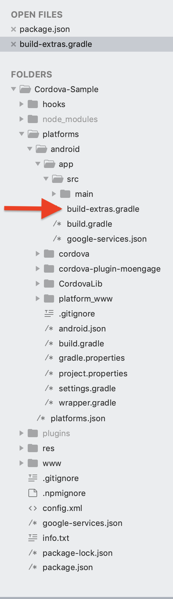

# Adding Dependency

To add MoEngage's Android SDK to your application, \<project-path\>/platforms/android/app` and create...` a file with the name **build-extras.gradle**. If you already have this file in your project, you need not create another one.



## Option 1: Using BOM (Recommended)


Use the Bill of Materials (BOM) to automatically manage compatible versions of the SDK modules.

<CodeGroup>

```auto build.gradle
dependencies {
    ...
    // Import the MoEngage BOM
    implementation(platform("com.moengage:android-bom:BOM_VERSION"))
    
    // Add optional modules as needed
     implementation("com.moengage:inapp")
}
```

</CodeGroup>

Replace \*\*\<bomVersion\>`** with the latest BOM version.`. For more info on integration using BOM, refer [here](/developer-guide/android-sdk/sdk-integration/basic-integration/Install-Using-BOM).

## Option 2: Manual Integration

Once the file is created, add the MoEngage SDK dependency to it.

<CodeGroup>

```auto Groovy
// adding the repositories block is optional. You can choose not to add this block if you have already added these repositories to your project.
repositories {
  google()
  mavenCentral()
}

dependencies {
  implementation("androidx.core:core:1.6.0")
  implementation("androidx.appcompat:appcompat:1.3.1")
  implementation("androidx.lifecycle:lifecycle-process:2.7.0")
  implementation("com.moengage:moe-android-sdk:13.02.00")
}
```

</CodeGroup>

Replace **\$sdkVersion** with the appropriate SDK version

<Info>
  You can add the firebase messaging dependency also to this file itself if your file does not already have firebase messaging added.
</Info>