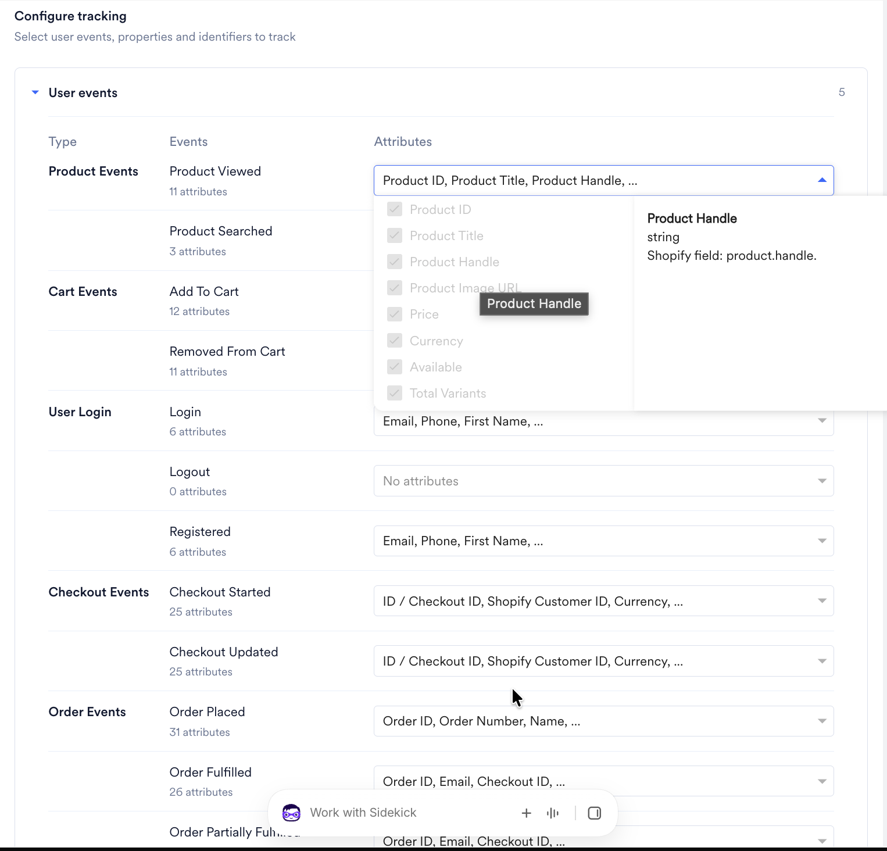
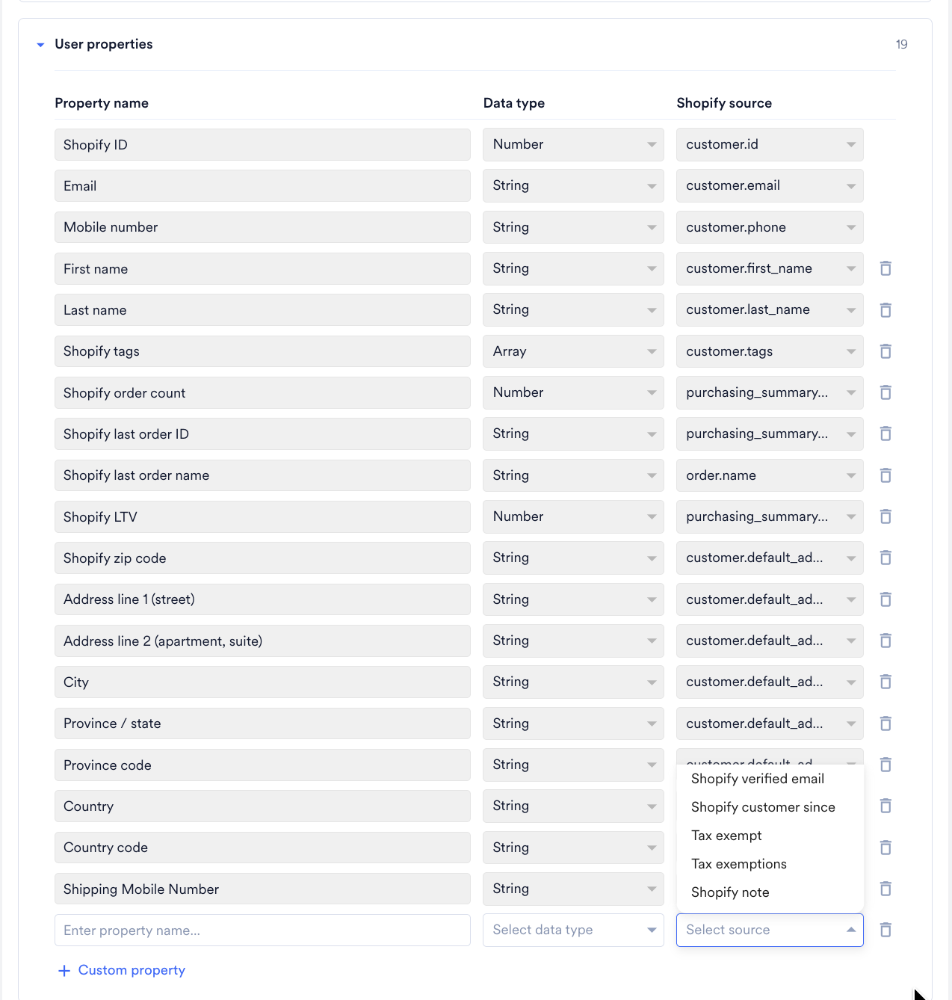
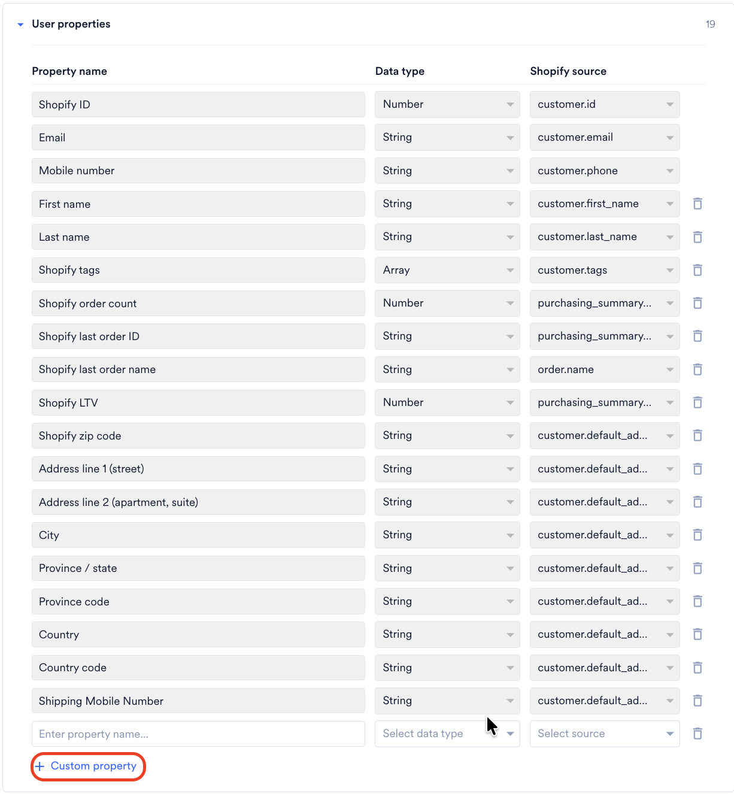

イベントトラッキングとユーザーデータトラッキングにより、Shopify ストアから MoEngage に行動データを送信できます。これらのイベントをトラッキングすると、ストア上でのユーザーの行動に基づいて、セグメントの作成、キャンペーンのトリガー、コミュニケーションのパーソナライズに利用できます。

## トラッキングされるイベント

統合が完了すると、MoEngage はすべてのストアで次のイベントをトラッキングします。イベントを選択する必要はありません。イベントとその属性を確認するには、MoEngage アプリの **Configuration** タブで **User events** を展開します。



| イベントタイプ       | イベント名                                    | 説明                                                                                                                                                                                                                                                                                                                                                                                                            |
| ---------------- | --------------------------------------------- | ---------------------------------------------------------------------------------------------------------------------------------------------------------------------------------------------------------------------------------------------------------------------------------------------------------------------------------------------------------------------------------------------------------------------- |
| 商品イベント    | Product Viewed                                | ユーザーが商品ページを閲覧したときに、MoEngage がこのイベントをトラッキングします。再入荷通知やパーソナライズされた商品レコメンデーションの送信に使用します。<br /><br />**注意**: このイベントは、Shopify のデフォルトの商品ページテンプレートでのみトリガーされます。カスタムの商品ページテンプレートを使用しているストアでは、追加の実装が必要です。詳細については、MoEngage サポートチームにお問い合わせください |
| 商品イベント    | Product Searched                              | ユーザーが商品を検索したときに、MoEngage がこのイベントをトラッキングします。検索意図に基づいてレコメンデーションをパーソナライズするために使用します。                                                                                                                                                                                                                                                                                         |
| カートイベント       | Shopify - Add To Cart / Shopify - Update Cart | ユーザーが商品をカートに追加したとき、またはカートを更新したときに、MoEngage がこのイベントをトラッキングします。カート放棄キャンペーンのトリガーに使用します。                                                                                                                                                                                                                                                                             |
| カートイベント       | Removed from Cart                             | ユーザーがカートから商品を削除したときに、MoEngage がこのイベントをトラッキングします。                                                                                                                                                                                                                                                                                                                                                |
| ユーザーログインイベント | Customer Registered                           | 顧客が Shopify ストアに登録したときに、MoEngage がこのイベントをトラッキングします。ウェルカムメッセージやオンボーディングフローに使用します。                                                                                                                                                                                                                                                                                       |
| ユーザーログインイベント | Customer Logged In                            | 顧客がストアにログインしたときに、MoEngage がこのイベントをトラッキングします。                                                                                                                                                                                                                                                                                                                                                       |
| ユーザーログインイベント | Customer Logged Out                           | 顧客がストアからログアウトしたときに、MoEngage がこのイベントをトラッキングします。                                                                                                                                                                                                                                                                                                                                                      |
| チェックアウトイベント   | Shopify - Checkout Started                    | 顧客がチェックアウトを開始したときに、MoEngage がこのイベントをトラッキングします。                                                                                                                                                                                                                                                                                                                                                       |
| チェックアウトイベント   | Shopify - Checkout Updated                    | 顧客がチェックアウト中にカートを更新したときに、MoEngage がこのイベントをトラッキングします。                                                                                                                                                                                                                                                                                                                                       |
| 注文イベント      | Shopify - Order Placed                        | 顧客が購入を完了したときに、MoEngage がこのイベントをトラッキングします。注文確認メッセージ、ロイヤルティプログラムへの誘導、サブスクリプションの案内に使用します。                                                                                                                                                                                                                                                            |
| 注文イベント      | Shopify - Order Fulfilled                     | 注文のフルフィルメントが完了し、出荷準備が整ったときに、MoEngage がこのイベントをトラッキングします。                                                                                                                                                                                                                                                                                                                                         |
| 注文イベント      | Shopify - Order Partially Fulfilled           | 注文内の一部の商品のみフルフィルメントが完了したときに、MoEngage がこのイベントをトラッキングします。                                                                                                                                                                                                                                                                                                                                      |
| 注文イベント      | Shopify - Order Cancelled                     | 注文をキャンセルしたときに、MoEngage がこのイベントをトラッキングします。                                                                                                                                                                                                                                                                                                                                                                   |
| 注文イベント      | Shopify - Refund Created                      | キャンセルまたは苦情により返金を作成したときに、MoEngage がこのイベントをトラッキングします。パーソナライズされたコミュニケーションを送信し、解約を減らすために使用します。                                                                                                                                                                                                                                                        |

<Warning>
  イベント、イベント属性、ユーザー属性の名前に「moe\_」をプレフィックスとして使用しないでください。これは予約済みのシステムプレフィックスです。使用すると、事前の通知なく定期的にブラックリストに登録される可能性があります。
</Warning>

## イベントの種類

MoEngage Shopify 統合では、次の 2 つのソースからイベントが生成されます。

- **Webhook**: Shopify がこれらのイベントを生成し、Shopify の Webhook システムを介して MoEngage に直接送信します。これらは、ユーザーが注文を行ったときやチェックアウトを開始したときなど、Shopify のバックエンドがトリガーするサーバーサイドのシグナルです。
- **Web SDK:** ブラウザーで動作する MoEngage JavaScript SDK が、ストアのフロントエンドでのユーザーの行動（商品ページの閲覧や検索操作など）に基づいてこれらのイベントを生成します。

Add to Cart や Checkout Started など、一部のイベントは両方のソースでキャプチャされます。つまり、同じユーザー行動に対して、名前と属性が異なる 2 つの別々のイベントレコードが MoEngage に表示される場合があります。

### キャンペーンとセグメンテーションに推奨されるイベントバージョン

<Info>
  Webhook と Web SDK の両方でトラッキングされるイベントについては、セグメントの作成やキャンペーンのトリガーには Webhook バージョンを使用してください。

  MoEngage は Webhook イベントを Shopify のバックエンドから直接受信するため、キャンペーンロジックにとってより信頼性の高いシグナルとなります。Web SDK イベントは、ブラウザーセッション内でリアルタイムに表示する必要があるオンサイトメッセージのトリガーに役立ちます。

  1 つのキャンペーンやジャーニーで同じイベントの両方のバージョンを使用すると、競合が発生し、一貫したイベントトリガー型のフローが実行されなくなります。
</Info>

## イベント属性の要件

### Webhook イベントにおける商品 URL と画像 URL

Webhook イベントのペイロードには、商品 URL や画像 URL は含まれません。これらの属性は、Web SDK を使用してイベントをキャプチャした場合にのみ存在します。

**これらの属性を取得するには:** 商品カタログを MoEngage に同期している場合は、**Product set-based personalization** を使用して、送信時にカタログから商品 URL と画像 URL を取得できます。詳細については、[User Actions Model](/ja/user-guide/content/recommendations/basic-recommendations/user-actions-model) を参照してください。

### Shopify 顧客メタフィールド

Shopify 顧客メタフィールドは、Shopify の顧客オブジェクトに付加されたカスタムデータフィールドです。これらをユーザー属性として MoEngage のユーザープロファイルに同期できます。詳細については、[顧客メタフィールド](#customer-metafields)を参照してください。

MoEngage は、顧客メタフィールドをイベント属性には含めません。

## Shopify Liquid を使用したカスタムイベントのトラッキング

ウィッシュリストへの追加やカスタムボタンのクリックなど、MoEngage のデフォルトセット以外のイベントをトラッキングする必要がある場合は、Shopify テーマの Liquid ファイルで MoEngage Web SDK を使用して追加できます。

<Note>
  **始める前に**

  この手順では Shopify のテーマファイルを編集する必要があり、開発者アクセスが必要です。変更を加える前に、Web チームに確認してください。
</Note>

### ステップ 1: 編集する正しい Liquid ファイルを特定する

Shopify テーマは、Liquid テンプレートファイルを使用してページをレンダリングします。正しいファイルを見つけるには、次の手順を実行します。

1. Shopify 管理画面にログインします。
2. **Online Store** > **Themes** に移動します。
3. 編集するテーマを見つけ、**Actions**（三点リーダー）ボタンをクリックします。
4. ドロップダウンメニューから **Edit code** を選択します。
5. `sections/` フォルダーを参照します。

編集するファイルは、イベントをトリガーする場所によって異なります。

- **商品ページでの操作:** `sections/product-template.liquid` または `sections/main-product.liquid` を編集します。
- **コレクションページでの操作:** 該当するコレクションセクションのファイルを編集します。
- **すべてのページ:** `layout/theme.liquid` を編集します。このファイルの使用は最小限にしてください。

### ステップ 2: track_event の呼び出しを追加する

Liquid ファイルで、ユーザーが操作する HTML 要素を見つけます。MoEngage の **track_event** メソッドを呼び出す JavaScript を追加します。

<CodeGroup>

```javascript No Attributes
Moengage.track_event("EVENT_NAME");
```

```javascript With Attributes
Moengage.track_event("EVENT_NAME", {
  "attribute_1": "value_1",
  "attribute_2": 2,
  "attribute_3": 3.4
});
```

```liquid Example: Wishlist
<button id="wishlist-btn" onclick="trackWishlistEvent()">Add to Wishlist</button>

<script>
  function trackWishlistEvent() {
    Moengage.track_event("Wishlist Added", {
      "Product ID": "{{ product.id }}",
      "Product Title": "{{ product.title }}",
      "Price": {{ product.selected_or_first_available_variant.price | divided_by: 100.0 }},
      "Product URL": "https://{{ shop.domain }}{{ product.url }}"
    });
  }
</script>
```

</CodeGroup>

### ステップ 3: イベントが発火することを検証する

イベントが正しく発火することを検証するには、[統合の検証](/ja/developer-guide/ecommerce-platforms/shopify/validate-integration)のドキュメントを参照してください。

## カスタムユーザー属性のトラッキング

Shopify 顧客メタフィールドを同期するには、MoEngage アプリの **Configuration** タブでそれらを選択します。詳細については、[顧客メタフィールド](#customer-metafields)を参照してください。

テーマでのみ利用できる値など、顧客メタフィールドに保存されていないデータを渡すには、次の方法を使用します。

### Liquid ベースの方法

ストアフロントアクセスが有効になっているメタフィールドなど、データが Shopify Liquid で利用できる場合は、テーマ内で読み取ることができます。正しいファイルを見つけてコードを追加するには、次の手順を実行します。

1. Shopify 管理画面にログインします。
2. **Online Store** > **Themes** に移動します。
3. 編集するテーマを見つけ、**Actions**（三点リーダー）ボタンをクリックします。
4. ドロップダウンメニューから **Edit code** を選択します。
5. `layout/theme.liquid` を開きます。
6. `<body>` タグ内で、MoEngage SDK を初期化した後に次のコードを追加します。

```liquid

<script>
  Moengage.add_user_attribute("Loyalty Tier", "{{ customer.metafields.loyalty.tier.value }}");
  Moengage.add_user_attribute("Custom Attribute", "{{ customer.metafields.custom.attribute_name.value }}");
</script>

```

_loyalty_ と _tier_ を、メタフィールドの実際の名前空間とキーに置き換えてください。`` ガードにより、顧客がログインしている場合にのみコードが実行されます。

### サーバーサイドの方法

サードパーティアプリなど、データが Shopify 顧客メタフィールド以外に保存されている場合は、サーバーサイドの統合を行います。

1. バックエンドで、同期する値を読み取ります。
2. MoEngage Data API を呼び出して、顧客のプロファイルの対応するユーザー属性を更新します。

## イベントペイロードのサンプル

以下のペイロードサンプルは、セグメントの作成やイベントデータのパーソナライズ時に参照できる属性を示しています。各イベントの完全なペイロードサンプルを以下に示します。

### Webhook イベントのペイロードサンプル

<CodeGroup>

```json Shopify - Update Cart
{
    "Event Received Time": "17th July 2023, 03:25:55 pm",
    "Product Title": "Sample Product",
    "Updated At": "17th July 2023, 03:26:15 pm",
    "Variation ID": "123456",
    "Currency": "USD",
    "cart_token": "c1-fcdd3207bee3eef9f98abefaf2ca...",
    "Product ID": "845236547",
    "Price": 555.99,
    "Source": "Shopify",
    "Vendor Name": "845236547",
    "Created At": "17th July 2023, 03:25:55 pm",
    "Quantity": 2
}
```

```json Removed From Cart
{
     "Event Received Time": "17th July 2023, 03:25:55 pm",
     "Product Title": "Sample Product",
     "Updated At": "17th July 2023, 03:26:15 pm",
     "Variation ID": "123456",
     "Currency": "USD",
     "Product ID": "845236547",
     "Price": 555.99,
     "Source": "Shopify",
     "Vendor Name": "845236547",
     "Created At": "17th July 2023, 03:25:55 pm",
     "Quantity": 2
}
```

```json Shopify - Checkout Started
{
     "Event Received Time": "17th July 2023, 03:25:55 pm",
     "Product Title": "Sample Product",
     "Updated At": "17th July 2023, 03:26:15 pm",
     "ID": "3cce6aeedf786679ac03e043729fd...",
     "Variation ID": "0:123456",
     "Currency": "USD",
     "Checkout ID": "3cce6aeedf786679ac03e043729fd...",
     "Source Name": "web",
     "cart_token": "c1-fcdd3207bee3eef9f98abefaf2ca...",
     "Checkout URL": "https://store.myshopify.com/products/snowboard",
     "Shopify Customer Id": 36838667059499,
     "Total Price": 327,
     "Price": 0:300.00,
     "Subtotal Price": 300.00,
     "Source": "Shopify",
     "Vendor Name": "845236547",
     "Created At": "17th July 2023, 03:25:55 pm",
     "Quantity": 2,
     "Product ID": "845236547"
}
```

```json Shopify - Checkout Updated
{
    "Event Received Time": "17th July 2023, 03:25:55 pm",
    "Product Title": "0:Sample Product01",
    "Updated At": "17th July 2023, 03:26:15 pm",
    "ID": "3cce6aeedf786679ac03e043729fd...",
    "Variation ID": "0:123456",
    "Currency": "USD",
    "Checkout ID": "3cce6aeedf786679ac03e043729fd...",
    "Source Name": "web",
    "cart_token": "c1-fcdd3207bee3eef9f98abefaf2ca...",
    "Checkout URL": "https://store.myshopify.com/products/snowboard",
    "Shopify Customer Id": 36838667059499,
    "Total Price": 327,
    "Price": [0:300.00],
    "Subtotal Price": 300.00,
    "Source": "Shopify",
    "Vendor Name": "845236547",
    "Created At": "17th July 2023, 03:25:55 pm",
    "Quantity": [0:1],
    "Product ID": [0:845236547]
}
```

```json Checkout Updated after Shipment
{
    "Event Received Time": "17th July 2023, 03:25:55 pm",
    "Shipping Address Country": "US",
    "Billing Address City": "New York",
    "Product Title": "0:Sample Product01",
    "cart_token": "c1-fcdd3207bee3eef9f98abefaf2ca...",
    "ID": "3cce6aeedf786679ac03e043729fd...",
    "Checkout ID": "3cce6aeedf786679ac03e043729fd...",
    "First Name": "John",
    "Currency": "USD",
    "Shipping Address Country Code": "US",
    "Billing Address Country Code": "US",
    "Updated At": "",
    "Source Name": "web",
    "first_name": "John",
    "Shipping Address Province": "New York",
    "Checkout URL": "https://store.myshopify.com/products/snowboard",
    "last_name": "Doe",
    "Shopify Customer Id": 36838667059499,
    "Total Price": 327,
    "Price": 0:300.00,
    "Shipping Address Zip": "10009",
    "Subtotal Price": 300.00,
    "Source": "Shopify",
    "Shipping Address Province Code": "NY",
    "Vendor Name": "845236547",
    "Billing Address Country": "US",
    "Created At": "17th July 2023, 03:25:55 pm",
    "Variation ID": "0:123456",
    "Quantity": [0:1],
    "Product ID": [0:845236547]
}
```

```json Shopify - Order Placed
{
       "Event Received Time": "17th July 2023, 03:25:55 pm",
       "Current Total Discounts": 0.00,
       "Product Title": "0:Sample Product01",
       "cart_token": "c1-fcdd3207bee3eef9f98abefaf2ca...",
       "ID": "3cce6aeedf786679ac03e043729fd...",
       "Name": "#1008",
       "Order Status URL": "",
       "Total Quantity": 1,
       "Billing Address Country Code": "US",
       "Billing Address Zip": 10009,
       "Order ID": 12334534345,
       "Currency": "USD",
       "Total Price": 354,
       "Checkout ID": "3cce6aeedf786679ac03e043729fd...",
       "First Name": "John",
       "Order Number": 1008,
       "Financial_status": "paid",
       "Source": "Shopify"
}
```

```json Order Partially Fulfilled
{
       "Event Received Time": "17th July 2023, 03:25:55 pm",
       "product_title": [0:"product 2", 1:"product 2"],
       "Updated At": "17th July 2023, 03:25:57 pm",
       "product_id": [0:234234324, 1: 97897897897],
       "variation_id": [0:23423423423, 1:23423423444],
       "Total Spent": 5687,
       "Currency": "USD",
       "Total Price": 354,
       "Checkout ID": "3cce6aeedf786679ac03e043729fd...",
       "tracking_company": "1",
       "vendor_name": [0:"ShopiWeb", 1:"ShopifyWeb"],
       "OrderID": 34343455,
       "item_fulfilment_status": [0:"partial", 1:"fulfilled"],
       "Quantity": [0:4, 1:3],
       "item_count": 2,
       "order_fulfilment_status": "partial",
       "Subtotal Price": 10500,
       "Order Status URL": "https://yourshopifystore...",
       "price": [0:1500.00, 1:1500.00],
       "variation_title": [0:"product 2 - black", 1:"product 2 - red"],
       "Financial status": "refunded",
       "Created At": "17th July 2023, 03:25:55 pm"
}
```

```json Shopify - Order Fulfilled
{
       "Event Received Time": "17th July 2023, 03:25:55 pm",
       "product_title": [0:"product 2"],
       "cart_token": "c1-fcdd3207bee3eef9f98abefaf2ca...",
       "product_id": [0:234234324],
       "variation_id": [0:23423423423],
       "Total Spent": 5687,
       "Currency": "USD",
       "Total Price": 354,
       "Checkout ID": "3cce6aeedf786679ac03e043729fd...",
       "Source Name": "web",
       "vendor_name": [0:"ShopiWeb"],
       "item_fulfilment_status": [0:"fulfilled"],
       "Updated At": "17th July 2023, 03:25:58 pm",
       "OrderID": 34343455,
       "Quantity": [0:1],
       "item_count": 1,
       "order_fulfilment_status": "fulfilled",
       "Subtotal Price": 300,
       "Order Status URL": "https://yourshopifystore...",
       "price": [0:1500.00, 1:1500.00],
       "variation_title": [0:"product 2 - black"],
       "Financial status": "paid",
       "Created At": "17th July 2023, 03:25:55 pm"
}
```

```json Shopify - Order Cancelled
{
       "Event Received Time": "17th July 2023, 03:25:55 pm",
       "product_title": [0:"product 2", 1:"product 2"],
       "cart_token": "c1-fcdd3207bee3eef9f98abefaf2ca...",
       "product_id": [0:234234324, 0:23423423446],
       "variation_id": [0:23423423423, 0:84353458],
       "Total Spent": 5687,
       "Currency": "USD",
       "Total Price": 354,
       "Checkout ID": "3cce6aeedf786679ac03e043729fd...",
       "cancelled at": "17th July 2023, 03:25:55 pm",
       "Source Name": "web",
       "vendor_name": [0:"ShopiWeb", 1:"ShopiWeb"],
       "item_fulfilment_status": [0:"fulfilled"],
       "Updated At": "17th July 2023, 03:25:58 pm",
       "OrderID": 34343455,
       "Quantity": [0:1, 1:2],
       "item_count": 2,
       "order_fulfilment_status": [0: , 1:],
       "Subtotal Price": 300,
       "Order Status URL": "https://yourshopifystore...",
       "price": [0:1500.00, 1:1500.00],
       "variation_title": [0:"product 2 - black", 1:"product 2 - red"],
       "Financial status": "refunded",
       "Created At": "17th July 2023, 03:25:55 pm"
}
```

```json Shopify - Refund Created
{
       "Event Received Time": "17th July 2023, 03:25:55 pm",
       "Variation Title": [0:"Product 2 Black"],
       "Product Title": [0:"Product 2"],
       "Updated At": "17th July 2023, 03:25:59 pm",
       "OrderID": 34343455,
       "Variation ID": [0:234234234],
       "Currency": "USD",
       "email": "John.doe@example.com",
       "user_id": 1545645465,
       "Refund Created At": "17th July 2023, 03:25:55 pm",
       "Source": "Shopify",
       "Vendor Name": [0:"ShopifyWeb"],
       "Created At": "17th July 2023, 03:25:55 pm",
       "price": [0:500.00],
       "Quantity": [0:1],
       "Product ID": [0:8923423]
}
```

</CodeGroup>

### Web SDK イベントのペイロードサンプル

<CodeGroup>

```json Product Viewed
{
    "Event Received Time": "17th July 2023, 03:25:55 pm",
    "Email": "john.doe@example.com",
    "Product Title": "Sample Product",
    "Variation ID": "123456",
    "Total Variants": 3,
    "Product Handle": "Product 1",
    "Available": true,
    "Currency": "USD",
    "Product ID": "845236547",
    "Price": 555.99,
    "Source": "Shopify",
    "Quantity": 3,
    "First Session": true,
    "URL": "https://yourstore.myshopify.com/products/view"
}
```

```json Product Searched
{
    "Event Received Time": "17th July 2023, 03:25:55 pm",
    "Variation ID": "123456",
    "Currency": "USD",
    "URL": "Search URL",
    "Search String": "Sneakers Green",
    "Source": "Shopify",
    "First Session": true
}
```

```json Add to Cart
{
       "Event Received Time": "17th July 2023, 03:25:55 pm",
       "Email": "john.doe@example.com",
       "Product Title": "Sample Product",
       "Variation ID": "123456",
       "Variation Title": "Sea Green",
       "Total Variants": 3,
       "Product Handle": "Product 1",
       "Available": true,
       "Currency": "USD",
       "Product ID": "845236547",
       "Vendor Name": "845236547",
       "Price": 555.99,
       "Source": "Shopify",
       "Quantity": 3,
       "First Session": true,
       "Product URL": "/product/type?type=Sneakers"
}
```

```json Update Cart
{
    "Event Received Time": "17th July 2023, 03:25:55 pm",
    "Email": "john.doe@example.com",
    "Product Title": "Sample Product",
    "Variation ID": "123456",
    "Variation Title": "Sea Green",
    "Total Variants": 3,
    "Product Handle": "Product 1",
    "Available": true,
    "Currency": "USD",
    "Product ID": "845236547",
    "Vendor Name": "845236547",
    "Price": 555.99,
    "Source": "Shopify",
    "Quantity": 3,
    "First Session": true,
    "Product URL": "/product/type?type=Sneakers"
}
```

```json Removed From Cart
{
     "Event Received Time": "17th July 2023, 03:25:55 pm",
     "Email": "john.doe@example.com",
     "Product Title": "Sample Product",
     "Variation ID": "123456",
     "Currency": "USD",
     "Product ID": "845236547",
     "Price": 555.99,
     "Source": "Shopify",
     "Quantity": 3
}
```

```json Customer Registered
{
        "Event Received Time": "17th July 2023, 03:25:55 pm",
        "Email": "john.doe@example.com",
        "Source": "Shopify",
        "First Session": true,
        "URL": "https://yourstore.myshopify.com/"
}
```

```json Customer Logged In
{
        "Event Received Time": "17th July 2023, 03:25:55 pm",
        "Email": "john.doe@example.com",
        "FirstName": "John",
        "LastName": "Doe",
        "Customer ID": 7385786908975,
        "URL": "https://yourstore.myshopify.com/account"
}
```

```json Checkout Started
{
        "Event Received Time": "17th July 2023, 03:25:55 pm",
        "Email": "john.doe@example.com",
        "currency": "USD",
        "Total Price": 699.95,
        "Product Prices": [699.95],
        "Product IDs": ["8869819679023"],
        "Product Quantities": [1],
        "Product Titles": ["The Complete Snowboard - Ice"],
        "Variation IDs": ["46822634324271"],
        "Vendor Names": ["Snowboard Vendor"],
        "Source": "Shopify",
        "First Session": true,
        "URL": "https://yourstore.myshopify.com/products/the-complete-snowboard"
}
```

</CodeGroup>

## プロファイル同期

MoEngage は、Shopify からユーザープロファイルをほぼリアルタイムで同期します。Shopify で顧客が作成または更新されたとき、あるいは顧客のタグ、マーケティング同意、購入合計が変更されたときに、Shopify は MoEngage に Webhook を送信し、MoEngage は一致するユーザープロファイルを更新します。

MoEngage は、統合時に選択したユーザー識別子を使用して、各更新をユーザープロファイルと照合します。一致するプロファイルがない場合、MoEngage は新しいユーザープロファイルを作成します。たとえば、ストアでアカウントまたはニュースレターに登録した顧客は、注文を行う前でも MoEngage のユーザープロファイルが作成されます。

<Note>
  **Mobile number** 属性には、顧客の Shopify アカウントの電話番号が入力されます。顧客の住所に含まれる電話番号は **Shipping Mobile Number** 属性に同期され、ユーザーの識別には使用されません。
</Note>

## トラッキングされるユーザー属性

### デフォルトのユーザープロパティ

**Configuration** タブの **User properties** セクションには、デフォルトで次のユーザー属性が一覧表示されます。MoEngage は、削除しない限りこれらの属性を同期します。**Shopify ID**、**Email**、**Mobile number** は削除できません。

| プロパティ名 | データ型 | 説明 |
| --- | --- | --- |
| Shopify ID | Number | Shopify におけるユーザーの顧客 ID。 |
| Email | String | ユーザーのメールアドレス。 |
| Mobile number | String | ユーザーの Shopify アカウントの携帯電話番号。 |
| First name | String | ユーザーの名。 |
| Last name | String | ユーザーの姓。 |
| Shopify tags | Array | Shopify 顧客に付与されたすべてのタグ。Shopify でタグが変更されると、MoEngage はタグを追加または削除します。 |
| Shopify order count | Number | ユーザーが行った注文の合計数。注文がキャンセルまたは返金されても、この値は減少しません。 |
| Shopify last order ID | String | ユーザーの最新の注文の ID。 |
| Shopify last order name | String | ユーザーの最新の注文の名前（例: `#1008`）。 |
| Shopify LTV | Number | ストアにおけるユーザーの正味の生涯支出額。詳細については、[Shopify LTV](#shopify-ltv) を参照してください。 |
| Shopify zip code | String | ユーザーのデフォルト住所の郵便番号。 |
| Address line 1 (street) | String | ユーザーのデフォルト住所の 1 行目。 |
| Address line 2 (apartment, suite) | String | ユーザーのデフォルト住所の 2 行目。 |
| City | String | ユーザーのデフォルト住所の市区町村。 |
| Province / state | String | ユーザーのデフォルト住所の州または都道府県。 |
| Province code | String | ユーザーのデフォルト住所の州または都道府県のコード。 |
| Country | String | ユーザーのデフォルト住所の国。 |
| Country code | String | ユーザーのデフォルト住所の国コード。 |
| Shipping Mobile Number | String | ユーザーのデフォルト住所の電話番号。 |

### カスタムユーザープロパティ

追加の顧客データを同期するには、**User properties** セクションで **+ Custom property** をクリックし、プロパティ名を入力してデータ型を選択してから、次のいずれかの Shopify ソースを選択します。

| Shopify ソース | 説明 |
| --- | --- |
| Shopify verified email | ユーザーが Shopify でメールアドレスを確認済みかどうか。 |
| Shopify customer since | ユーザーの Shopify 顧客アカウントが作成された日時。 |
| Tax exempt | ユーザーが Shopify で免税対象かどうか。 |
| Tax exemptions | ユーザーに適用される免税コード。 |
| Shopify note | チームが Shopify で顧客に追加したメモ。 |



### 顧客メタフィールド

Shopify 顧客メタフィールドをカスタムユーザープロパティとして同期できます。Shopify ソースリストには、ストア内の顧客メタフィールド定義が最大 250 件含まれます。入力したプロパティ名が、MoEngage ダッシュボードでのユーザー属性の名前になります。

MoEngage は、Shopify で顧客が作成または更新されたときにメタフィールドの値を更新します。

### 同期されない属性

MoEngage は、次の Shopify 顧客データを同期しません。

- 顧客アカウントの状態（有効または無効）
- 顧客の住所履歴全体。MoEngage はデフォルト住所のみを同期します。
- 従来の **Accepts marketing** フラグ。代わりにマーケティング同意の属性を使用してください。
- Multipass 識別子

## マーケティング同意のマッピング

MoEngage は、各チャネルの Shopify のマーケティング同意状態を、次のように MoEngage のサブスクリプション属性にマッピングします。

| Shopify の同意状態 | Email (`moe_unsubscribe`) | Email (`moe_email_optin_status`) | SMS (`moe_sms_subscription`) | WhatsApp (`moe_wa_subscription`) |
| --- | --- | --- | --- | --- |
| Subscribed | `false` | `DOUBLE_OPTED_IN` | `OPTIN` | `true` |
| Pending | `false` | `OPT_IN_PENDING` | `OPT-IN PENDING` | 更新されない |
| Unsubscribed | `true` | `OPTED_OUT` | `OPTOUT` | `false` |
| Not subscribed | `true` | 更新されない | `EMPTY` | 更新されない |
| Invalid | `true` | 更新されない | 該当なし | 該当なし |
| Redacted | 更新されない | 更新されない | 更新されない | 更新されない |

MoEngage は、**Configuration** タブの **Sync user OPTIN** セクションで該当チャネルのトグル（**Email subscription sync**、**SMS subscription sync**、または **WhatsApp subscription sync**）がオンになっている場合にのみ、そのチャネルのマーケティング同意を同期します。

## Shopify LTV

**Shopify LTV** 属性には、Shopify が顧客の合計支出額として報告する金額が保持されます。この値は、キャンセルされていないすべての注文について、送料を含む注文合計の合計から返品された商品の金額を差し引いて計算されます。

この属性を使用する際は、次の点に注意してください。

- Shopify は、注文が全額返金されたときに値を更新します。一部返金の場合は、Shopify が合計を再計算するまで値は更新されないため、しばらくの間、実際の正味支出額よりも高い値になることがあります。
- テスト注文ではこの値は更新されません。

## ユーザープロパティの設定

MoEngage が同期するユーザープロパティを追加または削除するには、次の手順を実行します。

1. Shopify アプリの **Configuration** タブに移動します。
2. **User properties** を展開します。
3. 不要なプロパティを削除するか、**+ Custom property** をクリックしてプロパティを追加します。
4. **Save configuration** をクリックします。



<Info>
  Shopify 統合について質問がある場合は、[MoEngage Shopify FAQ](/ja/developer-guide/ecommerce-platforms/shopify/faqs) を参照してください。
</Info>
