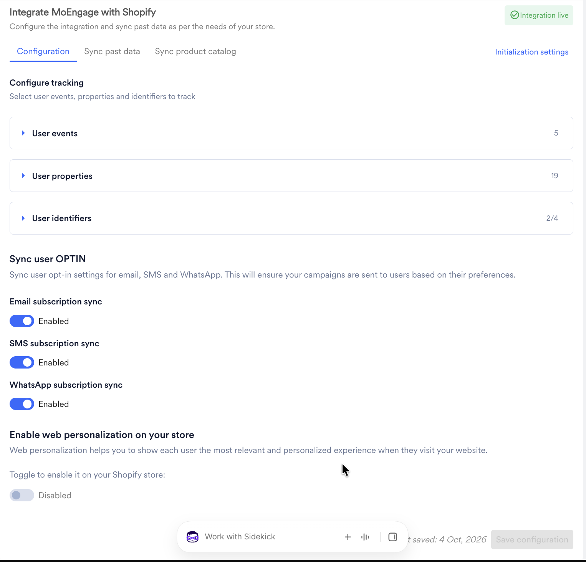
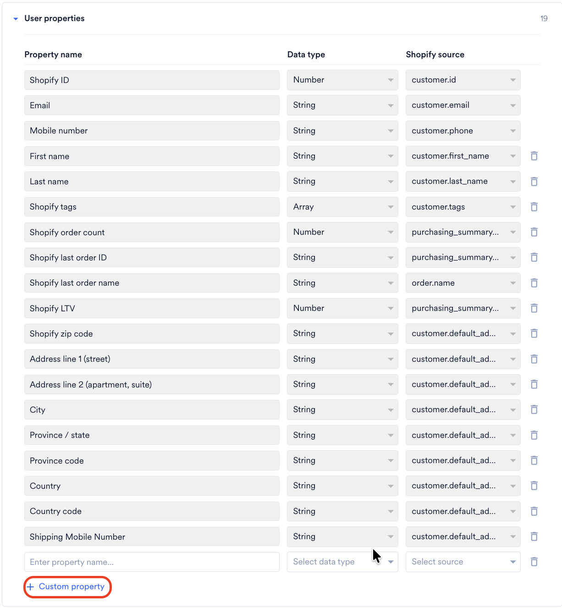
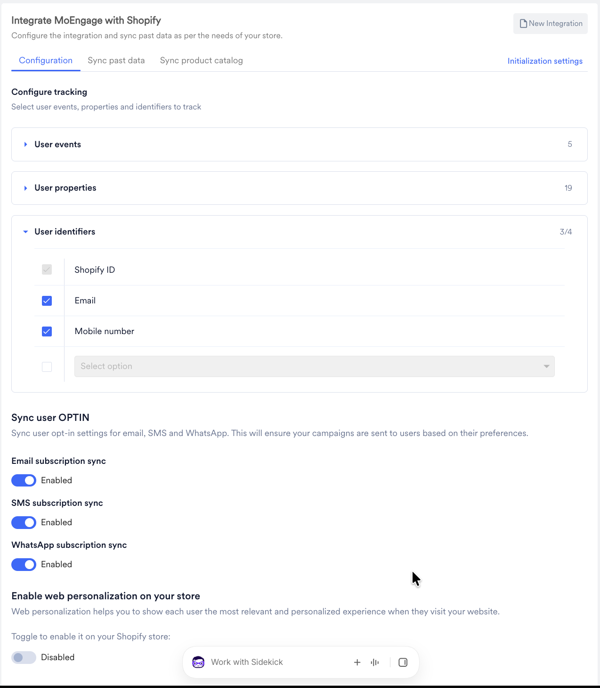

<Warning>
  **MoEngage アプリは Shopify App Store で一時的に利用できません**

  2026 年 10 月 28 日現在、MoEngage アプリは Shopify App Store で一時的に利用できなくなっています。Shopify 2.0 の統合を開始しようとしている場合、または統合の途中である場合は、続行する前に [MoEngage サポートチーム](/ja/user-guide/contact-support/raise-a-support-ticket-through-moengage-dashboard)にお問い合わせください。セットアップの完了をサポートします。
</Warning>

# 概要

この記事では、Shopify ストアに MoEngage アプリをインストールして設定する方法について説明します。イベントのトラッキングやデータの同期を開始する前に、以下の手順を完了して、統合の認証、初期化、設定を行ってください。

## ステップ 1: MoEngage アプリをインストールする

MoEngage アプリをインストールするには、次の手順を実行します。

1. MoEngage UI で **App Marketplace** に移動します。
2. **Shopify 2.0** を検索し、タイルをクリックします。
3. **Integrate** タブに移動し、**Install MoEngage app on your Shopify** **store** をクリックします。Shopify App Marketplace の MoEngage リスティングを使用して、ストアにアプリを追加します。

   

4. **Open** をクリックして Shopify 管理 UI にリダイレクトし、インストールを完了します。

## ステップ 2: 認証する

インストールが正常に完了したら、次の手順を実行して認証します。

1. **MoEngage App Integration** タブに移動します。
2. MoEngage アカウントの次の認証情報を入力します。
   | フィールド | 説明 |
   | --- | --- |
   | App ID | MoEngage アカウントの Workspace ID は、**Settings** \> **Account** \> **APIs** \> **Workspace ID** で確認できます。 |
   | Data API ID | **Workspace ID** と同じです。 |
   | Data API Key | MoEngage アカウントの Data API Key は、**Settings** \> **App Settings** \> **APIs** \> **API Keys** \> **Data.** で確認できます。 |
3. **Authenticate** をクリックし、**Continue** をクリックします。

   <Info>
     **情報** 新しく生成された API キーが有効になるまでには、最大 10 分かかる場合があります。新しい認証情報を入力した後に認証が失敗した場合は、サポートチケットを作成する前に 10 分待ってから再試行してください。
   </Info>

## ステップ 3: 初期化設定を構成する

<Info>
  **注意**

  MoEngage がユーザーデータとイベントをトラッキングするには、次の手順を実行する必要があります。
</Info>

初期化設定を構成するには、次の手順を実行します。

1. **Initialization Settings** で、Shopify 管理画面の **Theme Settings** に移動します。
2. **MoEngage Shopify app embed** 設定のトグルをオンにします。
3. **Save** をクリックします。

## ステップ 4: 構成設定

MoEngage は、すべてのストアで Shopify の標準イベントをすべてトラッキングします。イベントを選択する必要はありません。イベントの一覧については、[イベントとユーザーデータのトラッキング](/ja/developer-guide/ecommerce-platforms/shopify/events-and-user-data-tracking)を参照してください。

<Info>
  **前提条件**

  MoEngage は、初めて設定を保存したときに、ワークスペースの [Identity Resolution](/ja/user-guide/data/user-data/unified-identity-identity-resolution) をセットアップします。Identity Resolution は、ユーザー数が 1,000 以下のワークスペースでのみセットアップできます。ワークスペースのユーザー数がこれを超える場合、保存は失敗します。サポートチケットを作成し、サポートチームが解決した後に再度設定を保存してください。
</Info>

設定を構成するには、次の手順を実行します。

1. **Configuration** タブに移動します。**Configure tracking** セクションには、MoEngage がトラッキングするユーザーイベント、ユーザープロパティ、ユーザー識別子が一覧表示されます。

   

2. **User events** を展開して、MoEngage がトラッキングするイベントとイベント属性を確認します。すべてのイベントはデフォルトでトラッキングされ、選択を解除することはできません。
3. **User properties** を展開して、MoEngage がユーザープロファイルに同期するユーザー属性を確認します。完全な一覧については、[トラッキングされるユーザー属性](/ja/developer-guide/ecommerce-platforms/shopify/events-and-user-data-tracking#tracked-user-attributes)を参照してください。
   - プロパティの同期を停止するには、その横にある削除アイコンをクリックします。**Shopify ID**、**Email**、**Mobile number** は削除できません。
   - 追加のプロパティを同期するには、**+ Custom property** をクリックし、プロパティ名を入力してデータ型を選択してから、Shopify ソースを選択します。

   

4. **User identifiers** を展開して、ユーザー識別子を選択します。MoEngage はこれらの識別子を使用して、ユーザーを認識し、セッション、デバイス、Shopify での更新をまたいでプロファイルを統合します。最大 4 つの識別子を選択できます。
   - **Shopify ID** は常に選択されており、選択を解除できません。
   - **Email** と **Mobile number** はデフォルトで選択されています。少なくとも一方を選択したままにしてください。
   - 4 つ目の識別子を追加するには、最後の行のチェックボックスをオンにしてから、**Select option** リストから属性を選択します。タイプが単一行テキスト、URL、ID、整数、または小数の Shopify 顧客メタフィールドを使用するカスタムプロパティを選択できます。

   

   <Warning>
     **警告** 設定を保存した後は、ユーザー識別子を変更できません。後で変更するには、MoEngage サポートチームにお問い合わせください。識別子に基づいて行われたプロファイルの統合は元に戻せません。
   </Warning>

5. **Sync user OPTIN** で、Shopify からマーケティング同意を同期するチャネルについて、**Email subscription sync**、**SMS subscription sync**、**WhatsApp subscription sync** のトグルをオンにします。詳細については、[マーケティング同意のマッピング](/ja/developer-guide/ecommerce-platforms/shopify/events-and-user-data-tracking#marketing-consent-mapping)を参照してください。
6. **Save configuration** をクリックします。

<Info>
  MoEngage アプリは、Shopify の顧客統合を読み取る権限をリクエストします。この権限が追加される前にストアにアプリをインストールした場合は、次回アプリを開いたときに Shopify から承認を求められます。
</Info>

### 既存のストア

複数の識別子が利用可能になる前に MoEngage アプリを設定した場合、ストアには次の内容が適用されます。

- ストアでは、セットアップ時に選択した識別子（Email または Phone Number）が引き続き使用されます。
- 識別子を変更せずに、設定を再度保存してユーザープロパティとオプトイン同期の設定を更新できます。
- プロファイル同期には、ワークスペースで Identity Resolution が必要です。有効になっていない場合は、カスタマーサクセスマネージャーまたはサポートチームにお問い合わせください。
- Shopify ID やその他の識別子をストアに追加するには、サポートチームにお問い合わせください。Shopify ID が追加されるまで、MoEngage はストアの Shopify tags、Shopify LTV、Shopify order count、Shopify last order ID、または Shopify の顧客統合を同期しません。

## ステップ 5: Web Personalization を有効にする（任意）

Web Personalization を有効にするには、次の手順を実行します。

1. MoEngage アカウントで Web Personalization が有効になっていることを確認します。有効になっていない場合は、カスタマーサクセスマネージャーまたはサポートチームにお問い合わせください。
2. **Configuration** タブで、**Enable web personalization** **on your store** トグルをオンにします。

   

# 次のステップ

統合が完了したので、過去の注文に関するデータを同期し、イベントのトラッキングを開始できます。

1. [イベントとユーザーデータのトラッキング](/ja/developer-guide/ecommerce-platforms/shopify/events-and-user-data-tracking)
2. [ユーザーデータの同期](/ja/developer-guide/ecommerce-platforms/shopify/user-data-sync)
3. [統合を検証する手順](/ja/developer-guide/ecommerce-platforms/shopify/validate-integration)
4. [FAQ](/ja/developer-guide/ecommerce-platforms/shopify/faqs)
