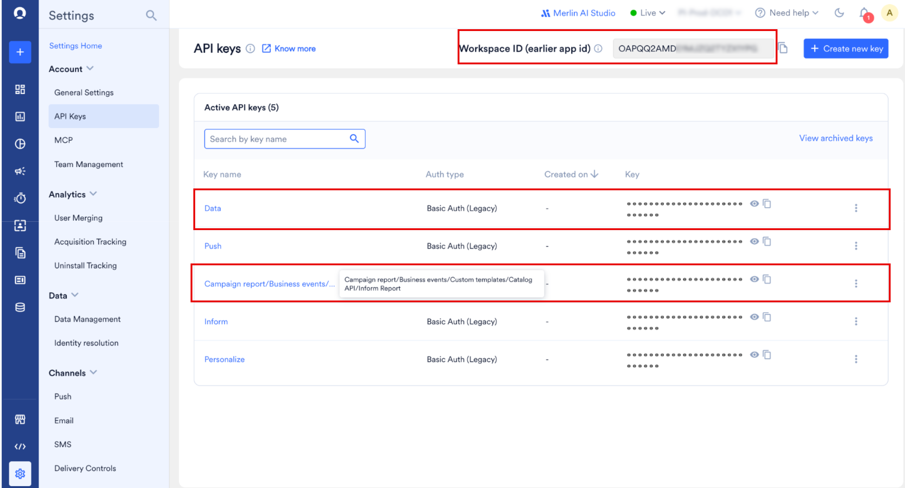
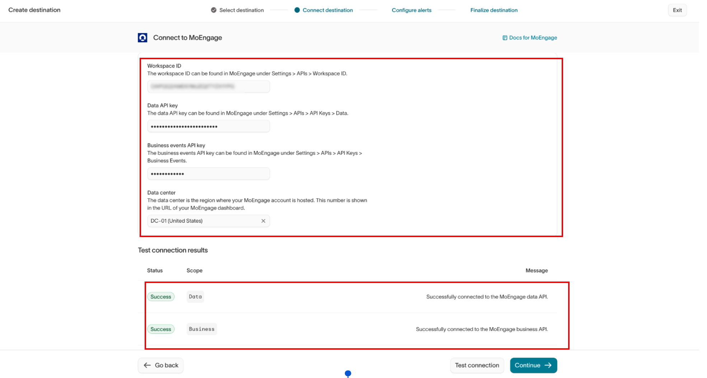
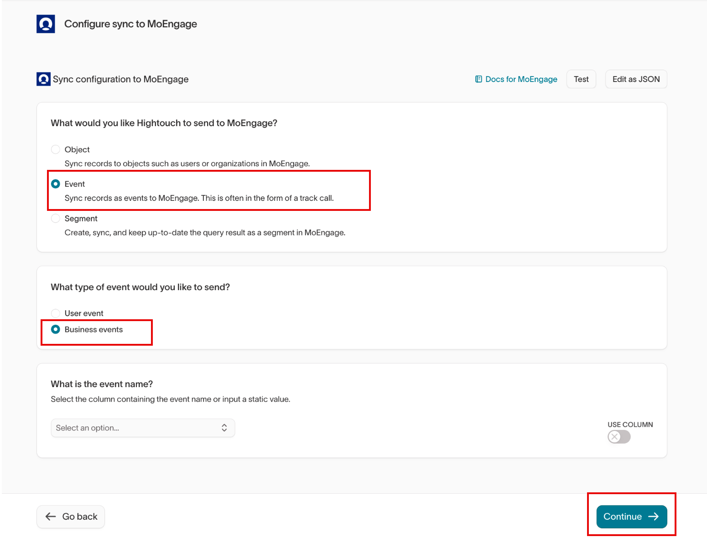
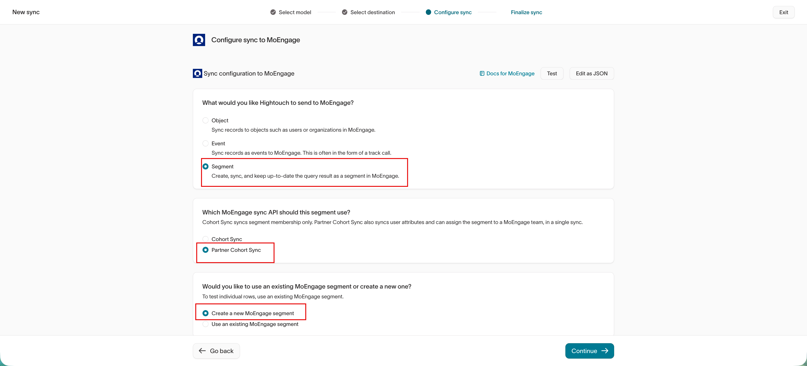
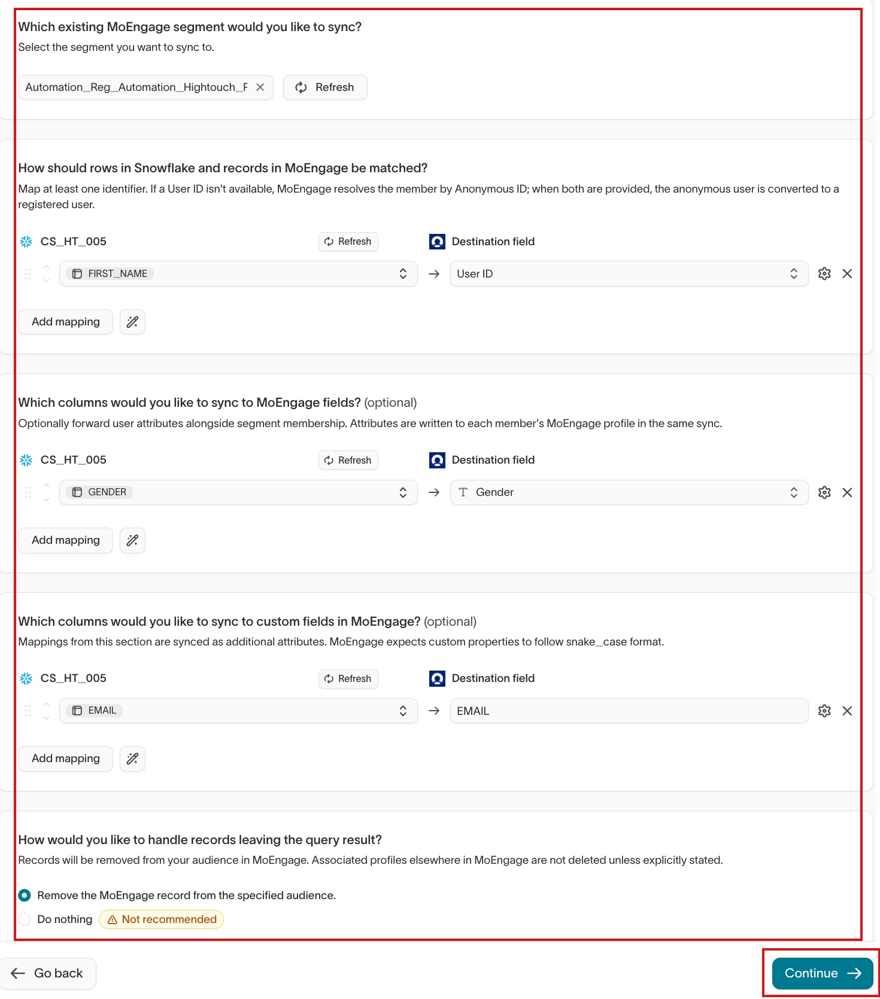
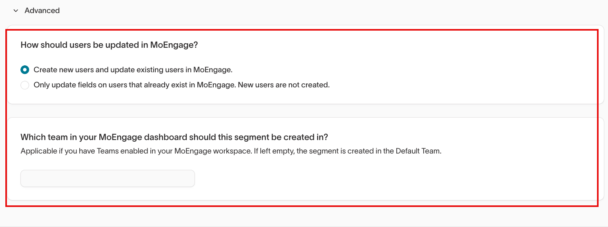

## はじめに

[Hightouch](https://hightouch.io/) は、IT チームやエンジニアリングチームの支援なしに、データウェアハウスやデータレイクにある顧客データ、商品データ、独自データを任意のアプリに同期できる最新のデータ統合プラットフォームです。

## MoEngage × Hightouch

MoEngage と Hightouch の連携により、データウェアハウスの最新の顧客データを使用して、MoEngage でより効果的なキャンペーンを構築できます。ユーザーとイベントを MoEngage に自動的に同期することで、データの一貫性を気にする必要がなくなり、顧客体験の構築に集中できます。

### ユースケース

この連携は、次のような用途に使用できます。

- ユーザーに関するデータを MoEngage に同期して、パーソナライズされたキャンペーンを構築します。
- Hightouch から Customer Events を MoEngage に同期して、イベントの一貫性を保ちます。
- 他の顧客タッチポイントのデータを MoEngage に取り込むことで、より良い体験を提供します。
- ターゲティングのために Hightouch から MoEngage に Audiences を同期します。
- 速報ニュース、新しいエピソードの公開、商品の再入荷などのビジネスイベントを使用して、ウェアハウスから 1 対多のキャンペーンをトリガーします。
- 匿名の訪問者を同期し、サインインまたは購読時に登録ユーザーに変換します。

## サポートされている同期

Hightouch は 5 種類のデータを MoEngage に送信します。次の表に示すように、それぞれレコードのマッチング方法と、未登録のユーザーの扱いが異なります。

| 同期 | 内容 | 同期モード | マッチングキー | 新規ユーザーの作成 |
| --- | --- | --- | --- | --- |
| Users | 標準属性とカスタム属性を使用してユーザープロファイルを作成・更新します。 | Upsert | User ID | はい |
| Events | イベント名とイベント時刻を指定してカスタムイベントをトラッキングします。 | Insert | Customer Id | はい |
| Business events | MoEngage でビジネスイベントトリガー型のキャンペーンと Flows をトリガーします。 | Insert | ユーザーレベルではない | 該当なし |
| Segment, Cohort Sync | MoEngage のセグメントにユーザーを追加、またはセグメントからユーザーを削除します。 | Add, Remove | User ID | いいえ、既存のユーザーのみ |
| Segment, Partner Cohort Sync(推奨) | セグメントのメンバーシップ、メンバーの属性、所有チームを 1 回の同期で同期します。 | Add, Remove | User ID, Anonymous ID | はい、または既存のユーザーのみ |

## 連携の前提条件

Hightouch を MoEngage に接続する前に、次の情報を用意してください。

- Hightouch アカウントにアクセスできることを確認してください。
- MoEngage の **Settings** > **Account** > **API Keys** で、**Workspace ID** と **Data** API キーを控えておきます。Workspace ID はそのページの上部に表示され、Data API ID と同じです。
- ビジネスイベントを同期する場合は、同じページにある **Campaign report/Business events/Custom templates/Catalog API/Inform Report** という名前の API キーを控えておきます。
- MoEngage のデータセンターを控えておきます。番号は MoEngage ダッシュボードの URL に表示されます。

## Hightouch で MoEngage の宛先を作成する

Hightouch で MoEngage を宛先として接続するには、次の手順を実行します。

1. Hightouch プラットフォームの **Destinations** セクションで、**Add destination** をクリックします。
2. 利用可能な宛先のリストから **MoEngage** を選択します。
3. 次の詳細を入力し、**Test connection** をクリックします。

   | フィールド | 説明 |
   | --- | --- |
   | **Workspace ID** | MoEngage アカウントの Workspace ID。**Settings** > **Account** > **API Keys** の上部に表示されます。Data API ID と同じです。 |
   | **Data API key** | **Settings** > **Account** > **API Keys** にある **Data** という名前のキー。 |
   | **Business events API key** | 同じページにある **Campaign report/Business events/Custom templates/Catalog API/Inform Report** という名前のキー。ビジネスイベントの同期にのみ必要です。 |
   | **Data center** | MoEngage アカウントをホストしているリージョン。番号は MoEngage ダッシュボードの URL に表示されます。 |

4. 両方のスコープで **Success** が返されたら、**Continue** をクリックします。

## ユーザーを同期する

Hightouch のオブジェクト(ユーザー)を MoEngage のユーザーに同期できます。また、レコードマッチングを実行して、2 つのプラットフォーム間でデータを統合することもできます。

この連携はユーザーのアップサートをサポートしています。このモードでは、新しいユーザーが MoEngage に挿入され、すべてのユーザー属性が MoEngage 内で最新の状態に保たれます。アップサートには 3 つの設定パラメーターがあります。

| 名前 | 詳細 |
| --- | --- |
| **Hightouch Column Containing MoEngage User ID** | MoEngage で一意のユーザー識別子として機能する Hightouch の列名(id、created_at、first_name)。 |
| **Hightouch to MoEngage Default Field Mappings** | MoEngage の新しいユーザーにプッシュされる一般的なユーザー属性のリスト。 |
| **Hightouch to MoEngage Custom Field Mappings** | MoEngage の新しいユーザーにプッシュされるカスタムユーザー属性のリスト。 |

### ユーザーフィールドマッピング

ここでマッピングした属性は、MoEngage でのセグメント化とパーソナライズに使用されます。そのため、現在使用しているものだけでなく、キャンペーンで必要になる可能性のあるものをすべてマッピングしてください。モデル内の任意の列を、標準またはカスタムのユーザー属性にマッピングできます。MoEngage では、カスタム属性名が `snake_case` 形式に従っていることが想定されています。

[MoEngage-Hightouch のユーザーアップサートの詳細はこちらをご覧ください。](https://hightouch.io/docs/destinations/moengage/#upsert)

## イベントを同期する

イベントは、購入やページビューなど、ユーザーが行ったことを記録します。ウェアハウスからイベントを同期すると、MoEngage のアクティビティが自社システムのアクティビティと一致した状態に保たれるため、キャンペーンは分析レポートと同じ行動に基づいてトリガーされます。

### イベント名の設定

イベント名は、このイベントに基づいてキャンペーンや Flow を構築する際に選択するものであるため、安定していて識別しやすい名前である必要があります。モデルのすべての行が同じイベントである場合は静的な名前を入力し、モデルに複数のイベントタイプが含まれている場合は列を選択します。

### イベントタイムスタンプの設定

タイムスタンプは、ユーザーのタイムライン上でイベントがどこに配置されるかを決定し、直近性に依存するキャンペーンにとって重要です。イベントが発生した時刻を保持する列を選択します。MoEngage では、ISO 8601 形式または秒単位の Epoch 時間が想定されています。空のままにすると、MoEngage はイベントがサーバーに到着した時刻を使用するため、過去の日付の行は不正確に報告されます。

### レコードマッチング

MoEngage は、**Customer Id** でマッチングしてイベントをユーザーに関連付けます。モデル内でその識別子を保持する列をマッピングしてください。マッピングしない場合、イベントは所有者のない状態で MoEngage に届きます。これはイベント同期で提供される宛先フィールドであり、ユーザー同期やセグメント同期でマッチングに使用される **User ID** とは異なります。

### フィールドマッピング

キャンペーンで読み取る必要がある列をマッピングします。マッピングしていない列は MoEngage に届かないため、後でその列に基づいてセグメント化やパーソナライズを行うことはできません。

### カスタムフィールドマッピング

注文金額やコンテンツカテゴリなど、MoEngage に標準フィールドがないものには、このセクションを使用します。MoEngage はこれらをイベント属性として保存し、その名前が `snake_case` 形式に従っていることを想定しています。

## ビジネスイベントを同期する

ビジネスイベントとは、速報ニュースの公開、エピソードのリリース、商品の再入荷など、ユーザーではなくビジネスが行ったことです。Hightouch がビジネスイベントを同期すると、MoEngage はそれにリンクされているすべてのビジネスイベントトリガー型のキャンペーンと Flow を実行し、ユーザー属性またはイベント属性をイベントの属性と照合して、メッセージの受信者を決定します。

最初の同期の前に、次の作業を行います。

- [Create Business Event](/ja/api/business-events/create-business-event) API を使用して、MoEngage でビジネスイベントを作成します。この 1 回限りの設定で、イベント名とその属性を定義します。
- Hightouch の MoEngage 宛先にビジネスイベント API キーを追加します。

ビジネスイベントを同期するには、次の手順を実行します。

1. Hightouch プラットフォームで、**Activation** > **Syncs** に移動し、**Add sync** をクリックします。
2. ビジネスイベントを保持するモデルを選択し、MoEngage の宛先を選択します。
3. **What would you like Hightouch to send to MoEngage?** で、**Event** を選択します。
4. **What type of event would you like to send?** で、**Business events** を選択します。
5. **What is the event name?** に静的な名前を入力するか、**USE COLUMN** をオンにして名前を保持する列を選択します。名前は MoEngage で作成したビジネスイベントと一致している必要があります。
6. モデルの列をビジネスイベントの属性にマッピングします。属性名は、ビジネスイベントで定義されている属性名と一致している必要があります。
7. **Continue** をクリックします。

Hightouch は、モデルに設定したプライマリキーによってモデル内の各行を識別し、新しい行ごとに 1 回のビジネスイベントトリガーとして扱います。どの行もイベントを複数回トリガーしないように、すべての行で一意となるプライマリキーを設定してください。

<Warning>
  ビジネスイベントのトリガーにはレート制限があり、その制限値は低く設定されています。ビジネスイベントの同期は少量で価値の高いタイミングに使用し、ユーザーごとのアクティビティにはイベントの同期を使用してください。制限については、[レート制限](#rate-limits)を参照してください。
</Warning>

### MoEngage でビジネスイベントを使用する

ビジネスイベントからキャンペーンを送信するには、次の手順を実行します。

1. MoEngage で **Engage** > **Campaigns** に移動し、**\+ Create campaign** をクリックします。
2. チャネルを選択し、**Business Event Triggered** を選択します。
3. **Select Business Event** で、Hightouch が同期するイベントを選択します。
4. **Target audience** で、ユーザー属性またはイベント属性をビジネスイベントの属性にマッピングします。たとえば、`section` が `football` に設定された `breaking_news` イベントが届いたときに、サッカーのセクションを閲覧した読者をターゲットにします。

これにより、1 つのキャンペーンでそのビジネスイベントのすべてのトリガーに対応できます。詳細については、[Business Event Triggered Campaigns](/ja/user-guide/campaigns-and-channels/getting-started/triggers/business-event/business-event-triggered-campaigns) を参照してください。

## ウェアハウスからキャンペーンと Flows をトリガーする

Hightouch の同期によって、MoEngage のジャーニーを直接開始できます。使用する同期は、メッセージの対象によって異なります。

| メッセージの対象 | 同期 | MoEngage での操作 |
| --- | --- | --- |
| 何らかの操作を行った 1 人のユーザー | `churn_risk_scored` などの **Event** | そのイベントをトリガーとするイベントトリガー型のキャンペーンまたは Flow を作成します |
| ビジネスが何かを行ったときの多数のユーザー | `breaking_news` などの **Business event** | ビジネスイベントトリガー型のキャンペーンまたは Flow を作成します |

マッピングしたイベント属性とビジネスイベント属性を使用して、メッセージのターゲティングとパーソナライズを行うことができます。

## オーディエンスを同期する

Hightouch は、Hightouch のオーディエンスをセグメントとして MoEngage に送信できます。MoEngage は同期のたびにセグメントのメンバーシップを最新の状態に保ち、同じ同期でメンバーのユーザー属性も更新できます。

### 同期 API の選択

Hightouch では、セグメント用に 2 つの同期 API が提供されています。MoEngage で最新の状態に保つ必要がある内容に合ったものを選択してください。

| 同期 API | 同期される内容 |
| --- | --- |
| **Cohort Sync** | セグメントのメンバーシップのみ。ユーザーはすでに MoEngage に存在している必要があり、Hightouch は MoEngage ユーザーと一致しないレコードをスキップします。 |
| **Partner Cohort Sync**(推奨) | セグメントのメンバーシップ、各メンバーのユーザー属性、およびセグメントが属する MoEngage チームを 1 回の同期で同期します。既存のユーザーのみを更新するように選択しない限り、MoEngage はまだ存在しないユーザーを作成します。 |

個別のユーザー同期を設定せずに MoEngage のメンバー属性を最新の状態に保ちたい場合は、**Partner Cohort Sync** を使用してください。

### 同期の設定

Hightouch のオーディエンスを MoEngage に同期するには、次の手順を実行します。

1. Hightouch プラットフォームで、**Activation** > **Syncs** に移動し、**Add sync** をクリックします。
2. オーディエンスを保持するモデルを選択し、MoEngage の宛先を選択します。
3. **What would you like Hightouch to send to MoEngage?** で、**Segment** を選択します。
4. **Which MoEngage sync API should this segment use?** で、**Cohort Sync** または **Partner Cohort Sync** を選択します。
5. **Would you like to use an existing MoEngage segment or create a new one?** で、**Create a new MoEngage segment** または **Use an existing MoEngage segment** を選択します。

   
6. **What should the segment be named?** に、MoEngage でセグメントに付ける名前を入力します。**Use an existing MoEngage segment** を選択した場合は、代わりに **Which existing MoEngage segment would you like to sync?** のリストで同期先のセグメントを選択します。
7. レコードマッチングのセクションで、User ID を保持する列を選択し、**Destination field** リストで **User ID** を選択します。
8. **How would you like to handle records leaving the query result?** で、**Remove the MoEngage record from the specified audience** または **Do nothing** を選択します。
9. **Continue** をクリックします。

Hightouch では **Do nothing** は非推奨とされています。セグメントが Hightouch のオーディエンスと一致した状態を保つように、**Remove the MoEngage record from the specified audience** を選択してください。レコードを削除すると、MoEngage のセグメントからのみ除外されます。MoEngage はユーザープロファイルを削除しません。

### Partner Cohort Sync の追加オプション

**Partner Cohort Sync** を選択すると、以下の識別子、属性、チームのオプションが設定に追加されます。これらを設定するには、次の手順を実行します。

1. レコードマッチングのセクションで **Add mapping** をクリックし、匿名識別子を保持する列を選択してから、**Destination field** リストで **Anonymous ID** を選択します。
2. **Which columns would you like to sync to MoEngage fields?** で、転送する列を選択し、書き込み先の MoEngage ユーザー属性(**Gender** など)を選択します。
3. **Which columns would you like to sync to custom fields in MoEngage?** で、転送する列を選択し、**Destination field** ボックスに MoEngage のカスタム属性名を入力します。
4. **Advanced** をクリックします。
5. **How should users be updated in MoEngage?** で、**Create new users and update existing users in MoEngage** または **Only update fields on users that already exist in MoEngage** を選択します。
6. **Which team in your MoEngage dashboard should this segment be created in?** に、MoEngage ダッシュボードに表示されているとおりにチーム名を正確に入力します。

少なくとも 1 つの識別子をマッピングしてください。ユーザー ID が利用できない場合、MoEngage は匿名 ID によってメンバーを解決します。両方をマッピングすると、MoEngage は匿名ユーザーを登録ユーザーに変換します。

<Tip>
  **匿名の読者から購読者へ。** 同じ行で **User ID** と **Anonymous ID** の両方をマッピングします。訪問者がサインインまたは購読すると、MoEngage は匿名プロファイルを登録ユーザーに変換するため、個別の ID 同期を行わなくても、属性とセグメントのメンバーシップが引き継がれます。
</Tip>

MoEngage は、マッピングした属性を同じ同期で各メンバーのプロファイルに書き込むため、個別のユーザー同期は不要です。MoEngage では、カスタム属性名が `snake_case` 形式に従っていることが想定されています。

チームフィールドは、MoEngage ワークスペースで Teams が有効になっている場合にのみ適用されます。チームを設定すると、そのチームのメンバーのみがセグメントを表示でき、MoEngage はオーディエンス条件に加えてチームレベルのフィルターを適用します。空のままにすると、MoEngage は Default Team にセグメントを作成します。詳細については、[Teams 2.0 in MoEngage](/ja/user-guide/settings/account/team-management/teams-20-in-moengage) を参照してください。

<Tip>
  **マルチブランドのワークスペース。** セグメント同期ごとに異なるチームを指定することで、1 つの Hightouch ワークスペースから個別のブランドやビジネスユニットにデータを提供できます。各ブランドのチームには、そのチーム自身のオーディエンスのみが表示されます。
</Tip>

詳細については、[Hightouch のドキュメント](https://hightouch.com/docs/destinations/moengage/#syncing-customer-events)をお読みください。

## セットアップを検証する

最初の同期の後、データが MoEngage に届いていることを確認します。

| 同期 | 確認する場所 |
| --- | --- |
| Users | **Segment** > **User Profile** でテストユーザーを検索し、マッピングした属性を確認します。 |
| Events | ユーザーの **Activity** タブを開き、イベントとその属性を確認します。 |
| Business events | **Engage** > **Campaigns** でリンクされたキャンペーンを開き、トリガーの分析を確認します。 |
| Segments | **Segment** > **All Segments** を開き、同期されたセグメントを探して、ユーザー数と所有チームを確認します。 |

## レート制限

プラットフォームの安定性を維持するため、MoEngage は Hightouch のオーディエンスデータの取り込みを、ワークスペースあたり最大 300 リクエスト/分(RPM)に制限しています。ワークスペースがこの制限を超えると、MoEngage は HTTP `429 (Too Many Requests)` ステータスコードを返します。

Hightouch からのユーザーおよびイベントの同期は、MoEngage Data API のレート制限に従います。詳細については、[Partner Data Ingestion Rate Limits](/ja/partner-guide/data-and-analytics/ingestion-rate-limits) を参照してください。

ビジネスイベントの同期には、代わりにビジネスイベントのトリガー制限が適用されます。キャンペーンの場合は 5 分あたり 10 回、1 時間あたり 50 回、1 日あたり 200 回、Flows の場合は 1 時間あたり 3 回、1 日あたり 10 回です。詳細については、[Trigger Rate Limits](/ja/user-guide/campaigns-and-channels/getting-started/triggers/business-event/overview-business-events#trigger-rate-limits) を参照してください。

## よくある質問

この連携を設定する際によく寄せられる質問は次のとおりです。

<AccordionGroup>
  <Accordion title="MoEngage にまだ存在しないユーザーのイベントが届いた場合はどうなりますか?">
    MoEngage はイベントの Customer Id からユーザーを作成するため、事前にユーザー同期を実行する必要はありません。
  </Accordion>
  <Accordion title="ビジネスイベントにはユーザー識別子が必要ですか?">
    いいえ。ビジネスイベントは、ユーザーが行ったことではなく、ビジネスが行ったことを表します。MoEngage は、イベントがトリガーされたときに、キャンペーンのターゲットオーディエンスから受信者を選択します。
  </Accordion>
</AccordionGroup>
