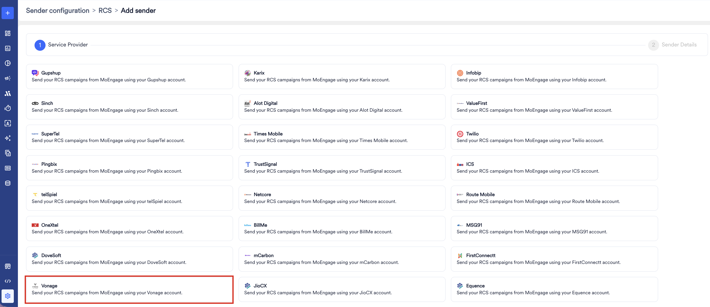
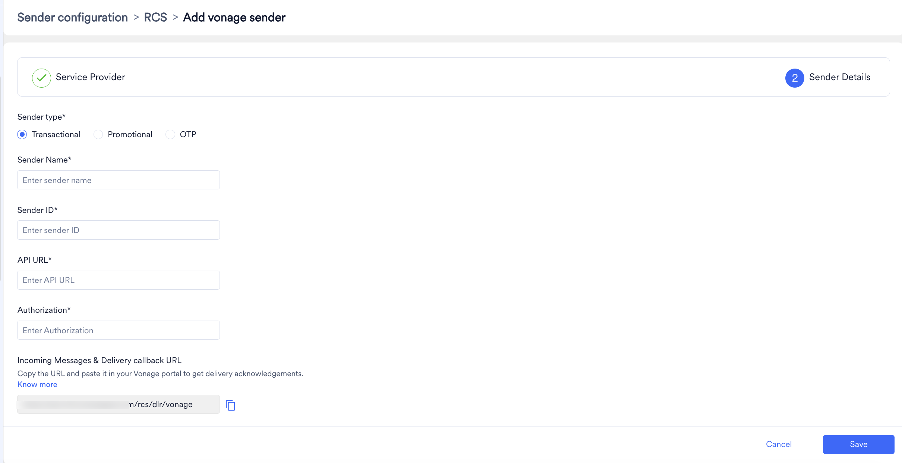

# はじめに

Vonage は、Communications Platform as a Service (CPaaS) の主要なメッセージングチャネルの 1 つとして RCS を提供するグローバルなクラウドコミュニケーションプロバイダーです。Vonage MoEngage Connector は、Vonage Cloud Runtime (VCR) 上に構築されたセルフサービス型のノーコード統合です。MoEngage のキャンペーン実行レイヤーと Vonage のメッセージングインフラストラクチャを橋渡しし、ブランドが Vonage を通じて直接 RCS キャンペーンを大規模に送信できるようにします。
詳細については、[Connector Overview](https://api.support.vonage.com/hc/en-us/articles/29661868078748-MoEngage-Connector-Overview) を参照してください。

<Info>
  **前提条件**
    - API キーを取得するための [Vonage Dashboard](https://dashboard.nexmo.com/private/dashboard) へのアクセス権。
    - コネクターインスタンスをデプロイするための [Vonage Cloud Runtime](https://developer.vonage.com/en/cloud-runtime) へのアクセス権。
    - 登録済みの RCS エージェントを持つ Vonage RCS Business Messaging アカウント。RCS エージェントの登録は、VCR Marketplace のフローとは別に、Vonage のカスタマーサクセスアソシエイト (CSA) またはアカウントマネージャーが対応します。
    - Signature secret を取得するための [Vonage Dashboard Settings](https://dashboard.vonage.com/settings) へのアクセス権 (Standalone モードのみ)。
    - MoEngage ダッシュボードの管理者権限と、MoEngage テナントで RCS チャネルが有効になっていること。
    - Conversational Connect モードの場合のみ:
      - RCS が設定された Conversational Connect アカウント。
      - Conversational Connect Developer Portal へのアクセス権。
      - Conversational Connect アカウントと Vonage Cloud Runtime のデプロイのリージョンが一致していること。
    - 前提条件の完全なリストについては、[Vonage MoEngage Connector - RCS Channel Guide](https://api.support.vonage.com/hc/en-us/articles/30075035241372-Vonage-MoEngage-Connector-RCS-Channel-Guide) のセクション 2 を参照してください。
</Info>

# RCS コネクター (サービスプロバイダー) を設定する

MoEngage ダッシュボードで Vonage をコネクターとして設定するには、次の手順を実行します。

1. MoEngage ダッシュボードの左側のナビゲーションメニューで、**Settings** \> **Channels** \> **SMS & RCS** \> **Sender configuration** に移動します。
2. **RCS** タブで、**\+ Add RCS Sender** をクリックします。
3. **Vonage** タイルをクリックします。
   
4. このページを開いたまま、[Vonage MoEngage Connector - RCS Channel Guide](https://api.support.vonage.com/hc/en-us/articles/30075035241372-Vonage-MoEngage-Connector-RCS-Channel-Guide) のセクション 3 (Conversational Connect モード) またはセクション 4 (Standalone モード) に従って、Vonage Cloud Runtime に Vonage Conversations for MoEngage コネクターをデプロイします。その後、このページに戻って Sender Details を入力します。
5. **Sender Details** ページで、次の詳細を追加します。

   

| フィールド | 説明 |
| --- | --- |
| **Mark as default** | このトグルをオンにすると、設定中のサービスプロバイダーのデフォルト送信者としてこの送信者がマークされます。デフォルトに設定すると、キャンペーン作成時に別の送信者を選択しない限り、MoEngage から送信されるすべての RCS キャンペーンでこの送信者が使用されます。 |
| **Sender type** | 送信者タイプを選択します。使用できるオプションは次のとおりです: <ul><li>**Promotional** : ブランドに関する情報の送信、お得な情報の宣伝、ユーザーとのエンゲージメントに送信者を使用する場合は、このオプションを選択します。</li><li>**Transactional** : 取引に関するアラート、OTP、セキュリティ情報、またはトランザクションの性質を持つと分類できる情報の送信に送信者を使用する場合は、このオプションを選択します。</li><li>**OTP** : OTP の送信に送信者を使用する場合は、このオプションを選択します。</li></ul> |
| **Sender Name** | 送信者の名前を入力します。このフィールドは、キャンペーンやアラートの作成時に使用できる、読みやすい送信者名を識別します。 |
| **Sender ID** | 受信者にメッセージの送信元として表示される RCS Sender ID (エージェント ID) です。Vonage アカウントにリンクされた登録済みの RCS エージェントと一致している必要があります。 |
| **API URL** | コネクター管理パネルの **MoEngage - Instance API URL** フィールドからコピーした API URL を貼り付けます。コネクター管理パネルから URL をコピーするには、[こちら](https://api.support.vonage.com/hc/en-us/articles/30075035241372-Vonage-MoEngage-Connector-RCS-Channel-Guide#h_01M23KNZ5AX66C6BA7NZ23NGK9:~:text=Step%202%3A%20Retrieve%20the%20API%20URL%20from%20the%20Connector%20Admin%20Panel)に記載されている手順を実行してください。 |
| **Authorization** | 値を `Bearer <token>` に設定し、`<token>` を生成したベアラートークンに置き換えます。コネクター管理パネルの **Tokens** タブでベアラートークンを生成するには、[こちら](https://api.support.vonage.com/hc/en-us/articles/30075035241372-Vonage-MoEngage-Connector-RCS-Channel-Guide#h_01M23KNZ5AX66C6BA7NZ23NGK9:~:text=Step%201%3A%20Generate%20a%20Bearer%20Token%20for%20Authentication)に記載されている手順を実行してください。 |

6. **Save** をクリックして、この送信者設定を保存します。
7. **Incoming Messages and delivery callback URL**: 配信トラッキングを設定すると、メッセージがエンドユーザーに配信されたかどうかを監視できます。受信メッセージの URL を設定すると、メッセージへの応答を追跡し、それに応じて対応できます。[こちら](https://api.support.vonage.com/hc/en-us/articles/30075035241372-Vonage-MoEngage-Connector-RCS-Channel-Guide#h_01M23KNZ5AX66C6BA7NZ23NGK9:~:text=Step%205%3A%20Enter%20the%20Delivery%20URL%20in%20the%20Connector%20Admin%20Panel)の説明に従って、この URL を MoEngage ダッシュボードからコピーし、コネクター管理パネルの **RCS MoEngage Delivery Tracking URL** フィールドに貼り付けてから、**Update configuration** をクリックします。

この統合の詳細については、[Vonage MoEngage Connector - RCS Channel Guide](https://api.support.vonage.com/hc/en-us/articles/30075035241372-Vonage-MoEngage-Connector-RCS-Channel-Guide) を参照してください。

