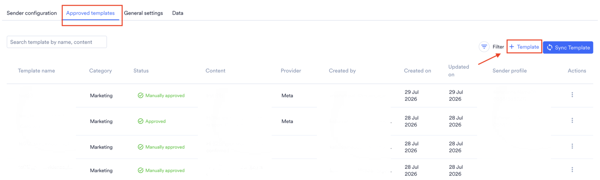
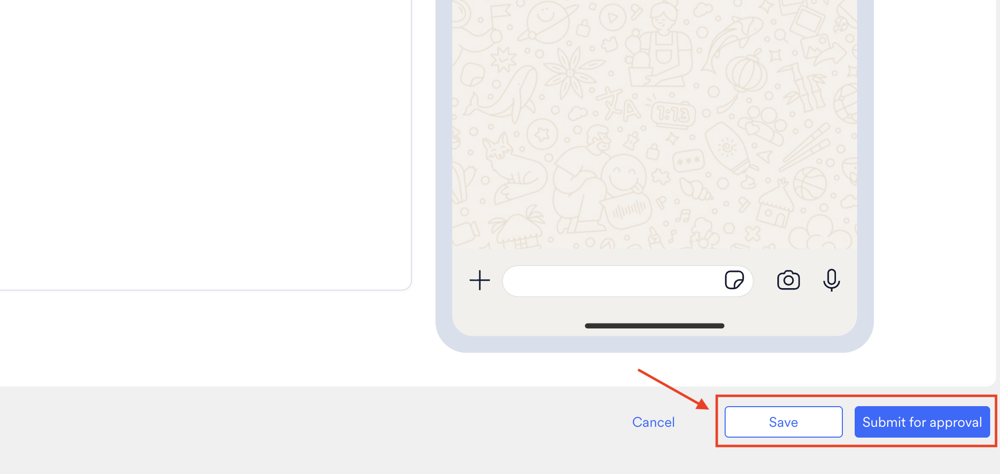
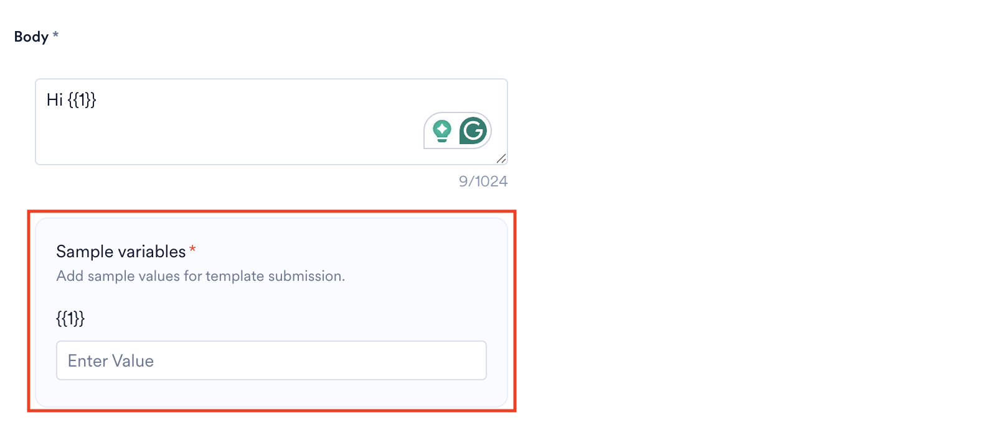
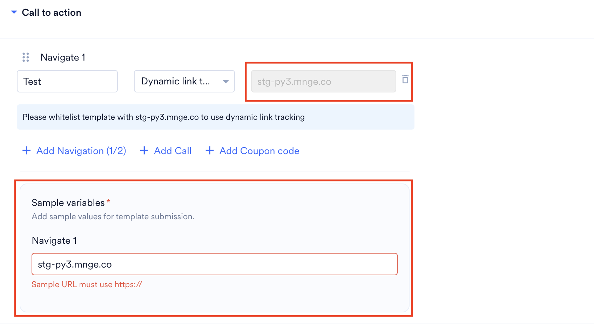
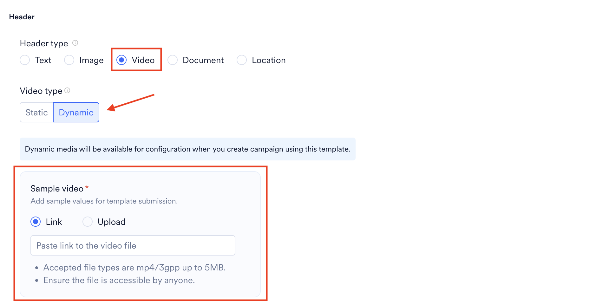
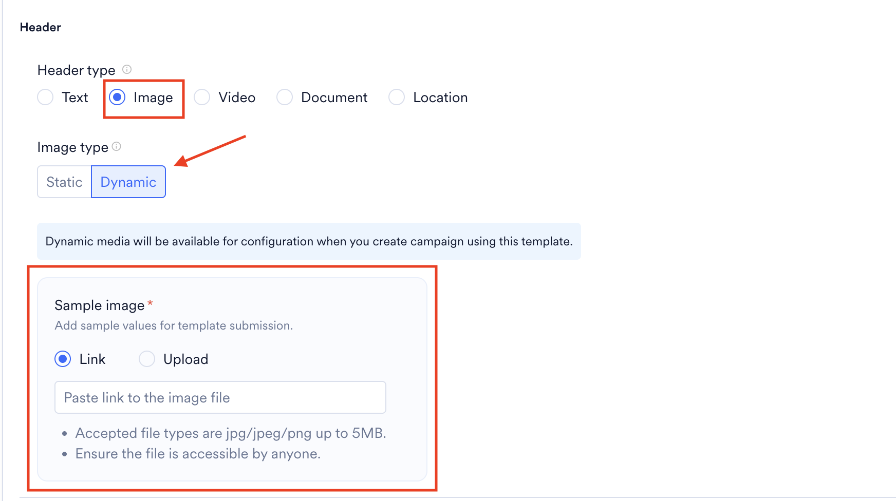
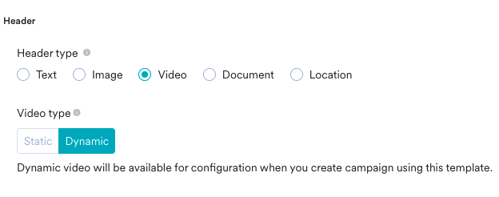
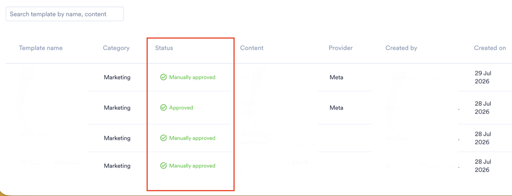
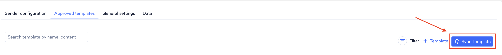

Meta パートナーのポータルに切り替えることなく、MoEngage から直接 WhatsApp テンプレートを作成および管理できます。Meta アカウントを設定すると、テンプレートの作成、Meta への承認申請、承認ステータスの追跡をすべて 1 つのインターフェイスから行えます。

承認済み/ホワイトリスト登録済みの WhatsApp テンプレートを MoEngage に追加する方法については、[Meta の設定](/ja/partner-guide/messaging-channels/whatsapp-providers/meta/configure-meta-sender)を参照してください。

## Meta テンプレートを作成する

1. **Settings** **\> Channels \>** **WhatsApp** に移動します。
2. **Approved templates** タブを選択し、**\+ Template** ボタンをクリックします。

   <Frame>
     
   </Frame>
3. 必要なコンポーネントを追加してテンプレートを設定します。

   | フィールド | 説明 |
   | --- | --- |
   | **Name** | BSP 側に表示されているとおりにテンプレート名を正確に入力します。名前は最大 100 文字まで入力できます。 |
   | **Service Provider** | このテンプレートメッセージの送信に使用する Meta (または BSP) をドロップダウンから選択します。WhatsApp テンプレートは WhatsApp Business Account (WABA) レベルで承認され、WABA は 1 つの BSP にのみ属することができます。テンプレートと互換性のある BSP を選択してください。 |
   | **Sender Profile** | このテンプレートが承認されている Meta プロファイルを選択します。同じ BSP に属し、同じ WABA の配下にある場合は、複数の Meta プロファイルを選択できます。 |
   | **Language** | テンプレートのコンテンツの言語を選択します。この値はテンプレートの言語を決定するもので、BSP/WSP 側で指定されている言語と一致している必要があります。 |
   | **Category** | ドロップダウンからカテゴリの種類を選択します。WhatsApp では、次のいずれかのカテゴリに属するメッセージを送信できます。 • Marketing • Utility |
   | **Template Type** | このフィールドは、Category フィールドで Marketing を選択した場合にのみ表示されます。ドロップダウンメニューからテンプレートタイプを選択します。 |
4. **Save** または **Submit for approval** ボタンをクリックします。

   <Frame>
     
   </Frame>

<Info>
  **Submit for approval** を選択すると、MoEngage はテンプレートを Meta に送信して承認を申請します。**Save** を選択すると、MoEngage はテンプレートを保存するだけです。この方法で保存したテンプレートは、手動で作成して Meta に承認を申請する必要があります。
</Info>

テンプレートの設定時には、次のセクションを使用できます。

<Tabs>
  <Tab title="カルーセルテンプレート">
    | フィールド | 説明 |
    | --- | --- |
    | **Header** | ヘッダーは WhatsApp メッセージの上部に表示され、テキストまたはサポートされているメディアを含めることができます。このフィールドは任意です。動的メディアのヘッダー (画像など) を選択した場合は、テンプレートの作成時にサンプル画像を指定してください。 |
    | **Body** | テンプレートの本文を設定します。最大 1024 文字まで入力できます。テンプレートの本文で、オーディエンスに目的が明確に伝わるようにしてください。本文に動的変数が含まれる場合は、テンプレートの作成時に各変数のサンプル値を指定してください。  |
    | **Carousel Content** | このセクションは、Template Type フィールドがカルーセルテンプレートに設定されている場合に表示されます。 |
    | **Media Type** | カルーセルカードに表示するメディアの種類を選択します。Image または Video のいずれかを選択できます。このセクションは、Template Type フィールドがカルーセルテンプレートに設定されている場合に表示されます。 |
    | **Image Type** | メディアの種類として画像を選択した場合、さらに画像タイプとして静的または動的を選択できます。このセクションは、Template Type フィールドがカルーセルテンプレートに設定されている場合に表示されます。 |
    | **Image Source** | デバイスから画像を直接アップロードするか、外部の画像ソースにリンクして、画像ソースを指定します。このセクションは、Template Type フィールドがカルーセルテンプレートに設定されている場合に表示されます。画像ソースが動的な場合は、テンプレートの作成時にサンプル画像を指定してください。  |
    | **Link to image** | このフィールドは、Image Source フィールドが Link に設定されている場合に表示されます。画像がホストされている URL を指定できます。 |
    | **Video Type** | メディアの種類として動画を選択した場合、さらに動画タイプとして静的または動的を選択できます。このセクションは、Template Type フィールドがカルーセルテンプレートに設定されている場合に表示されます。 |
    | **Video Source** | デバイスから動画を直接アップロードするか、外部の動画ソースにリンクして、動画ソースを指定します。このセクションは、Template Type フィールドがカルーセルテンプレートに設定されている場合に表示されます。 |
    | **Link to video** | このフィールドは、Video Source フィールドが Link に設定されている場合に表示されます。動画がホストされている URL を指定できます。 |
    | **Card Body** | テキストやメディアなどのコンテンツを紹介するカードを最大 10 枚まで追加できます。複数のカードがある場合は、進む/戻るのナビゲーションボタンを使用してカード間を移動できます。このセクションは、Template Type フィールドがカルーセルテンプレートに設定されている場合に表示されます。 |
    | **Footer** | WhatsApp テンプレートのフッターを設定します。このフィールドは任意です。Template Type フィールドがカルーセルテンプレートに設定されている場合に表示されます。 |
    | **Button(s)** | このセクションで CTA ボタンを追加できます。Template Type フィールドがカルーセルテンプレートに設定されている場合、合計 2 個のボタンを追加できます。CTA ボタンに動的な値 (動的 URL など) が含まれる場合は、各動的変数のサンプル値を指定し、ドメインが一致していることを確認してください。  |
  </Tab>
  <Tab title="シンプルなデフォルトテンプレート">
    | フィールド | 説明 |
    | --- | --- |
    | **Header** | ヘッダーは WhatsApp メッセージの上部に表示され、テキストまたはサポートされているメディアを含めることができます。このフィールドは任意です。動的メディアのヘッダー (画像など) を選択した場合は、テンプレートの作成時にサンプル画像を指定してください。  |
    | **Body** | テンプレートの本文を設定します。最大 1024 文字まで入力できます。テンプレートの本文で、オーディエンスに目的が明確に伝わるようにしてください。本文に動的変数が含まれる場合は、テンプレートの作成時に各変数のサンプル値を指定してください。  |
    | **Footer** | WhatsApp テンプレートのフッターを設定します。このフィールドは任意です。 |
    | **Button(s)** | このセクションで CTA ボタンを追加できます。Template Type フィールドがシンプルなデフォルトテンプレートに設定されている場合、合計 10 個のボタンを追加できます。Navigation CTA 2 個、Add a call CTA 1 個、Coupon Code CTA 1 個とクイック返信ボタン 6 個を追加するか、最大 10 個のクイック返信ボタンを追加できます。3 個を超えるボタンを追加した場合は、See More Options をクリックするとすべてのボタンを表示できます。CTA ボタンに動的な値 (動的 URL など) が含まれる場合は、各動的変数のサンプル値を指定し、ドメインが一致していることを確認してください。  |
  </Tab>
  <Tab title="期間限定オファーテンプレート">
    | フィールド | 説明 |
    | --- | --- |
    | **Header** | ヘッダーは WhatsApp メッセージの上部に表示され、テキストまたはサポートされているメディアを含めることができます。このフィールドは任意です。動的メディアのヘッダー (画像など) を選択した場合は、テンプレートの作成時にサンプル画像を指定してください。  |
    | **Offer Details** | 宣伝するオファーについて、簡潔かつ正確な説明を指定します。 |
    | **Offer Valid for Limited Time** | オファーが期間限定で利用できる場合は、このチェックボックスをオンにします。オンにすると、キャンペーンの作成時に有効期限を設定するよう求められます。オンにしない場合、オファーに期間の制限はありません。 |
    | **Body** | テンプレートの本文を設定します。最大 1024 文字まで入力できます。テンプレートの本文で、オーディエンスに目的が明確に伝わるようにしてください。本文に動的変数が含まれる場合は、テンプレートの作成時に各変数のサンプル値を指定してください。  |
    | **Footer** | WhatsApp テンプレートのフッターを設定します。このフィールドは任意です。 |
    | **Button(s)** | このセクションで CTA ボタンを追加できます。Offer Valid for Limited Time チェックボックスがオンの場合、Coupon Code CTA の追加が必須となり、このボタンがテンプレートの最初のアクションとして表示されます。CTA ボタンに動的な値 (動的 URL など) が含まれる場合は、各動的変数のサンプル値を指定し、ドメインが一致していることを確認してください。  |
  </Tab>
</Tabs>

WhatsApp でサポートされているとおり、一部のフィールドは次のように設定できます。

- **Static**: 静的フィールドはテンプレートレベルで固定されます。たとえば、静的画像を使用すると、このテンプレートを使用するすべてのキャンペーンで、ターゲットユーザーへのすべてのメッセージに同じ画像を送信できます。
- **Dynamic**: 動的フィールドは柔軟で、キャンペーンの作成時に設定できます。動的画像を使用すると、キャンペーンごと、またはキャンペーン内のユーザーごとにパーソナライズできます。
- **Dynamic Link Tracking**: 動的リンクトラッキングを使用すると、アクションとして Navigation が設定されたボタンのクリックを追跡できます。これは Navigation ボタンでのみ、かつプロバイダーが Gupshup の場合にのみ利用できます。

## ヘッダー

ヘッダーは任意で、次の種類があります。

- テキスト (最大 60 文字、プレースホルダーを 1 つ含めることができます)
- 画像
- 動画
- ドキュメント
- 位置情報

テキスト以外のヘッダーは、静的または動的にできます。固定の画像やドキュメントのリンクを使用することも、ユーザーごとにパーソナライズされた画像/ドキュメントを使用することもできます。動的フィールドは、キャンペーンの作成時に設定できます。詳細については、[画像のパーソナライズ](/ja/user-guide/campaigns-and-channels/getting-started/message-personalization/overview#image-personalization)を参照してください。

<Frame>
  
</Frame>

MoEngage がサポートしているメディアの種類、メディア形式、ファイルサイズは次のとおりです。

| コンテンツタイプ | サポートされている形式とファイルサイズ |
| --- | --- |
| **Image** | サポートされている画像の種類は JPG、JPEG、PNG です。最大ファイルサイズは 5MB です。サンプルファイルにも、記載されているものと同じファイルの種類とサイズの要件が適用されます。 |
| **Document** | サポートされているドキュメントの種類は PDF です。最大ドキュメントサイズは 5MB です。サンプルファイルにも、記載されているものと同じファイルの種類とサイズの要件が適用されます。 |
| **Video** | サポートされているファイルの種類は MP4 と 3GPP です。最大ファイルサイズは 15MB です。サンプルファイルは記載されているものと同じファイルの種類をサポートしていますが、サンプルファイルの最大サイズは 5MB です。 |

## テンプレートのステータス

テンプレートの承認を申請すると、テンプレートは次のステータスを順に経ます。

| ステータス | 説明 |
| --- | --- |
| **Under Review** | テンプレートは送信済みで、現在 Meta による審査中です。 |
| **Approved** | テンプレートは Meta によって承認され、WhatsApp キャンペーンで使用できる状態です。 |
| **Rejected** | Meta がテンプレートを却下しました。却下の理由を確認し、必要に応じてテンプレートを更新してから、再度申請してください。 |

<Frame>
  
</Frame>

その他のテンプレートのステータスについては、[ベンダーから MoEngage にテンプレートを同期する](/ja/user-guide/campaigns-and-channels/whatsapp/getting-started-with-whatsapp/whatsapp-templates#sync-templates-from-vendors-to-moengage)を参照してください。

<Info>
  Meta はテンプレートの同期もサポートしています。Meta ですでにテンプレートを作成している場合は、**Sync Template** を使用して、利用可能なすべてのテンプレートを MoEngage にインポートします。この機能を使用して、新しく作成されたテンプレートを取得したり、既存のテンプレートを更新したりすることもできます。

  <Frame>
    
  </Frame>
</Info>
