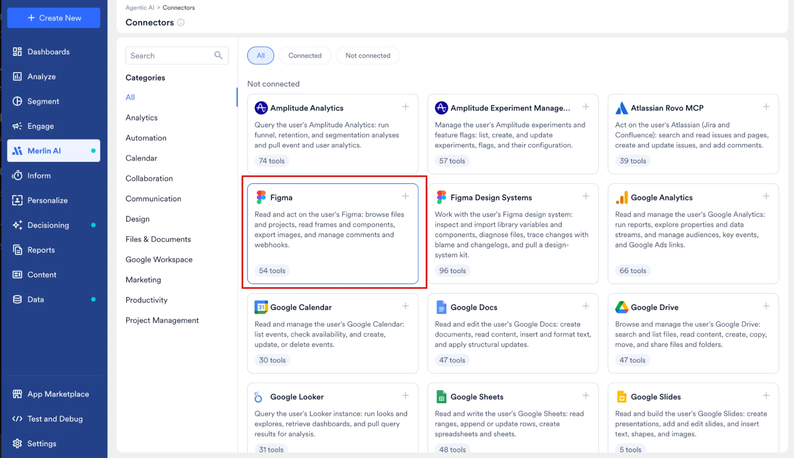
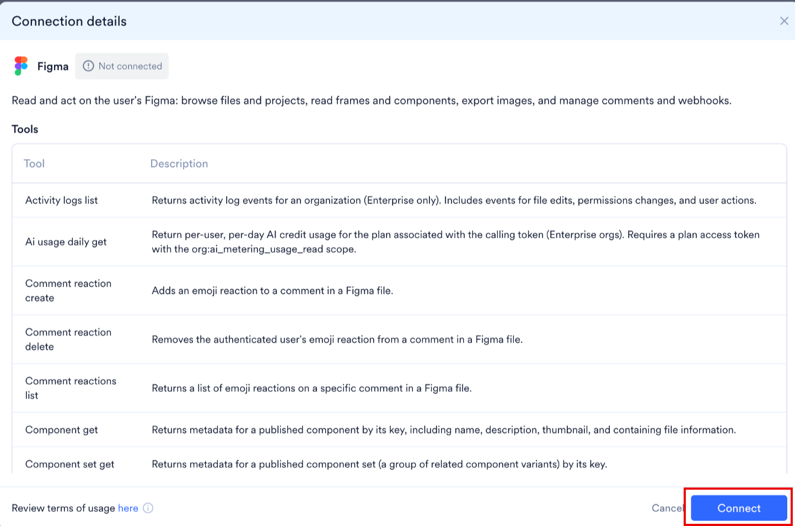
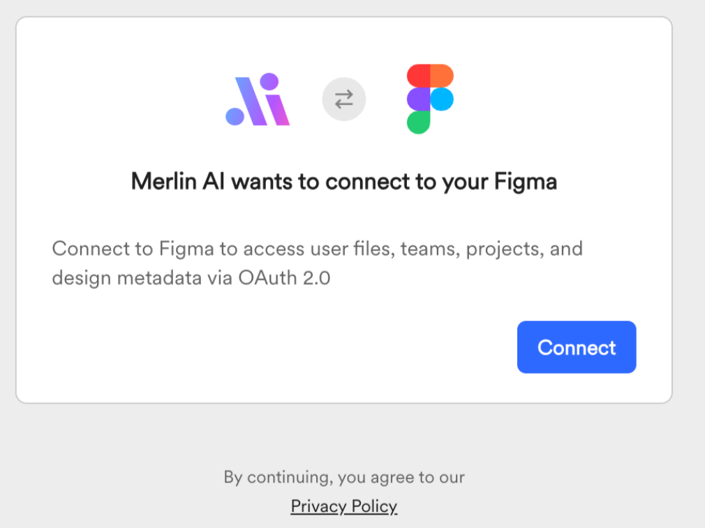
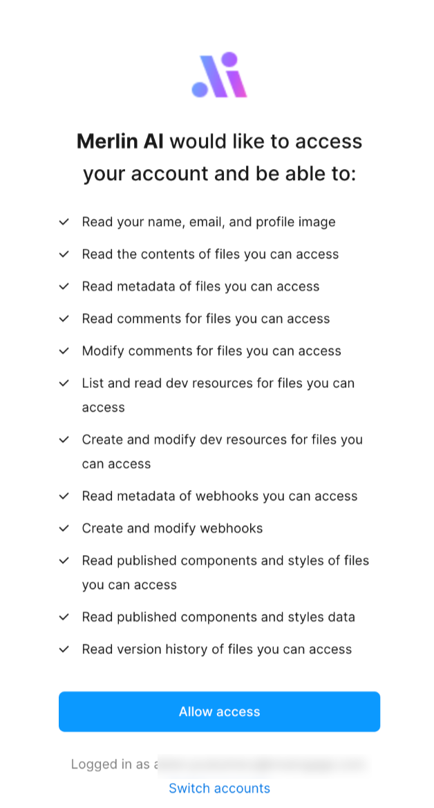
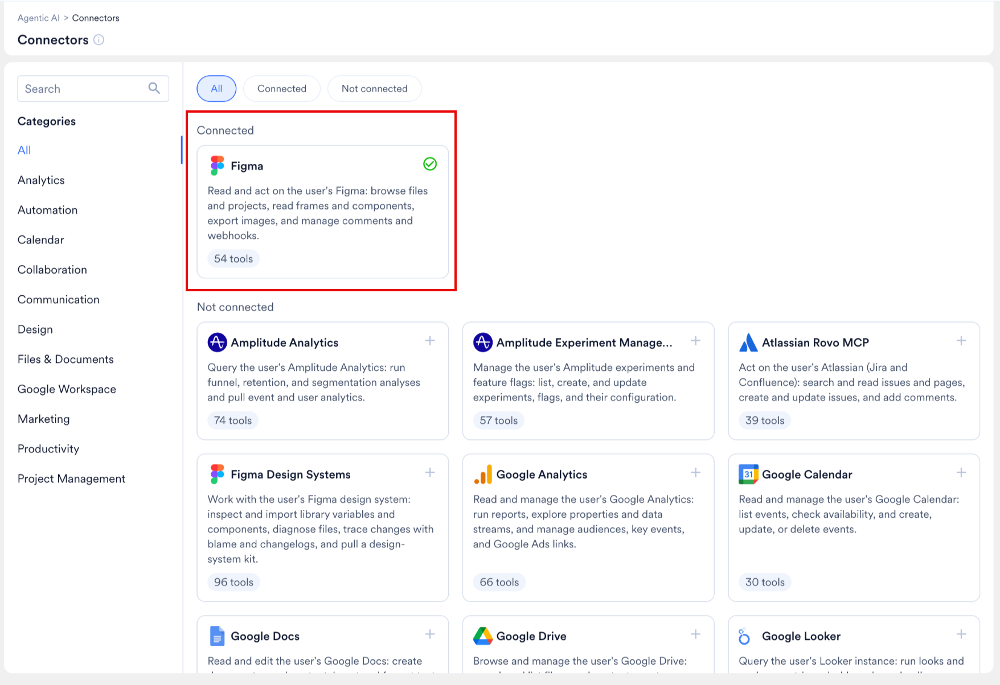

Figma は、チームがインターフェースのレイアウトを作成・共有するためのコラボレーション型デザインツールで、マーケティングチームが送信するメールのデザインもここで作成されます。デザインは Figma に残ったままのため、マーケターは各レイアウトを MoEngage で手作業で作り直すことになります。

Figma コネクタを使用すると、Custom Agents が Figma アカウントにアクセスできるようになります。エージェントはデザインチームが作業しているファイルを読み取り、対応する MoEngage のアセットを作成します。フレーム全体はメールテンプレートに、再利用可能なセクションはコンテンツブロックになります。これにより、マーケティングチームはすぐに使えるアセットから作業を始められます。

<Note>
 Custom Agents と Connectors は現在 Early Access 機能です。ダッシュボードに **Merlin AI** > **Connectors** が表示されない場合は、Customer Success Manager (CSM) にアクセスをリクエストしてください。
</Note>

## 概要

Figma にアクセスできる Custom Agent は、デザインから次の MoEngage アセットを作成します。

| Figma の入力 | MoEngage の出力 |
| --- | --- |
| メール全体を表すフレーム | [メールテンプレート](/ja/user-guide/content/template/templates)。エージェントはフレームを、レスポンシブでメールに安全な HTML として再構築します。 |
| ヘッダー、商品カード、プロモーションバナー、フッターなど、複数のキャンペーンで再利用するデザインのセクション | [コンテンツブロック](/ja/user-guide/content/content-blocks/content-blocks)。セクションにはテキスト、画像、またはその両方を含めることができます。 |
| どのフレームにも含まれない単独の画像 | その画像を含むコンテンツブロック。 |

コンテンツブロックは 1 つの画像に限定されません。MoEngage のコンテンツブロックには **Plain text** と **HTML** の 2 種類があり、HTML コンテンツブロックにはテキスト、画像、ボタン、インラインスタイルを自由に組み合わせて含めることができます。再利用可能なモジュールからメールを組み立てる場合は、各モジュールを個別のコンテンツブロックとしてインポートし、それらのブロックからメールを作成します。[コンテンツブロック](/ja/user-guide/content/content-blocks/content-blocks)を参照してください。

インポートするフレーム、セクション、または画像を指定すると、エージェントは実行中に作成または更新したすべてのアセットを一覧にしたサマリーテーブルを返します。

### 前提条件

開始する前に、次の点を確認してください。

* ワークスペースで Custom Agents と Connectors が有効になっていること。
* インポートする Figma ファイルにアクセスできる Figma アカウントを持っていること。
* MoEngage のロールに、メールテンプレートとコンテンツブロックを作成する権限が含まれていること。Custom Agent は、エージェントを実行するユーザーの MoEngage 権限の範囲内で動作します。[Custom Agent の基本: 権限とセキュリティ](/ja/user-guide/ai-and-intelligence/merlin-ai/custom-agents/custom-agents-essentials-permission-and-security)を参照してください。

### Figma を MoEngage に接続する

Figma を一度接続すると、それ以降、あなたが実行するすべてのエージェントが Figma アカウントにアクセスできるようになります。Figma アカウントの接続はユーザーごとに個別に行います。

1. MoEngage ダッシュボードの左側のナビゲーションメニューで、**Merlin AI** > **Connectors** に移動します。
2. **Figma** を選択します。

   <Frame>
   
   </Frame>

3. **Connection details** ダイアログで、Figma のツールと利用規約を確認してから、**Connect** をクリックします。

   <Frame>
   
   </Frame>

4. 確認画面で **Connect** をクリックして、Figma の OAuth 2.0 フローを開始します。

   <Frame>
   
   </Frame>

5. Figma の同意画面で、Figma が MoEngage に付与するアカウントへのアクセス権を確認してから、**Allow access** をクリックします。別の Figma アカウントを承認するには、アクセスを許可する前に **Switch accounts** をクリックします。

   <Frame>
   
   </Frame>

6. Figma から **Connectors** ページに戻ります。Figma のカードは **Connected** セクションに移動し、緑色のチェックマークが表示されます。

   <Frame>
   
   </Frame>

7. 接続済みの Figma カードを選択して **Connection details** ダイアログを再度開き、個々の Figma ツールを有効化または無効化します。無効化したツールは、あなたが実行するすべてのエージェントで利用できなくなります。

コネクタの動作全般、ツールごとの制御、利用規約については、[外部アプリを Custom Agents に接続する](/ja/user-guide/ai-and-intelligence/merlin-ai/connectors/connect-external-apps)を参照してください。

<Note>
 Custom Agent は、実行を開始したユーザーに代わって Figma を読み取ります。あなたのインポートエージェントを実行するチームメイトは、自分の Figma アカウントを個別に接続し、同じ Figma ファイルへのアクセス権を持っている必要があります。
</Note>

## ユースケース

デザインの一部をメールテンプレートにするか、コンテンツブロックにするかは、プロンプトによって決まります。

* **メール全体のデザインハンドオフ。** フレームは通常メール全体を表すため、フレーム全体はデフォルトでメールテンプレートになります。デザインチームから完成したレイアウトを受け取る場合に使用します。
* **再利用可能なモジュールのライブラリ。** フレーム内の名前付きセクションは、プロンプトでそのセクションを指定するとコンテンツブロックになります。ヘッダー、商品カード、プロモーションバナーなど、複数のキャンペーンで再利用するモジュールに使用します。コンテンツブロックには、セクションのテキストと画像がまとめて含まれます。
* **単独の画像アセット。** 単独の画像は、その画像を含むコンテンツブロックになります。フレーム内の画像は、その画像またはそれを含むセクションを個別のインポートとして指定しない限り、エージェントがそのフレームから作成するメールテンプレートの一部として扱われます。

次のプロンプトは、それぞれの結果を示しています。

| プロンプト | 結果 |
| --- | --- |
| `Import the frame times-daily-briefing as an email template.` | フレーム全体から作成された 1 つのメールテンプレート。 |
| `Import the sections Masthead and introduction and Top stories from times-daily-briefing as content blocks.` | 2 つのコンテンツブロック。それぞれにそのセクションのテキストと画像が含まれます。 |
| `Import the standalone images only.` | どのフレームにも含まれない画像ごとに 1 つのコンテンツブロック。エージェントは、すべてのフレームと既存のメールテンプレートに変更を加えません。 |

再利用可能なモジュールからメールを組み立てるには、各モジュールを個別のコンテンツブロックとしてインポートし、それらのブロックをメールテンプレートに挿入します。[コンテンツブロックを使用してコンテンツをパーソナライズする](/ja/user-guide/campaigns-and-channels/getting-started/message-personalization/personalize-content-using-content-blocks)を参照してください。

## ツール

Figma コネクタは Figma アカウントを読み取り、操作します。ファイルとプロジェクトの閲覧、フレームとコンポーネントの読み取り、画像のエクスポート、コメントと Webhook の管理を行います。**Connection details** ダイアログには、コネクタが提供するすべてのツールが、その説明とステータス (**Enabled** または **Disabled**) とともに一覧表示されます。

| ツールグループ | エージェントによる活用方法 |
| --- | --- |
| ファイルとプロジェクト | Figma アカウント内のファイルとプロジェクトを閲覧します。 |
| フレームとコンポーネント | 名前、説明、サムネイルなどのメタデータを含め、フレーム、コンポーネント、コンポーネントセットを読み取ります。 |
| 画像のエクスポート | フレーム、セクション、画像を URL としてエクスポートし、エージェントが作成する HTML に埋め込みます。 |
| コメント | ファイル上のコメントを読み取り、コメントへの絵文字リアクションを追加または削除します。 |
| Webhook | ファイルまたはチームに登録された Webhook を管理します。 |
| 組織のレポート | アクティビティログのイベントと、ユーザーごとの AI クレジットの使用量を返します。これらのツールには Figma Enterprise プランが必要です。 |

インポートに必要なのは読み取りアクセスのみです。エージェントが Figma ファイルを変更することがない場合は、コネクタの書き込みツールを無効にし、エージェントの指示にも同じルールを記載してください。ツールのステータスは個々のエージェントではなくコネクタに属するため、あなたが実行するすべてのエージェントに適用されます。[コネクタのツールを有効化または無効化する](/ja/user-guide/ai-and-intelligence/merlin-ai/connectors/connect-external-apps#enable-or-disable-a-connectors-tools)を参照してください。

## 使用例

次の例では、Figma ファイルからメールデザインをインポートするエージェントを作成します。

### Figma ファイルを準備する

エージェントはデザインの構造から HTML を作成するため、整理された Figma ファイルほど正確なテンプレートが作成されます。次のようにファイルを準備してください。

* **Auto Layout を使用する。** エージェントは各フレームの Auto Layout 構造を読み取り、HTML 内でのセクションの配置方法を決定します。固定幅または塗りつぶし幅の Auto Layout を使用したフレームは、手動で配置したレイヤーで構成されたフレームよりも確実に変換されます。
* **メールの幅を固定する。** メールデザインでは通常 600 px の幅が使用されます。エージェントが同じ幅の HTML コンテナを作成できるよう、フレームの幅を明示的に設定してください。
* **フレームにわかりやすい名前を付ける。** エージェントを実行する際は各フレームを名前で指定し、MoEngage はフレーム名をメールテンプレート名として使用します。`times-daily-briefing` のように、一貫した命名規則に従ってください。
* **セクションと画像レイヤーに名前を付ける。** `Masthead and introduction` や `Top stories` のようなわかりやすいレイヤー名は、エージェントが HTML を整理するのに役立ちます。MoEngage はレイヤー名をコンテンツブロック名として使用するため、個別にインポートする予定のセクションにはすべて名前を付けてください。
* **再利用可能なモジュールはそれぞれ独自のレイヤーにまとめる。** ヘッダー、商品カード、プロモーションバナーなど、複数のキャンペーンで再利用するモジュールは、1 つの名前付きグループまたはフレームにまとめてください。これにより、エージェントはテキストと画像を含むモジュール全体を 1 つのコンテンツブロックとしてインポートします。
* **テキストはライブテキストレイヤーのままにする。** アウトライン化したテキストや画像に統合したテキストは、MoEngage では画像の一部として取り込まれるため、メールテンプレートでそのテキストを編集できません。

### インポートエージェントを作成する

Agent Builder でインポートエージェントを作成します。ゼロから始めて Merlin AI Assistant に設定の下書きを作成させることも、自分で指示を記述することもできます。エージェントのライフサイクル全体については、[Custom Agents を作成・管理する](/ja/user-guide/ai-and-intelligence/merlin-ai/custom-agents/create-and-manage-custom-agents)を参照してください。

1. 左側のナビゲーションメニューで、**Merlin AI** > **Custom Agents** に移動します。
2. **+ New custom agent** をクリックし、**Create from scratch** をクリックします。MoEngage が Agent Builder を開きます。
3. Merlin AI Assistant で、目的を平易な言葉で説明します。たとえば、`Import email templates from Figma` のように入力します。
4. Merlin AI Assistant からの 4 つの質問に回答します。各質問は、エージェントの動作の一部を決定します。

| 質問 | オプション |
| --- | --- |
| エージェントはインポートする Figma デザインをどのように判断しますか? | <ul><li>エージェントを実行するときに Figma のファイルまたはフレームの URL を貼り付けます。</li><li>エージェントが特定の Figma プロジェクトまたはファイルを監視し、新しいフレームをインポートします。</li><li>`Welcome Email v2` のように、特定のフレームを名前で指定します。</li></ul> |
| インポートしたデザインに対してエージェントは何を行いますか? | <ul><li>新しい MoEngage メールテンプレートを下書きとして作成します。</li><li>テンプレート名がフレーム名と一致する場合、既存のテンプレートを更新します。</li><li>名前の一致に基づいて、新しいテンプレートを作成するか既存のテンプレートを更新します。</li></ul> |
| Figma デザインから HTML をどのように作成しますか? | <ul><li>フレームを画像としてエクスポートし、シンプルな HTML ラッパーに画像を埋め込みます。</li><li>見出し、テキストブロック、ボタン、画像を含む構造化された HTML としてフレームを再構築します。</li><li>可能な限り構造化された HTML を使用し、複雑なセクションについては画像のエクスポートにフォールバックします。</li></ul> |
| 各実行後、エージェントはどのように報告しますか? | <ul><li>各テンプレートへのリンクを含むサマリーをチャットに表示します。</li><li>実行レポートを .docx ファイルとして保存します。</li><li>実行レポートを .md ファイルとして保存します。</li></ul> |

5. 下書きされたエージェントを確認します。Merlin AI Assistant が **Instructions** エディターに入力し、推奨ツールのセットを提示します。ワークフローに合わせて、指示と推奨ツールの両方を編集します。
6. **Files** セクションで、ブランドガイドラインや推奨する HTML 構造のサンプルなど、エージェントが毎回の実行で参照するファイルを添付します。各エージェントには最大 5 つのファイルを添付できます。

<Warning>
 テンプレートやコンテンツブロックを作成または更新するエージェントは、テスト実行中も含めて、ワークスペースに実際の変更を加えます。テストを実行する前に、ツールの選択と指示を確認してください。MoEngage はコネクタによる書き込みを制限しないため、エージェントが Figma ファイルを変更する必要がない限り、Figma からの読み取りのみを行うように指示を記述してください。
</Warning>

### 指示の例

次の例は、推奨される Role、Objective、Rules、Steps、Output format の構成に従っています。デザインシステムと命名規則に合わせて例を調整してください。

```plaintext wrap
## Role
You are an email template importer. You convert Figma frames into MoEngage email templates that are responsive, accessible, and email-client-safe.

## Objective
In each run, import the Figma frames or images that the user names, and create or update the matching MoEngage assets.

## Rules
- Always read the Auto Layout structure of the frame before you build the HTML.
- Always build the HTML with table-based, fluid-hybrid layout and inline styles.
- Always keep text as live, editable HTML text. Never convert text to images.
- Always add alt text to images and use bulletproof buttons for calls to action.
- Always use the Figma layer name as the template or content block name.
- Never modify the Figma file.
- Never import frames or images that the user did not name.

## Steps
1. Parse the request. Identify the Figma file, the names of the frames, sections, and images to import, and whether each one becomes an email template or a content block.
2. Locate each frame, section, or image in the Figma file.
3. For each frame, extract headings, text, buttons, and images. Export the images as URLs.
4. Build the email HTML.
5. If an email template with the same name exists, update that template. Otherwise, create a new template as a draft.
6. For each section or image that becomes a content block, create an HTML content block named after the layer. Keep the text of the section as live HTML text, and give every image alt text, width, and height.
7. Send a test email of each template to <test-email-address>.

## Output format
Return a table with the columns: Frame name, Mode, Action, Template or content block ID, Test sent. Below the table, list every frame or image you skipped and the reason you skipped it.
```

<Note>
 正確な指示は、安定した実行結果につながります。エージェントがインポートするフレーム、各出力に付ける名前、変更を加えないものを明確に記述してください。
</Note>

### エージェントをテストして実行する

1. Agent Builder の右下にあるアクションバーで **Test agent** をクリックします。
2. Figma ファイルとインポートするアセットを指定するプロンプトを入力します。例:
   * `Import the frame times-daily-briefing from the Times Figma file as an email template.`
   * `Import the section Top stories from times-daily-briefing as a content block.`
   * `Import the standalone images only.`
3. テストパネルで、ツールの呼び出し、エージェントの推論、最終出力を確認します。エージェントが誤ったアセットをインポートしたり、誤った HTML 構造を作成したりした場合は、**Instructions** エディターに戻り、該当するステップをより具体的にします。
4. テスト実行で期待どおりの出力が得られたら、**Make live** をクリックします。チームメイトは **All custom agents** ページからエージェントを開くか、ハブのコンポーザーでエージェントを選択して実行できます。[エージェントセッションを実行・管理する](/ja/user-guide/ai-and-intelligence/merlin-ai/custom-agents/run-and-manage-agent-sessions)を参照してください。

<Warning>
 テストセッションは本番のワークスペースに対して実行されます。フレームをインポートするテスト実行では、実際のメールテンプレートが作成されます。
</Warning>

### 結果を確認する

実行が完了すると、エージェントはチャットにサマリーテーブルを返します。テーブルには次の列が含まれます。

| 列 | 説明 |
| --- | --- |
| **Frame name** | エージェントがインポートした Figma のフレーム、セクション、または画像レイヤーの名前。 |
| **Mode** | メールテンプレートやコンテンツブロックなど、エージェントが作成した出力の種類。 |
| **Action** | エージェントが新しいアセットを作成したか、既存のアセットを更新したか。 |
| **Content block** | エージェントが作成または更新した MoEngage アセットの ID。 |
| **Test sent** | エージェントがアセットのテストメールを送信したかどうか。MoEngage は個々のコンテンツブロックではなく、メールテンプレートとキャンペーンを送信するため、この列はメールテンプレートにのみ適用されます。 |

実行が完了したら、次の操作を行います。

1. MoEngage で各メールテンプレートを開き、レイアウト、フォント、リンクを確認します。生成された HTML を調整するには、[カスタム HTML エディターでコンテンツを作成する](/ja/user-guide/campaigns-and-channels/email/create/create-content-with-custom-html-editor)を参照してください。
2. 指定した受信トレイでテストメールを開き、オーディエンスが最もよく使用するメールクライアントでテンプレートがどのように表示されるかを確認します。[メールキャンペーンをテストする](/ja/user-guide/campaigns-and-channels/email/create/test-email-campaign)を参照してください。
3. テンプレート内のプレースホルダーリンクをキャンペーンの URL に置き換え、キャンペーンに必要なパーソナライズと Jinja を追加します。[メールコンテンツをパーソナライズする](/ja/user-guide/campaigns-and-channels/email/create/personalize-email-content)を参照してください。

<Note>
 エージェントはデザインを HTML として再構築するため、生成されるテンプレートは Figma フレームをピクセル単位で再現したものではなく、編集可能な出発点となります。キャンペーンで使用する前に、生成された各テンプレートを確認してください。Custom Agents は下書きを作成・更新しますが、キャンペーンを公開することはないため、最終的な承認はキャンペーンビルダーであなたが行います。
</Note>

## 関連ページ

* [外部アプリを Custom Agents に接続する](/ja/user-guide/ai-and-intelligence/merlin-ai/connectors/connect-external-apps)
* [Custom Agents: 概要](/ja/user-guide/ai-and-intelligence/merlin-ai/custom-agents/custom-agents-overview)
* [Custom Agents を作成・管理する](/ja/user-guide/ai-and-intelligence/merlin-ai/custom-agents/create-and-manage-custom-agents)
* [エージェントセッションを実行・管理する](/ja/user-guide/ai-and-intelligence/merlin-ai/custom-agents/run-and-manage-agent-sessions)
* [マルチエージェントワークフローを構築する](/ja/user-guide/ai-and-intelligence/merlin-ai/custom-agents/build-multi-agent-workflows)
* [コンテンツブロック](/ja/user-guide/content/content-blocks/content-blocks)
* [テンプレート](/ja/user-guide/content/template/templates)

## よくある質問

<AccordionGroup>
  <Accordion title="エージェントごとに Figma を接続する必要がありますか?">
    いいえ。**Connectors** ページで Figma を一度接続すれば、あなたが実行するすべてのエージェントが Figma アカウントにアクセスできます。各エージェントがいつ Figma を呼び出すかは、そのエージェントに記述した指示によって決まります。
  </Accordion>

  <Accordion title="チームメイトが私の Figma インポートエージェントを実行できますか?">
    はい、エージェントが公開されている場合は実行できます。Custom Agent は実行を開始したユーザーの Figma アカウントを使用するため、チームメイトは自分の Figma アカウントを個別に接続し、同じ Figma ファイルへのアクセス権を持っている必要があります。
  </Accordion>

  <Accordion title="フレームの名前が既存のテンプレートと同じ場合はどうなりますか?">
    結果は、ビルダーの 2 番目の質問で選択したオプションによって異なります。エージェントは、毎回新しいテンプレートを作成するか、毎回一致するテンプレートを更新するか、一致するテンプレートがある場合は更新し、ない場合は新しいテンプレートを作成します。後で動作を変更するには、**Instructions** エディターでエージェントの指示を編集します。
  </Accordion>

  <Accordion title="エージェントは Figma ファイルを変更しますか?">
    エージェントが Figma ファイルを変更するのは、指示でそのように指定した場合のみです。インポートに必要なのは読み取りアクセスのみです。Figma ファイルを変更しないようにするには、**Connection details** ダイアログで Figma の書き込みツールを無効にし、エージェントの指示に Figma ファイルを決して変更しないことを記載してください。
  </Accordion>

  <Accordion title="エージェントはテキストと画像の両方を含むコンテンツブロックを作成できますか?">
    はい。コンテンツブロックにはテキスト、画像、またはその両方を含めることができるため、見出し、本文、画像を組み合わせたモジュールは 1 つのコンテンツブロックとしてインポートされます。プロンプトでモジュールを指定し、Figma ではモジュールを 1 つの名前付きグループまたはフレームにまとめてください。MoEngage のコンテンツブロックには **Plain text** と **HTML** の 2 種類があり、テキストと画像を組み合わせたモジュールは HTML コンテンツブロックとしてインポートされます。[コンテンツブロック](/ja/user-guide/content/content-blocks/content-blocks)を参照してください。
  </Accordion>

  <Accordion title="エージェントはキャンペーンを送信できますか?">
    いいえ。Custom Agents がキャンペーンを公開することはありません。エージェントはメールテンプレートを作成してテストメールを送信し、キャンペーンの承認と開始はキャンペーンビルダーであなたが行います。
  </Accordion>

  <Accordion title="実行中に Figma との接続が切れた場合はどうなりますか?">
    別のブラウザタブで **Connectors** ページを開いて Figma を再接続してから、同じセッションで次のメッセージを送信してください。エージェントがスキップしたステップがあれば、再試行させるためにそのステップを改めて指示してください。[実行中に再接続する](/ja/user-guide/ai-and-intelligence/merlin-ai/connectors/connect-external-apps#reconnect-during-a-run)を参照してください。
  </Accordion>
</AccordionGroup>
