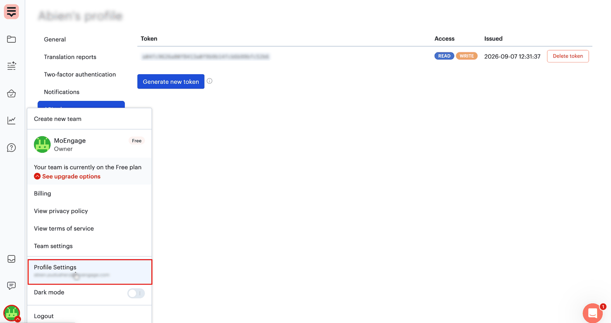
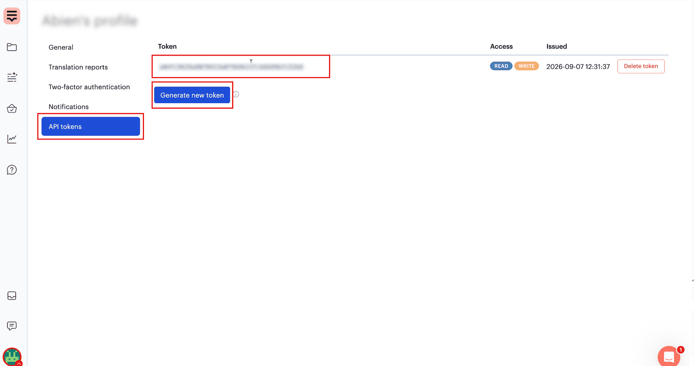
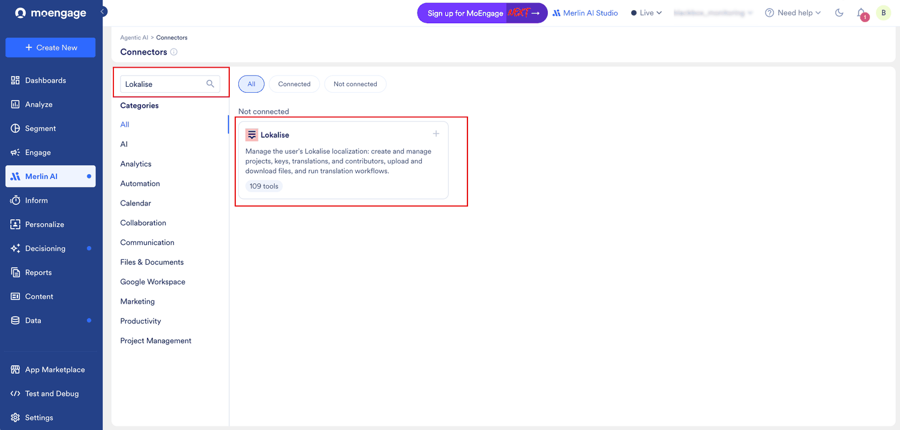
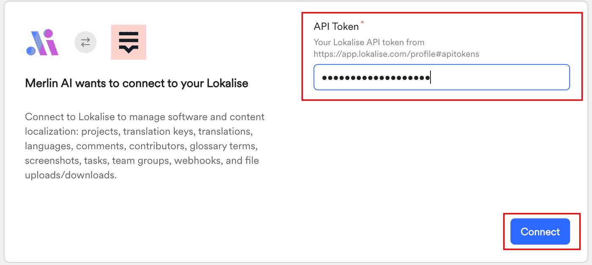
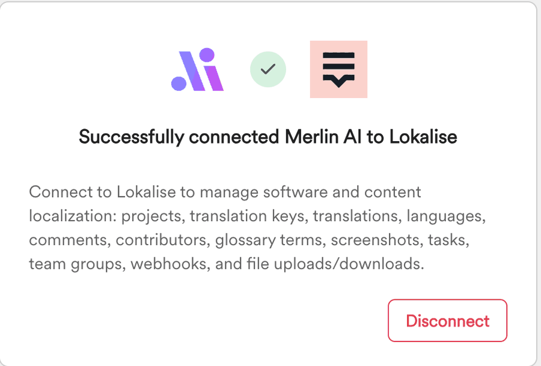
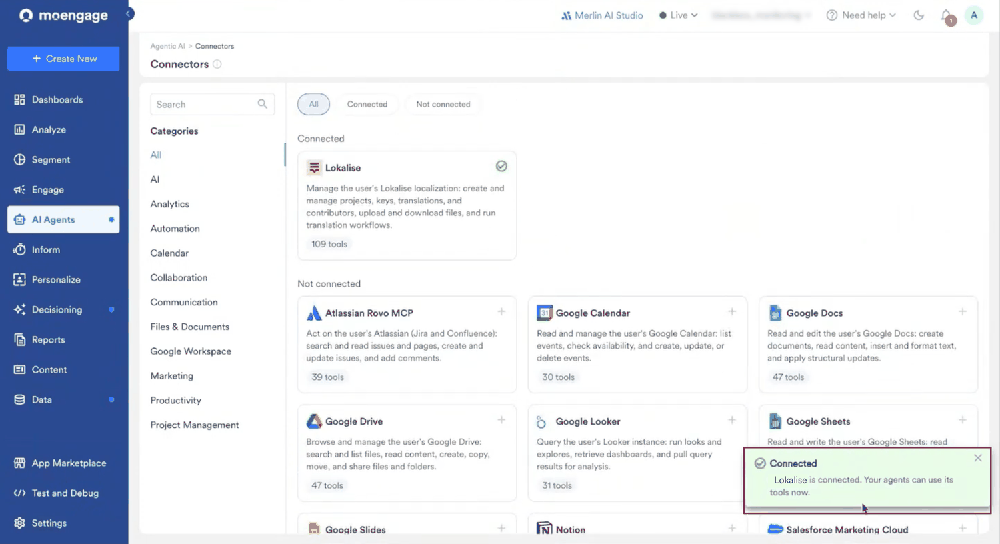
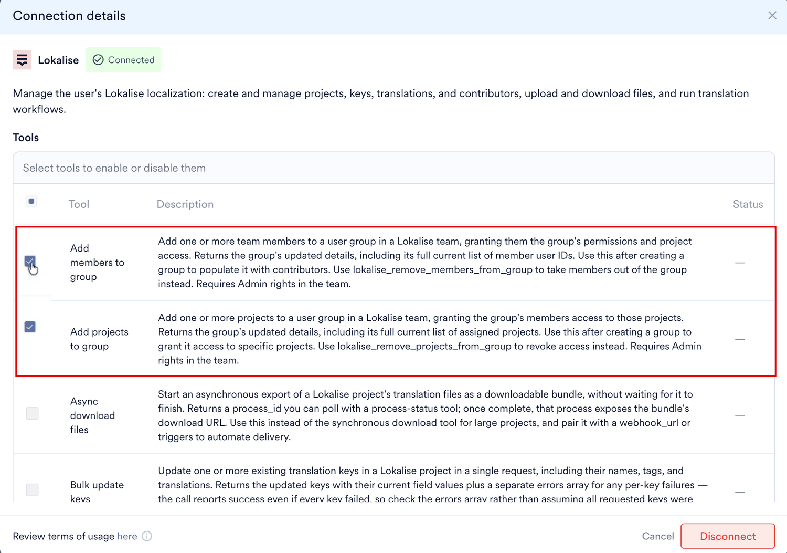
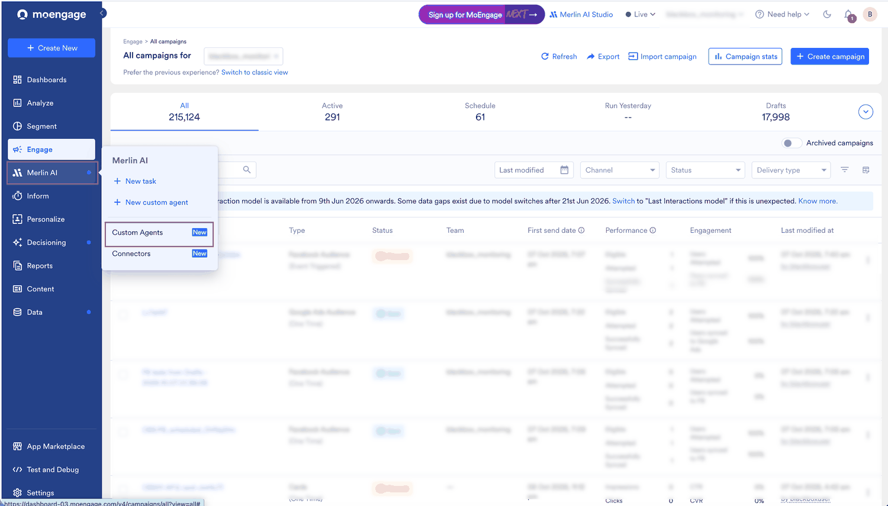

Lokalise は、アジャイルなチームが多言語コンテンツを管理するために使用する翻訳管理プラットフォームです。MoEngage でキャンペーンコンテンツを作成するチームは、そのコンテンツを Lokalise に移して翻訳し、ローカライズされた各キャンペーンを手作業で作り直しています。

Lokalise コネクタを使用すると、Custom Agents が Model Context Protocol (MCP) 経由で Lokalise アカウントにアクセスできるようになります。エージェントは翻訳が必要なコンテンツを見つけて Lokalise に送信し、翻訳を MoEngage に取り込んで、それをもとにキャンペーンを作成します。2 つのプラットフォーム間で API キーをやり取りする必要も、Lokalise にアプリをインストールする必要もありません。

<Note>
 Custom Agents と Connectors は現在 Early Access 機能です。ダッシュボードに **AI Agents** > **Connectors** が表示されない場合は、Customer Success Manager (CSM) にアクセスをリクエストしてください。
</Note>

MoEngage は、Lokalise の MoEngage アプリを通じても Lokalise と連携しています。このアプリは、保存済みのテンプレートを 2 つのプラットフォーム間で同期します。キャンペーンテンプレートを翻訳し、各言語を個別のテンプレートとして受け取りたい場合は、この方法を使用してください。[Lokalise](/ja/partner-guide/personalize-and-optimize/localization/lokalise) を参照してください。

## 概要

**Connectors** ページで Lokalise アカウントを一度接続すると、そのツールはあなたが実行するすべての Custom Agent で利用できるようになります。各ユーザーは自分の Lokalise アカウントを接続し、エージェントは実行を開始したユーザーのアカウントで動作します。

### 前提条件

開始する前に、次の点を確認してください。

* ワークスペースで Custom Agents と Connectors が有効になっていること。
* 使用する翻訳プロジェクトにアクセスできる、有効な Lokalise アカウントを持っていること。
* MoEngage のロールに、コンテンツブロックとキャンペーンを作成する権限が含まれていること。Custom Agent は、エージェントを実行するユーザーの MoEngage 権限の範囲内で動作します。[Custom Agent の基本: 権限とセキュリティ](/ja/user-guide/ai-and-intelligence/merlin-ai/custom-agents/custom-agents-essentials-permission-and-security)を参照してください。

### Lokalise API トークンを生成する

Lokalise を接続するには、Lokalise アカウントの個人用 API トークンが必要です。

1. Lokalise で、左下隅にあるアバターをクリックし、**Profile Settings** をクリックします。

   <Frame>
   
   </Frame>

2. **API tokens** をクリックします。
3. **Generate new token** をクリックします。
4. トークンをコピーします。

   <Frame>
   
   </Frame>

トークンは安全な場所に保管してください。トークンはこのページに一覧表示され、接続が不要になった場合はここで削除することもできます。

### Lokalise を MoEngage に接続する

1. MoEngage のサイドバーメニューで、Merlin AI メニュー項目  にカーソルを合わせます。**Merlin AI** メニューが表示されます。
2. **Connectors** をクリックします。

   <Frame>
   
   </Frame>

3. **Search** ボックスに `Lokalise` と入力します。
4. **Lokalise** カードをクリックします。**Connection details** ダイアログが表示されます。

   <Frame>
   
   </Frame>

5. Lokalise が提供するツールと利用規約を確認してから、**Connect** をクリックします。
6. **Merlin AI wants to connect to your Lokalise** ページで、**API Token** にトークンを貼り付けてから、**Connect** をクリックします。

   <Frame>
   
   </Frame>

7. 接続が確認されたらウィンドウを閉じ、MoEngage ダッシュボードに戻ります。

   <Frame>
   
   </Frame>

Lokalise が **Connected** に移動し、エージェントがそのツールを使用できることを確認するメッセージが表示されます。後で Lokalise を再度見つけるには、**Connected** フィルターまたは **Search** ボックスを使用します。

<Frame>

</Frame>

コネクタの動作全般、ツールごとの制御、利用規約については、[外部アプリを Custom Agents に接続する](/ja/user-guide/ai-and-intelligence/merlin-ai/connectors/connect-external-apps)を参照してください。

## ユースケース

マーケティングチームは MoEngage で 1 つの言語でコンテンツブロックを作成し、それを他の複数の言語でも必要とします。Lokalise にアクセスできる Custom Agent は、この作業をエンドツーエンドで処理します。

* **スケジュールされた翻訳の実行。** 前回の実行以降にチームが作成または編集したコンテンツブロックを、誰も 2 つのプラットフォーム間でファイルを移動することなく、スケジュールに従って翻訳します。
* **翻訳済みキャンペーンの自動作成。** 返された翻訳からキャンペーンを作成するため、手作業での作り直しを待つことなく、ローカライズされたキャンペーンをすぐに確認できます。
* **配信前のレビュー。** 翻訳済みのキャンペーンを下書きのままにしておくことで、ユーザーに届く前にマーケターが各キャンペーンを承認できます。
* **市場間での一貫した表現。** エージェントが書き戻すキーと翻訳を、翻訳者がすでに作業している同じ Lokalise プロジェクト内に保持します。

## ツール

Lokalise コネクタは、プロジェクト、キー、翻訳、コントリビューターに加え、ファイルのアップロードとダウンロード、翻訳ワークフローをカバーします。**Connection details** ダイアログには、コネクタが提供するすべてのツールが、その説明とステータス (**Enabled** または **Disabled**) とともに一覧表示されます。

| ツールグループ | エージェントによる活用方法 |
| --- | --- |
| プロジェクト | Lokalise アカウント内の翻訳プロジェクトを一覧表示し、その設定を読み取ります。 |
| キー | ソースコンテンツを保持する翻訳キーを読み取り、作成、更新します。 |
| 翻訳 | キーの翻訳値を読み取り、書き戻します。 |
| ファイル | プロジェクトにコンテンツをアップロードし、翻訳結果をダウンロードします。 |
| 翻訳ワークフロー | レビュー段階を通じてコンテンツを進める翻訳タスクを開始し、追跡します。 |
| コントリビューター | プロジェクトのコントリビューターと、それぞれに割り当てられた言語を読み取ります。 |

エージェントが呼び出せるツールを制御するには、次の手順に従います。

1. **Connectors** ページで **Lokalise** カードをクリックします。**Connection details** ダイアログに、すべてのツールがその説明とステータスとともに一覧表示されます。
2. 変更する各ツールの横にあるチェックボックスを選択します。
3. **Enable** または **Disable** をクリックします。選択した各ツールの **Status** 列が更新されます。

   <Frame>
   
   </Frame>

無効化が特に重要なのは、Lokalise のデータを読み取るのではなく変更するツールです。ツールのステータスは個々のエージェントではなくコネクタに属するため、あなたが実行するすべてのエージェントに適用され、ステータスはいつでも変更できます。[コネクタのツールを有効化または無効化する](/ja/user-guide/ai-and-intelligence/merlin-ai/connectors/connect-external-apps#enable-or-disable-a-connectors-tools)を参照してください。

## 使用例

接続したアプリケーションはあなたが実行するすべてのエージェントで利用できるため、Agent Builder で何かを紐付ける必要はありません。エージェントが Lokalise で何を行うかは、あなたが記述する指示によって決まります。

MoEngage のサイドバーメニューで、Merlin AI メニュー項目  にカーソルを合わせ、**Custom Agents** をクリックして、ゼロからエージェントを作成します。実行したい作業を説明し、Merlin AI からの質問に回答して、エージェントを実行するスケジュールを設定します。[Custom Agents を作成・管理する](/ja/user-guide/ai-and-intelligence/merlin-ai/custom-agents/create-and-manage-custom-agents)を参照してください。

<Frame>

</Frame>

### コンテンツブロックを翻訳してキャンペーンを作成する

次の指示は、コンテンツの検索からレビュー用のキャンペーンの準備まで、翻訳ワークフロー全体をカバーしています。

```text Agent Instruction
Every day, find the content blocks in my MoEngage workspace that are tagged English and
were created or updated in the last 24 hours, and send them to Lokalise for translation
into German. Keep a record of what you have already sent so that nothing is translated
twice. On each run, check whether the earlier Lokalise translations are complete. When they
are, bring the translated content back into MoEngage as content blocks, and create an
event-triggered push campaign for Android and iOS that targets users who viewed the web
page in the last 3 days. Leave new campaigns as drafts for review, update campaigns that
are still in draft, and flag live campaigns instead of changing them. Save a report of
each run.
```

エージェントは各実行で、名前ではなくタグでコンテンツブロックを見つけ、まだ送信していないものだけを送信し、翻訳の完了を待って、それらをコンテンツブロックとして書き戻し、キャンペーンを下書きとして作成します。

<Tip>
 対象言語、チャネル、そのチャネル内のプラットフォーム、オーディエンス、すでに配信中のキャンペーンの扱いなど、エージェントが推測できない詳細はすべて指定してください。指定しなかった内容はエージェントが省略するため、後で下書き上で修正することになります。
</Tip>

エージェントを本番稼働させる前に、自分のコンテンツで数回実行し、出力を信頼できるようになるまでキャンペーンを下書きのままにしておいてください。[エージェントをテストする](/ja/user-guide/ai-and-intelligence/merlin-ai/custom-agents/create-and-manage-custom-agents#test-agent)および[エージェントを本番稼働させる](/ja/user-guide/ai-and-intelligence/merlin-ai/custom-agents/create-and-manage-custom-agents#make-the-agent-live)を参照してください。

<Warning>
 MoEngage はコネクタによる書き込みを制限しません。Lokalise にアクセスするエージェントは Lokalise アカウント内のデータを変更できるため、エージェントが必要としない書き込みツールは無効にし、エージェントの指示にも同じルールを記載してください。
</Warning>

## 関連ページ

* [外部アプリを Custom Agents に接続する](/ja/user-guide/ai-and-intelligence/merlin-ai/connectors/connect-external-apps)
* [Smartling コネクタ](/ja/user-guide/ai-and-intelligence/merlin-ai/connectors/smartling)
* [Lokalise テンプレート同期](/ja/partner-guide/personalize-and-optimize/localization/lokalise)
* [Custom Agents: 概要](/ja/user-guide/ai-and-intelligence/merlin-ai/custom-agents/custom-agents-overview)
* [Custom Agents を作成・管理する](/ja/user-guide/ai-and-intelligence/merlin-ai/custom-agents/create-and-manage-custom-agents)
* [コンテンツブロック](/ja/user-guide/content/content-blocks/content-blocks)

## よくある質問

<AccordionGroup>
  <Accordion title="コネクタは Lokalise の MoEngage アプリとどう違いますか?">
    Lokalise の MoEngage アプリは、保存済みのテンプレートを 2 つのプラットフォーム間で同期するもので、各テンプレートを個別にインポート・エクスポートします。コネクタは Custom Agent に Lokalise アカウントへのアクセスを提供するため、エージェントが設定したスケジュールに従ってコンテンツを見つけて翻訳し、キャンペーンを作成します。[Lokalise](/ja/partner-guide/personalize-and-optimize/localization/lokalise) を参照してください。
  </Accordion>

  <Accordion title="Lokalise を接続すると、実行するすべてのエージェントが Lokalise にアクセスできますか?">
    はい。アプリケーションは一度接続すれば、あなたが実行するすべてのエージェントで利用可能になります。特定の実行で Lokalise を使用するかどうかは、エージェントの指示によって決まります。[Connectors の仕組み](/ja/user-guide/ai-and-intelligence/merlin-ai/connectors/connect-external-apps#how-connectors-work)を参照してください。
  </Accordion>

  <Accordion title="エージェントは誰の Lokalise アカウントを使用しますか?">
    実行を開始したユーザーのアカウントです。各チームメイトは自分の API トークンを生成し、**Connectors** ページで自分の Lokalise アカウントを接続するため、チームメイトがエージェントを実行すると、エージェントはそのチームメイトの Lokalise プロジェクトを扱います。
  </Accordion>

  <Accordion title="エージェントは Lokalise アカウント内のデータを変更できますか?">
    はい、Lokalise に書き込むツールが有効になっている場合は変更できます。MoEngage は、コネクタによる書き込みの前にあなたの承認を求めません。アクセスさせたくないツールは無効にし、それに合わせてエージェントの指示を記述してください。
  </Accordion>

  <Accordion title="実行中に Lokalise との接続が切れた場合はどうなりますか?">
    別のブラウザタブで **Connectors** ページを開いて Lokalise を再接続してから、同じセッションで次のメッセージを送信してください。エージェントがスキップしたステップがあれば、再試行させるためにそのステップを改めて指示してください。[実行中に再接続する](/ja/user-guide/ai-and-intelligence/merlin-ai/connectors/connect-external-apps#reconnect-during-a-run)を参照してください。
  </Accordion>
</AccordionGroup>
