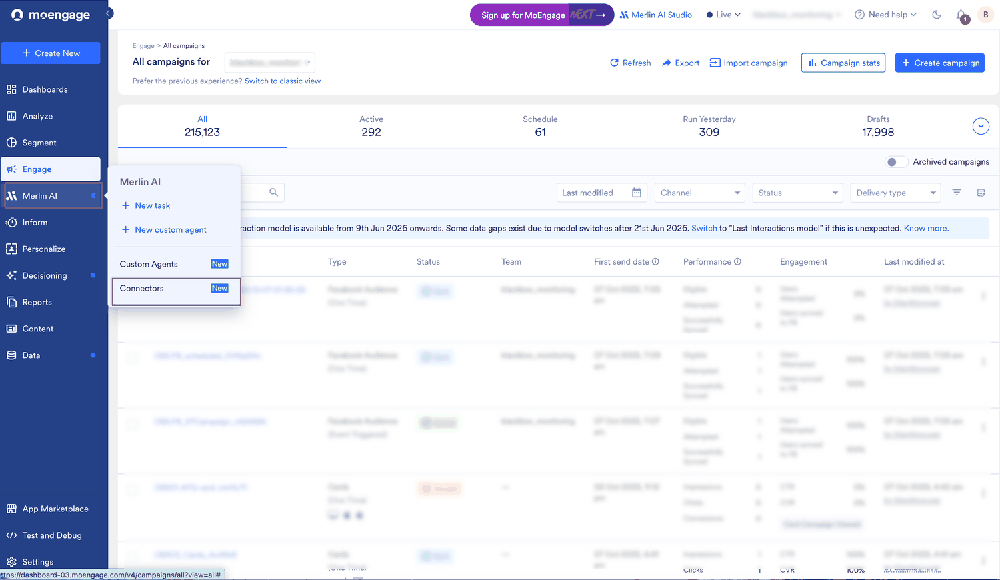
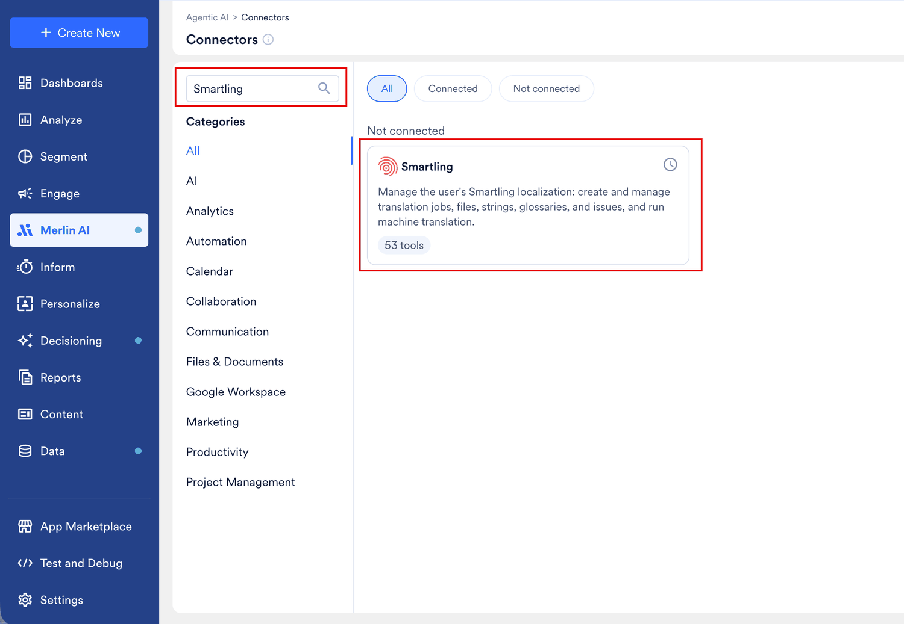
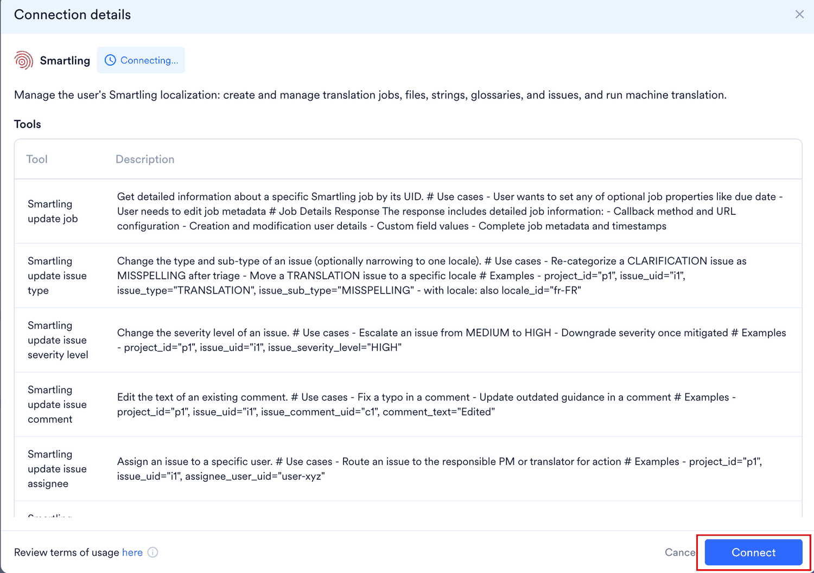
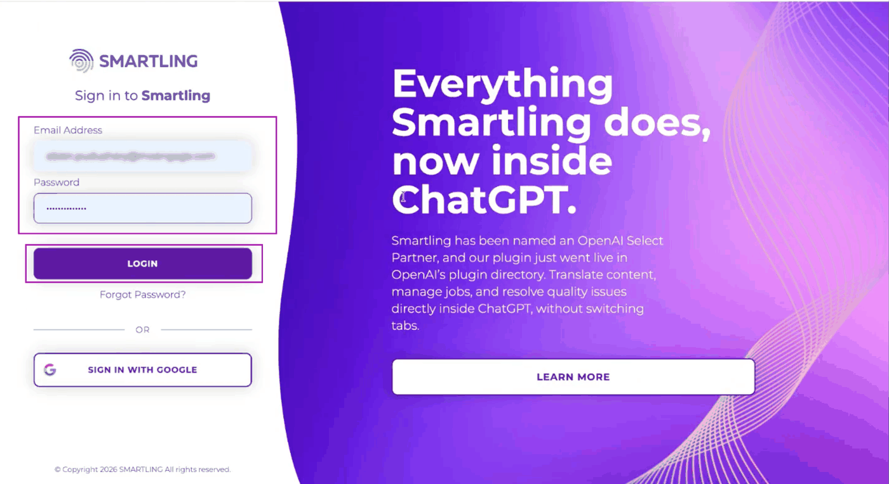
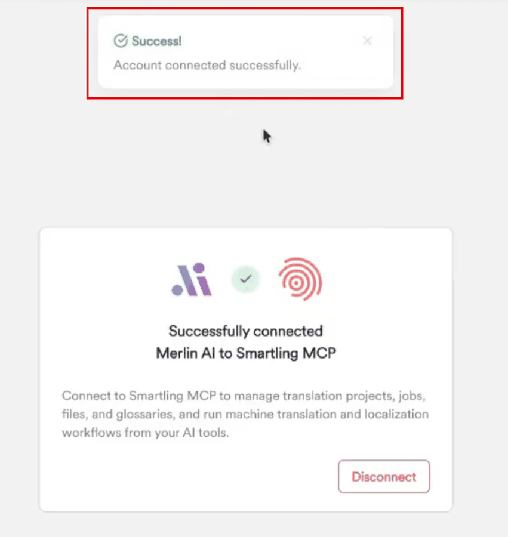
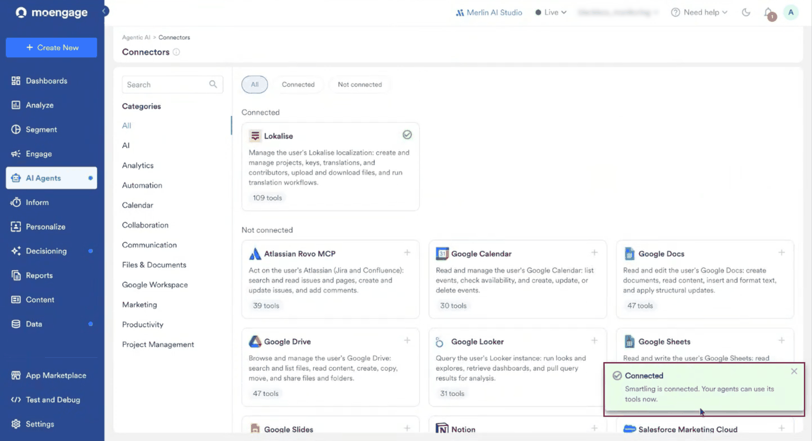
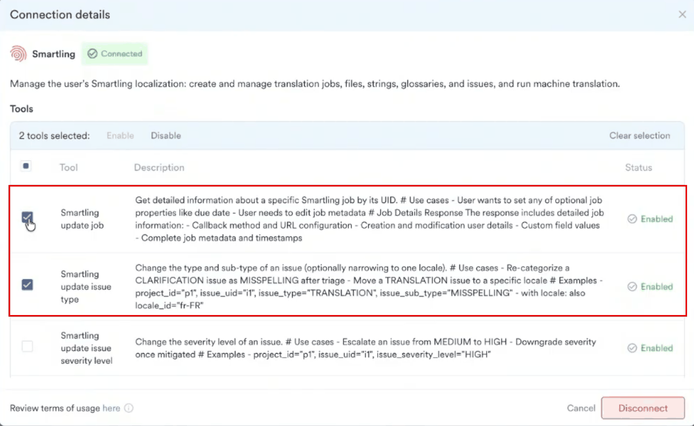

Smartling は、グローバルブランドが市場をまたいでコンテンツを展開するために使用している翻訳・ローカライゼーションプラットフォームです。MoEngage でキャンペーンのコンテンツを作成しているチームは、そのコンテンツを翻訳のために Smartling に移し、ローカライズされた各キャンペーンを手作業で作り直しています。

Smartling コネクタを使用すると、Custom Agents が Model Context Protocol (MCP) を介して Smartling アカウントにアクセスできるようになります。エージェントは翻訳が必要なコンテンツを見つけて Smartling に送信し、翻訳を MoEngage に取り込んで、そこからキャンペーンを作成します。フィールドごとに設定する統合や、維持が必要なファイル転送はありません。

<Note>
 Custom Agents と Connectors は現在 Early Access 機能です。ダッシュボードに **AI Agents** > **Connectors** が表示されない場合は、Customer Success Manager (CSM) にアクセスをリクエストしてください。
</Note>

## 概要

**Connectors** ページで Smartling アカウントを一度接続すると、そのツールを実行するすべての Custom Agent で利用できるようになります。各ユーザーは自分の Smartling アカウントを接続し、エージェントは実行を開始したユーザーのアカウントで動作します。

### 前提条件

開始する前に、次の点を確認してください。

* ワークスペースで Custom Agents と Connectors が有効になっている。
* 翻訳先のプロジェクトにアクセスできる、有効な Smartling アカウントを持っている。
* MoEngage のロールに、コンテンツブロックとキャンペーンを作成する権限が含まれている。Custom Agent は、エージェントを実行するユーザーの MoEngage 権限の範囲内で動作します。[Custom Agent の基本：権限とセキュリティ](/ja/user-guide/ai-and-intelligence/merlin-ai/custom-agents/custom-agents-essentials-permission-and-security)を参照してください。

### Smartling を MoEngage に接続する

1. MoEngage のサイドバーメニューで、Merlin AI メニュー項目  にカーソルを合わせます。**Merlin AI** メニューが表示されます。
2. **Connectors** をクリックします。

   <Frame>
   
   </Frame>

3. **Search** ボックスに `Smartling` と入力します。
4. **Smartling** カードをクリックします。**Connection details** ダイアログが表示されます。

   <Frame>
   
   </Frame>

5. Smartling が提供するツールと利用規約を確認し、**Connect** をクリックします。

   <Frame>
   
   </Frame>

6. Smartling のサインインページで、メールアドレスとパスワードを入力し、**LOGIN** をクリックします。

   <Frame>
   
   </Frame>

7. 接続が確認されたらウィンドウを閉じ、MoEngage ダッシュボードに戻ります。

   <Frame>
   
   </Frame>

Smartling が **Connected** に移動し、エージェントがそのツールを使用できることを確認するメッセージが表示されます。後で Smartling を再度見つけるには、**Connected** フィルターまたは **Search** ボックスを使用します。

<Frame>

</Frame>

コネクタの動作の詳細、ツールごとの制御、利用規約については、[Custom Agents への外部アプリの接続](/ja/user-guide/ai-and-intelligence/merlin-ai/connectors/connect-external-apps)を参照してください。

## ユースケース

マーケティングチームは MoEngage で 1 つの言語でコンテンツブロックを作成し、それを他の複数の言語でも必要とします。Smartling にアクセスできる Custom Agent は、この作業を最初から最後までカバーします。

* **スケジュールされた翻訳の実行。** 前回の実行以降にチームが作成または編集したコンテンツブロックを、誰も 2 つのプラットフォーム間でファイルを移動することなく、スケジュールに従って翻訳します。
* **翻訳済みキャンペーンの自動作成。** 返された翻訳からキャンペーンを作成するため、ローカライズされたキャンペーンを手作業で作り直すのを待つことなく、すぐにレビューできます。
* **配信前のレビュー。** 翻訳済みのキャンペーンを下書きのままにしておくことで、マーケターがユーザーに届く前に各キャンペーンを承認できます。
* **実行間での翻訳作業の追跡。** すでに Smartling に送信した内容を記録しておくことで、同じコンテンツが二重に送信され、二重に費用が発生することを防ぎます。

## ツール

Smartling コネクタは、翻訳ジョブ、ファイル、文字列、用語集、課題に加えて、機械翻訳をカバーします。**Connection details** ダイアログには、コネクタが提供するすべてのツールが、説明とステータス (**Enabled** または **Disabled**) とともに一覧表示されます。

| ツールグループ | エージェントが行うこと |
| --- | --- |
| 翻訳ジョブ | 翻訳ジョブを作成し、コンテンツを追加して、ジョブが完了したかどうかを確認します。 |
| ファイル | Smartling プロジェクトにコンテンツをアップロードし、翻訳結果をダウンロードします。 |
| 文字列 | 個々のソース文字列とその翻訳を読み取り、送信します。 |
| 用語集 | 言語間で製品やブランドの表現の一貫性を保つための用語集の用語を読み取ります。 |
| 課題 | 翻訳者が文字列に対して起票した課題を読み取り、課題を起票します。 |
| 機械翻訳 | 人による翻訳が不要な場合に機械翻訳を返します。 |

エージェントが呼び出せるツールを制御するには、次の手順を実行します。

1. **Connectors** ページで **Smartling** カードをクリックします。**Connection details** ダイアログに、すべてのツールが説明とステータスとともに一覧表示されます。
2. 変更する各ツールの横にあるチェックボックスを選択します。
3. **Enable** または **Disable** をクリックします。選択した各ツールの **Status** 列が更新されます。

   <Frame>
   
   </Frame>

無効化が最も重要になるのは、Smartling のデータを読み取るのではなく変更するツールです。ツールのステータスは個々のエージェントではなくコネクタに属するため、実行するすべてのエージェントに適用されます。ステータスはいつでも変更できます。[コネクタのツールを有効化または無効化する](/ja/user-guide/ai-and-intelligence/merlin-ai/connectors/connect-external-apps#enable-or-disable-a-connectors-tools)を参照してください。

## 使用例

接続したアプリケーションは実行するすべてのエージェントで利用できるため、Agent Builder で何かをアタッチする必要はありません。エージェントが Smartling で何を行うかは、作成した指示によって決まります。

MoEngage のサイドバーメニューで、Merlin AI メニュー項目  にカーソルを合わせ、**Custom Agents** をクリックして、ゼロからエージェントを作成します。実行したいジョブを記述し、Merlin AI からの質問に回答して、エージェントを実行するスケジュールを設定します。[Custom Agents の作成と管理](/ja/user-guide/ai-and-intelligence/merlin-ai/custom-agents/create-and-manage-custom-agents)を参照してください。

### コンテンツブロックを翻訳してキャンペーンを作成する

次の指示は、コンテンツの検索からレビュー可能なキャンペーンの準備まで、翻訳ワークフロー全体をカバーします。

```text Agent Instruction
Every day, find the content blocks in my MoEngage workspace that are tagged English and
were created or updated in the last 24 hours, and submit them to Smartling for translation
into German. Keep a record of what you have already submitted so that nothing is translated
twice. On each run, check whether the earlier Smartling jobs are complete. When they are,
bring the translated content back into MoEngage as content blocks, and create an
event-triggered push campaign for Android and iOS that targets users who viewed the web
page in the last 3 days. Leave new campaigns as drafts for review, update campaigns that
are still in draft, and flag live campaigns instead of changing them. Save a report of
each run.
```

各実行で、エージェントは名前ではなくタグでコンテンツブロックを見つけ、以前に送信していないものだけを送信し、Smartling がジョブを完了としてマークするのを待ってから、翻訳をコンテンツブロックとして書き戻し、キャンペーンを下書きとして作成します。

<Tip>
 対象言語、チャネル、そのチャネル内のプラットフォーム、オーディエンス、すでにライブになっているキャンペーンの扱いなど、エージェントが推測できない詳細はすべて指定してください。指定しなかった内容はエージェントが省略するため、後で下書き上で修正することになります。
</Tip>

エージェントをライブにする前に、自社のコンテンツに対して何度か実行し、出力を信頼できるようになるまでキャンペーンを下書きのままにしておいてください。[エージェントをテストする](/ja/user-guide/ai-and-intelligence/merlin-ai/custom-agents/create-and-manage-custom-agents#test-agent)と[エージェントをライブにする](/ja/user-guide/ai-and-intelligence/merlin-ai/custom-agents/create-and-manage-custom-agents#make-the-agent-live)を参照してください。

<Warning>
 MoEngage は、コネクタによる書き込みを制限しません。Smartling にアクセスするエージェントは Smartling アカウントのデータを変更できるため、エージェントに不要な書き込みツールは無効にし、同じルールをエージェントの指示にも記述してください。
</Warning>

## 関連ページ

* [Custom Agents への外部アプリの接続](/ja/user-guide/ai-and-intelligence/merlin-ai/connectors/connect-external-apps)
* [Lokalise コネクタ](/ja/user-guide/ai-and-intelligence/merlin-ai/connectors/lokalise)
* [Custom Agents：概要](/ja/user-guide/ai-and-intelligence/merlin-ai/custom-agents/custom-agents-overview)
* [Custom Agents の作成と管理](/ja/user-guide/ai-and-intelligence/merlin-ai/custom-agents/create-and-manage-custom-agents)
* [Custom Agent の基本：権限とセキュリティ](/ja/user-guide/ai-and-intelligence/merlin-ai/custom-agents/custom-agents-essentials-permission-and-security)
* [コンテンツブロック](/ja/user-guide/content/content-blocks/content-blocks)

## よくある質問

<AccordionGroup>
  <Accordion title="Smartling 用に別途 MoEngage の統合が必要ですか?">
    いいえ。Smartling は **Connectors** ページでコネクタとして接続され、その接続が統合になります。Smartling へのサインイン以外に、インストールするアプリや 2 つのプラットフォーム間で交換する認証情報はありません。
  </Accordion>

  <Accordion title="Smartling を接続すると、実行するすべてのエージェントが Smartling にアクセスできますか?">
    はい。アプリケーションを一度接続すると、実行するすべてのエージェントで利用できるようになります。特定の実行で Smartling を使用するかどうかは、エージェントの指示によって決まります。[Connectors の仕組み](/ja/user-guide/ai-and-intelligence/merlin-ai/connectors/connect-external-apps#how-connectors-work)を参照してください。
  </Accordion>

  <Accordion title="エージェントは誰の Smartling アカウントを使用しますか?">
    実行を開始したユーザーのアカウントです。各チームメイトが **Connectors** ページで自分の Smartling アカウントを接続するため、チームメイトがエージェントを実行すると、エージェントはそのチームメイトの Smartling プロジェクトで動作します。
  </Accordion>

  <Accordion title="エージェントは Smartling アカウントのデータを変更できますか?">
    はい、Smartling に書き込むツールが有効になっている場合は変更できます。MoEngage は、コネクタによる書き込みの前に承認を求めません。アクセスさせたくないツールは無効にし、それに合わせてエージェントの指示を記述してください。
  </Accordion>

  <Accordion title="実行中に Smartling との接続が切れた場合はどうなりますか?">
    別のブラウザタブで **Connectors** ページから Smartling を再接続し、同じセッションで次のメッセージを送信します。エージェントがスキップしたステップがあれば、再試行されるようにそのステップをもう一度指示してください。[実行中に再接続する](/ja/user-guide/ai-and-intelligence/merlin-ai/connectors/connect-external-apps#reconnect-during-a-run)を参照してください。
  </Accordion>
</AccordionGroup>
