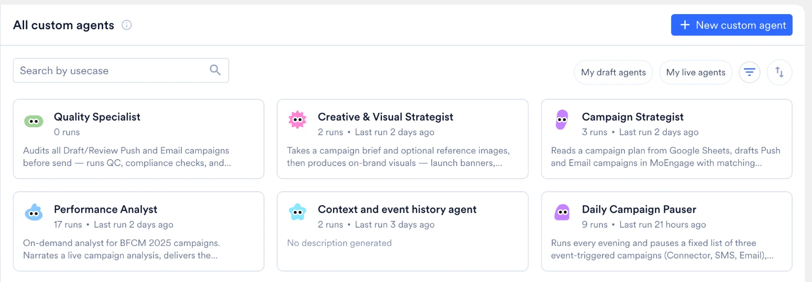

import { AcademyCourse } from "/snippets/academy-course.jsx";

<AcademyCourse
  title="Custom Agents 学習パス"
  href="https://academy.moengage.com/student/path/3637990-custom-agents-learning-path" />

## 概要

Merlin AI を使用すると、コードを書いたりエンジニアリングのサポートを受けたりすることなく、MoEngage 内でカスタム AI エージェントを構築してデプロイできます。これらのエージェントは、反復的で時間のかかるキャンペーンタスクを自動化し、チームが戦略に集中できるようにします。

<Note>
探索的な作業には、MoEngage が構築・管理している、すぐに使えるエージェントである Global Agent を使用してください。どちらのエージェントファミリーも同じタスクリストを共有します。詳細については、[Global Agent：概要](/ja/user-guide/ai-and-intelligence/merlin-ai/global-agent/global-agent-overview)を参照してください。
</Note>

## ユースケース

Custom Agents の一般的なユースケースは次のとおりです。

- **品質管理（QC）：** キャンペーンの下書きにエラーや不整合がないか監査します。
- **ローカライゼーション：** 言語の一括翻訳を実行します。
- **データ分析：** 自動化されたマーケティングアナリストとしてキャンペーンデータを処理します。
- **キャンペーンの下書き作成：** クリエイティブブリーフに基づいて新しいキャンペーンの下書きを生成します。
- **パフォーマンス監査：** 過去のキャンペーン指標を確認して、成果の高いキャンペーンと低いキャンペーンを明らかにします。

## Custom Agents のメリット

Custom Agents をマーケティング戦略に組み込むことで、次のメリットが得られます。

- **ワークフローの自動化：** キャンペーンをまたがる定型タスク（QA、下書き作成、ローカライゼーションなど）を実行し、手作業をなくします。
- **ネイティブ統合：** ライブのキャンペーンデータやセグメントデータを MoEngage 内で直接処理し、サードパーティの AI によるセキュリティリスクを回避します。
- **プレーンテキストによる設定：** プレーンテキストを使用してエージェントの動作を定義します。定義済みのテンプレートから始めることも、カスタムのユースケースには Merlin Agent Builder を使用することもできます。
- **安全な実行：** 厳格な読み取り/書き込みの境界を適用します。書き込みが有効なエージェントは下書きの作成に制限され、キャンペーンを自動公開することはできません。
- **ワークスペースでのコラボレーション：** エージェントの設定をチームに公開して共有できます。パブリックエージェントの実行履歴はワークスペース全体で表示でき、制限されるのは自分が開始していないセッションを継続することのみです。
- **非同期実行：** アクティブなセッションウィンドウを開いたままにすることなく、複雑でデータ量の多いタスクをバックグラウンドで実行できます。
- **永続的なセッション：** ワークフローはいつでも一時停止して再開できます。各セッションは、以前のプロンプト、ツールの出力、添付ファイルの完全なコンテキストを保持し、エージェントは自身のメモリストアとワークスペースのメモリストアに実行間で事実を保持します。
- **スケジュール実行：** エージェントを定期的なスケジュール（毎日、毎週、または毎月）で自動実行するように設定し、スケジュールされた実行が完了または失敗したときにメールを受け取ることができます。このメールには、実行の結果、Task ID、実行日、所要時間、次回の実行時刻が記載されます。メールは、エージェントの **Email** トグルでオフにできます。
- **サマリーメール：** タスクが生成した内容のサマリーメールを最大 5 件の添付ファイル付きでリクエストできるため、無人で実行されるタスクの結果を受信トレイに報告させることができます。[サマリーメールを送信する](/ja/user-guide/ai-and-intelligence/merlin-ai/custom-agents/create-and-manage-custom-agents#send-summary-emails)を参照してください。
- **柔軟なモデルティア：** 各エージェントのタスクの複雑さに合わせて、モデルの機能ティア（Fast、Balanced、Expert）を選択できます。
- **マルチエージェントによる委任：** 既存のエージェントをサブエージェントとして 1 つのコーディネーターエージェントにアタッチすることで、1 つのセッションで複数ステップのワークフローを専門エージェントに分散し、結果を統合できます。
- **外部アプリケーション：** MoEngage 外部のアプリケーションを接続することで、実行するエージェントが 1 回の実行でキャンペーンデータとあわせてそれらのアプリケーションを利用できます。**Connectors** ページには、ワークスペースで利用可能なアプリケーションが一覧表示されます。[Custom Agents への外部アプリの接続](/ja/user-guide/ai-and-intelligence/merlin-ai/connectors/connect-external-apps)と、実際の例として [Custom Agents を使用して Figma のデザインを MoEngage にインポートする](/ja/user-guide/ai-and-intelligence/merlin-ai/connectors/figma)を参照してください。
- **クリエイティブの生成：** 実行中にテキストプロンプトからキャンペーンのクリエイティブを生成し、別の画像分析ツールを使用してそれらを確認できます。

## スコープと機能

各 Custom Agent は、特定の単一目的のタスク向けに設計されています。エージェントの機能のスコープは、設定時に割り当てたツールと権限によって厳密に定義されます。エージェントが実行するアクションは、割り当てたツールによって決まります。ツールの割り当ての詳細については、[ツールの割り当て](/ja/user-guide/ai-and-intelligence/merlin-ai/custom-agents/create-and-manage-custom-agents#assign-tools)を参照してください。 

## Custom Agents ダッシュボードの操作

次のいずれかの方法で **All custom agents** ページにアクセスします。

- 左側のメニューで **Merlin AI** にカーソルを合わせ、**Custom Agents** をクリックします。
- **Merlin AI Agents** ハブの左ペインで、**Custom agents** の横にある **View all** をクリックします。

このページから、ワークスペース内のすべての Custom Agent を作成、検索、管理し、開くことができます。

<Frame>
 
</Frame>

### ダッシュボードのインターフェース要素

このページには、エージェントを見つけて評価するための次の機能があります。

- **Search by usecase：** 名前でエージェントを検索します。
- **My draft agents：** まだ作成中で公開されていない自分のエージェントを表示します。
- **My live agents：** 公開済みで実行できる自分のエージェントを表示します。
- **More filters：** フィルターアイコンをクリックすると、**Triggers**（**Manual** と **Scheduled**）と **Visibility**（**Public** と **Private**）を含むパネルが開きます。**Apply** をクリックして選択内容を適用するか、**Reset all** をクリックしてパネルをクリアします。
- **Sort：** 並べ替えアイコンで、カードを **Newest first**、**Oldest first**、**Most runs** の順に並べ替えます。
- **エージェントカード：** 各カードには、エージェントのアイコン、名前、短い説明が表示されます。説明がない場合は **No description generated** と表示されます。ライブのエージェントには実行回数も表示され、実行後は最後に実行されてからの経過時間も表示されます。下書きのエージェントには、実行の詳細の代わりに **Draft** と表示されます。
- **+ New custom agent：** テンプレートギャラリーを開きます。ここでテンプレートを選択するか、**Create from scratch** を選択してビルダーを開きます。

## よくある質問

<AccordionGroup>
  <Accordion title="ダッシュボードに表示されているエージェントを実行できないのはなぜですか？">
    エージェントが My draft agents フィルターに表示されている場合、そのエージェントは本番利用向けにまだ公開されていません。有効にするには、エージェントカードをクリックしてビルダーを直接開き、Test agent パネルを使用して動作を確認してから、**Make live** をクリックします。
  </Accordion>
</AccordionGroup>

## 次のステップ

Custom Agents の基本的な概念と機能を理解したら、次のガイドを参照してワークスペースへの実装を始めてください。

- [Custom Agents の作成と管理](/ja/user-guide/ai-and-intelligence/merlin-ai/custom-agents/create-and-manage-custom-agents)
- [エージェントセッションの実行と管理](/ja/user-guide/ai-and-intelligence/merlin-ai/custom-agents/run-and-manage-agent-sessions)
- [Custom Agent の基本：権限とセキュリティ](/ja/user-guide/ai-and-intelligence/merlin-ai/custom-agents/custom-agents-essentials-permission-and-security)
- [マルチエージェントワークフローの構築](/ja/user-guide/ai-and-intelligence/merlin-ai/custom-agents/build-multi-agent-workflows)
- [Custom Agents への外部アプリの接続](/ja/user-guide/ai-and-intelligence/merlin-ai/connectors/connect-external-apps)

Copywriter、Designer、Segmentation Assist などの単一目的のジェネレーターについては、[Merlin AI Studio](/ja/user-guide/ai-and-intelligence/merlin-ai/merlin-ai-studio) を参照してください。

スケジュールされた実行やマルチエージェントワークフローを含むすべてのエージェントの実行で、ワークスペースの月間残高から MoEngage AI Credits が消費されます。詳細については、[Merlin AI の使用量](/ja/user-guide/settings/account/billing/merlin-ai-usage)を参照してください。
