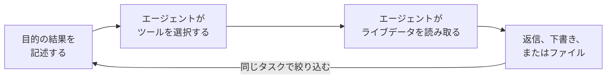
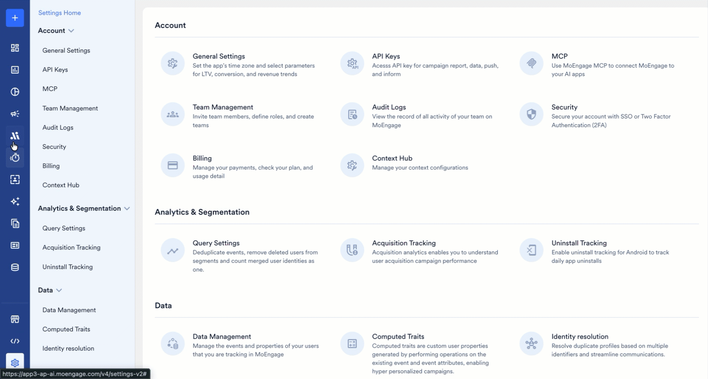
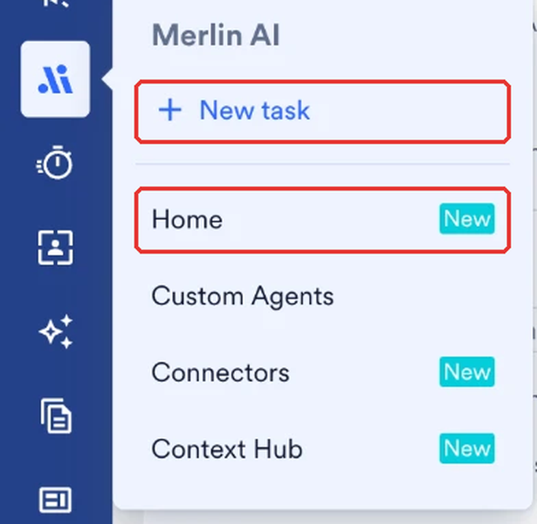

## 概要

<Note>
Global Agent は Early Access 機能です。ダッシュボードに Global Agent が表示されない場合は、カスタマーサクセスマネージャー（CSM）にアクセスをリクエストしてください。
</Note>

Global Agent は、MoEngage が構築・管理している Merlin AI エージェントです。Global Agent はプラットフォーム全体で 1 つの共有エージェントとして機能し、ワークスペース内のすべてのユーザーが利用できます。最初のタスクを実行する前に設定を行う必要はありません。

Global Agent は、目的の結果を平易な言葉で記述した説明を受け付けます。その説明から、Global Agent は読み取る MoEngage データを選択し、実行するツールを選び、出力を生成します。Global Agent が実行する各タスクは、ご自身のワークスペースのキャンペーン、セグメント、コンテンツ、分析に限定されます。[Custom Agents](/ja/user-guide/ai-and-intelligence/merlin-ai/custom-agents/custom-agents-overview) も同じエージェントリストに表示され、同じタスクリストを共有します。

この記事では、Global Agent がカバーする機能とユースケース、Global Agent がタスクを処理する方法、ワークスペースで Global Agent にアクセスする場所、適用される権限と利用可能性について説明します。

## 機能とユースケース

Global Agent は、ダッシュボードの複数の画面にまたがる作業や、まだ反復可能なプロセスとして形にしている途中の作業に適しています。

- **オーディエンスとセグメンテーション：** ターゲティングに関する質問を保存済みのセグメントに変換し、セグメントのサイズと到達可能性を報告します。キャンペーンを確定する前に、条件に一致するユーザー数を確認し、サイズが計画と一致したらセグメントを保存できます。
- **キャンペーンの作成：** 1 回限り、定期、イベントトリガー、ビジネスイベントトリガーを含む Push とメールの下書きを、A/B バリエーションとロケール付きで作成します。オーディエンス、チャネル、メッセージを記述し、キャンペーンビルダーで下書きを確認できます。SMS の下書きには、SMS キャンペーンの作成が有効になっている必要があります。
- **コンテンツとクリエイティブ：** パーソナライズされたコピー、メール HTML、フォールバック付きの Jinja トークン、ロケール、コンテンツブロックを作成します。自社のスタイルで Push のコピーを作成したり、送信先のすべてのロケールで同じメッセージを作成したりできます。
- **品質管理：** キャンペーン、下書き、Flow を監査し、go、go with fixes、no-go のいずれかの判定を返します。キャンペーンを送信する前に、オーディエンス、リンク、ロケールの整合性、配信設定を確認できます。
- **キャンペーンの検索とレポート：** チャネルをまたいでキャンペーンを検索し、特定の期間、期間ごとの比較、または反復可能なダイジェストについてレポートします。先週の Push とメールの結果を前の週と比較し、キャンペーンレポートを 1 つずつ確認する代わりに、1 つの返信で数値を確認できます。
- **分析と診断：** 行動、ファネル、リテンション、ユーザーの分析を実行します。送信後に開封率が低下した理由を尋ねると、エージェントは送信からインプレッション、クリック、コンバージョンへとファネルをたどり、数値が変化した箇所を報告します。
- **Flows：** Flow の構造を読み取り、トリップ数、エンゲージ対コントロール、コンバージョンを報告します。Flow を変更する前に、ライブの Flow のパフォーマンスを確認できます。Flow の作成は Flow ビルダーで行います。

エージェントは、件数と比率をコードで計算し、返信を送信する前に下書きの返信をそれらの数値と照合するよう指示されています。この確認によって誤った数値は減りますが、なくなるわけではないため、意思決定に関わる数値は必ず検証してください。

最初のタスクを開始するには、[Global Agent でタスクを実行する](/ja/user-guide/ai-and-intelligence/merlin-ai/global-agent/run-tasks-with-the-global-agent)を参照してください。

## Global Agent の仕組み

各タスクは同じサイクルに従い、同じタスクで別のメッセージを送信することでサイクルを繰り返します。

1. **目的の結果を記述します。** 必要な内容、期間、関係するチャネルやキャンペーンを記述します。
2. **エージェントがツールを選択します。** エージェントはリクエストを読み取り、クエリする MoEngage データを決定します。そのため、機能やレポートの種類を選択するのではなく、目的の結果を記述します。
3. **エージェントがライブデータを読み取ります。** エージェントは、リクエストされた時点でキャンペーンのステータス、オーディエンス数、パフォーマンスの数値を参照するため、返信にはワークスペースの現在の状態が反映されます。
4. **エージェントが作業結果を返します。** タスク内の返信、ビルダー内のキャンペーンの下書き、またはタスクからダウンロードするファイルとして返されます。

<Frame>
  
</Frame>

タスク内では、エージェントはそれまでのすべてのメッセージと結果を記憶しているため、新しい質問はそれぞれ以前の返信を踏まえたものになり、背景を繰り返し説明する必要はありません。タスク間では、エージェントはワークスペースメモリを利用します。詳細については、[Global Agent のメモリ](/ja/user-guide/ai-and-intelligence/merlin-ai/global-agent/run-tasks-with-the-global-agent#global-agent-memory)を参照してください。

## Global Agent にアクセスする

左側のメニューで **Merlin AI** にカーソルを合わせます。Global Agent にアクセスできる項目は 2 つあり、どちらも **Merlin AI Agents** ハブを開きます。

- **New task** は、作業内容を記述するコンポーザーを開きます。
- **Home** は、カスタムエージェント、最近のタスク、利用可能なテンプレートが一覧表示されるハブを開きます。

すべてのタスクは 1 つのエージェントで実行されるため、最初のメッセージを送信する前にエージェントを選択してください。

<Frame>
  
</Frame>

ご自身のタスクと同僚のタスクは同じタスクリストに表示され、そこでタスクのフィルタリング、検索、ピン留め、再オープンを行えます。詳細については、[Global Agent のタスクを管理・共有する](/ja/user-guide/ai-and-intelligence/merlin-ai/global-agent/manage-and-share-global-agent-tasks)を参照してください。

## 権限と安全対策

Global Agent はワークスペースに書き込みを行います。指示に応じて、エージェントは次のことを行います。

- **キャンペーンの下書きを作成・編集します。**
- **既存のキャンペーンや Flow のステータスを変更します。** エージェントは、キャンペーンの一時停止、再開、停止、および Flow の一時停止、再開、停止、リタイア、アーカイブを行います。
- **コンテンツを作成します。** エージェントは、テストメッセージを送信し、コンテンツブロック、メールテンプレート、カタログアイテムを作成します。

次の 2 つのステップはユーザー自身が行います。

- **キャンペーンの公開：** エージェントはキャンペーンを公開しないよう指示されているため、標準の MoEngage キャンペーンビルダーから公開します。
- **クリエイティブの承認：** エージェントは、生成したクリエイティブを、ユーザーが承認した後にのみ公開するよう指示されています。公開すると、画像は恒久的なパブリック URL でワークスペースのライブラリに追加されるため、画像を公開しても問題ない場合にのみクリエイティブを承認してください。

タスクは実行されているワークスペースのみを読み取るため、データはそのワークスペース内にとどまります。

権限とガバナンスのモデルの詳細については、[Custom Agent の基本：権限とセキュリティ](/ja/user-guide/ai-and-intelligence/merlin-ai/custom-agents/custom-agents-essentials-permission-and-security)を参照してください。

## 利用可能性

Global Agent は Early Access 機能であり、MoEngage はワークスペースごとに Global Agent を有効にします。ワークスペースがアクセス権を取得すると、すぐに Global Agent がエージェントリストに表示されます。アクセスをリクエストするには、MoEngage のカスタマーサクセスマネージャー（CSM）に連絡するか、[サポートチケットを作成](/ja/user-guide/contact-support/raise-a-support-ticket-through-moengage-dashboard)してください。

利用できる機能は、ワークスペースで有効になっているツールにも左右されるため、このページに記載されている機能がワークスペースで有効になっていない場合があります。

## よくある質問

<AccordionGroup>
  <Accordion title="タスクの実行中、ダッシュボードを開いたままにしておく必要がありますか？">
    タスクはバックグラウンドで実行されます。ダッシュボードの別の場所で作業し、後でタスクに戻ることができます。実行中のタスクには点滅するドットが表示され、未読のタスクにはオレンジ色のドットが表示されます。
  </Accordion>

  <Accordion title="Global Agent にキャンペーンを公開してもらうことはできますか？">
    エージェントはキャンペーンを下書きとして準備し、公開しないよう指示されています。公開は、標準の MoEngage キャンペーンビルダーでユーザーが行うステップです。
  </Accordion>

  <Accordion title="Global Agent で実行したタスクは誰が閲覧できますか？">
    Global Agent のタスクはデフォルトでワークスペースに公開されており、タスクの所有者はいつでもタスクの公開範囲を変更できます。詳細については、[タスクの公開範囲を変更する](/ja/user-guide/ai-and-intelligence/merlin-ai/global-agent/manage-and-share-global-agent-tasks#change-task-visibility)を参照してください。
  </Accordion>

  <Accordion title="同僚が開始したタスクを続行できますか？">
    同僚のタスクは、トランスクリプトやタスクの出力を含めてすべて閲覧できます。会話を続行するのはタスクの所有者です。
  </Accordion>

  <Accordion title="タスクはどのくらいの期間利用できますか？">
    MoEngage はすべてのタスクとその出力ファイルを保持し、自動的にアーカイブすることはありません。タスクは最後のアクティビティから 30 日間再開できます。30 日が経過した後もタスクは閲覧できますが、作業を続けるには新しいタスクを開始します。アーカイブされたタスクは復元すると開けるようになり、Custom Agent が削除されると、そのタスクはタスクリストに表示されなくなります。
  </Accordion>

  <Accordion title="タスクにはどのモードを選択すればよいですか？">
    各タスクは **Fast**、**Balanced**、**Expert** のいずれかのモードで実行され、デフォルトは **Balanced** です。タスクに必要な推論のレベルに合ったモードを選択してください。Global Agent ではタスクごとにモードを設定し、Custom Agent ではエージェント側でモードを設定します。
  </Accordion>
</AccordionGroup>

## 次のステップ

<CardGroup cols={3}>
  <Card title="最初のタスクを実行する" icon="play" href="/ja/user-guide/ai-and-intelligence/merlin-ai/global-agent/run-tasks-with-the-global-agent">
    タスクを開始し、ファイルを添付し、モードを選択して、エージェントが生成する出力ファイルを確認します。
  </Card>
  <Card title="タスクを管理・共有する" icon="list-check" href="/ja/user-guide/ai-and-intelligence/merlin-ai/global-agent/manage-and-share-global-agent-tasks">
    タスクリストのフィルタリング、タスクのピン留めと名前の変更、タスクの閲覧者の管理、不要になったタスクのアーカイブを行います。
  </Card>
  <Card title="Custom Agent を構築する" icon="wrench" href="/ja/user-guide/ai-and-intelligence/merlin-ai/custom-agents/custom-agents-overview">
    繰り返し行う作業を、独自の指示、ツール、スケジュールを持つエージェントに変換します。
  </Card>
</CardGroup>
