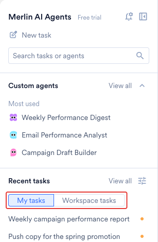
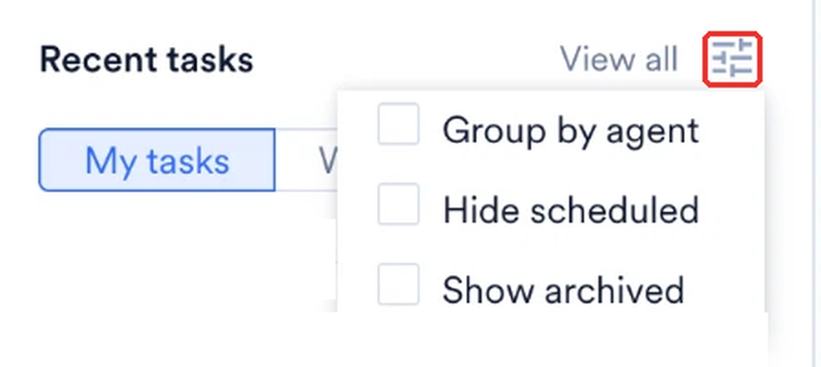
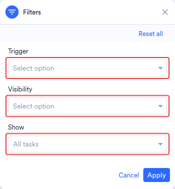

<Note>
**前提条件**

開始する前に、次の点を確認してください。
- ワークスペースが Global Agent にアクセスできる。詳細については、[Global Agent：概要](/ja/user-guide/ai-and-intelligence/merlin-ai/global-agent/global-agent-overview#availability)を参照してください。
- 少なくとも 1 つのタスクを実行している。詳細については、[Global Agent でタスクを実行する](/ja/user-guide/ai-and-intelligence/merlin-ai/global-agent/run-tasks-with-the-global-agent)を参照してください。
</Note>

## 最近のタスク

**Merlin AI Agents** ハブの左ペインにある **Recent tasks** で、2 つのタブを切り替えます。各タスクは、いずれか 1 つのタブにのみ表示されます。

| | My tasks | Workspace tasks |
| :--- | :--- | :--- |
| **タブに表示される内容** | ワークスペースに公開されているか自分だけに表示されるかにかかわらず、自分が開始したすべてのタスク | 同僚が開始したタスクのうち、閲覧権限があるもの |
| **対象となるエージェントファミリー** | Global Agent と Custom Agent の実行 | Global Agent と Custom Agent の実行 |
| **表示時の状態** | タスクを開くまでは未読 | 同僚がすでにタスクを実行しているため既読 |
| **タスクメニューのアクション** | **Copy link**、**Rename**、**Pin**、**Archive**、**Visible to workspace** スイッチ | **Copy link** と **Pin** |

**Copy link** は、タスクがワークスペースに公開されると利用可能になります。

同僚のタスクは、次のいずれかの場合に **Workspace tasks** に表示されます。

- タスクが Global Agent のタスクであり、タスクの所有者がタスクをワークスペースに公開したままにしている場合。
- タスクが、ワークスペースでパブリックとして公開されている Custom Agent の実行である場合。Custom Agent の実行の場合、同僚に実行が表示されるかどうかはエージェントの公開範囲によって決まります。

<Frame>
  
</Frame>

リストの各列に表示される内容については、[All tasks の列](/ja/user-guide/ai-and-intelligence/merlin-ai/global-agent/run-tasks-with-the-global-agent#all-tasks-columns)を参照してください。

### タスクリストの表示を変更する

**Recent tasks** の横にある表示オプションアイコンを選択して、左ペインに表示される内容を変更します。

| オプション | 効果 |
| :--- | :--- |
| **Group by agent** | 各タスクを実行したエージェントごとにリストをグループ化します。各エージェントグループは折りたたむことができます。 |
| **Hide scheduled** | スケジュールされた Custom Agent の実行をリストから除外します。 |
| **Show archived** | リストをアーカイブ済みのタスクに切り替えます。アクティブなタスクに戻るには、オプションをオフにします。 |

<Frame>
  
</Frame>

いずれかのオプションがオンになっている間は、表示オプションアイコンにマーカーが表示されます。メニュー上部の **Reset** をクリックするとすべてのオプションがオフになり、MoEngage はこのブラウザで選択内容を記憶します。**Group by agent** がオンの場合、各エージェントグループには 5 つのタスクが表示され、**View all** をクリックするとそのエージェントの **All tasks** ページが開きます。

### タスクとエージェントを検索する

**Search tasks or agents** で Enter キーを押すか、虫眼鏡アイコンを選択して検索を開きます。結果には **Tasks** タブと **Agents** タブがあり、検索には 2 文字以上が必要です。

<Warning>
**Tasks** タブはデフォルトで過去 30 日間を対象とするため、期間を広げるまでは、それより古いタスクは結果に表示されません。
</Warning>

**Tasks** タブは、期間、実行タイプ、タスクがアクティブかアーカイブ済みかで絞り込めます。特定のタスクを開くには、タスクのセッション ID を検索フィールドに貼り付けます。

左ペインには **Custom agents** セクションもあります。このセクションには、ピン留めしたエージェントと、実行回数が最も多い 3 つのライブエージェントを含む **Most used** グループが一覧表示されます。セクションヘッダーの **View all** を選択すると、**All custom agents** ページが開きます。**Most used** の下のエージェントにカーソルを合わせると、エージェントの説明、エージェントの実行回数、最後に実行されてからの経過時間が表示されます。

## タスクを見つける

### テーブル上部のフィルター

**Recent tasks** の横にある **View all** をクリックして、フィルターがある **All tasks** ページを開きます。テーブルの上には 3 つのフィルターがあります。

| フィルター | 説明 |
| :--- | :--- |
| **Search tasks** | タスクのタイトルに含まれる各単語の先頭と照合します。`revi` という語句は "Review" に一致します。 |
| **All agents** | Global Agent を含め、リストを 1 つのエージェントに限定します。ドロップダウンを検索して、名前でエージェントを見つけます。 |
| **Select run date** | リストを特定の期間内の実行に限定します。 |

**Select run date** には、**Today**、**Yesterday**、**Last 7 Days**、**Last 30 Days**、**This Month**、**Custom Range** があります。カスタム期間の場合はカレンダーで日付を選択し、**Done** をクリックします。**Reset** をクリックすると期間がクリアされます。

### Filters パネルのフィルター

フィルターアイコンをクリックして **Filters** パネルを開きます。このパネルには、さらに 3 つのフィルターがあります。

| フィルター | オプション |
| :--- | :--- |
| **Trigger** | **Manual (Live)** または **Scheduled**。Global Agent のタスクは常に **Manual (Live)** で、**Scheduled** は Custom Agent の実行に適用されます。 |
| **Visibility** | **All tasks**、**My tasks**、または **Workspace tasks**。 |
| **Show** | **Pinned only** または **Archived only**。すべてのタスクを表示するには、フィルターを空のままにします。 |

<Frame>
  
</Frame>

**Apply** をクリックしてフィルターを適用するか、**Reset all** をクリックしてフィルターをクリアします。**All tasks** ページには最新の実行から順に一覧表示され、**Load more** をクリックすると、さかのぼる期間に制限なくリストが拡張されます。ページ上部には **New task** があるため、リストを離れずにタスクを開始できます。

<Note>
**Visibility** フィルターは、**My tasks** タブおよび **Workspace tasks** タブと同じビューを切り替えます。ワークスペースにタスクを表示するかどうかを設定するには、[タスクの公開範囲を変更する](#change-task-visibility)を参照してください。
</Note>

## タスクを開く

**All tasks** ページでタスクの行を選択すると、リストの横にプレビューパネルが開きます。このパネルには次の内容が表示されます。

- エージェントが返した内容を含む、タスクのトランスクリプト。
- エージェントが実行したステップを展開する **Finished working**。
- タスクを最後に実行したユーザーとその日時。

パネルのボタンはタスクによって異なります。自分が開始した手動タスクでは、パネルに **Continue task** が表示されます。同僚のタスク、およびスケジュールされたタスク、テストタスク、アーカイブ済みのタスクでは、パネルに **Open task** と、タスクが閲覧専用であることを示す注記が表示されます。ファイルアイコンを選択すると、タスクの出力ファイルとともにタスクが開きます。アーカイブ済みのタスクにはファイルアイコンはありません。

開いたタスクには、エージェントとタスク名がパンくずリストとして表示され、タスクの所有者のみが変更できる **Visible to workspace** スイッチも表示されます。タスクメニューには、**Copy link**、**Copy session ID**、**Pin to sidebar** があります。自分が所有するタスクの場合、メニューには **Rename** と **Archive** もあります。

## タスクメニュー

左ペインの各タスクにはタスクメニューがあります。自分が所有するタスクの場合、メニューには次のアクションがあります。

- **Copy link**
- **Rename**
- **Pin** と **Unpin**
- **Archive** と **Unarchive**
- **Visible to workspace** スイッチ

**Workspace tasks** にある同僚のタスクでは、左ペインのタスクメニューには **Copy link** と **Pin** のみが表示され、**Visible to workspace** スイッチは表示されません。Custom Agent の実行では、スイッチは無効になっており、タスクがエージェントの公開範囲に従うことを示す注記が表示されます。詳細な区分については、[同僚がタスクに対して行えること](#what-a-colleague-does-on-your-task)を参照してください。

**All tasks** ページの行にはメニューはありません。タスクを開いて、タスクのヘッダーメニューから **Copy link**、**Copy session ID**、**Pin to sidebar** を使用します。自分が所有するタスクでは、**Rename** と **Archive** も使用できます。

### タスクをピン留めする

タスクをピン留めすると、タスクリストですばやく見つけることができます。

- ピン留めはユーザーごとに個別に管理され、サイドバーには最大 50 個のピン留め項目を保持できます。
- 閲覧できる同僚の Global Agent タスクであれば、どれでもピン留めできます。
- タスクの所有者がタスクをアーカイブすると、そのタスクはすべてのユーザーのピン留めから削除されます。

ピン留めしたタスクを一覧表示するには、**All tasks** ページで **Filters** パネルを開き、**Show** を **Pinned only** に設定します。

### タスクの名前を変更する

各タスクには、最初に MoEngage が作成したタイトルが付けられます。スケジュールされた実行には、エージェントの名前と実行のスケジュール時刻 (UTC) がタイトルとして付けられます。タスクの名前を変更して、タスクを自分の言葉で説明できます。タスクの名前を変更できるのは、タスクの所有者のみです。

タスクメニューで **Rename** を選択し、最大 120 文字のタイトルを入力して、**Save** をクリックします。ダイアログには、入力中の文字数が表示されます。

<Warning>
タスクのタイトルは、タスクを閲覧できるすべてのユーザーに表示されます。タスクをワークスペースに公開する前に、タイトルを確認してください。
</Warning>

### タスクの公開範囲を変更する

Global Agent のタスクは、デフォルトでワークスペースに公開されています。タスクの所有者は、**Visible to workspace** スイッチでタスクの公開範囲を制御します。

- **スイッチをオン：** ワークスペース内のすべてのユーザーが **Workspace tasks** でタスクを見つけ、タスクのトランスクリプトを開き、タスクの出力を閲覧できます。
- **スイッチをオフ：** タスクは **Workspace tasks** から削除され、タスクリストからタスクを開けるのは自分だけになります。

スイッチをオンにすると、タスクに含まれる顧客データを含め、ワークスペース内の全員がタスクを閲覧できるようになるため、確認が表示されます。

公開範囲の仕組みは、2 つのエージェントファミリーで異なります。Global Agent のタスクには独自の設定があるため、タスクごとに設定を変更します。Custom Agent の実行は親エージェントに設定された公開範囲に従い、自分で開始した実行も含め、Custom Agent の実行ではスイッチは無効のままです。Custom Agent の実行の閲覧者を変更するには、エージェントの公開範囲を変更します。詳細については、[Custom Agents の作成と管理](/ja/user-guide/ai-and-intelligence/merlin-ai/custom-agents/create-and-manage-custom-agents)を参照してください。

タスクを共有すると、送信したすべてのメッセージとエージェントが返したすべてのツールの結果を含め、トランスクリプト全体が共有されます。自分専用の情報を扱うタスクでは、スイッチをオフにしてください。

### タスクのリンクをコピーする

タスクメニューで **Copy link** を選択すると、開いているタスクのアドレスがコピーされます。このオプションはタスクがワークスペースに公開されると利用可能になり、リンクはタスクの閲覧権限を持つユーザーに対してのみ機能します。

### タスクをアーカイブ・復元する

タスクをアーカイブすると、アクティブなリストからタスクを外すことができます。タスクをアーカイブまたは復元できるのは、タスクの所有者のみです。

タスクをアーカイブすると、次のようになります。

- MoEngage はトランスクリプトと出力ファイルを保持します。
- タスクはすべてのユーザーのピン留めから削除されます。
- 所有者がタスクを復元すると、タスクを再び開けるようになります。

アーカイブ済みのタスクを復元するには、次の手順を実行します。

<Steps>
  <Step title="アーカイブ済みのタスクを表示する">
    **Recent tasks** の横にある表示オプションアイコンを選択し、**Show archived** をオンにします。**All tasks** ページでは、代わりに **Filters** パネルを開いて **Show** を **Archived only** に設定します。
  </Step>
  <Step title="タスクを見つける">
    リストでタスクを見つけます。
  </Step>
  <Step title="タスクを復元する">
    タスクメニューで **Unarchive** を選択するか、タスクを開いて **Unarchive and open** を選択します。
  </Step>
</Steps>

自分が開始していないアーカイブ済みのタスクを開くと、タスクを開始したユーザーのみがタスクを復元できることを示す通知が表示されます。

MoEngage はすべてのタスクとその出力ファイルを保持し、自動的にアーカイブすることはありません。タスクは、アーカイブするか、タスクを実行した Custom Agent が削除されるまでリストに残ります。MoEngage にはタスクを削除する機能はありません。

## 同僚がタスクに対して行えること

自分が所有するタスクを同僚が開くと、メッセージボックスの代わりに通知が表示されるため、会話を続行できるのは自分だけです。同僚は次のことを行えます。

- トランスクリプト全体と出力ファイルを閲覧する。
- タスクのリンクをコピーする。
- セッション ID をコピーする。
- タスクを自分のサイドバーにピン留めする。

タスク内で適用される制限については、[権限と安全対策](/ja/user-guide/ai-and-intelligence/merlin-ai/global-agent/global-agent-overview#permissions-and-safeguards)を参照してください。

## 次のステップ

<CardGroup cols={3}>
  <Card title="タスクを実行する" icon="play" href="/ja/user-guide/ai-and-intelligence/merlin-ai/global-agent/run-tasks-with-the-global-agent">
    タスクを開始し、ファイルを添付し、モードを選択して、エージェントが生成する出力ファイルを確認します。
  </Card>
  <Card title="エージェントが変更できる内容" icon="shield" href="/ja/user-guide/ai-and-intelligence/merlin-ai/global-agent/global-agent-overview#permissions-and-safeguards">
    エージェントが書き込む内容、手動のステップとして残る内容、ワークスペースのデータが分離される仕組みを確認します。
  </Card>
  <Card title="エージェントの権限" icon="lock" href="/ja/user-guide/ai-and-intelligence/merlin-ai/custom-agents/custom-agents-essentials-permission-and-security">
    Merlin AI エージェント全体に適用される権限スコープとセキュリティのガードレールを確認します。
  </Card>
</CardGroup>
