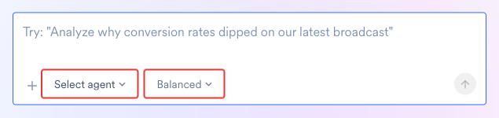
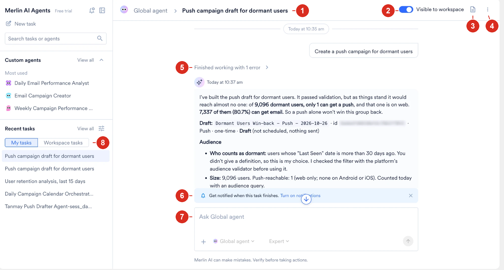
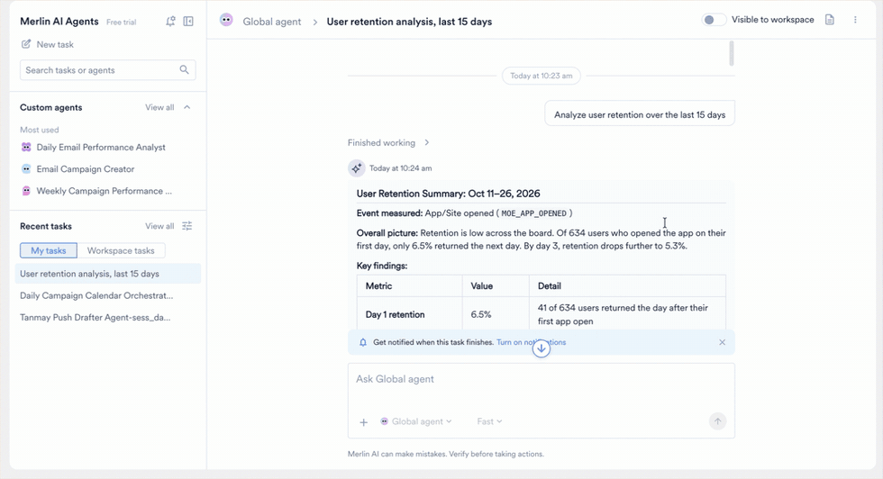

<Info>
前提条件

開始する前に、次の点を確認してください。

- ワークスペースが Global Agent にアクセスできる。詳細については、[Global Agent：概要](/ja/user-guide/ai-and-intelligence/merlin-ai/global-agent/global-agent-overview#availability)を参照してください。
- キャンペーン、セグメント、分析など、リクエストに必要な MoEngage データへのアクセス権がある。
</Info>

## タスクを開始する

<Steps>
  <Step title="コンポーザーを開く">
    左側のメニューで **Merlin AI** にカーソルを合わせて **Home** をクリックするか、**New task** をクリックしてコンポーザーを直接開きます。
  </Step>
  <Step title="エージェントを選択する">
    **Select agent** をクリックし、**Global agent** を選択します。すべてのタスクは 1 つのエージェントで実行されるため、タスクを開始する前にエージェントを選択してください。
  </Step>
  <Step title="モードを選択する">
    **Fast**、**Balanced**、**Expert** のいずれかを選択します。デフォルトのモードは **Balanced** です。モードはタスクの開始時に固定されるため、別のモードを使用するには新しいタスクを開始します。

    Global Agent ではタスクごとにモードを設定します。Custom Agent ではエージェント側でモードを設定するため、タスクの開始前に Custom Agent を選択した場合、このコントロールは表示されません。タスクの開始後、コントロールにはエージェントのモードが表示され、固定されたままになります。
  </Step>
  <Step title="作業内容を記述する">
    必要な内容を平易な言葉で記述し、メッセージを送信します。
  </Step>
</Steps>

<Frame>
  
</Frame>

各タスクは個別の会話です。エージェントは、タスク内のすべての指示、ツールの結果、生成されたファイルを保持します。ターンごとにリクエストを積み上げることができ、エージェントは以前の詳細を引き継ぎます。

目的の結果、期間、関係するチャネルやキャンペーンを記述してください。不足している詳細があれば、エージェントが質問します。

<Note>
最初のメッセージで実行が開始されます。エージェントはメッセージを受け取るとすぐに作業を開始します。
</Note>

### タスクビューの構成要素

<Frame>
  
</Frame>

1. **エージェントとタスク名：** パンくずリストには、タスクを実行するエージェントの名前と、それに続くタスク名が表示されます。名前を変更するには、[タスクの名前を変更する](/ja/user-guide/ai-and-intelligence/merlin-ai/global-agent/manage-and-share-global-agent-tasks#rename-a-task)を参照してください。
2. **Visible to workspace：** 同僚が **Workspace tasks** でタスクを見つけられるかどうかを切り替えます。詳細については、[タスクの公開範囲を変更する](/ja/user-guide/ai-and-intelligence/merlin-ai/global-agent/manage-and-share-global-agent-tasks#change-task-visibility)を参照してください。
3. **Output files：** 実行で生成されたすべてのファイルを一覧表示するパネルを開きます。詳細については、[タスクの出力を確認する](#review-task-outputs)を参照してください。
4. **タスクメニュー：** タスクのピン留め、名前の変更、リンクのコピー、アーカイブを行います。詳細については、[タスクメニュー](/ja/user-guide/ai-and-intelligence/merlin-ai/global-agent/manage-and-share-global-agent-tasks#task-menu)を参照してください。
5. **Finished working：** エージェントが発生したエラーを含め、エージェントが実行したステップを展開します。
6. **通知バナー：** タスクが完了したときのブラウザ通知をオンにします。詳細については、[通知](#notifications)を参照してください。
7. **コンポーザー：** 同じタスクで次のメッセージを送信します。エージェントピッカーとモードのコントロールは、メッセージボックスの下にあります。
8. **My tasks と Workspace tasks：** **Recent tasks** リストを、自分のタスクとワークスペースで共有されているタスクの間で切り替えます。詳細については、[最近のタスク](/ja/user-guide/ai-and-intelligence/merlin-ai/global-agent/manage-and-share-global-agent-tasks#recent-tasks)を参照してください。

### 例：Day 1 リテンションの改善

次のウォークスルーでは、4 つのターンにわたってタスクがどのように展開するかを示します。値は説明用のものです。

| ターン | ユーザーの質問 | エージェントの処理 | 得られる結果 |
| :--- | :--- | :--- | :--- |
| 1 | "Analyze user retention over the last 15 days." | 期間全体でリテンション分析を実行し、数値を日ごとに分類します | 期間のリテンションカーブと、各日の離脱率 |
| 2 | "Why is Day 1 retention only 6.5%?" | オンボーディングのステップ、初回セッションのアクティビティ、チャネルの到達可能性について、Day 1 に戻ってきたユーザーと戻ってこなかったユーザーを比較します | 2 つのグループが分かれるポイントと、各ポイントの根拠となる数値 |
| 3 | "What should we be aiming for, and what would move the number?" | オンボーディングの完了率や Push のオプトインなど、Day 1 リテンションに影響する要因を示し、どの目標に取り組むかを尋ねます | 目標の選択肢と、アプリに合わせてランク付けされた要因 |
| 4 | "Map the onboarding lever to work we can run." | 選択した目標から、ギャップを埋める変更へとさかのぼり、途中で止まっているユーザー向けのセグメントを作成して Push の下書きを作成します | 行うべき変更、保存済みのセグメント、キャンペーンビルダーで開けるキャンペーンの下書き |

<Frame>
  
</Frame>

各ターンは前のターンを踏まえたものになるため、背景を繰り返し説明するのではなく、質問を絞り込んでいくことができます。下書きの公開は、キャンペーンビルダーでユーザーが行うステップです。

## タスクにファイルを添付する

コンポーザーのプラスアイコンを選択すると、最初のメッセージを含む任意のメッセージにファイルを添付できます。エージェントは、各添付ファイルを同じターンの一部として読み取ります。キャンペーン ID の CSV やブランドガイドラインのドキュメントを送信すると、エージェントは添付ファイルに基づいて作業します。

| 制限 | 値 |
| :--- | :--- |
| **メッセージあたりのファイル数** | 5 |
| **ファイルあたりのサイズ** | 5 MB |
| **対応形式** | .csv, .doc, .docx, .gif, .jpeg, .jpg, .json, .md, .pdf, .png, .txt, .webp, .xls, .xlsx |

## 実行中のタスクを監視する

タスクはバックグラウンドで実行されます。ダッシュボードの別の場所で作業している間も実行は継続し、いつでもタスクに戻ることができます。

左ペインと **All tasks** ページでは、各タスクにその状態が表示されます。

- 実行中のタスクには、点滅するドットが表示されます。
- 未読のタスクには、オレンジ色のドットが表示されます。
- オレンジ色のドットはタスクを開くと消え、タスクが更新されると再び表示されます。
- 実行中かつ未読のタスクには、点滅するドットが表示されます。

### 通知

長いタスクは、別の作業をしている間に完了することがよくあります。エージェントが停止すると、ハブはブラウザ通知を表示します。

<Steps>
  <Step title="Notification settings を開く">
    **Merlin AI Agents** の横にある通知アイコンを選択します。
  </Step>
  <Step title="ブラウザに許可をリクエストする">
    **System notification when a task finishes while I'm away** を選択し、**Save** をクリックします。ブラウザから許可を求められます。
  </Step>
</Steps>

エージェントが結果を生成した場合、失敗した場合、または質問するために停止した場合のいずれでも、エージェントがタスクの作業を停止するとタスクは完了したものと見なされます。通知は、ダッシュボードがタブで開いていて、別のタブまたはウィンドウで作業している場合にのみ表示されます。

<Note>
許可は MoEngage ではなくブラウザに属します。許可を付与するとオプションは選択されたままになり、通知をオフにするには、ブラウザの設定でサイトの通知をブロックします。
</Note>

この設定はブラウザ通知のみを対象とします。スケジュールされた実行がエージェントの作成者に送信するメールなどのメールは、この設定とは関係なく届きます。

### 実行中のタスクを制御する

エージェントの作業中に **Stop response** を選択すると、実行を終了できます。その間に送信したメッセージはキューで待機し、キューは一時停止、追加、削除、再開できます。実行を停止できるのは、タスクの所有者のみです。

### All tasks の列

すべての履歴を確認するには、**Recent tasks** の横にある **View all** をクリックします。**All tasks** ページには、すべてのタスクが次の列とともに一覧表示されます。

| 列 | 説明 |
| :--- | :--- |
| **Task name** | タスクのタイトルです。タスクの所有者はいつでも名前を変更できます。スケジュールされた実行には、エージェントの名前と実行のスケジュール時刻 (UTC) がタイトルとして付けられます。 |
| **Agent** | タスクを実行するエージェントです。 |
| **Run by** | タスクを開始したユーザーです。スケジュールされた実行にはユーザーは表示されません。 |
| **Run date** | 実行が開始された日時です。 |
| **Trigger** | **Manual (Live)** または **Scheduled**。Global Agent のタスクは常に **Manual (Live)** で、**Scheduled** は Custom Agent の実行に適用されます。 |

スケジュールされた実行が完了または失敗すると、MoEngage はエージェントの作成者に、実行の結果、Task ID、実行日、所要時間、次回の実行時刻をメールで送信します。メールには実行の出力は含まれません。作成者は、エージェントの **Email** トグルでメールをオフにできます。詳細については、[Custom Agents：概要](/ja/user-guide/ai-and-intelligence/merlin-ai/custom-agents/custom-agents-overview)を参照してください。

このリストのタスクのフィルタリング、ピン留め、名前の変更、アーカイブについては、[Global Agent のタスクを管理・共有する](/ja/user-guide/ai-and-intelligence/merlin-ai/global-agent/manage-and-share-global-agent-tasks)を参照してください。

## タスクを再開する

以前に開始したタスクを続行するには、次の手順を実行します。

1. タスクリストからタスクを開きます。
2. 別のメッセージを送信します。

エージェントは以前の会話、ツールの結果、生成されたファイルを保持しており、前のターンが終了したところから続行します。

再開できるのは、自分が開始した手動タスクです。同僚のタスクは閲覧専用であり、自分のスケジュールされた実行やテスト実行も同様です。これらのタスクでは、メッセージボックスの代わりに通知が表示され、**Start a new task** で作業を引き継ぐことができます。同僚のタスクで行えることについては、[タスクを開く](/ja/user-guide/ai-and-intelligence/merlin-ai/global-agent/manage-and-share-global-agent-tasks#open-a-task)を参照してください。

タスクは最後のアクティビティから 30 日間再開できます。30 日が経過した後もタスクは閲覧できますが、作業を続けるには新しいタスクを開始します。アーカイブされたタスクは復元すると開けるようになり、Custom Agent が削除されると、そのタスクはタスクリストに表示されなくなります。

## タスクの出力を確認する

タスクには、実行中にエージェントが生成したすべてのファイルが集められます。タスクのヘッダーで **Output files** を選択するとパネルが開き、各ファイルが形式とサイズとともに一覧表示されます。ファイルは、パネルから、またはエージェントがファイルを生成したトランスクリプト内のカードからダウンロードできます。

ファイルを選択すると、コピーを保存する前に内容を確認できます。ファイルの開き方はファイル形式によって異なります。

- **画像と PDF：** PNG、JPG、GIF、WebP、PDF ファイルはプレビューペインで開きます。プレビューの横にはダウンロードボタンがあります。
- **テキストファイル：** Markdown、プレーンテキスト、ログ、JSON ファイルもプレビューペインで開きます。2 MB を超えるファイルは、代わりにダウンロードされます。
- **Office ファイルとスプレッドシートファイル：** .docx、.xlsx、.pptx、CSV ファイルは直接ダウンロードされます。内容を確認するには、各ファイルを対応するアプリケーションで開きます。

新しいファイルが届くと、**Output files** にマーカーが表示されます。プレビューから **Download** を選択するか、PDF、画像、Markdown、テキスト、JSON ファイルの場合は **Open in new tab** を選択します。

エージェントはデフォルトで .docx を作成し、PDF をリクエストすると PDF を生成します。

## Global Agent のメモリ

Global Agent は 2 つのメモリストアの読み取りと書き込みを行い、どちらもワークスペースで共有されます。

- **ワークスペースメモリ：** ワークスペース用に一度保存される事実です。Custom Agents もこのストアを使用します。
- **Global Agent メモリ：** Global Agent が自身の使用のために保持する事実で、ワークスペース内のすべてのユーザーで共有されます。

非公開にしているタスクを含め、どのタスクでも両方のストアに書き込むことができます。いずれのストアも、表示、編集、消去することはできません。

<Warning>
メモリはワークスペース全体で共有されます。あるタスクでエージェントが記録した内容は、同僚が自分のタスクで読み取ることができるため、メモリは個人的なメモではなく、ワークスペースの知識として扱ってください。
</Warning>

メモリには、タスク間で変わらない情報が保持されます。キャンペーンのステータス、オーディエンス数、パフォーマンスの数値などのライブの数値は、リクエストのたびにエージェントが参照します。意思決定に関わる数値は必ず検証してください。

## 権限と安全対策

各タスクには 1 人の所有者がいます。所有者がタスク内のすべてのメッセージを送信し、同僚は会話を続行せずに共有タスクを閲覧します。

エージェントがワークスペースに書き込む内容、ユーザー自身が行うステップ、タスクが読み取るワークスペースについては、[権限と安全対策](/ja/user-guide/ai-and-intelligence/merlin-ai/global-agent/global-agent-overview#permissions-and-safeguards)を参照してください。

## 次のステップ

<CardGroup cols={3}>
  <Card title="タスクを管理・共有する" icon="list-check" href="/ja/user-guide/ai-and-intelligence/merlin-ai/global-agent/manage-and-share-global-agent-tasks">
    タスクリストのフィルタリング、タスクのピン留めと名前の変更、タスクの閲覧者の管理、不要になったタスクのアーカイブを行います。
  </Card>
  <Card title="エージェントがカバーする範囲を確認する" icon="list" href="/ja/user-guide/ai-and-intelligence/merlin-ai/global-agent/global-agent-overview#capabilities-and-use-cases">
    オーディエンスのサイズ見積もりから送信前のチェックまで、Global Agent が処理する作業のカテゴリーを確認します。
  </Card>
  <Card title="Custom Agent を構築する" icon="wrench" href="/ja/user-guide/ai-and-intelligence/merlin-ai/custom-agents/custom-agents-overview">
    繰り返し行う作業を、独自の指示、ツール、スケジュールを持つエージェントに変換します。
  </Card>
</CardGroup>
