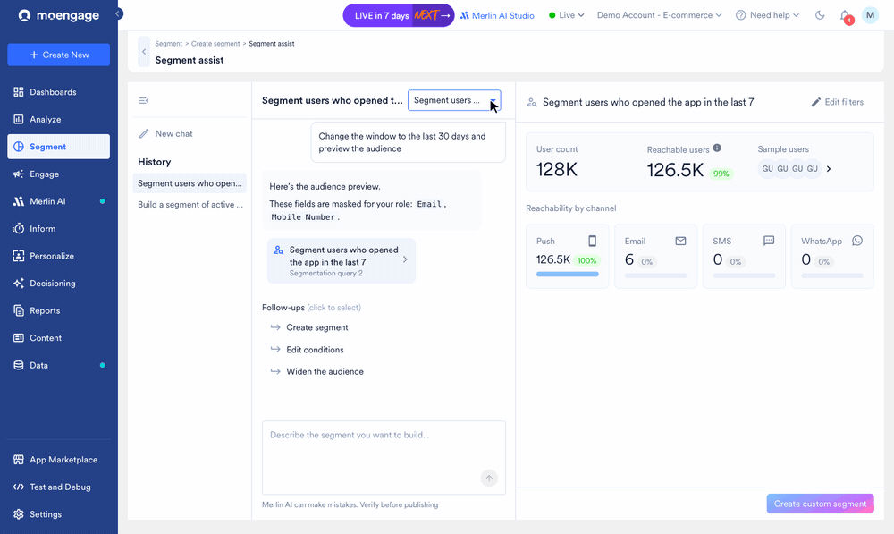
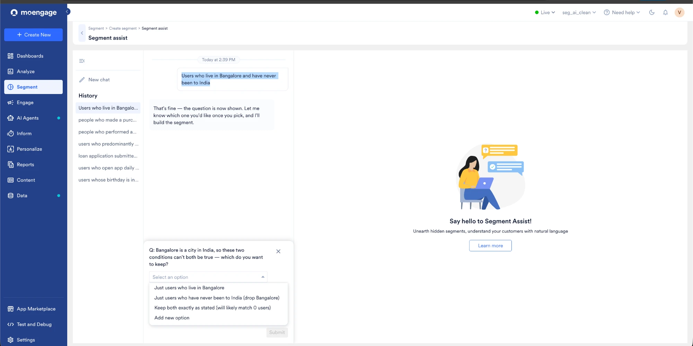
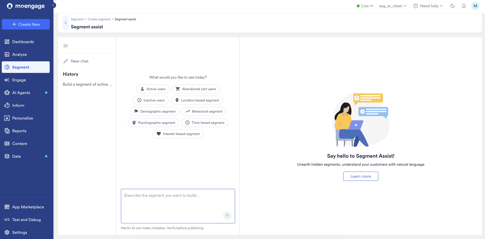
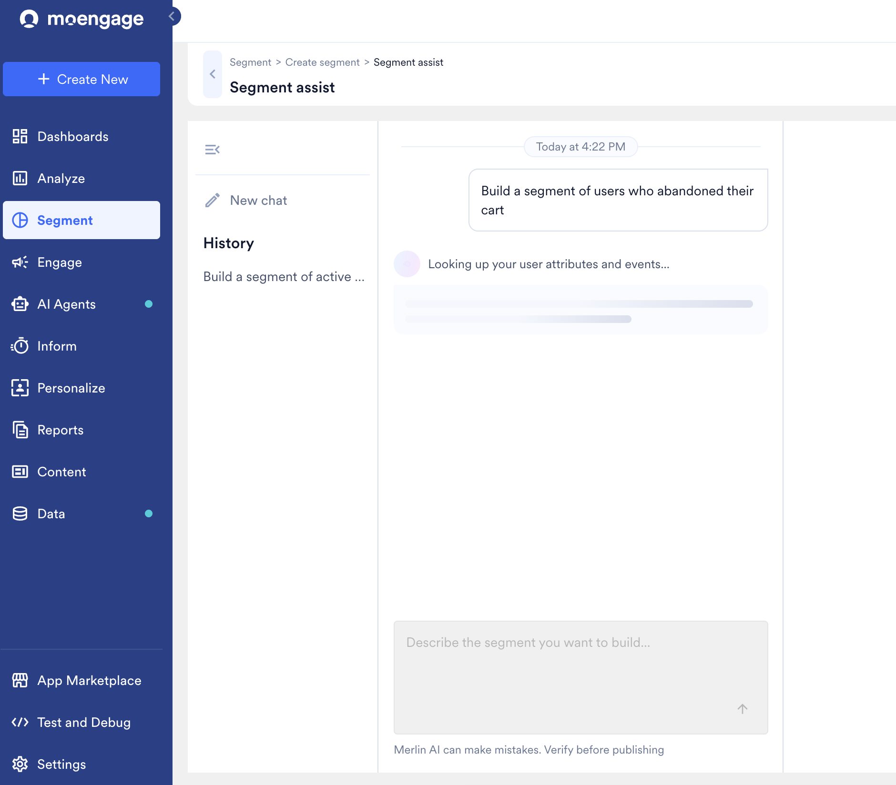
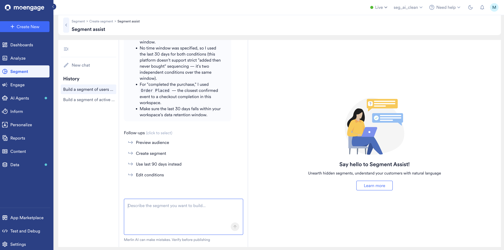
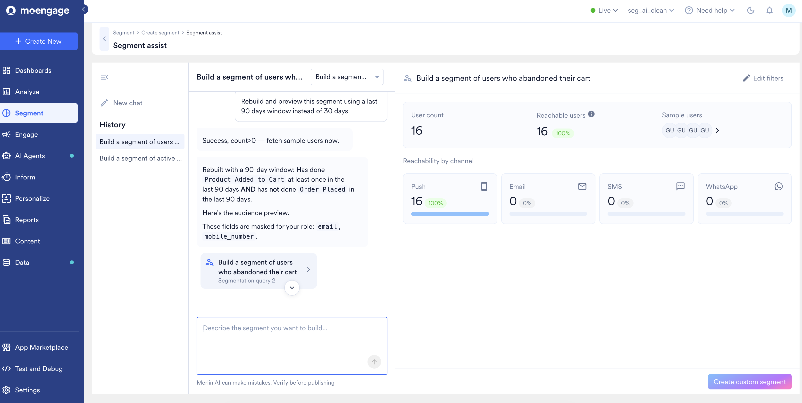
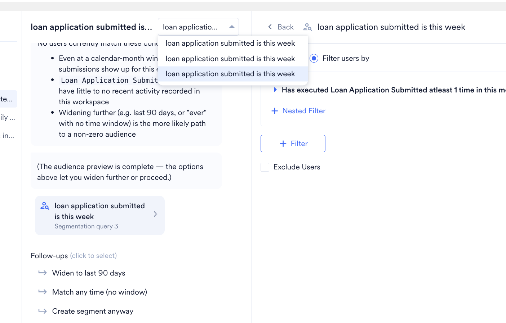
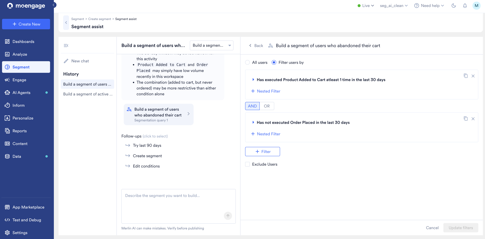

import { AcademyCourse } from "/snippets/academy-course.jsx";

<AcademyCourse
  title="Segment Assist"
  href="https://academy.moengage.com/student/path/3394704-segment-assist" />

<Note>
  これは Early Access 機能です。アカウントで有効にするには、CSM にお問い合わせいただくか、[サポートチケットを作成](/ja/user-guide/contact-support/raise-a-support-ticket-through-moengage-dashboard)してください。
</Note>

# はじめに

Merlin AI Segment Assist を使用すると、目的のオーディエンスを平易な英語で記述するだけでセグメントを作成できます。適切なイベントを探してフィルターを自分で組み合わせる代わりに、プロンプトを入力するだけで、Segment Assist がリクエストを一致するユーザーフィルターとイベントフィルターにマッピングし、結果のオーディエンスをプレビューします。保存する前に、会話を通じてクエリを絞り込むこともできます。

MoEngage ダッシュボードではなく、Claude や ChatGPT などの外部アシスタントを通じて AI を活用したセグメント作成を行う場合は、[MoEngage MCP のセグメンテーションツール](/ja/user-guide/ai-and-intelligence/merlin-ai/moengage-mcp-server#segments)を参照してください。

## Segment Assist の仕組み

Segment Assist は、平易な英語で記述したオーディエンスの説明を、プレビュー、編集、保存が可能なセグメントに変換します。ワークスペースにすでに存在するイベントとユーザープロパティに基づいて動作するため、固定された用語リストではなく、お客様自身のデータにリクエストをマッピングします。そのため、同じ説明でも、ワークスペースが異なれば異なるセグメントが生成される場合があります。

プロンプトを入力すると、Segment Assist は次の処理を行います。

1. 説明を読み取り、ユーザープロパティ (例: 都市やオペレーティングシステム) やイベント (例: 過去 7 日間の購入) などの条件を特定します。
2. 各条件をワークスペース内の一致するイベントまたは属性にマッピングし、指定した値がそれらのフィールドに存在するかどうかを確認します。
3. マッピングした条件からクエリを構築し、検証します。
4. 結果を編集可能なセグメントとして表示し、選択したイベントや適用した期間など、行った選択についての説明を併せて示します。

その後、フォローアップのプロンプトや提案されたフォローアップアクションでクエリを絞り込み、オーディエンスをプレビューして、セグメントとして保存します。

### セグメントカード

オーディエンスをプレビューするか、セグメントを作成するたびに、Segment Assist はチャットに **セグメントカード** を追加します。カードはクエリの 1 つのバージョンを表し、各カードには Segmentation query 1、Segmentation query 2 のように、会話内の順序を示すラベルが付けられます。カードをクリックすると、そのクエリが右側のパネルで開き、オーディエンスを確認したり、フィルターを編集したりできます。

チャットに複数のカードがある場合は、チャット上部のドロップダウンを使用してカードを切り替えます。

同じチャット内のすべてのカードは同じ名前を共有するため、ドロップダウンの項目は同じように表示されます。順序で区別し、目的の順番で作成されたカードを選択してください。

### 複数ターンでの絞り込み

Segment Assist は会話のコンテキストを保持するため、複数のターンにわたってセグメントを構築できます。フォローアップのリクエストごとに現在のクエリが絞り込まれて新しいカードが作成され、いつでも以前のカードに戻ることができます。たとえば、Segment Assist に条件の追加、期間の変更、フィルターの削除を依頼すると、現在のバージョンからクエリが再構築されます。

### 確認とヒューマンインザループ

Segment Assist がリクエストを確実にマッピングできない場合は、セグメントを構築する前に一時停止して確認を求めます。チャットに質問と選択肢のセットが表示され、独自の選択肢を追加できる場合もあります。選択を行うと、Segment Assist は処理を続行します。確認は、最初にセグメントを記述したときにも、セグメントを絞り込むときにも発生する可能性があります。

確認は次の場合に発生します。

- **あいまいな用語**: "active users" のようなフレーズがワークスペース内で複数の意味を持つ可能性がある場合、Segment Assist は考えられる選択肢を表示し、選択を求めます。
- **認識されない値**: フィールドに値が見つからない場合、Segment Assist はそのフィールドに実際に存在する値を表示します。
- **不足している詳細**: 条件に必要な数値が指定されていない場合、Segment Assist はその数値を尋ねます。

リクエストの一部を表現できるイベントや属性がワークスペースにない場合、Segment Assist は別のフィールドで代用せずに、その旨を通知します。

### 実現不可能なリクエストや結果が空のリクエスト

意味のあるオーディエンスを生成できないリクエストもあります。たとえば、"users who live in Bangalore and have never been to India" は、同時に成り立たない 2 つの条件を組み合わせています。Segment Assist は、どのユーザーにも一致しないセグメントを構築する代わりに、どちらの条件を残すかを尋ねます。

有効なクエリでも一致するユーザーがいない場合、Segment Assist は考えられる理由を説明し、期間の延長、期間の削除、そのままセグメントを作成するなど、オーディエンスを広げる方法を提案します。

<Note>
  Segment Assist は間違いを犯す可能性があります。セグメントを作成する前に、生成されたクエリを確認し、オーディエンスをプレビューしてください。
</Note>

# Segment Assist でセグメントを作成する

Segment Assist でセグメントを作成するには、次の手順を実行します。

1. MoEngage のサイドバーメニューで **Segment** にカーソルを合わせ、**+ New Segment** をクリックします。**Create segment** ページが表示されます。
2. 右上隅にある **Use MerlinAI to create segments** をクリックします。**Segment assist** ページが表示されます。

   
3. **Describe the segment you want to build** ボックスにプロンプトを入力して送信します。例: `Build a segment of users who abandoned their cart`

   すぐに始めるには、**What would you like to see today?** の下にある提案されたセグメントタイプ (**Active users**、**Abandoned cart users**、**Behavioral segment** など) のいずれかを選択できます。プロンプトの作成に関するガイダンスについては、[効果的なプロンプトを作成するためのガイドライン](#guidelines-to-write-effective-prompts)を参照してください。

   Segment Assist がユーザープロパティとイベントを検索し、クエリを生成します。

   
4. 生成されたクエリと、リクエストをマッピングしたイベントや適用した期間など、Segment Assist が行った選択についての説明を確認します。クエリが意図と一致していることを確認してください。

   
5. クエリを調整したり次に進んだりするには、応答の下に表示される提案された **Follow-ups** のいずれかを選択します。利用可能なオプションはクエリによって異なり、次のようなものがあります。
   - **Preview audience**: クエリに一致するオーディエンスを確認します。
   - **Use last 90 days instead**: 期間を広げます。
   - **Edit conditions**: クエリをフィルタービューで開き、手動で編集します。詳細については、[フィルタービューでクエリを編集する](#edit-the-query-in-filter-view)を参照してください。
   - **Create segment**: クエリをセグメントとして保存します。

   提案を選択する代わりに、独自のフォローアッププロンプトを入力することもできます。Segment Assist が表示するフォローアップの提案や確認のプロンプトは動的であるため、プロンプトやフォローアップごとに異なります。
6. 保存する前にオーディエンスを確認するには、**Preview audience** をクリックします。プレビューには、**User count**、**Reachable users** (到達可能な割合を含む)、**Sample users** のセット、Push、Email、SMS、WhatsApp の **Reachability by channel** が表示されます。
   - **Preview audience** または **Create segment** アクションを実行すると、Segment Assist はそのクエリのセグメントカードをチャットに追加します。チャット内のカードをクリックすると、右側のパネルでそのフィルターが開きます。
   - クエリに一致するユーザーがいない場合、プレビューには空のセグメントが表示されます。期間を広げるなど、フォローアッププロンプトでクエリを絞り込んでください。
   - `email` や `mobile_number` などの一部のフィールドは、ロールの権限に基づいてプレビューでマスクされる場合があります。Segment Assist は、どのフィールドがマスクされているかを通知します。

   
7. オーディエンスを絞り込むには、チャットにフォローアッププロンプトを入力します。例: `Rebuild and preview this segment using a last 90 days window instead of 30 days`。絞り込みを行うたびに、Segmentation query 1、Segmentation query 2 のような新しいセグメントカードが作成されます。
   - チャット内のカード間を移動するには、チャット上部のドロップダウンを使用するか、会話内のカードをクリックします。カードをクリックすると、右側のパネルにそのフィルターが表示されます。
   - 別のオーディエンスで最初からやり直すには、**New chat** をクリックします。過去の会話は **History** で確認でき、現在のワークスペースのユーザーごとに管理されます。

   
8. プレビューが目的どおりになったら、**Create custom segment** をクリックしてオーディエンスをセグメントとして保存します。フォローアップアクションから **Create segment** をクリックすることもできます。Segment Assist がセグメントの名前を生成します。特定の名前を使用するには、セグメント作成アクションを実行する前に、プロンプトに名前を含めてください。

## フィルタービューでクエリを編集する

生成されたクエリを手動で調整するには、オーディエンスのプレビューの上にある **Edit filters** をクリックします。フィルタービューでは、クエリが編集可能なフィルターとして開き、次の操作を行えます。

- イベント、属性、条件 (例: **Has executed** または **Has not executed**) を変更する。
- 条件内にネストされたフィルターを追加する。
- **AND** または **OR** で条件を組み合わせる。
- フィルターを追加する、または **Exclude Users** をオンにする。

**Update filters** をクリックして変更を適用するか、**Cancel** をクリックして変更を破棄します。セグメントの手動作成の詳細については、[ルールベースのフィルターセグメント](/ja/user-guide/segment/create-segments/rule-based-filter-segments)を参照してください。

# 効果的なプロンプトを作成するためのガイドライン

次のガイドラインとプロンプト構造は、Segment Assist が正確なクエリを生成するのに役立ちます。

<Info>
  - プロンプトを作成する前に、MoEngage におけるセグメンテーションの[主要な概念](/ja/user-guide/segment/getting-started/basics-of-segmentation)を確認してください。
  - ユーザープロパティとユーザーアクティビティ (イベントとイベントプロパティ) は、セグメンテーションの構成要素です。
  - フィルターは、結果を特定のユーザープロパティとイベントに絞り込みます。
  - 演算子 (AND/OR) は、複数の条件を組み合わせます。
</Info>

## プロンプト構造

一般的なセグメントを記述するには、次の構造を使用します。

- Segment Assist がそれぞれを適切なフィルターにマッピングできるように、イベント (ユーザーの行動) とユーザープロパティを明確にクエリします。
  - **ユーザープロパティ:** Segment users whose city, country, email ID, or mobile number is `<value>`. 例: "Segment users who are in New York City."
  - **イベント:** Segment users who have done or performed an `<event>` in the last n days. 例: "Segment users who opened the app in the last 7 days."
  - **イベントプロパティを含むイベント:** Segment users who have performed an `<event>` with `<event property>` containing `<value>`. 例: "Segment users who updated the app in the last 15 days with app versions containing 2.3."
  - **イベントを実行していないユーザー:** Segment users who have not performed an `<event>` in the last n days. 例: "Segment users who have not updated the app in the last 15 days."
- ビジネスロジックに応じて、AND または OR でユーザープロパティとイベントを組み合わせます。ユーザープロパティを先に記述し、続いてイベントを記述します。例: "Segment users who are in New York City and who opened the app in the last 30 days."
- オブジェクト型またはオブジェクト配列型のユーザープロパティとイベントプロパティについては、正確なフィールド名をドットで区切って、ネストされたパス全体を記述します。たとえば、`nations` オブジェクトプロパティに `cities` フィールドがあり、その中に `name` フィールドがある場合は、"Segment users whose nations.cities.name is Chennai." と記述します。

## はじめに使えるサンプルプロンプト

これらのサンプルプロンプトを、構造と表現の参考として使用してください。プロンプトをコピーし、**Describe the segment you want to build** ボックスに貼り付けます。

<Prompt description="7 日間のアクティブユーザー">
  Segment users who opened the app in the last 7 days.
</Prompt>

<Prompt description="特定の都市のユーザー">
  Segment users who are in New York City.
</Prompt>

<Prompt description="アクションの実行">
  Segment users who opened an email last week.
</Prompt>

<Prompt description="アクションの回数">
  Segment users who have clicked a push notification at least 5 times in the last 30 days.
</Prompt>

<Prompt description="複合条件">
  Segment users who are in New York City and who opened the app in the last 30 days.
</Prompt>

<Prompt description="アクションの未実行">
  Segment users who have not updated the app in the last 15 days.
</Prompt>

<Prompt description="チャネルでのインタラクション">
  Segment users who have clicked a notification from an Android device at least once in the last 3 days.
</Prompt>

<Prompt description="初回">
  Segment users who opened the app for the first time in the last 30 days.
</Prompt>

<Prompt description="データの検証">
  Segment users whose email IDs are not available.
</Prompt>

<Prompt description="前方一致">
  Segment users whose mobile number starts with +91.
</Prompt>

<Prompt description="後方一致">
  Segment users whose email ID ends with education.
</Prompt>

<Prompt description="部分文字列を含む">
  Segment users whose email ID contains @moengage.
</Prompt>

<Prompt description="複数の部分文字列を含む">
  Segment users whose email ID contains @moengage, @gmail, @hotmail.
</Prompt>

<Prompt description="数値によるアクション">
  Segment users who opened the app in the last 3 days with an app version greater than 16.1.
</Prompt>

<Info>
  - Segment Assist は、すべてのセグメントをデフォルトのチームに作成します。特定のチーム向けのセグメント作成はサポートしていません。
  - Segment Assist は、すべてのセグメントをデフォルトのアプリに作成します。マルチアプリワークスペースで特定のアプリ向けのセグメントを作成することはサポートしていません。
  - Segment Assist は、データ管理でブラックリストに登録された属性に、登録日から 1 日間アクセスできます。これらの属性は、翌日以降の結果には含まれません。次に進む前に結果を確認してください。
</Info>
