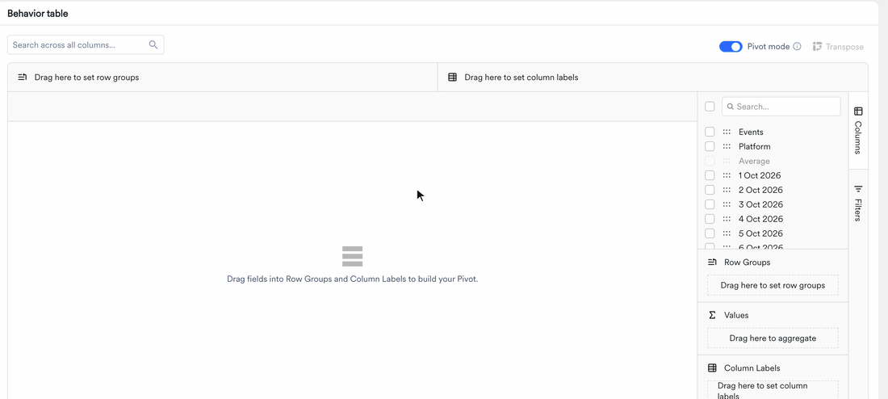
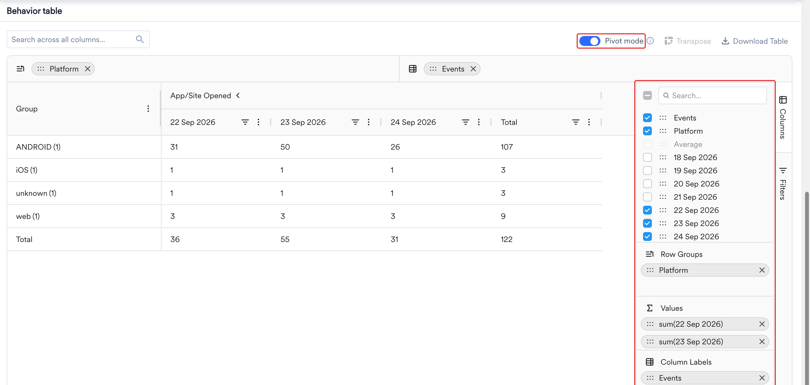
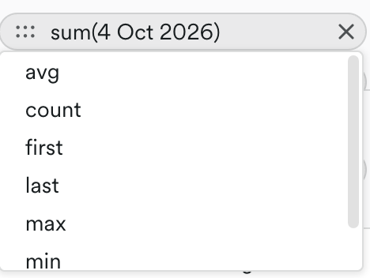

MoEngageは、製品のパフォーマンスやプラットフォームでのユーザーインタラクションを評価するために、さまざまなシナリオに適した多様な分析タイプを提供しています。これらの分析オプションを活用することで、データドリブンなカスタマーエンゲージメント戦略を実行できます。利用できる分析オプションは次のとおりです。

- [Users](/ja/user-guide/analyze/analytics/users)
- [Behavior](/ja/user-guide/analyze/analytics/behavior)
- [Funnel](/ja/user-guide/analyze/analytics/funnels)
- [Retention](/ja/user-guide/analyze/analytics/retention)
- [Session and source](/ja/user-guide/analyze/analytics/session-and-source)
- [User paths](/ja/user-guide/analyze/analytics/user-paths)
- [Acquisition](/ja/user-guide/analyze/analytics/acquisition)
- [Uninstalls](/ja/user-guide/analyze/analytics/uninstall)

これらのツールは、デモグラフィック、嗜好、さまざまなチャネルにわたるユーザーインタラクション、コンバージョン率、リテンションのパターンを収集・分析するのに役立ちます。主要なトレンドを特定し、顧客と製品のニーズについてより深いインサイトを得ることができます。

# はじめに

大まかには、次の標準的な手順に従ってこれらの分析を実行します。具体的な内容はケースやニーズによって異なる場合がありますが、ここでは従うべきプロセスの概要を示します。

## イベントを選択する

分析に使用するイベントまたはプロパティを、1つまたは複数選択します。分析に最も価値をもたらすものを選択してください。一般的に、これらはユーザーとアプリ/Webサイトに関連するものである必要があります。

## 属性を定義する

イベントに関連する属性を選択します。属性は選択したイベントに文脈を与え、特定のアクションやイベントをさらにフィルタリングできるようにします。

## ユーザーを選択する

この分析を実行する対象のユーザーを特定します。これらは、選択した一連のイベントを完了したユーザーです。詳細については、[Segmentation](/ja/user-guide/segment/create-segments/rule-based-filter-segments)を参照してください。

## 分析オプションと期間

MoEngageは、カウントレベルの分析と集計分析のオプションを提供しています。これらのオプションは分析のタイプによって異なります。これらのオプションの詳細については、各分析タイプで説明します。

分析オプションを選択した後、分析を実行する期間を指定します。

## チャート

チャートは、分析の最後に得られる結果です。データを視覚的に表現するため、大量のデータやさまざまなデータ間の関係を理解しやすくなります。分析タイプごとに、クエリを可視化するさまざまな方法が用意されています。概要として、利用できる可視化オプションの種類は次のとおりです。

- Line
- Bar
- Column
- Area
- Pie
- Choropleth

結果は数値ビューとパーセンテージビューで可視化できます。

## Tables

チャートとともに、データは行と列で構成された表形式でも表示されます。テーブルは、特定の情報を見つけたり、パターンを特定したりするのに便利です。

クエリを再実行することなく、各テーブルの外観と表示内容を調整できます。列のサイズ変更と並べ替え、値の並べ替えとフィルタリング、重要な列の固定、現在のビューのダウンロードが可能です。これらのテーブル操作は、Behavior、Funnels、Retention、Session & Source、User Analysis、Custom Dashboardsで利用できます。

<Note>
並べ替え、フィルタリング、その他の列操作は、テーブルの表示方法のみを変更します。基になるクエリやテーブル上部のチャートは変更されません。
</Note>

### テーブルの転置

テーブルを転置できます。これにより、テーブルの縦と横の向きを入れ替えて、希望する形式でテーブルを表示およびダウンロードできます。

### Sorting and Calculation

外部ツールを使用せずに、テーブル内のデータを整理できます。任意の列のヘッダーをクリックすると、テーブルのデータを並べ替えることができます。並べ替えはすべての列で利用できます。

- 1回目のクリックで昇順に並べ替え、2回目のクリックで降順に並べ替え、3回目のクリックで列がデフォルトの順序にリセットされます。
- 複数の列で並べ替えるには、**Shift**を押しながら追加の列ヘッダーをクリックします。テーブルは、クリックした順序で並べ替えを適用します。
- 列メニュー(列ヘッダーの三点アイコン)を開いて、**Sort Ascending**または**Sort Descending**を選択することもできます。

並べ替えに加えて、列のリストから計算タイプを選択できます。

- Sum
- Median
- Average
- Min
- Max

複数のイベントを含むテーブルでは、計算タイプのヘッダーをクリックして計算結果を並べ替えることができます。これにより、データが昇順または降順に並べ替えられます。転置ビューでは、計算タイプの行は固定されたまま、列を並べ替えることができます。

### 列のサイズ変更

2つの列ヘッダーの間にある区切り線をドラッグして、列の幅を広げたり狭めたりします。各列には最小幅と最大幅があるため、内容は読みやすく保たれます。列の幅を内容に合わせて自動的に調整するには、列メニュー(列ヘッダーの三点アイコン)を開き、**Autosize This Column**または**Autosize All Columns**を選択します。ブラウザウィンドウのサイズを変更すると、テーブルは利用可能なスペースに合わせて調整されます。

### フィルター

クエリを変更することなく、テーブルに表示される行を絞り込むことができます。

- **列フィルター:** 列ヘッダーのフィルター(漏斗)アイコンをクリックすると、条件に一致する行のみを表示できます。テキスト列で利用できる演算子は、**Contains**、**Does not contain**、**Equals**、**Does not equal**、**Begins with**、**Ends with**、**Blank**、**Not blank**です。**AND**または**OR**で2つの条件を組み合わせることができ、複数の列に同時にフィルターを適用できます。
- **クイック検索:** テーブル上部の**Search across all columns**ボックスを使用すると、すべての行と列にわたって値を一度に検索できます。入力するとテーブルが更新され、一致する行のみが表示されます。
- **詳細フィルター:** より複雑な条件の場合は、右側のサイドバーの**Filters**タブを開き、複数の条件を1つのフィルター式にまとめます。

### 列の固定、並べ替え、選択

- **固定:** 横スクロール中も列を表示したままにするには、列メニュー(列ヘッダーの三点アイコン)を開き、**Pin Column**を選択して、**Pin Left**または**Pin Right**を選択します。固定を解除するには**No Pin**を選択します。列を固定セクションにドラッグしたり、固定セクションからドラッグして出したりすることもできます。
- **並べ替え:** 列ヘッダーを左右にドラッグして、列の順序を変更します。
- **列の選択:** 列メニューを開いて**Choose Columns**を選択し、列の表示/非表示を切り替えます。または、右側のサイドバーの**Columns**タブを使用します。デフォルトのレイアウトに戻すには、**Reset Columns**を選択します。

### テーブルのダウンロード

テーブルを共有したり、他の場所で分析したりするには、テーブル上部の**Download Table**をクリックし、**Download as CSV**または**Download as Excel**を選択します。ダウンロードには、適用したフィルターや設定した並べ替え順序など、テーブルの現在の状態が反映され、すべての列が含まれます。

### ツールチップとコピー

セルの値や列ヘッダーが長すぎて収まらない場合、カーソルを合わせるとツールチップに全文が表示されます。すでに収まっている値にはツールチップは表示されません。また、1つ以上のセルを選択してクリップボードにコピーすることもできます。コピーされたテキストは、セルを選択した順序を保持します。

### ページネーションと無限スクロール

テーブルが行を読み込む方法は、表示する場所によって異なります。分析ページ(Behavior、Funnels、Retention、Session & Source、User Analysis)では、テーブルはページ分割されます。**Page Size**セレクターで1ページに表示する行数を制御し、行数表示で現在の範囲(例: 1 to 38 of 38)が示され、ページコントロールでページ間を移動できます。Custom Dashboardsでは、テーブルは無限スクロールを使用し、下にスクロールするにつれてさらに行が読み込まれます。

### ピボットテーブル

<Info>
この機能は、MoEngage AnalyticsのProduct Analyticsパッケージでのみ利用できます。アカウントで有効にするには、MoEngageのカスタマーサクセスマネージャー(CSM)またはサポートチームにお問い合わせください。
</Info>

テーブルをExcelにエクスポートしなくても、MoEngage上でイベントと属性を並べて確認できます。ピボットモードでは、テーブルの列を行、列、値にドラッグし、数値の集計方法を選択します。ピボットには、すでに表示しているデータ(同じイベント、フィルター、日付範囲)が常に反映されます。

ピボットモードは、分析に複数のイベントや分割属性がある場合に特に役立ちます。標準テーブルでは、イベントと属性値の組み合わせごとに1行が表示されるため、組み合わせが増えると比較が難しくなります。ピボットモードでは、行に何を配置し、列に何を並べるかを自分で決められます。

<Tip>
  **始める前に**

  - [Behavior](/ja/user-guide/analyze/analytics/behavior/behavior-analysis)または[Session and Source](/ja/user-guide/analyze/analytics/session-and-source/session-and-source-analysis)の分析を開きます。
  - **Platform**や**City**など、少なくとも1つの属性でデータを分割またはグループ化します。Behaviorでは、**Split by**または**Group by user property**を使用します。Session and Sourceでは、ソースプロパティを選択します。

  **Pivot mode**トグルが無効になっている場合は、テーブルが転置されていないこと、および分析タイプがピボットに対応していることを確認してください。詳細については、[ピボットを利用できる場所](#where-pivot-is-available)を参照してください。
</Tip>

#### ピボットモードをオンにする

<Steps>
  <Step title="分析を実行する">
    分割またはグループ化する属性を少なくとも1つ指定してBehaviorまたはSession and Sourceの分析を設定し、**Apply**をクリックします。
  </Step>
  <Step title="ピボットモードをオンにする">
    テーブルヘッダーの**Transpose**と**Download Table**の横にある**Pivot mode**トグルをオンにします。テーブルは空の状態で開き、*Drag fields into Row Groups and Column Labels to build your Pivot*というメッセージが表示され、右側に**Columns**サイドバーが開きます。
  </Step>
  <Step title="レイアウトを作成する">
    列を**Row Groups**、**Values**、**Column Labels**にドラッグします。詳細については、[ピボットテーブルを作成する](#build-a-pivot-table)を参照してください。
  </Step>
</Steps>

<Tip>
ピボットは、すでに表示しているデータを並べ替えるだけです。新しいデータは取得しないため、分析を再実行せずにさまざまなレイアウトを試すことができます。
</Tip>

標準テーブルに戻るには、**Pivot mode**トグルをオフにします。分析を変更して再度**Apply**をクリックすると、ピボットモードがオフになりレイアウトがクリアされるため、レイアウトを再作成する必要があります。

#### ピボットテーブルを作成する

ピボットは次の3つの要素で構成されます。

- **行**は、プラットフォームなど、比較する対象です。
- **列**は、イベントなど、並べて表示したい対象です。
- **値**は、日別の件数など、比較する数値です。

**Columns**サイドバーには、使用できる標準テーブルの列が一覧表示されます。

- **Events**: イベント名が含まれます。この列はBehaviorでのみ表示されます。
- 分析内の分割属性、グループ化ユーザープロパティ、またはソースプロパティごとに1つの列。
- 分析期間内の各日付ごとに、分析の粒度で1つの列。たとえば、2026年9月17日から2026年9月24日までの日次分析では、その8日間それぞれに1つの列が表示されます。週次分析では、1週間ごとに1つの列が表示されます。

各列を配置したいゾーンにドラッグします。より素早く列を配置するには、代わりにチェックボックスを選択します。属性は**Row Groups**に、日付は**Values**に配置されます。列を削除するには、その**X**をクリックします。

| ゾーン | 機能 | 例 |
| :--- | :--- | :--- |
| **Row Groups** | 列の値で行をグループ化します。複数の列を追加すると、テーブル上部のバーに表示される順序でグループがネストされます。 | **Platform**を追加すると、Android、iOS、Webごとに1行ずつ表示されます。 |
| **Values** | テーブルに表示する数値を設定します。追加した各日付列がピボットの列になります。比較したい日付のみを追加してください。 | 直近3日間を比較するには、最新の3つの日付を追加します。 |
| **Column Labels** | 列の値ごとに列グループを追加します。各グループには、**Values**の日付列と**Total**列が含まれます。テキスト属性やtrue/false属性など、値の種類が少ない属性を使用してください。 | **Events**を追加すると、イベントごとに1つの列グループが表示されます。 |

<Note>
整数、浮動小数点数、配列、オブジェクトの属性は、一意の値ごとに独自の列になってしまうため、列ラベルとして使用できません。ただし、**Row Groups**には追加できます。
</Note>

**ヒント**

- ピボットテーブルは折りたたまれた状態で開始されるため、最初は合計のみが表示されます。日別の数値を表示するには、テーブルヘッダーのグループ名の横にある矢印をクリックします。もう一度クリックするとグループが折りたたまれます。
- 行グループをネストした場合は、行グループの横にある矢印をクリックして、その下の行を表示または非表示にします。
- テーブル下部の**Total**行は、すべての行にわたって各列を集計します。

##### ピボットの集計方法を変更する

**Values**の各列には、集計関数と名前(例: **sum(17 Sep 2026)**)が表示されます。値にはデフォルトで**sum**が使用されます。変更するには、**Values**内の列をクリックし、次のいずれかの関数を選択します。

| 関数 | 各グループに表示される内容 |
| :--- | :--- |
| **sum** | グループ内の値の合計。 |
| **avg** | グループ内の値の平均。 |
| **min** | グループ内の最小値。 |
| **max** | グループ内の最大値。 |
| **count** | グループ内の行数。 |
| **first** | グループ内の最初の行の値。 |
| **last** | グループ内の最後の行の値。 |

テーブルの列ヘッダーには、日付などの列名のみが表示され、関数名は含まれません。

#### 例: プラットフォーム別にカートと注文を比較する

あるeコマースチームは、各プラットフォームの買い物客が同じ割合でカートを注文に変えているかどうかを知りたいと考えています。

チームはBehaviorで**Add to Cart**と**Order Placed**の2つのイベントを追加し、それぞれを**Platform**で分割し、**Total events**を選択して、2026年9月22日から2026年9月24日までの日次分析を実行します。標準テーブルでは、イベントとプラットフォームの組み合わせごとに1行が表示されるため、同じプラットフォームのカートと注文を比較するには行の間を行き来する必要があります。

| Events | Platform | Average | 22 Sep 2026 | 23 Sep 2026 | 24 Sep 2026 |
| :--- | :--- | ---: | ---: | ---: | ---: |
| Add to Cart | Android | 1,350 | 1,200 | 1,350 | 1,500 |
| Add to Cart | iOS | 840 | 800 | 820 | 900 |
| Add to Cart | Web | 600 | 600 | 550 | 650 |
| Order Placed | Android | 340 | 310 | 320 | 390 |
| Order Placed | iOS | 255 | 240 | 255 | 270 |
| Order Placed | Web | 90 | 90 | 80 | 100 |

カートと注文を並べて表示するために、チームは**Pivot mode**をオンにして次のレイアウトを作成します。

1. **Platform**を**Row Groups**にドラッグします。
2. **Events**を**Column Labels**にドラッグします。
3. **22 Sep 2026**、**23 Sep 2026**、**24 Sep 2026**を**Values**にドラッグし、関数は**sum**のままにします。

これで、ピボットにはプラットフォームごとに1行、イベントごとに1つの列グループが表示されます。両方のグループを展開すると、テーブルは次のようになります。

| Group | Add to Cart: 22 Sep | Add to Cart: 23 Sep | Add to Cart: 24 Sep | Add to Cart: Total | Order Placed: 22 Sep | Order Placed: 23 Sep | Order Placed: 24 Sep | Order Placed: Total |
| :--- | ---: | ---: | ---: | ---: | ---: | ---: | ---: | ---: |
| Android | 1,200 | 1,350 | 1,500 | 4,050 | 310 | 320 | 390 | 1,020 |
| iOS | 800 | 820 | 900 | 2,520 | 240 | 255 | 270 | 765 |
| Web | 600 | 550 | 650 | 1,800 | 90 | 80 | 100 | 270 |
| **Total** | 2,600 | 2,720 | 3,050 | 8,370 | 640 | 655 | 760 | 2,055 |

これで差が読み取りやすくなりました。2026年9月22日、Webの買い物客はカート約7件につき約1件の注文を行っており、Androidでは約4件に1件、iOSではほぼ3件に1件でした。同じパターンがすべての日付で見られることから、1日だけの落ち込みではなく、Webのチェックアウトに問題があることがわかります。両方のグループを折りたたむと、2つの**Total**列で期間全体について同じ比較ができます。Webではカート1,800件から注文270件、Androidではカート4,050件から注文1,020件です。**Total**行には、すべてのプラットフォームにわたるカートと注文の数が表示されます。

チームは、追加の疑問に答えるためにピボットを組み替えることができます。

- **イベントごとにプラットフォームを比較する:** **Events**を**Row Groups**に、**Platform**を**Column Labels**に移動します。各イベントが1行になり、各日付の下にプラットフォームが並んで表示されます。
- **差の原因を特定する:** **City**を**Group by user property**として追加し、**Apply**をクリックします。再度**Pivot mode**をオンにしてレイアウトを再作成し、**City**を**Row Groups**の**Platform**の下にドラッグします。**Web**を展開すると、カートに対する注文が最も少ない都市を確認でき、折りたたむとプラットフォームのビューに戻ります。

さまざまな業界の例については、[ピボットテーブルを使用して一般的なビジネス上の質問に答える方法](/ja/use-cases/analytics/how-to-use-pivot-tables-to-answer-common-business-questions)を参照してください。

#### ピボットテーブルのダウンロードと固定

ピボットを共有するには、ダウンロードするか、ダッシュボードに固定します。

- **ダウンロード:** **Download Table**をクリックし、**Download as CSV**または**Download as Excel**を選択すると、ピボットされた形のままテーブルをエクスポートできます。Excelファイルでは、グループ化された列ヘッダーは結合されたヘッダー行として保持されます。詳細については、[テーブルのダウンロード](#download-the-table)を参照してください。
- **ダッシュボードに固定:** テーブルを[カスタムダッシュボード](/ja/user-guide/analyze/dashboards/custom-dashboards)に固定します。ダッシュボードウィジェットには、固定した時点のピボットレイアウトが表示されます。ダッシュボードからレイアウトを編集することはできず、ウィジェットには**Pivot mode**トグルは表示されません。レイアウトを変更するには、元の分析でピボットを編集し、再度固定してください。

#### ピボットを利用できる場所

ピボットモードは、BehaviorとSession and Sourceの分析で使用できます。Funnels、Retention、User Paths、User Analysisでは利用できません。

ピボットは件数や合計に最適です。中央値、パーセンタイル、または直帰率などの比率指標では、それらの数値を再度組み合わせると誤解を招く結果になるため利用できません。これらの分析タイプではトグルが無効になり、そのツールチップに理由が表示されます。たとえば、中央値の場合は*Pivot is not available for median or percentile aggregation*、比率レポートの場合は*Pivot is not available for a derived ratio metric like this report type*と表示されます。

<Tabs>
  <Tab title="Behavior">
    | 分析タイプ | ピボットの利用可否 |
    | :--- | :--- |
    | Total events | 可。分割属性またはグループ化ユーザープロパティが設定されている場合。 |
    | Unique users | 可。分割属性またはグループ化ユーザープロパティが設定されている場合。 |
    | Unique sessions | 可。分割属性またはグループ化ユーザープロパティが設定されている場合。 |
    | sum、minimum、maximum、average、またはdistinct countによる集計 | 可。分割属性またはグループ化ユーザープロパティが設定されている場合。 |
    | medianまたはpercentileによる集計 | 不可。 |
    | sum、average、minimum、maximum、またはcountによるユーザーあたりの合計イベント数 | 可。分割属性またはグループ化ユーザープロパティが設定されている場合。 |
    | medianまたはpercentileによるユーザーあたりの合計イベント数 | 不可。 |
    | Aggregation distribution | 不可。 |
    | Attribute aggregation per user | 不可。 |
  </Tab>
  <Tab title="Session and Source">
    | レポートタイプ | ピボットの利用可否 |
    | :--- | :--- |
    | Session count | 可。ソースプロパティが選択されている場合。 |
    | Conversion Count | 可。ソースプロパティが選択されている場合。 |
    | Revenue | 可。ソースプロパティが選択されている場合。 |
    | Avg. Session Duration | 不可。 |
    | Avg. Sessions / User | 不可。 |
    | Avg. Conversions/Session | 不可。 |
    | Bounce Rate | 不可。 |
  </Tab>
</Tabs>

#### ピボットの制限事項

- ピボットにカスタム計算フィールドを追加することはできません。
- ダッシュボードウィジェットからピボットを編集することはできません。変更するには、元の分析でピボットを編集し、再度固定してください。

# 次のステップ

- [ピボットテーブルを使用して一般的なビジネス上の質問に答える方法](/ja/use-cases/analytics/how-to-use-pivot-tables-to-answer-common-business-questions)
- [MoEngage Dashboards](/ja/user-guide/analyze/dashboards/overview)
- [Behavior Analysis](/ja/user-guide/analyze/analytics/behavior/behavior-analysis)
