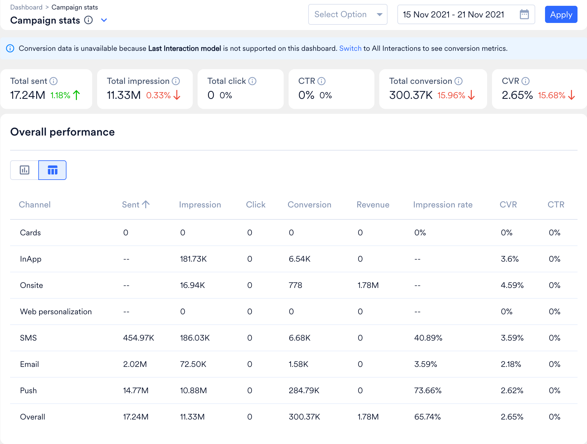
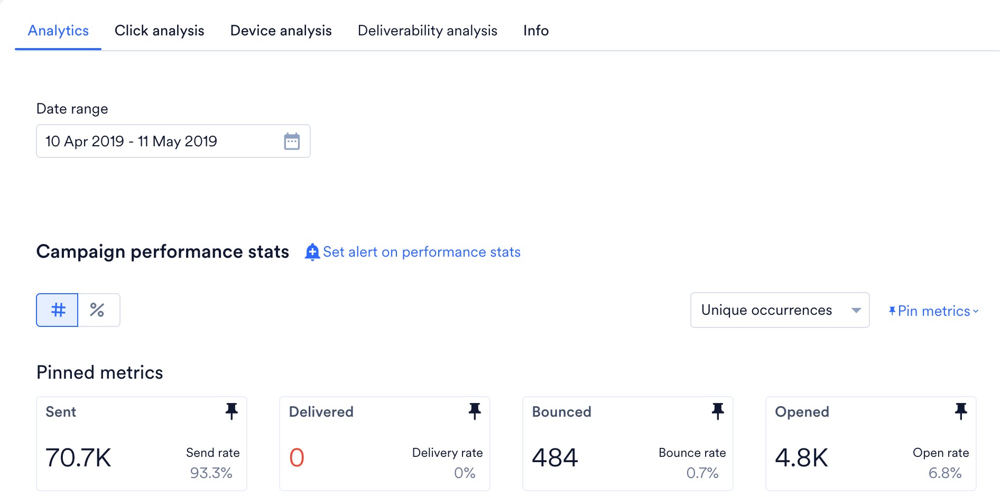

## 問題

MoEngage の Campaign Stats ダッシュボードと Campaign Analytics ページの間で、開封率やクリック率などのエンゲージメント指標に違いが見られます。

## 原因

Campaign Stats と Campaign Analytics の間で開封率やクリック率などのエンゲージメント指標に違いが生じるのは、分析ロジックの違いによるものです。どちらの機能も同じプラットフォームの一部ですが、特定の分析要件を満たすために、類似したデータを異なる方法で表示します。

## 解決策

この違いを理解して解決するには、次の点を確認してください。

1. **クエリの期間**
   - キャンペーンダッシュボードには、過去 7 日間など、特定の期間のデータが表示されます。
   - この期間外のイベントと指標は含まれません。
2. **クリックしたキャンペーンのリダイレクト**
   - キャンペーンをクリックすると、システムによって Campaign Analytics ページにリダイレクトされます。
   - このページには独自の **Date range** フィルターがあり、ダッシュボードの期間とは別に設定されます。
3. **データの計算**
   - ダッシュボード上の統合された **Campaign stats** では、選択した期間内のイベントのみに基づいて指標が計算されます。
   - 指定した期間外に発生したイベントは除外されます。
4. **選択した期間外のイベント**
   - キャンペーンが開始され、選択した期間外のイベントが含まれる場合があります。
   - これにより、送信数は少ないのに開封数やクリック数が多いといった不一致が生じ、クリックスルー率(CTR)やコンバージョン率(CVR)が高くなることがあります。
5. **想定された動作**
   - この動作は想定されたものです。各ページは、それぞれの期間内のイベントのみをカウントします。件数を比較するには、両方のページで同じ日付範囲を設定してください。

<Info>
**情報**

Campaign stats ダッシュボードは選択した期間のキャンペーン全体の指標を集計するのに対し、Campaign Analytics ページにはそのページで選択した日付範囲における 1 つのキャンペーンの指標が表示されます。
</Info>

