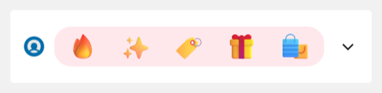
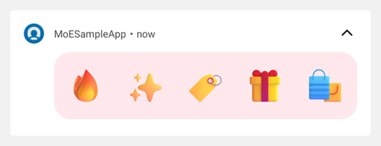
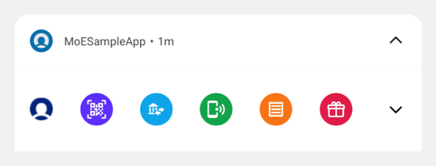
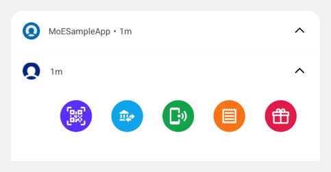
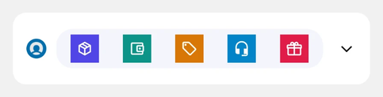
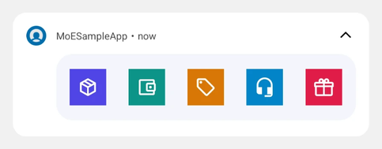
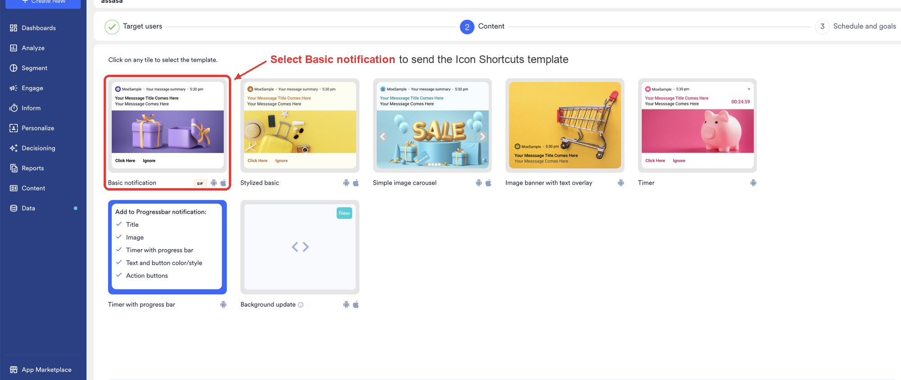
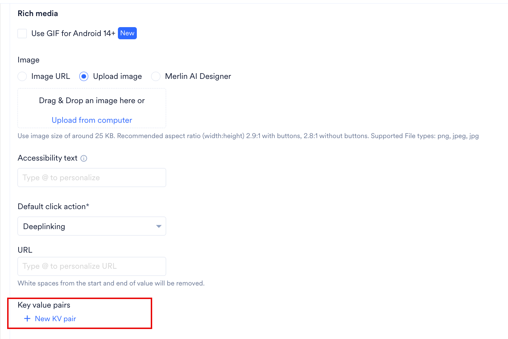
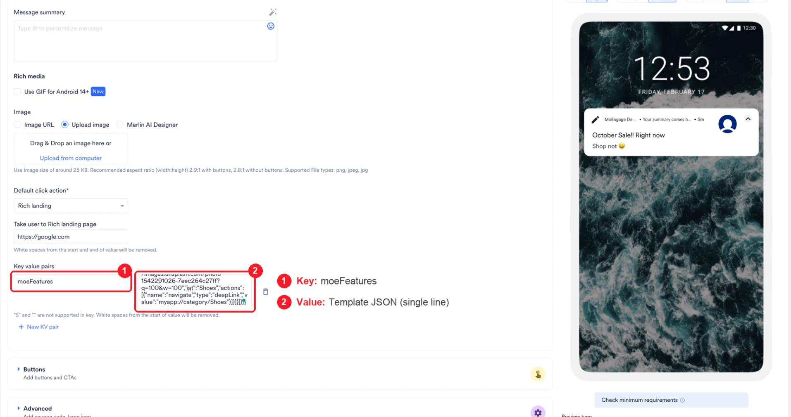

import IconShortcutsPayloadBuilder from '../../../../../components/IconShortcutsPayloadBuilder.jsx';

## 概要

<Note>
  Icon Shortcuts はベータ版の機能です。ダッシュボードのテンプレートタイルではなく、キーと値のペアを使用して設定します。詳細については、[FAQ](#faqs) および[ベータ版の機能または製品](/ja/user-guide/getting-started/overview/feature-or-product-in-beta)を参照してください。
</Note>

Icon Shortcuts は、3～6 個のタップ可能なアイコンを横一列に表示する Android 向けのプッシュテンプレートです。各アイコンにはそれぞれ独自の遷移先が設定されているため、1 つの通知でアプリへの入り口を最大 6 つ提供できます。

標準的なプッシュ通知では、通知をタップしたすべてのユーザーが同じ画面に誘導されます。Icon Shortcuts を使用すると、各ユーザーが自分の関心に合った遷移先を選択できます。

| 折りたたみ表示 | 展開表示 |
| --- | --- |
|  |  |

上記の通知には、いずれも 5 つのアイコンが含まれています。通知ドロワーには最初に折りたたみ表示が表示され、ユーザーが通知を下に引くと展開表示が表示されます。このキャンペーンでは、アイコンを配置するカードに背景色を設定しています。

アイコンの形状とカードの色は自由に選択できます。次の通知は、2 種類のアイコンの形状を示しています。

| アイコンの形状 | 折りたたみ表示 | 展開表示 |
| --- | --- | --- |
| 円形 |  |  |
| 正方形 |  |  |

形状と色を設定するキーについては、[カードとアイコンの外観](#card-and-icon-appearance)を参照してください。

<Warning>
  Icon Shortcuts を利用するには、**Android 12 以降**を搭載したデバイスと、**MoEngage Android SDK BOM 4.5.0 以降**でビルドされたアプリが必要です。それ以外のユーザーには、キャンペーンに含まれる Basic notification が届くため、そのタイトルとメッセージは単独で完結した通知として作成してください。詳細については、[はじめる前に](#before-you-begin)を参照してください。
</Warning>

## ユースケース

1 つの Icon Shortcuts 通知で、複数の目的に同時に対応できます。一般的なパターンは次のとおりです。

- 小売・コマース: 各アイコンから Trending、Bestseller、New Arrival などの異なるカテゴリを開いたり、1 つのアイコンを現在開催中のセール用に確保したりできます。
- マーケットプレイス・アグリゲーター: パートナーブランドごとに 1 つのアイコンを表示し、そのブランドのストアフロントを開くことができます。ブランド別ショッピングのキャンペーンに適しています。
- オファー・プロモーション: 季節のセール、1 つ買うと 1 つ無料になるキャンペーン、キャッシュバックキャンペーンなど、各アイコンを個別のオファーに割り当てることができます。
- アカウント・サービス: 1 つの通知から注文、ウォレット、オファー、サポートへユーザーを誘導でき、日常的なタスクまでの導線を短縮できます。
- コンテンツ・メディア: ニュース、スポーツ、動画など、各アイコンからセクションを開いたり、各アイコンにチャンネルを割り当ててそのチャンネルのライブストリームを開いたりできます。

Icon Shortcuts ではアイコンの横にテキストが表示されないため、各画像はそれ自体で意味が伝わる必要があります。認識しやすいロゴやカテゴリのシンボルが最も効果的です。形式、サイズ、視認性の要件については、[アイコン画像の選択](#choosing-icon-images)を参照してください。

## Icon Shortcuts の仕組み

Icon Shortcuts は Basic notification テンプレートをベースにしています。Basic notification のキャンペーンを作成し、Icon Shortcuts をキーと値のペアとして追加します。キャンペーンにはテンプレート全体が含まれるため、[はじめる前に](#before-you-begin)の要件を満たすアプリであれば、コードを変更せずに表示できます。

### ユーザーに表示される内容

Icon Shortcuts が通知のコンテンツ全体を構成します。折りたたみ表示と展開表示では同じアイコンが使用され、サイズのみが異なるため、両方の表示に対して 1 セットの画像を用意するだけで済みます。アイコンをタップすると、そのアイコンのアクションが実行され、デフォルトでは通知が閉じられます。

アイコン以外の部分をタップすると、Basic notification のクリックアクションが実行されます。このクリックアクションには、アイコンを選ばずに通知をタップしたユーザーに適した遷移先（ホーム画面やキャンペーンのランディングページなど）を設定してください。

### Icon Shortcuts が表示されない場合の動作

キャンペーンには 1 つのメッセージが含まれ、Icon Shortcuts はその上に重ねて表示されます。Icon Shortcuts が表示されない場合、デバイスには Basic notification に入力したタイトル、メッセージ、画像が表示されます。この結果につながるすべての条件は、[要件と検証ルール](#requirements-and-validation-rules)に記載されています。

**Template Backup** オプションは Icon Shortcuts には適用されません。キャンペーンビルダーでは Basic notification を除くすべてのテンプレートで **Template Backup** を利用できますが、Icon Shortcuts は Basic notification をベースにしているためです。

### アイコン数と表示サイズ

MoEngage は通知領域で使用できる幅にアイコンを収めるため、アイコン数によって各アイコンの表示サイズが決まります。次の表では、Android が画面間で要素のサイズを一定に保つために使用する単位である dp（密度非依存ピクセル）でサイズを示しています。

| アイコン数 | 折りたたみ表示のサイズ | 展開表示のサイズ |
| --- | --- | --- |
| 3～5 | 34dp | 44dp |
| 6 | 30dp | 40dp |

6 個目のアイコンを追加すると遷移先が 1 つ増える一方で、すべてのアイコンのサイズが小さくなります。アイコンのサイズよりも 6 つ目の遷移先が重要な場合は 6 個を選択し、各画像を認識しやすく保つために大きなサイズが必要な場合は 5 個以下を選択してください。

一部のデバイスではよりコンパクトな通知レイアウトが使用され、MoEngage はアイコン周りの余白を縮小します。上の表のアイコンサイズは変わりません。

### アイコン画像の選択

各アイコンは、正方形の PNG、JPEG、または WebP 画像として用意してください。サポートされていない形式の場合、Icon Shortcuts は表示されません。それ以外に強制される要件はありませんが、次の 3 点が結果に影響します。

- **192 x 192 ピクセル。** これより小さい画像も表示されますが、高密度の画面ではシャープさに欠けて見えます。
- **10 KB 以下。** 画像が重いほど、テンプレートが表示される割合が低下します。テンプレートが表示されない場合、デバイスには Basic notification が表示されます。
- **コントラストの高い 1 つのシンボル。** アイコンは 30dp～44dp で表示されるため、細かいディテールや小さなテキストは判読できません。ラベルを付ける場合は、1～2 語で画像内に配置してください。

## はじめる前に

<Tip>
  キャンペーンを作成する前に、次の点を確認してください。

  - **SDK バージョン**: アプリが MoEngage Android SDK [BOM](/ja/developer-guide/android-sdk/sdk-integration/basic-integration/Install-Using-BOM) 4.5.0 以降でビルドされており、Rich Notification モジュール（`com.moengage:rich-notification`）が含まれていること。BOM はこのモジュールのバージョンを設定しますが、アプリにモジュールを含める必要があります。両方について開発チームに確認してください。
  - **アイコン画像**: PNG、JPEG、または WebP 形式の正方形のアイコン画像が 3～6 個あり、誰でもブラウザで開ける公開 HTTPS URL でホストされていること。MoEngage では、1 画像あたり 192 x 192 ピクセル、10 KB 以下を推奨しています。詳細については、[アイコン画像の選択](#choosing-icon-images)を参照してください。
  - **遷移先**: 各アイコンの遷移先が決まっていること。ディープリンクまたは画面名は開発チームから提供されます。アプリ内でウェブページを開くアイコンの場合、開発者の作業は不要です。
</Tip>

## Icon Shortcuts キャンペーンを送信する手順

### ステップ 1: Basic notification を作成する

1. プッシュキャンペーンを作成します。**Content** ステップで、**Basic notification** テンプレートを選択します。



2. タイトル、メッセージ、画像を入力します。詳細については、[プッシュキャンペーンの作成](/ja/user-guide/campaigns-and-channels/mobile-push/create/create-push-campaigns)を参照してください。
3. サポート対象のデバイスと SDK バージョンに該当しないユーザーには、Icon Shortcuts の代わりにこの Basic notification が届くため、タイトルとメッセージは単独で完結した通知として作成してください。

### ステップ 2: Icon Shortcuts をキーと値のペアとして追加する

1. **Basic Details** で **Key value pairs** を探し、**+ New KV pair** をクリックします。

   

2. **Enter key** ボックスに `moeFeatures` と入力します。
3. Icon Shortcuts のペイロードを **Enter value** ボックスに貼り付けます。次の例を出発点として使用してください。



#### ペイロードを作成する

以下にアイコンと遷移先を入力し、生成された結果を **Enter value** ボックスにコピーします。ビルダーは、後述の例と同じ構造を、そのまま貼り付けられる 1 行の形式で生成します。

<IconShortcutsPayloadBuilder />

#### 例から始める

`moeFeatures` キーの値は、Icon Shortcuts を定義する JSON ブロックです。この例では 5 つの正方形アイコンを定義しており、それぞれが商品カテゴリを開きます。

**Ready to Paste** バージョンをダッシュボードにコピーし、キャンペーン固有の値に置き換える際は **Formatted** バージョンで構造を確認してください。どちらのバージョンも同じ Icon Shortcuts テンプレートを定義しています。

この例では、先に画像をホストしなくてもテストキャンペーンを送信できるよう、Unsplash の URL を使用しています。公開前に独自の画像に置き換えてください。MoEngage はサードパーティの URL を管理していないため、これらの URL はいつでも変更されたり、アクセスできなくなったりする可能性があります。

<CodeGroup>

```json Ready to Paste wrap
{"richPush":{"displayName":"IconShortcuts","android":{"showLargeIcon":false},"expanded":{"type":"iconShortcuts","style":{"i_sh":"sq","co_r":16,"bgColor":"#FFF3E0"},"cards":[{"id":1,"type":"iconShortcuts","widgets":[{"id":1,"type":"image","content":"https://images.unsplash.com/photo-1545127398-14699f92334b?q=60&w=192","iat":"Headphones","actions":[{"name":"navigate","type":"deepLink","value":"myapp://category/headphones"}]},{"id":2,"type":"image","content":"https://images.unsplash.com/photo-1511499767150-a48a237f0083?q=60&w=192","iat":"Sunglasses","actions":[{"name":"navigate","type":"deepLink","value":"myapp://category/sunglasses"}]},{"id":3,"type":"image","content":"https://images.unsplash.com/photo-1523170335258-f5ed11844a49?q=60&w=192","iat":"Watches","actions":[{"name":"navigate","type":"deepLink","value":"myapp://category/watches"}]},{"id":4,"type":"image","content":"https://images.unsplash.com/photo-1598532163257-ae3c6b2524b6?q=60&w=192","iat":"Handbags","actions":[{"name":"navigate","type":"deepLink","value":"myapp://category/handbags"}]},{"id":5,"type":"image","content":"https://images.unsplash.com/photo-1542291026-7eec264c27ff?q=60&w=192","iat":"Shoes","actions":[{"name":"navigate","type":"deepLink","value":"myapp://category/shoes"}]}]}]}}}
```

```json Formatted wrap
{
  "richPush": {
    "displayName": "IconShortcuts",
    "android": { "showLargeIcon": false },
    "expanded": {
      "type": "iconShortcuts",
      "style": { "i_sh": "sq", "co_r": 16, "bgColor": "#FFF3E0" },
      "cards": [
        {
          "id": 1,
          "type": "iconShortcuts",
          "widgets": [
            {
              "id": 1,
              "type": "image",
              "content": "https://images.unsplash.com/photo-1545127398-14699f92334b?q=60&w=192",
              "iat": "Headphones",
              "actions": [
                { "name": "navigate", "type": "deepLink", "value": "myapp://category/headphones" }
              ]
            },
            {
              "id": 2,
              "type": "image",
              "content": "https://images.unsplash.com/photo-1511499767150-a48a237f0083?q=60&w=192",
              "iat": "Sunglasses",
              "actions": [
                { "name": "navigate", "type": "deepLink", "value": "myapp://category/sunglasses" }
              ]
            },
            {
              "id": 3,
              "type": "image",
              "content": "https://images.unsplash.com/photo-1523170335258-f5ed11844a49?q=60&w=192",
              "iat": "Watches",
              "actions": [
                { "name": "navigate", "type": "deepLink", "value": "myapp://category/watches" }
              ]
            },
            {
              "id": 4,
              "type": "image",
              "content": "https://images.unsplash.com/photo-1598532163257-ae3c6b2524b6?q=60&w=192",
              "iat": "Handbags",
              "actions": [
                { "name": "navigate", "type": "deepLink", "value": "myapp://category/handbags" }
              ]
            },
            {
              "id": 5,
              "type": "image",
              "content": "https://images.unsplash.com/photo-1542291026-7eec264c27ff?q=60&w=192",
              "iat": "Shoes",
              "actions": [
                { "name": "navigate", "type": "deepLink", "value": "myapp://category/shoes" }
              ]
            }
          ]
        }
      ]
    }
  }
}
```

</CodeGroup>

#### 編集可能なフィールド

| 変更する要素 | 編集するフィールド |
| --- | --- |
| アイコンに表示される画像 | 画像 URL を保持する `content`。 |
| アイコンの遷移先 | `actions` 内の `value`。詳細については、[アイコンのアクション](#icon-actions)を参照してください。 |
| スクリーンリーダーが読み上げるラベル | `iat`。 |
| アイコンの数 | `widgets` 内のブロックを追加または削除し、3～6 個の範囲を維持します。各ブロックには異なる `id` を割り当ててください。 |
| アイコンの形状、カードの色と角 | `style`。詳細については、[カードとアイコンの外観](#card-and-icon-appearance)を参照してください。 |

構造に関するキー（`expanded.type`、`cards[].type`、`widgets[].type`、`showLargeIcon`）は、例で定義されているとおりに維持してください。Icon Shortcuts は、`expanded.type` が `iconShortcuts` で、各ウィジェットの `type` が `image` の場合にのみ表示されます。詳細については、[要件と検証ルール](#requirements-and-validation-rules)を参照してください。

`displayName` は `IconShortcuts` に設定してください。このキーは必須で、その値は表示ではなくレポートに影響します。MoEngage はこの値を Notification Clicked Android イベントの `template_name` 属性として送信するため、`IconShortcuts` に設定することで、すべての Icon Shortcuts キャンペーンのクリックデータが 1 つのグループにまとめられます。詳細については、[レポート](#reporting)を参照してください。

<Warning>
  **Ready to Paste** バージョンには改行が含まれていません。ペイロードの編集中に JSON の書式を変更した場合は、ダッシュボードに貼り付ける前に改行とスペースを削除し、ペイロードが有効な JSON のままであることを確認してください。書式エラーがあると、Icon Shortcuts は表示されません。

  FCM が適用する 4 KB の上限は、このペイロードと Basic notification を合わせたプッシュメッセージ全体に適用されます。上限を超えるメッセージは FCM によって拒否され、デバイスには通知がまったく届きません。
</Warning>

### ステップ 3: テストして公開する

1. Android 12 以降を搭載したデバイスにテストキャンペーンを送信します。
2. Icon Shortcuts が表示されることを確認します。標準の通知チャネルでは、デバイスは最初に Basic notification を表示し、少し後に Icon Shortcuts に置き換えます。そのため、タイトルとメッセージが一瞬表示されるのは想定どおりの動作です。[ヘッドアップ通知](/ja/user-guide/campaigns-and-channels/mobile-push/notification-features-and-behavior/android-push-heads-up-notifications)チャネルでは、MoEngage は Icon Shortcuts を直接表示します。
3. 各アイコンをタップし、設定した遷移先が開くことを確認します。
4. Icon Shortcuts とすべての遷移先が想定どおりに動作したら、キャンペーンを公開します。

## 要件と検証ルール

Icon Shortcuts は、次のすべての条件が満たされた場合にのみ表示されます。Icon Shortcuts は完全に表示されるか、まったく表示されないかのどちらかであるため、**デバイスとアプリ**、**ペイロードの構造**、**アイコン**のいずれかの条件が 1 つでも満たされない場合、Icon Shortcuts は Basic notification に置き換えられます。**配信**の条件は動作が異なり、サイズ超過のメッセージは FCM によって拒否されるため、デバイスには何も届きません。

キャンペーンを公開する前にこのチェックリストを確認し、テスト通知が Icon Shortcuts なしで届いた場合にも再度確認してください。

**デバイスとアプリ**

1. デバイスで Android 12 以降が動作している。
2. デバイス上のアプリのバージョンが MoEngage Android SDK BOM 4.5.0 以降でビルドされており、Rich Notification モジュールが含まれている。

**ペイロードの構造**

3. `moeFeatures` の値が有効な JSON である。
4. `richPush` に `displayName` と、`showLargeIcon` を含む `android` オブジェクトが含まれている。どちらのキーも必須です。いずれの値も Icon Shortcuts が表示されるかどうかには影響しません。`displayName` はレポート名を設定し、`showLargeIcon` は Basic notification のラージアイコンを制御します。
5. `expanded.type` が `iconShortcuts` である。
6. `cards` の最初のエントリに、整数の `id`、`type`、`widgets` リストの 3 つのキーが含まれている。MoEngage は `cards` の 2 番目以降のエントリをすべて無視します。

**アイコン**

7. 最初のカードに、`type` が `image` のウィジェットが 3～6 個含まれている。その他のタイプのウィジェットは合計数にカウントされません。
8. すべてのウィジェットに整数の `id` と `content` URL が含まれている。
9. すべてのアイコンに少なくとも 1 つのアクションがある。アクションのないアイコンが 1 つでもあると、Icon Shortcuts は表示されません。
10. すべての画像 URL が HTTPS を使用し、公開アクセス可能であり、すべての画像が PNG、JPEG、または WebP である。寸法とファイルサイズは強制されません。詳細については、[アイコン画像の選択](#choosing-icon-images)を参照してください。
11. すべての画像のダウンロードが合計 10 秒以内に完了する。読み込みの遅い画像が 1 つでもあると、Icon Shortcuts は表示されません。

**配信**

12. プッシュペイロード全体が FCM の上限である 4 KB 以内に収まっている。上限を超えるメッセージは FCM によって拒否され、デバイスには Basic notification も含めて通知がまったく届きません。

<Info>
  これらの条件のいずれかを満たさないキャンペーンでも、ダッシュボードでエラーや警告は表示されません。ユーザーには代わりに Basic notification が届き、それが Icon Shortcuts が表示されなかったことを示す唯一のサインとなります。例外は 4 KB を超えるペイロードで、この場合は FCM がメッセージを拒否するため、通知は届きません。公開のたびに、事前に Android 12 以降を搭載したデバイスにテストキャンペーンを送信してください。
</Info>

## アイコンのアクション

すべてのアイコンには、少なくとも 1 つのアクションが必要です。ほとんどのキャンペーンではアプリ内の画面を開きますが、アイコンでテキストの共有、通話の開始、コードのコピー、イベントの記録を行うこともできます。

| アイコンの動作 | 使用するアクション | 必要なもの |
| --- | --- | --- |
| アプリ内の画面を開く | `navigate`（`deepLink`） | 開発チームから提供されるディープリンク。 |
| 名前を指定してアプリの特定の画面を開く | `navigate`（`screenName`） | 開発チームから提供される画面名。 |
| アプリ内でウェブページを開く | `navigate`（`richLanding`） | ページの URL。このオプションでは開発者の作業は不要です。 |
| 共有シートでテキストを共有する | `share` | 共有するテキスト。 |
| 通話を開始する | `call` | 電話番号。 |
| コードをクリップボードにコピーする | `copy` | コード。 |
| イベントを記録する、またはユーザープロパティを更新する | `track` | 開発チームに確認したイベント名または属性名。 |
| アプリで定義されたアクションを実行する | `custom` | 開発者による設定。詳細については、[コールバックとカスタマイズ](/ja/developer-guide/android-sdk/push/advanced/callbacks-and-customisation#custom-action-on-action-button-click)を参照してください。 |

いずれかのアイコンをタップすると、そのアイコンのアクションが実行され、デフォルトでは通知が閉じられます。アイコンは閉じるアクションをサポートしていないため、アイコンを閉じるボタンとして使用することはできません。

### アクションの例

必要なブロックをアイコンの `actions` リストにコピーし、例の値を独自の値に置き換えてください。

**遷移先を開く**

<CodeGroup>

```json Deep Link wrap
{ "name": "navigate", "type": "deepLink", "value": "myapp://category/headphones" }
```

```json Deep Link with Extra Data wrap
{
  "name": "navigate",
  "type": "deepLink",
  "value": "myapp://product/10482",
  "kvPairs": { "coupon": "SAVE10", "source": "push" }
}
```

```json Screen Name wrap
{
  "name": "navigate",
  "type": "screenName",
  "value": "com.yourcompany.store.ProductActivity",
  "kvPairs": { "productId": "10482" }
}
```

```json Web Page wrap
{ "name": "navigate", "type": "richLanding", "value": "https://cdn.example.com/landing/autumn-sale.html" }
```

</CodeGroup>

`myapp://category/headphones` と `com.yourcompany.store.ProductActivity` はプレースホルダーです。開発チームから提供された値を使用してください。

**行動を記録する**

<CodeGroup>

```json Track an Event wrap
{
  "name": "track",
  "type": "event",
  "value": "icon_shortcut_clicked",
  "kvPairs": { "valueOf": "homepage" }
}
```

```json Set a User Attribute wrap
{
  "name": "track",
  "type": "userAttribute",
  "value": "last_shortcut_tapped",
  "kvPairs": { "valueOf": "offers" }
}
```

</CodeGroup>

**デバイス上で操作する**

<CodeGroup>

```json Share wrap
{ "name": "share", "value": "Explore the current offers" }
```

```json Call wrap
{ "name": "call", "value": "+14155550123" }
```

```json Copy wrap
{ "name": "copy", "value": "PROMO2026" }
```

```json Custom wrap
{ "name": "custom", "value": "{\"screen\":\"wallet\",\"tab\":\"offers\"}" }
```

</CodeGroup>

### アクション内のカスタムデータ

`navigate` アクションでは、`kvPairs` に独自の値を含めることができます。ユーザーがアイコンをタップすると、MoEngage は各値をアプリに渡し、ディープリンクにクエリパラメーターとして追加します。`kvPairs` を使用して、タップにつながったキャンペーンやオファーを識別してください。キー名はアプリが読み取るため、開発チームに確認してください。

`kvPairs` は `navigate` と `track` アクションに適用されます。`share`、`call`、`copy`、`custom`、`coupon` アクションでは `kvPairs` は無視されます。

## レポート

アイコンをタップすると [Notification Clicked Android](/ja/user-guide/getting-started/integration/default-android-sdk) イベントが記録され、MoEngage はアイコンを識別する 3 つの属性を追加します。

| 属性 | 値 |
| --- | --- |
| `template_name` | ペイロード内の `displayName`（`IconShortcuts`）。 |
| `card_id` | `cards` の最初のエントリの `id`。 |
| `widget_id` | タップされたアイコンを含むウィジェットの `id`。 |

`widget_id` によってユーザーが選択した遷移先を識別できるよう、各アイコンには異なる `widgets[].id` を割り当ててください。

アイコン間でタップ数を比較するには、Notification Clicked Android イベントで [Behavior 分析](/ja/user-guide/analyze/analytics/behavior/behavior-analysis)を実行し、`widget_id` に **Split by** を適用します。

アイコン以外の部分をタップすると、`template_name` のみを含む同じイベントが記録されます。`widget_id` がないことから、通知本文がタップされたことがわかります。

独自の名前でイベントを記録するには、アイコンに `track` アクションを追加します。MoEngage は Notification Clicked Android イベントに加えて、そのイベントを記録します。詳細については、[アイコンのアクション](#icon-actions)を参照してください。

## カードとアイコンの外観

`style` 内で次の 3 つのキーを設定して、アイコンの形状と、アイコンを配置するカードの外観を制御します。

| 設定 | キー | 適用対象 | 値 |
| --- | --- | --- | --- |
| アイコンの形状 | `i_sh` | 各アイコン | 円形の場合は `ci`、正方形の場合は `sq`。キーを省略した場合や別の値を入力した場合、MoEngage は円形を適用します。 |
| 角の丸み | `co_r` | カード | dp 単位の整数で、カードの四隅すべてに適用されます。キーを省略した場合、MoEngage は角を丸めません。 |
| 背景色 | `bgColor` | カード | `#FFF3E0` などの 16 進数のカラーコード。キーを省略した場合、カードはデバイスのライトテーマまたはダークテーマに従います。 |

このページの冒頭にある最初の通知では、`bgColor` を淡いピンク色に設定しています。この色はアイコンを配置するカードを塗りつぶし、その周囲には通知本来の背景が維持されます。

アイコン画像に対して十分なコントラストを保てる色を選択してください。アイコンはこの色の上に直接配置されるため、明るいカードの上に明るいアイコンを置くと輪郭がわかりにくくなります。

## 詳細設定

### Icon Shortcuts で使用できる設定

Basic notification の **Advanced** セクションで、次の設定を構成できます。

- **Auto Dismiss**: 設定した時間が経過すると通知を消去します。
- **Group Key**: キーを共有する通知を 1 つのサマリーの下にグループ化します。グループ化の処理方法はデバイスメーカーによって異なるため、すべてのデバイスではなく、ほとんどのデバイスでグループ化が表示されます。詳細については、[プッシュ通知のグループ化](/ja/user-guide/campaigns-and-channels/mobile-push/notification-features-and-behavior/push-notification-grouping)を参照してください。
- **Update Key**: キーを共有する以前の通知を置き換えます。この置き換えは、キャンペーンが Basic notification を配信した場合にも適用されます。詳細については、[プッシュ通知の更新](/ja/user-guide/campaigns-and-channels/mobile-push/notification-features-and-behavior/push-notification-update)を参照してください。

### Icon Shortcuts に適用されない設定

- **テキスト。** Icon Shortcuts にはタイトル、メッセージ、サマリーは含まれません。これらのテキストは Basic notification を通じてのみユーザーに届きます。
- **アクションボタン。** キャンペーンで設定したボタンは、Basic notification でのみ表示されます。
- **ラージアイコン。** テンプレートにはラージアイコン用のスペースがないため、キャンペーンのラージアイコンは Basic notification でのみ表示されます。
- **通知本文用の個別のクリックアクション。** アイコン以外の部分をタップすると、Basic notification のクリックアクションが実行されます。

## ペイロードリファレンス

値を確認したり、他の人が作成したペイロードを確認したりする際は、次の表を使用してください。

### richPush フィールド

| キー | 型 | 必須 | 説明 |
| --- | --- | --- | --- |
| `displayName` | String | はい | `displayName` は `IconShortcuts` に設定します。MoEngage はこの値を Notification Clicked Android イベントの `template_name` 属性として送信します。別の値を指定しても Icon Shortcuts は通常どおり表示されますが、そのキャンペーンのクリックは入力した名前でレポートされます。詳細については、[レポート](#reporting)を参照してください。 |
| `android` | Object | はい | ペイロードで必須の `showLargeIcon` を含むラッパーオブジェクト。`showLargeIcon` の値は Icon Shortcuts ではなく Basic notification に影響し、Basic notification にラージアイコンを含めるかどうかを決定します。 |
| `expanded` | Object | はい | Icon Shortcuts を定義します。 |
| `title`、`body`、`summary` | String | 効果なし | Icon Shortcuts にはテキストが含まれません。 |
| `dismissCta` | String | 効果なし | Icon Shortcuts には閉じるアクションがありません。 |
| `defaultActions` | Array | 効果なし | Icon Shortcuts には独自のタップアクションがありません。 |
| `collapsed` | Object | 効果なし | MoEngage は `expanded.cards` から折りたたみ表示を作成し、同じアイコンを小さいサイズで再利用します。 |

MoEngage は認識できないキーを無視するため、サポートされていないキーがあっても Icon Shortcuts はそのまま表示されます。

### expanded フィールド

| キー | 型 | 必須 | 説明 |
| --- | --- | --- | --- |
| `type` | String | はい | `expanded.type` は `iconShortcuts` に設定します。 |
| `style` | Object | いいえ | アイコンの形状、角の半径、背景色。 |
| `cards` | Array | はい | アイコンの定義を保持します。最初のエントリのみが表示されます。 |

### カードとウィジェットのフィールド

| キー | 型 | 必須 | 説明 |
| --- | --- | --- | --- |
| `cards[].id` | Integer | はい | カードを識別する整数。例では `1` を使用しています。 |
| `cards[].type` | String | はい | 必須のキー。例と同様に、`cards[].type` は `iconShortcuts` に設定します。 |
| `cards[].widgets` | Array | はい | 3～6 個の画像エントリを保持します。 |
| `widgets[].id` | Integer | はい | アイコンを識別する整数。MoEngage はこの値を `widget_id` としてレポートするため、アイコンごとに異なる値を割り当ててください。詳細については、[レポート](#reporting)を参照してください。 |
| `widgets[].type` | String | はい | `widgets[].type` は `image` に設定します。その他のタイプのエントリはアイコンとしてカウントされません。 |
| `widgets[].content` | String | はい | アイコン画像の公開 URL。 |
| `widgets[].iat` | String | いいえ | スクリーンリーダーがアイコンについて読み上げるラベル。 |
| `widgets[].actions` | Array | はい | 少なくとも 1 つのアクションを保持します。 |

### アクションタイプ

| `name` | 必須のキー | 任意のキー | 動作 |
| --- | --- | --- | --- |
| `navigate` | `type`、`value` | `kvPairs` | ディープリンク、アプリの画面、またはウェブページを開きます。 |
| `track` | `type`、`value`、`kvPairs.valueOf` | なし | カスタムイベントを記録するか、ユーザープロパティを設定します。 |
| `share` | `value` | なし | `value` をテキストとして Android の共有シートを開きます。 |
| `call` | `value` | なし | `value` の番号で Android のダイヤラーを開きます。 |
| `copy` | `value` | なし | `value` をクリップボードにコピーします。 |
| `custom` | `value` | なし | アプリが解釈できるよう、`value` を生の文字列としてアプリに渡します。 |
| `coupon` | `value` | なし | `copy` と同様に、`value` をクリップボードにコピーします。`copy` を使用し、`coupon` はすでに含まれているペイロードでのみ維持してください。 |

### navigate アクションのタイプ

| `type` | 遷移先 | `value` の内容 |
| --- | --- | --- |
| `deepLink` | アプリ内の画面。 | `myapp://category/headphones` などのディープリンク。 |
| `screenName` | アプリ内の名前付き画面。 | `com.yourcompany.store.ProductActivity` などの完全な画面名。 |
| `richLanding` | アプリ内で開くウェブページ。 | ページの URL。 |

### track アクションのタイプ

| `type` | 記録内容 | `value` の内容 | `kvPairs.valueOf` の内容 |
| --- | --- | --- | --- |
| `event` | カスタムイベント。 | イベント名。 | イベントとともに記録される属性値。 |
| `userAttribute` | ユーザープロパティ。 | 属性名。 | ユーザーに設定する属性値。`userAttribute` アクションでは `kvPairs.valueOf` が必須で、ペイロードで `kvPairs.valueOf` が省略されている場合、MoEngage はそのアクションを破棄します。 |

`kvPairs.valueOf` には 1 つの値しか含められないため、`track` アクションでは 1 つのイベントプロパティを記録するか、1 つのユーザープロパティを設定します。`navigate` アクションの `kvPairs` は、MoEngage が値を記録せずにアプリに渡すため、代替手段にはなりません。詳細については、[アクション内のカスタムデータ](#custom-data-in-actions)を参照してください。

## FAQ

<AccordionGroup>
  <Accordion title="Icon Shortcuts にダッシュボードのテンプレートタイルがないのはなぜですか？">
    Icon Shortcuts はベータ版の機能です。ベータ期間中、キャンペーンビルダーには専用のテンプレートタイルが用意されていないため、画面上のフィールドではなく `moeFeatures` のキーと値のペアでテンプレートを設定します。

    これはキャンペーンの設定にのみ影響します。配信後は、Icon Shortcuts は他のすべてのプッシュテンプレートと同じように表示され、レポートされます。

    キャンペーンビルダーに専用のテンプレートタイルを追加するようリクエストするには、MoEngage のアカウントマネージャーまたは [MoEngage サポート](https://help.moengage.com/hc/en-us/requests/new)を通じて機能リクエストを送信してください。
  </Accordion>

  <Accordion title="Icon Shortcuts キャンペーンには開発者の作業が必要ですか？">
    キャンペーンは `moeFeatures` のキーと値のペアでテンプレート全体を送信するため、MoEngage Android SDK BOM 4.5.0 以降でビルドされ、Rich Notification モジュールが含まれているアプリであれば、コードを変更する必要はありません。開発チームはバージョンを確認し、各アイコンのディープリンクまたは画面名を提供します。アプリ内でウェブページを開くアイコンの場合は、どちらも不要です。

    それより前のバージョンのアプリでは、Icon Shortcuts をユーザーに届けるために SDK のアップグレードとアプリのリリースが必要です。詳細については、[Android 開発者向けプッシュテンプレート](/ja/developer-guide/android-sdk/push/optional/push-templates)を参照してください。
  </Accordion>

  <Accordion title="通知にアイコンショートカットが表示されないのはなぜですか？">
    デバイス、アプリ、またはペイロードが Icon Shortcuts の要件のいずれかを満たしていません。どの原因でも同じ結果になります。[要件と検証ルール](#requirements-and-validation-rules)を順番に確認してください。
  </Accordion>

  <Accordion title="アイコンをタップしても遷移先が開かないのはなぜですか？">
    Icon Shortcuts は表示されアクションも実行されているため、遷移先を確認してください。入力したディープリンクまたは画面名をアプリが認識すること、および値を正確にコピーしたことを開発チームに確認してください。
  </Accordion>

  <Accordion title="通知をタップすると別の遷移先が開くのはなぜですか？">
    アイコン以外の部分をタップすると、アイコンのアクションではなく Basic notification のクリックアクションが実行されます。このクリックアクションには、アイコン以外の部分がタップされた場合に適した遷移先を設定してください。
  </Accordion>

  <Accordion title="Icon Shortcuts にタイトルやメッセージを含めることはできますか？">
    Icon Shortcuts にはテキストが含まれず、各画像はそれ自体で意味を伝えます。Basic notification に入力したタイトルとメッセージは、Basic notification を受信するユーザーに届きます。ラベルが必要なアイコンの場合は、アイコン画像内にラベルを含めてください。
  </Accordion>

  <Accordion title="いずれかのアイコンで通知を閉じることはできますか？">
    すべてのアイコンは設定したアクションを実行した後に通知を閉じるため、アイコンを閉じるボタンとして使用することはできません。ユーザーの操作なしで通知を消去するには、Basic notification で **Auto Dismiss** を設定してください。
  </Accordion>

  <Accordion title="Android 11 以前、またはそれより前の SDK バージョンのユーザーには何が届きますか？">
    これらのユーザーには、Basic notification に入力したタイトル、メッセージ、画像が届きます。これがこれらのユーザーに届く唯一のメッセージであるため、単独で完結したメッセージとして作成してください。
  </Accordion>

  <Accordion title="各ユーザーがどのアイコンをタップしたかを確認できますか？">
    はい。MoEngage は、Notification Clicked Android イベントの `widget_id` 属性に、`template_name` および `card_id` とともにアイコンを記録します。詳細については、[レポート](#reporting)を参照してください。
  </Accordion>
</AccordionGroup>

## 関連記事

- [プッシュキャンペーンの作成](/ja/user-guide/campaigns-and-channels/mobile-push/create/create-push-campaigns)
- [プッシュテンプレート](/ja/user-guide/campaigns-and-channels/mobile-push/create/push-templates)
- [Android 開発者向けプッシュテンプレート](/ja/developer-guide/android-sdk/push/optional/push-templates)
- [Android プッシュのヘッドアップ通知](/ja/user-guide/campaigns-and-channels/mobile-push/notification-features-and-behavior/android-push-heads-up-notifications)
- [プッシュ通知のグループ化](/ja/user-guide/campaigns-and-channels/mobile-push/notification-features-and-behavior/push-notification-grouping)
- [デフォルトの Android SDK イベントと属性](/ja/user-guide/getting-started/integration/default-android-sdk)
