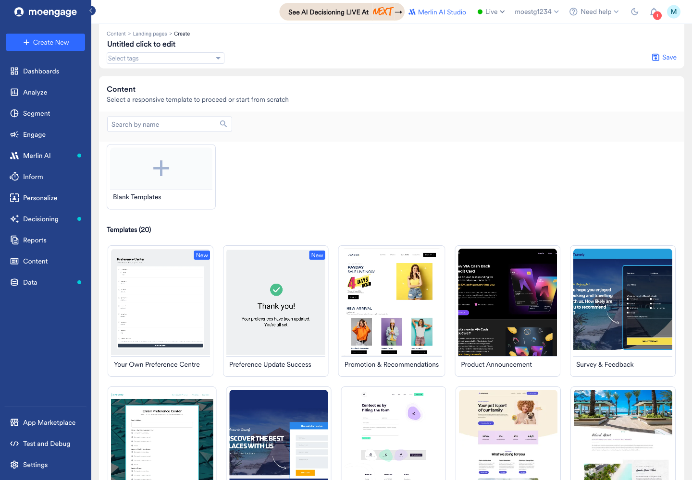
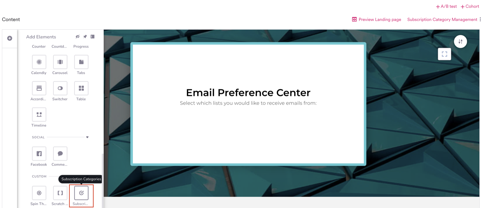
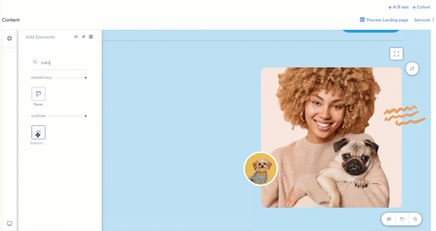
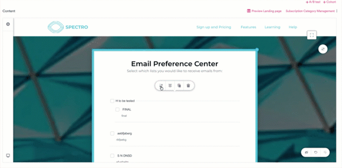
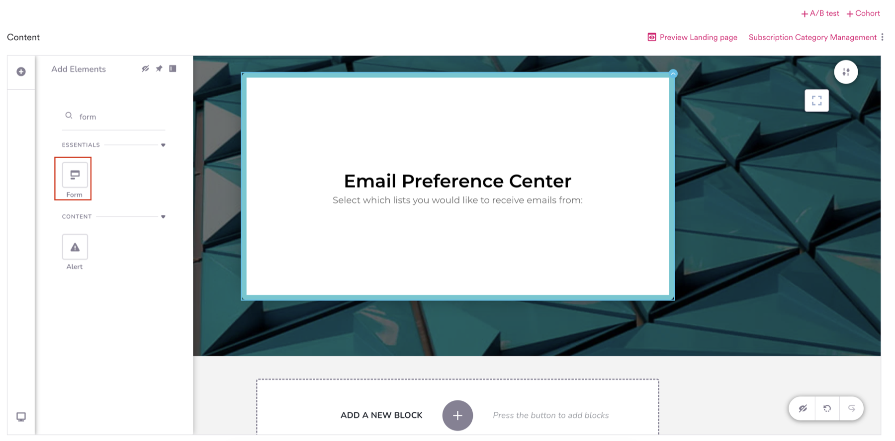
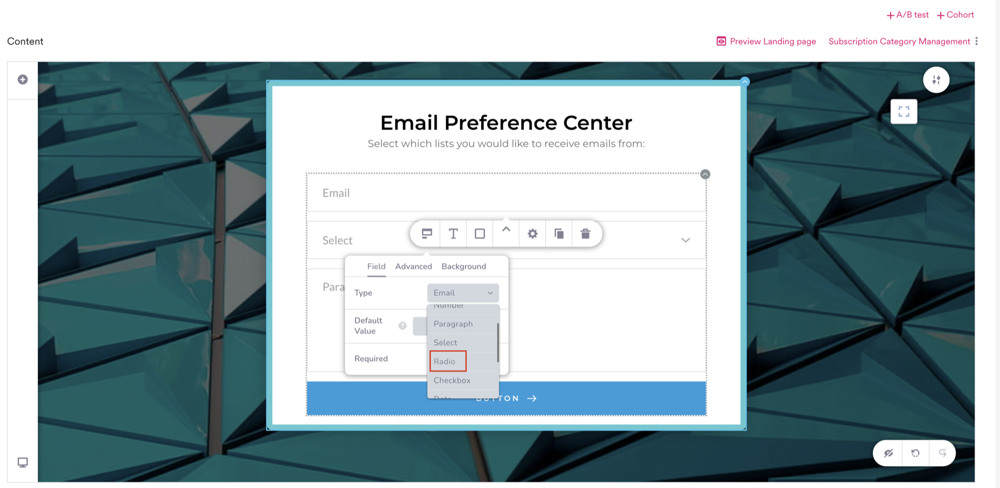
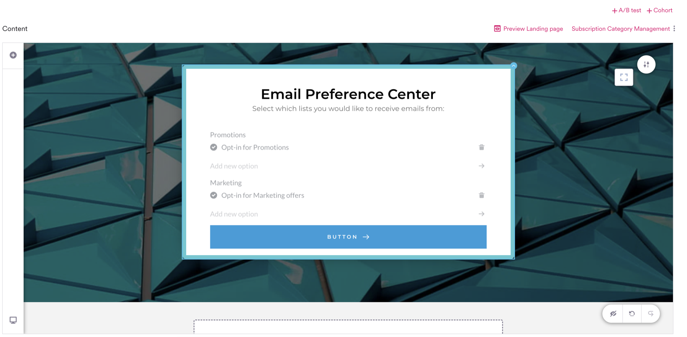
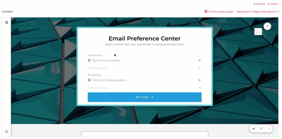
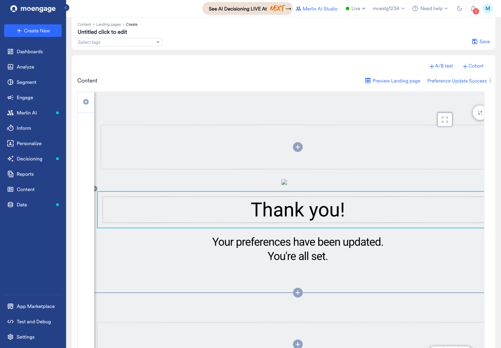
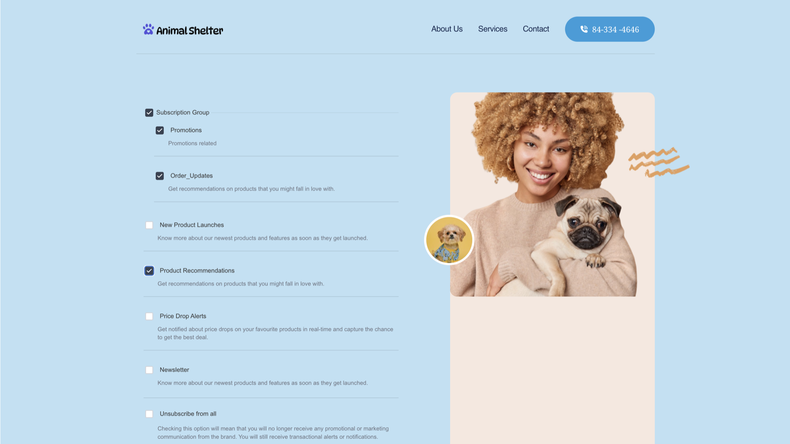

ランディングページを使用して、プリファレンスセンターを構築できます。プリファレンスセンターとは、ユーザーが受信したいメールカテゴリーを選択できるブランド化されたページで、すべてのメールの購読を解除するオプションも含まれます。MoEngage はユーザーの選択内容をプロファイルにネイティブに保存するため、今後のメールキャンペーンは各ユーザーの設定に従って送信されます。

このページでは、ドラッグ＆ドロップエディターでプリファレンスセンターを構築する方法について説明します。完全にカスタムの HTML ランディングページを使用する場合は、代わりに [JavaScript ブリッジメソッド](#use-a-fully-custom-html-landing-page)を使用してください。

<Info>
  **前提条件**

  - _Landing Pages_ 機能へのアクセス権。アクセス権がない場合は、MoEngage の Customer Success Manager (CSM) または Support チームにお問い合わせください。
  - メール用に設定された購読カテゴリーとグループ。ランディングページは、すでに定義されているカテゴリーとグループを読み込みます。設定方法については、[購読カテゴリーの設定](/ja/user-guide/campaigns-and-channels/email/getting-started-with-email/configure-subscription-categories)を参照してください。
</Info>

# ユースケース

ランディングページのプリファレンスセンターは、次のユースケースに対応しています。

- **ブランド化されたプリファレンスセンター**: デフォルトのスタイルを使用する代わりに、ロゴ、フォント、色など、プリファレンスページをブランドのルック＆フィールに合わせることができます。
- **詳細なオプトインとオプトアウト**: すべてのメールの購読解除だけでなく、ニュースレター、プロモーション、製品アップデートなどの特定のカテゴリーをユーザーが購読または購読解除できるようにします。
- **購読解除率の低減**: すべてをオプトアウトする代わりにカテゴリー単位の選択肢を提供することで、ユーザーが自分に関連するコンテンツの購読を継続できるようにします。
- **セルフサービスによる設定の更新**: ユーザーがいつでも自分のメール設定を更新できるようにします。設定は手動で同期することなく、MoEngage にネイティブに保存されます。

# 仕組み

## 構築するもの

ランディングページエディターで、[Subscription Categories 要素](#use-the-subscription-categories-element)またはカテゴリーにマッピングされた[カスタムフォーム](#build-a-custom-form-mapped-to-categories)のいずれかを使用してプリファレンスセンターを構築し、公開します。MoEngage は、設定で構成したメールの購読カテゴリーにページを直接接続します。

## ユーザーに表示される内容

Subscription Categories 要素で構築されたページをユーザーが開くと、現在の設定が表示され、購読中のカテゴリーがあらかじめ選択された状態になります。ユーザーが選択内容を変更して保存すると、MoEngage は更新内容をプロファイルに保存し、今後のメールキャンペーンにそれが反映されます。カスタムフォームの動作は異なります。詳細については、[カテゴリーにマッピングされたカスタムフォームを構築する](#build-a-custom-form-mapped-to-categories)を参照してください。

<Info>
  MoEngage がユーザーの設定を取得して保存するには、ユーザーを識別できる (MoEngage ID を解決できる) 必要があります。プリファレンスセンターのリンクがメールキャンペーンなどの MoEngage チャネルを通じて配信された場合、これは自動的に解決されます。このコンテキストなしでページが開かれた場合、MoEngage はユーザーを識別できないため、設定を事前入力したり保存したりすることはできません。
</Info>

プリファレンスセンターは、次の 2 つの方法で構築できます。

| アプローチ | 使用するタイミング |
| --- | --- |
| [Subscription Categories 要素](#use-the-subscription-categories-element) | 設定済みのすべてのカテゴリーとグループを表示したい場合。最も一般的なユースケースで、必要な設定が最も少なくて済みます。 |
| [カテゴリーにマッピングされたカスタムフォーム](#build-a-custom-form-mapped-to-categories) | 特定のカテゴリーのみの設定を収集したい場合、またはフィールドを自分でデザインしたい場合。 |

# Subscription Categories 要素を使用する

**Subscription Categories** 要素は、メール用に設定したすべての購読カテゴリーとグループを取り込むため、ページ上でそれらを再作成する必要はありません。

<Tip>
  既製のページから始めるには、ランディングページの作成時にテンプレートギャラリーで **Your Own Preference Centre** テンプレートを選択します。このテンプレートには、設定済みのカテゴリーに接続された Subscription Categories 要素がすでに含まれているため、ページを一から構築しなくても、スタイルを設定して公開できます。以下の手順では、任意のページに要素を自分で追加する方法について説明します。
</Tip>



1. ランディングページエディターで、要素パネルを開き、**Custom** セクションまでスクロールします。



2. **Subscription Categories** 要素をキャンバスにドラッグします。設定済みのすべてのカテゴリーが、それぞれの表示名、説明、チェックボックスとともに自動的に表示されます。



<Note>
  この要素には、メールの購読設定で定義されたカテゴリーとグループが常に反映されます。要素から個々のカテゴリーを削除することはできません。存在するカテゴリーを変更するには、[購読カテゴリーの設定](/ja/user-guide/campaigns-and-channels/email/getting-started-with-email/configure-subscription-categories)で編集してください。
</Note>

## 要素を設定する

要素を選択して設定を開きます。設定には、**Subscription Categories** と **Styling** の 2 つのタブがあります。

**Subscription Categories** タブで、コンテンツと外観を設定します。

| 設定 | 説明 |
| --- | --- |
| Preference layout | カテゴリーのレイアウト方法を選択します。 |
| Show category description | 各カテゴリーの下に説明を表示するか非表示にするかを設定します。 |
| Button text | 保存ボタンのラベルです。デフォルトは _Update Preferences_ です。 |
| Unsubscribe all description | 組み込みの _Unsubscribe from all_ オプションに表示される説明です。 |
| Background color | 要素の背景色です。 |
| Button background color | 保存ボタンの背景色です。 |
| Button text color | 保存ボタンのテキストの色です。 |
| Button hover color | ホバー時のボタンの背景色です。 |

**Styling** タブでは、デスクトップでの要素の表示、パディング、マージンなどの[共通のスタイルオプション](/ja/user-guide/content/landing-pages/create/landing-page-editor#common-styling-options-for-elements)を適用します。



# カテゴリーにマッピングされたカスタムフォームを構築する

すべてのリストを表示するのではなく、特定のカテゴリーのみの設定を収集したい場合は、**Form** 要素を使用してフィールドを自分で構築し、各フィールドを購読カテゴリーにマッピングします。

1. 要素パネルの **Essentials** で、**Form** 要素をキャンバスにドラッグします。



2. フォーム内のフィールドを選択して、フィールドエディターを開きます。**Field** タブで、**Type** を **Checkbox** または **Radio** に設定します。購読カテゴリーにマッピングできるフィールドタイプはこの 2 つのみです。ユーザーがオプトインとオプトアウトの両方を行えるように、**Checkbox** を使用してください。単一の Radio オプションは一度選択すると解除できないため、ユーザーはそのカテゴリーの購読を解除できません。



3. フィールドにラベル (例: _Promotions_) を追加し、_Opt-in for Promotions_ などの単一のオプションを設定します。



4. フィールドを選択し、フィールドエディターの **Advanced** タブを開いて、**Subscription categories** リストでフィールドのマッピング先となるカテゴリーを選択します。



ユーザーがフォームを送信すると、MoEngage は入力内容に基づいてマッピングされた各カテゴリーを設定します。

- **選択済み** (チェックされている、または何らかの値が入力されている) の場合、購読は `true` に設定されます。
- **未選択** (チェックされていない、または空白のまま) の場合、購読は `false` に設定されます。

<Warning>
  カスタムフォームは、表示されているフィールドの状態をそのまま送信します。フォームを開いたときにユーザーの現在の購読状況が反映されていない限り、フォームを送信すると、ユーザーが選択しなかったマッピング済みのカテゴリーはすべて `false` に設定され、以前に購読していたカテゴリーであっても購読が解除されます。各ユーザーの現在の設定を自動的に読み込んで事前選択するには、代わりに [Subscription Categories 要素](#use-the-subscription-categories-element)を使用してください。
</Warning>

<Warning>
  カスタムフォームで設定が正しくマッピングされるのは、各ラベルに 1 つのカテゴリーにマッピングされたオプションが 1 つだけある場合のみです。次のルールに従ってください。

  - **ラベルごとに 1 つのオプション。** 各ラベルの下には、単一の購読カテゴリーにマッピングされた単一のチェックボックスまたはラジオオプションを使用します。
  - **同じカテゴリーにマッピングされた複数のオプションを 1 つのラベルの下に追加しないでください。** 複数のオプションが同じカテゴリーにマッピングされている場合、いずれかのオプションが選択されるとカテゴリーが `true` に設定されるため、誤った設定になります。
  - **自由記述の入力はブール値として扱われます。** マッピングされたテキストフィールドが空白のままの場合、カテゴリーは `false` に設定されます。ユーザーが何らかの値を入力した場合は `true` に設定されます。
</Warning>

## 確認ページを表示する

Subscription Categories 要素とは異なり、カスタムフォームでは、ユーザーが設定を保存した後に組み込みの確認メッセージは表示されません。更新を確認するには、別の確認ページを公開し、それをフォームの送信ボタンの遷移先として設定します。

1. **Preference Update Success** テンプレート (「Your preferences have been updated」というメッセージを表示する既製のページ) を使用してランディングページを作成し、公開します。公開された URL をコピーします。代わりに、独自の確認ページを作成して公開することもできます。
2. プリファレンスフォームで送信ボタンを選択し、**Link** アイコンをクリックします。
3. **URL** タブの **Link to** フィールドに、公開した確認ページの URL を入力します。リンクオプションの詳細については、[ランディングページエディター](/ja/user-guide/content/landing-pages/create/landing-page-editor#common-styling-options-for-elements)を参照してください。

ユーザーがフォームを送信すると、MoEngage は設定を保存し、ユーザーを確認ページにリダイレクトします。



# プリファレンスセンターを公開して共有する

ページの構築が完了したら、ページを公開してユーザーに配信し、ユーザーが自分の設定を管理できるようにします。

1. ランディングページを公開し、その URL をコピーします。
2. MoEngage チャネルを通じてページを配信します。設定管理の場合、これは通常[メールキャンペーン](/ja/user-guide/campaigns-and-channels/email/create/create-an-email-campaign)です。たとえば、メール内の設定管理リンクとして URL を追加します。チャネルを通じて配信することで、MoEngage は各ユーザーを識別し、ユーザーごとにページをパーソナライズできます。

<Tip>
  メールフッターの **Manage preferences** リンクからユーザーがこのページにアクセスするようにするには、**Settings** \> **Channel** \> **Email** \> **Subscription Categories** で、このページの URL をカスタムランディングページとして設定します。フッターのリンクにはユーザーの ID が含まれているため、外部でホストされているページで使用されるコネクターや API の手順を必要とせずに、ページで設定がネイティブに事前入力および保存されます。詳細については、[購読カテゴリーの設定](/ja/user-guide/campaigns-and-channels/email/getting-started-with-email/configure-subscription-categories#custom-landing-page)を参照してください。
</Tip>

Subscription Categories 要素で構築されたページをユーザーが開くと、現在の設定が表示され、購読中のカテゴリーがあらかじめ選択されています。ユーザーが選択内容を変更して保存ボタン (デフォルトでは **Update Preferences**) をクリックすると、MoEngage はプロファイル上の購読カテゴリーを更新します。



更新が保存されたことを確認するには、[ユーザープロファイル](/ja/user-guide/campaigns-and-channels/email/getting-started-with-email/configure-subscription-categories#view-user-preferences)の **Subscription Categories** セクションを確認します。

# 完全にカスタムの HTML ランディングページを使用する

ドラッグ＆ドロップエディターで構築する代わりに、完全にカスタムの HTML ランディングページをホストする場合は、MoEngage JavaScript ブリッジを使用して購読カテゴリーの読み取りと書き込みを行います。

- `Moengage.getEmailSubscription()` は、ユーザーの現在の設定を取得します。これを使用してフォームを事前入力できます。
- `Moengage.updateEmailSubscription(<subscription_object>)` は、ユーザーの更新された設定を MoEngage に書き戻します。

```javascript JavaScript
Moengage.updateEmailSubscription({
  is_globally_unsubscribed: false,
  categories: {
    "New_Product_Launches": true,
    "Price_drop_alerts": false
  }
});
```

メソッドのリファレンスと例については、[On-Site Messaging とランディングページ向けの JavaScript ブリッジ](/ja/developer-guide/components-for-sdk/javascript-bridge/javascript-bridge-for-on-site-messaging-and-landing-pages#email-subscription-preferences)を参照してください。
