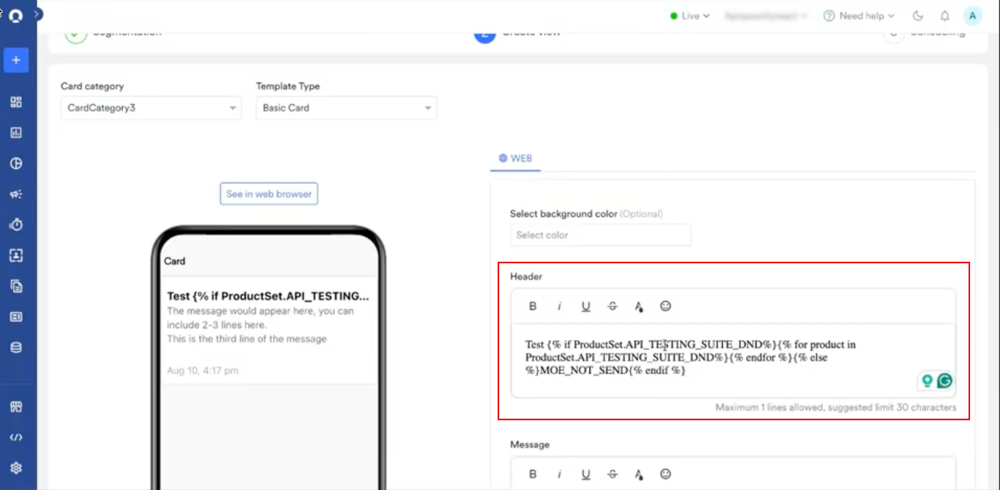
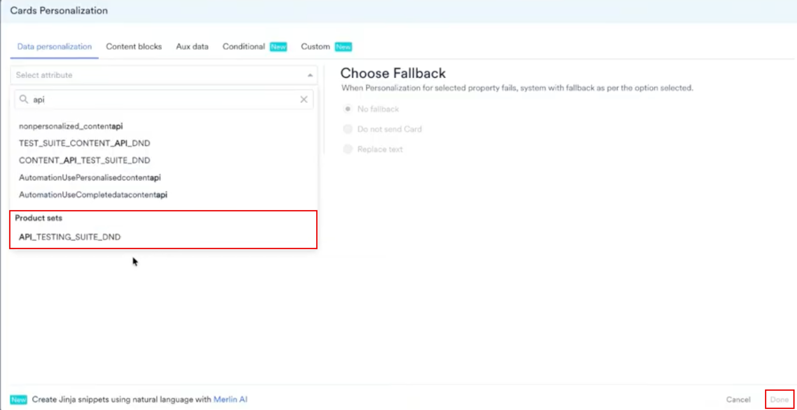

Card キャンペーンにレコメンデーションを追加すると、全員に同じメッセージを表示するのではなく、各ユーザーの関心に合った商品を表示できます。Cards チャネルでは、レコメンデーションは [Jinja テンプレート言語](/ja/user-guide/campaigns-and-channels/getting-started/message-personalization/jinja-templating-language)を使用してカードに挿入されます。

Cards チャネルでは商品グリッドは使用しません。カードに他のパーソナライズを追加するのと同じ方法で、パーソナライズメニューからプロダクトセットを追加します。

MoEngage では、Card キャンペーンの作成は 3 つのステップで行います。

1. Target users
2. Content
3. Schedule and Goals

2 番目のステップ「Content」で、レコメンデーションを使用してキャンペーンをパーソナライズできます。それでは、レコメンデーションを使用してパーソナライズした Card キャンペーンを作成してみましょう。

<Warning>
  目的のレコメンデーションが作成済みであることを確認してください。キャンペーンのパーソナライズには、アクティブなレコメンデーションのみを使用できます。[レコメンデーションの作成と管理](/ja/user-guide/content/recommendations)の方法を確認してください。
</Warning>

# レコメンデーションを使用した Card キャンペーンの作成

レコメンデーションを使用した Card キャンペーンを作成するには、次の手順を実行します。

1. MoEngage のサイドバーメニューで、Engage メニュー項目  にカーソルを合わせます。**Engage** メニューが表示されます。
2. **+ New Campaign** をクリックします。
3. **New Campaign** ダイアログボックスの **INBOUND** で、**Cards** をクリックします。
4. **Periodic** キャンペーンをクリックします。他の Card キャンペーンタイプでも同じ手順を実行できます。配信タイプの詳細については、[配信タイプ](/ja/user-guide/campaigns-and-channels/getting-started/introduction/delivery-types-moengage-channels)を参照してください。
5. ステップ 1「Target users」でキャンペーンの基本情報を入力してオーディエンスを定義し、**Next** をクリックします。
6. ステップ 2 の **Content** タブで、**Card category** と、**Basic Card** などの **Template Type** を選択します。
7. **Header** または **Message** フィールドで、レコメンデーションを表示する位置に **@** と入力します。**Cards Personalization** ウィンドウが開きます。

   
8. **Data personalization** タブで、レコメンデーションを検索し、**Product sets** の下でクリックします。
9. **Choose Fallback** で、ユーザーのパーソナライズが失敗した場合の動作を選択します。

   | オプション | 動作 |
   | --- | --- |
   | **No fallback** | レコメンデーションなしでカードを送信します。 |
   | **Do not send Card** | そのユーザーへのカードの送信を停止します。 |
   | **Replace text** | 入力した代替テキストを使用してカードを送信します。 |

   
10. **Done** をクリックします。
11. 次のセクションで説明するように、挿入された Jinja コードを変更して単一のアイテムを取得します。
12. 下部の **Next** をクリックし、キャンペーン設定のステップ 3 である「Schedule and Goals」に進みます。
13. **Schedule and Goals** で適切な設定を行い、キャンペーンを公開します。

**Header** と **Message** はどちらも必須で、どちらもパーソナライズに対応しています。ヘッダーは太字で、メッセージは細いテキストで表示され、入力に合わせて左側のカードプレビューが更新されます。

<Warning>
  ヘッダーは最大 1 行で、推奨される文字数の上限は 30 文字です。長い商品タイトルに解決されるレコメンデーションはヘッダーからはみ出す可能性があるため、単一のアイテムを取得し、前後のテキストを短くしてください。
</Warning>

<Note>
  Cards チャネルにはパーソナライズされたプレビューがありません。公開する前に、**Test campaign** を使用してカードの表示を確認し、レコメンデーションがプレースホルダーではなく実際の商品に解決されることを確認してください。
</Note>

# 単一のレコメンドアイテムを取得する

プロダクトセットをそのまま追加すると、セット内のすべてのアイテムが挿入されます。代わりに 1 つの商品を表示するには、プロダクトセットをループ処理します。次の例では、`Recommendations` という名前のレコメンデーションを含む `ProductSet` という名前のプロダクトセットを使用しています。

最初のレコメンドアイテムのタイトルを取得するには:

<CodeGroup>
```text JINJA


{{product.title}}


MOE_NOT_SEND

```
</CodeGroup>

同じカードに商品の画像リンクを追加するには:

<CodeGroup>
```text JINJA


{{product.image_link}}


MOE_NOT_SEND

```
</CodeGroup>

`MOE_NOT_SEND` は、ユーザーのプロダクトセットが空の場合にカードの送信を停止するため、商品が欠けたカードを受け取るユーザーはいません。別のフォールバックを使用するには、`MOE_NOT_SEND` を表示したいテキストに置き換えるか、何も表示しない場合は空のままにします。

プロダクトセットにはアイテムのリストが含まれており、各アイテムには `title`、`description`、`id`、`link`、`image link` などの属性があります。利用可能な属性は、レコメンデーションが使用するカタログによって決まるため、そのカタログを開いて存在する属性を確認してください。ループ内で属性を取得するには、**@** と入力し、パーソナライズウィンドウからプロパティを選択します。

<Note>
  Card キャンペーン用に作成した Jinja コードは、In-App と On-Site Messaging でもそのまま動作します。これらのチャネルは同じ方法でプロダクトセットを読み取るためです。
</Note>

# UTM パラメーターを追加する

UTM パラメーターを追加すると、カードからのトラフィックが、そのトラフィックをもたらしたキャンペーンに帰属されます。パラメーターの値はカードのコンテンツと同じ方法でパーソナライズできるため、1 つのキャンペーンでバリエーションごとまたはセグメントごとにレポートできます。

独自のキーと値のペアを追加するには、**\+ Create custom parameter** をクリックします。パラメーターの完全な一覧とアカウントレベルのデフォルトの適用方法については、[キャンペーンへの UTM パラメーターの追加](/ja/user-guide/settings/advanced-settings/add-utm-parameters-to-campaigns)を参照してください。

<Note>
  UTM パラメーターはカード内のリンクに適用されます。キャンペーンで使用する前に、**Settings** \> **App** \> **UTM tracking** で一般的な UTM パラメーターを有効にしてください。
</Note>

# 関連記事

- [Card キャンペーンの作成](/ja/user-guide/campaigns-and-channels/cards/create/create-a-card-campaign)
- [レコメンデーションを使用したコンテンツのパーソナライズ](/ja/user-guide/campaigns-and-channels/getting-started/message-personalization/personalize-content-using-recommendations)
- [In-App でのレコメンデーションの使用](/ja/user-guide/content/recommendations/personalize-campaign-with-recommendations/using-recommendations-in-in-app)
- [On-Site Messaging でのレコメンデーションの使用](/ja/user-guide/content/recommendations/personalize-campaign-with-recommendations/using-recommendations-in-on-site-messaging)
