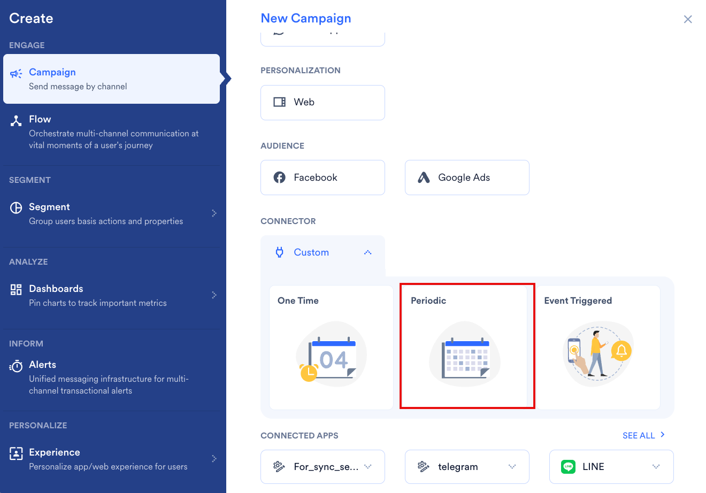
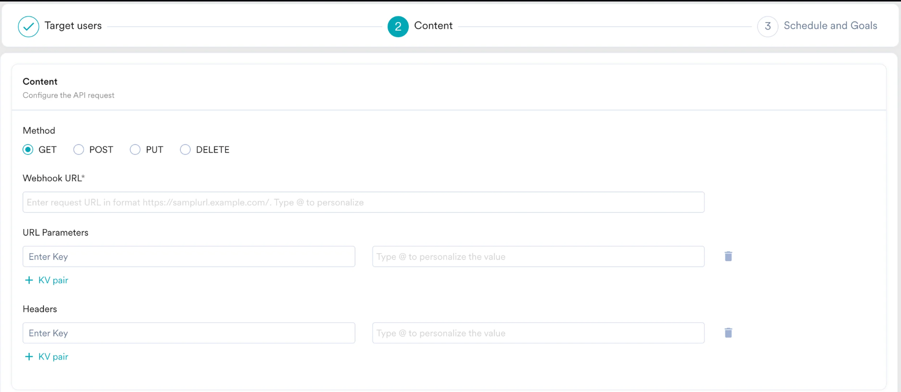
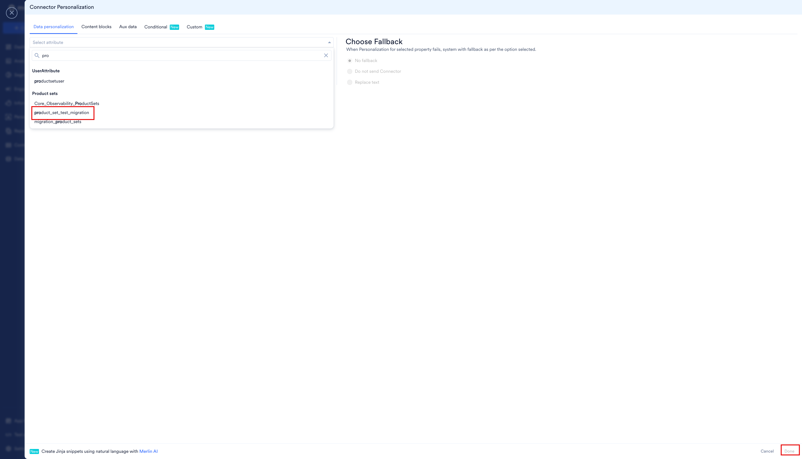

Connector キャンペーンにレコメンデーションを追加すると、全員に同じペイロードを送信するのではなく、各ユーザーのレコメンドアイテムをサードパーティのシステムに送信できます。Connector チャネルでは、レコメンデーションは [Jinja テンプレート言語](/ja/user-guide/campaigns-and-channels/getting-started/message-personalization/jinja-templating-language)を使用してリクエストペイロードに挿入されます。

MoEngage では、Connector キャンペーンの作成は 3 つのステップで行います。

1. Target users
2. Content
3. Schedule and Goals

2 番目のステップ「Content」で、レコメンデーションを使用してキャンペーンをパーソナライズできます。それでは、レコメンデーションを使用してパーソナライズした Connector キャンペーンを作成してみましょう。

<Warning>
  目的のレコメンデーションが作成済みであることを確認してください。キャンペーンのパーソナライズには、アクティブなレコメンデーションのみを使用できます。[レコメンデーションの作成と管理](/ja/user-guide/content/recommendations)の方法を確認してください。
</Warning>

<Note>
  Connector キャンペーンはメッセージを配信するのではなく API を呼び出すため、**Personalized preview** はありません。パーソナライズが正しく解決されることを確認するには、テストキャンペーンを配信し、エンドポイントが受信したペイロードを確認してください。
</Note>

# レコメンデーションを使用した Connector キャンペーンの作成

レコメンデーションを使用した Connector キャンペーンを作成するには、次の手順を実行します。

1. MoEngage のサイドバーメニューで、Engage メニュー項目  にカーソルを合わせます。**Engage** メニューが表示されます。
2. **+ New Campaign** をクリックします。
3. **New Campaign** ダイアログボックスの **CONNECTOR** で、**Custom** をクリックします。
4. **Periodic** キャンペーンをクリックします。**One Time** を選択することもできます。配信タイプの詳細については、[配信タイプ](/ja/user-guide/campaigns-and-channels/getting-started/introduction/delivery-types-moengage-channels)を参照してください。

   
5. ステップ 1「Target users」でキャンペーンの基本情報を入力してオーディエンスを定義し、**Next** をクリックします。
6. ステップ 2 の **Content** タブで、リクエストを設定します。
   1. **POST** などの **Method** を選択します。
   2. **Webhook URL** ボックスに、呼び出すエンドポイントを入力します。
   3. 必要に応じて、**URL Parameters** と **Headers** をキーと値のペアとして追加します。
   4. エンドポイントで認証情報が必要な場合は、**Enable authorization settings** をオンにします。
   5. **Body type** として **Form**、**JSON**、**Raw** のいずれかを選択します。

   
7. レコメンデーションを表示する位置に **@** と入力します。**Connector Personalization** ウィンドウが開きます。**Webhook URL**、**URL Parameters** と **Headers** の値、およびリクエストボディをパーソナライズできます。
8. **Data personalization** タブで、レコメンデーションを検索し、**Product sets** の下でクリックします。
9. **Choose Fallback** で、ユーザーのパーソナライズが失敗した場合の動作を選択します。

   | オプション | 動作 |
   | --- | --- |
   | **No fallback** | レコメンデーションなしでリクエストを送信します。 |
   | **Do not send Connector** | そのユーザーへのリクエストの送信を停止します。 |
   | **Replace text** | 入力した代替テキストを使用してリクエストを送信します。 |

   
10. **Done** をクリックします。
11. 次のセクションで説明するように、挿入された Jinja コードを変更して必要なアイテムを取得します。
12. テストキャンペーンを配信し、エンドポイントで受信したペイロードを確認します。
13. 下部の **Next** をクリックし、キャンペーン設定のステップ 3 である「Schedule and Goals」に進みます。
14. **Schedule and Goals** で適切な設定を行い、キャンペーンを公開します。

# 単一のレコメンドアイテムを取得する

プロダクトセットをそのまま追加すると、セット内のすべてのアイテムが挿入されます。代わりに 1 つの商品を送信するには、プロダクトセットをループ処理します。次の例では、`Recommendations` という名前のレコメンデーションを含む `ProductSet` という名前のプロダクトセットを使用しています。

最初のレコメンドアイテムのタイトルを取得するには:

<CodeGroup>
```text JINJA


{{product.title}}


MOE_NOT_SEND

```
</CodeGroup>

同じペイロードで商品のリンクを送信するには:

<CodeGroup>
```text JINJA


{{product.link}}


MOE_NOT_SEND

```
</CodeGroup>

`MOE_NOT_SEND` は、ユーザーのプロダクトセットが空の場合にリクエストの送信を停止するため、エンドポイントが商品の欠けたペイロードを受信することはありません。

プロダクトセットにはアイテムのリストが含まれており、各アイテムには `name`、`title`、`id`、`image link` などの属性があります。ループ内で属性を取得するには、**@** と入力し、パーソナライズウィンドウからプロパティを選択します。

# 関連記事

- [Connector キャンペーンの作成](/ja/user-guide/campaigns-and-channels/connectors/create/create-a-connector-campaign)
- [レコメンデーションを使用したコンテンツのパーソナライズ](/ja/user-guide/campaigns-and-channels/getting-started/message-personalization/personalize-content-using-recommendations)
- [SMS でのレコメンデーションの使用](/ja/user-guide/content/recommendations/personalize-campaign-with-recommendations/using-recommendations-in-sms)
- [WhatsApp でのレコメンデーションの使用](/ja/user-guide/content/recommendations/personalize-campaign-with-recommendations/using-recommendations-in-whatsapp)
