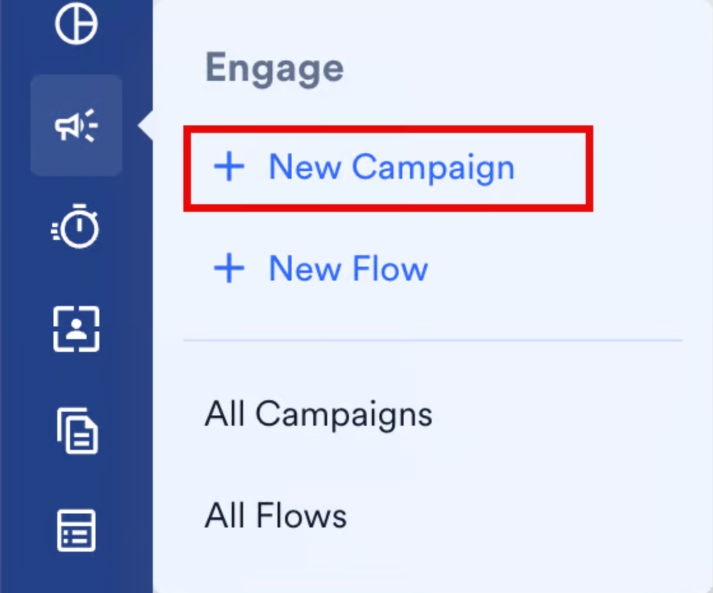
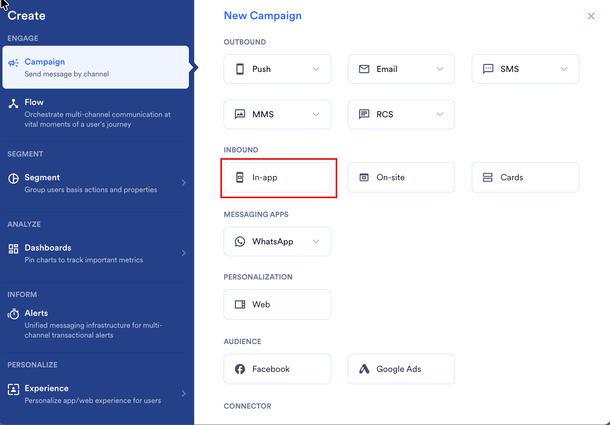
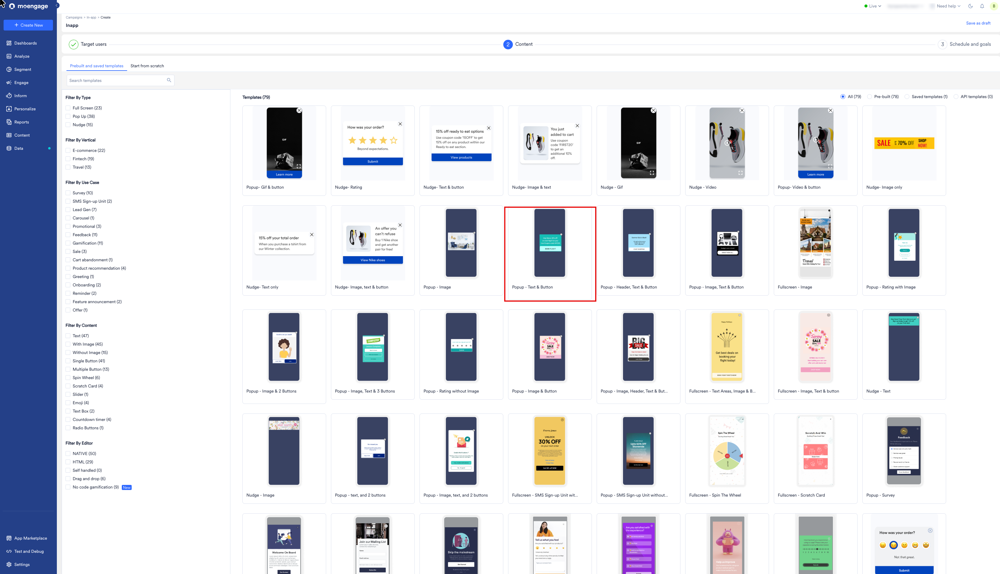
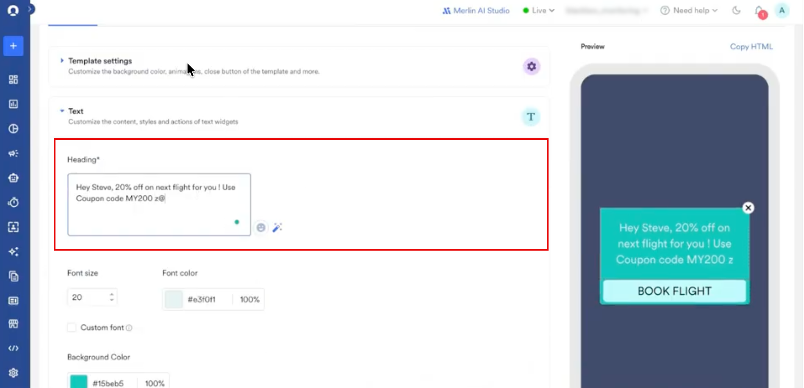
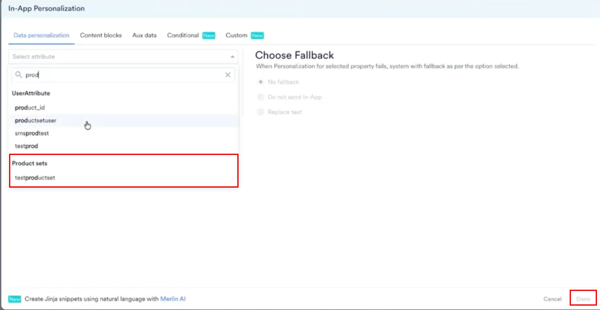
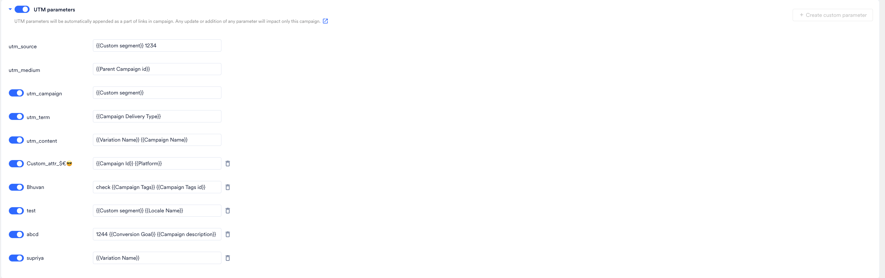
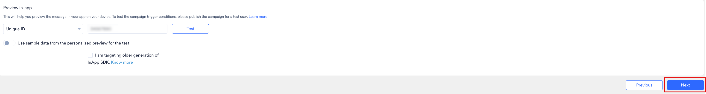

In-App キャンペーンにレコメンデーションを追加すると、全員に同じメッセージを表示するのではなく、各ユーザーの関心に合った商品を表示できます。In-App チャネルでは、レコメンデーションは [Jinja テンプレート言語](/ja/user-guide/campaigns-and-channels/getting-started/message-personalization/jinja-templating-language)を使用してメッセージに挿入されます。

In-App チャネルでは商品グリッドは使用しません。メッセージに他のパーソナライズを追加するのと同じ方法で、パーソナライズメニューからプロダクトセットを追加します。

MoEngage では、In-App キャンペーンの作成は 3 つのステップで行います。

1. Target users
2. Content
3. Schedule and Goals

2 番目のステップ「Content」で、レコメンデーションを使用してキャンペーンをパーソナライズできます。それでは、レコメンデーションを使用してパーソナライズした In-App キャンペーンを作成してみましょう。

<Warning>
  目的のレコメンデーションが作成済みであることを確認してください。キャンペーンのパーソナライズには、アクティブなレコメンデーションのみを使用できます。[レコメンデーションの作成と管理](/ja/user-guide/content/recommendations)の方法を確認してください。
</Warning>

# レコメンデーションを使用した In-App キャンペーンの作成

レコメンデーションを使用した In-App キャンペーンを作成するには、次の手順を実行します。

1. MoEngage のサイドバーメニューで、Engage メニュー項目  にカーソルを合わせます。**Engage** メニューが表示されます。
2. **\+ New Campaign** をクリックします。

   
3. **New Campaign** ダイアログボックスの **INBOUND** で、**In-app** をクリックします。

   
4. ステップ 1「Target users」でキャンペーンの基本情報を入力してオーディエンスを定義し、**Next** をクリックします。
5. ステップ 2 の **Content** タブで、**Prebuilt and saved templates** からテンプレートを選択するか、**Start from scratch** をクリックします。リストを絞り込むには、**Filter By Use Case** の **Product recommendation** など、左側のフィルターを使用します。

   
6. テンプレートエディターの **Text** セクションで、**Heading** などのパーソナライズしたいフィールドをクリックし、レコメンデーションを表示する位置に **@** と入力します。**In-App Personalization** ウィンドウが開きます。

   
7. **Data personalization** タブで、レコメンデーションを検索し、**Product sets** の下でクリックします。
8. **Choose Fallback** で、ユーザーのパーソナライズが失敗した場合の動作を選択します。

   | オプション | 動作 |
   | --- | --- |
   | **No fallback** | レコメンデーションなしで In-App メッセージを送信します。 |
   | **Do not send In-App** | そのユーザーへのメッセージの送信を停止します。 |
   | **Replace text** | 入力した代替テキストを使用してメッセージを送信します。 |

   
9. **Done** をクリックします。
10. 次のセクションで説明するように、挿入された Jinja コードを変更して単一のアイテムを取得します。
11. 下部の **Next** をクリックし、キャンペーン設定のステップ 3 である「Schedule and Goals」に進みます。
12. **Schedule and Goals** で適切な設定を行い、キャンペーンを公開します。

# 単一のレコメンドアイテムを取得する

プロダクトセットをそのまま追加すると、セット内のすべてのアイテムが挿入されます。代わりに 1 つの商品を表示するには、プロダクトセットをループ処理します。次の例では、`Recommendations` という名前のレコメンデーションを含む `ProductSet` という名前のプロダクトセットを使用しています。

最初のレコメンドアイテムのタイトルを取得するには:

<CodeGroup>
```text JINJA


{{product.title}}


MOE_NOT_SEND

```
</CodeGroup>

同じメッセージに商品の画像リンクを追加するには:

<CodeGroup>
```text JINJA


{{product.image_link}}


MOE_NOT_SEND

```
</CodeGroup>

`MOE_NOT_SEND` は、ユーザーのプロダクトセットが空の場合にメッセージの送信を停止するため、商品が欠けたメッセージを受け取るユーザーはいません。別のフォールバックを使用するには、`MOE_NOT_SEND` を表示したいテキストに置き換えるか、何も表示しない場合は空のままにします。

プロダクトセットにはアイテムのリストが含まれており、各アイテムには `title`、`description`、`id`、`link`、`image link` などの属性があります。利用可能な属性は、レコメンデーションが使用するカタログによって決まるため、そのカタログを開いて存在する属性を確認してください。ループ内で属性を取得するには、**@** と入力し、パーソナライズウィンドウからプロパティを選択します。

<Note>
  In-App キャンペーン用に作成した Jinja コードは、Cards と On-Site Messaging でもそのまま動作します。これらのチャネルは同じ方法でプロダクトセットを読み取るためです。
</Note>

# UTM パラメーターを追加する

UTM パラメーターを追加すると、レコメンデーションからのトラフィックが、そのトラフィックをもたらしたキャンペーンに帰属されます。パラメーターの値はメッセージのコンテンツと同じ方法でパーソナライズできるため、1 つのキャンペーンでバリエーションごとまたはセグメントごとにレポートできます。



独自のキーと値のペアを追加するには、**\+ Create custom parameter** をクリックします。パラメーターの完全な一覧とアカウントレベルのデフォルトの適用方法については、[キャンペーンへの UTM パラメーターの追加](/ja/user-guide/settings/advanced-settings/add-utm-parameters-to-campaigns)を参照してください。

# In-App メッセージをプレビューする

公開する前に、**Preview in-app** を使用して自分のデバイスでメッセージを確認します。



**Unique ID** ボックスにテストユーザーの ID を入力し、**Test** をクリックします。**Use sample data from the personalized preview for the test** を選択して、レコメンデーションがプレースホルダーではなく実際の商品に解決されることを確認します。

<Note>
  プレビューにはメッセージ自体が表示されます。キャンペーンのトリガー条件をテストするには、テストユーザー向けにキャンペーンを公開してください。
</Note>

# 関連記事

- [In-App キャンペーンの作成](/ja/user-guide/campaigns-and-channels/in-app-message/create/create-in-app-campaign)
- [レコメンデーションを使用したコンテンツのパーソナライズ](/ja/user-guide/campaigns-and-channels/getting-started/message-personalization/personalize-content-using-recommendations)
- [Cards でのレコメンデーションの使用](/ja/user-guide/content/recommendations/personalize-campaign-with-recommendations/using-recommendations-in-cards)
- [On-Site Messaging でのレコメンデーションの使用](/ja/user-guide/content/recommendations/personalize-campaign-with-recommendations/using-recommendations-in-on-site-messaging)
