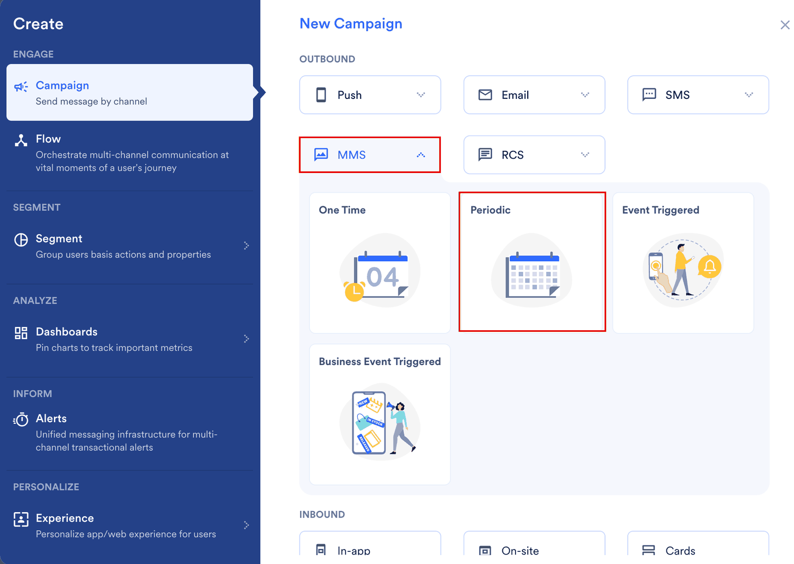
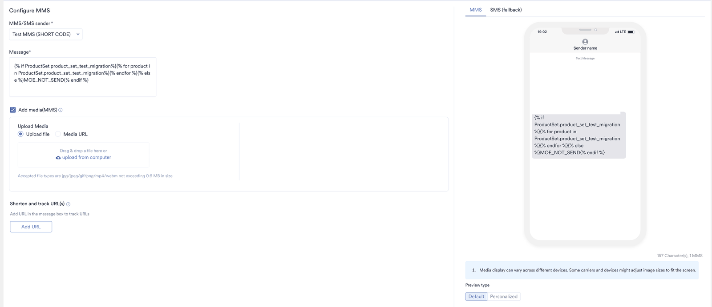
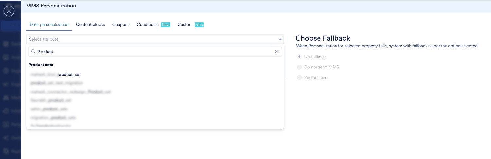
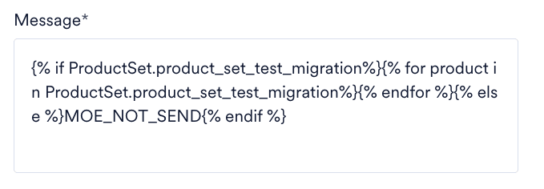
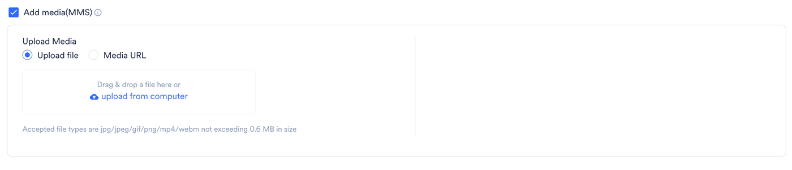
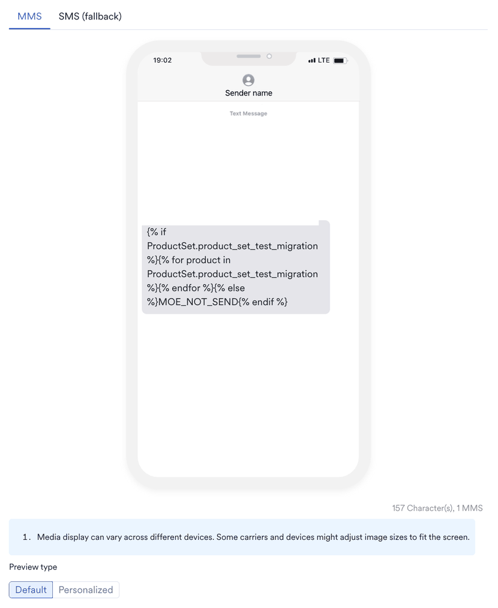
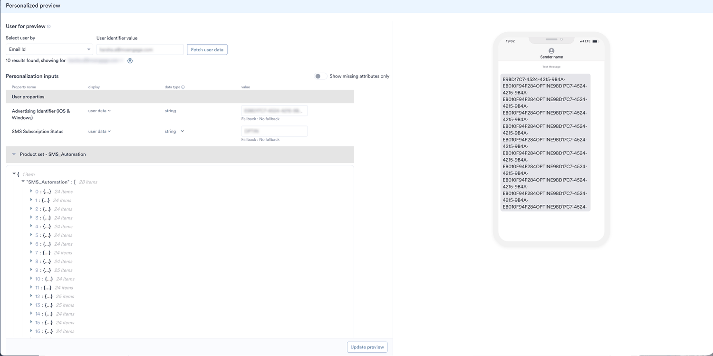

MMS キャンペーンにレコメンデーションを追加すると、全員に同じメッセージを送信するのではなく、各ユーザーの関心に合った商品を送信できます。MMS チャネルでは、レコメンデーションは [Jinja テンプレート言語](/ja/user-guide/campaigns-and-channels/getting-started/message-personalization/jinja-templating-language)を使用してメッセージテキストに挿入されます。

MoEngage では、MMS キャンペーンの作成は 3 つのステップで行います。

1. Target users
2. Content
3. Schedule and Goals

2 番目のステップ「Content」で、レコメンデーションを使用してキャンペーンをパーソナライズできます。それでは、レコメンデーションを使用してパーソナライズした MMS キャンペーンを作成してみましょう。

<Info>
  MMS チャネルは、米国およびカナダ地域でのみ利用できます。アカウントで有効にするには、MoEngage の Customer Success Manager (CSM) または [Support チーム](/ja/user-guide/contact-support/raise-a-support-ticket-through-moengage-dashboard)にお問い合わせください。
</Info>

<Warning>
  目的のレコメンデーションが作成済みであることを確認してください。キャンペーンのパーソナライズには、アクティブなレコメンデーションのみを使用できます。[レコメンデーションの作成と管理](/ja/user-guide/content/recommendations)の方法を確認してください。
</Warning>

<Note>
  MMS メッセージは最大 1600 文字に対応しています。プロダクトセットをそのまま追加するとセット内のすべてのアイテムが挿入されるため、メッセージがこの上限を超える可能性があります。手順 10 で説明するように、Jinja コードを変更して単一のアイテムを取得してください。文字数と MMS の件数はプレビューの下に表示されます。
</Note>

# レコメンデーションを使用した MMS キャンペーンの作成

レコメンデーションを使用した MMS キャンペーンを作成するには、次の手順を実行します。

1. MoEngage のサイドバーメニューで、Engage メニュー項目  にカーソルを合わせます。**Engage** メニューが表示されます。
2. **+ New Campaign** をクリックします。 **Engage** メニューの **All Campaigns** をクリックし、All campaigns ページで **\+ Create campaign** をクリックすることもできます。
3. **New Campaign** ダイアログボックスの **Outbound** で、**MMS** をクリックします。
4. **Periodic** キャンペーンをクリックします。他の MMS キャンペーンタイプでも同じ手順を実行できます。配信タイプの詳細については、[配信タイプ](/ja/user-guide/campaigns-and-channels/getting-started/introduction/delivery-types-moengage-channels)を参照してください。

   
5. ステップ 1「Target users」でキャンペーンの基本情報を入力してオーディエンスを定義し、**Next** をクリックします。
6. ステップ 2 の **Content** タブで、**MMS/SMS sender** リストから、キャンペーンの送信に使用するコネクターを選択します。

   
7. **Message** フィールドで、レコメンデーションを表示する位置に「@」と入力します。**MMS Personalization** ウィンドウが開きます。
8. **Data personalization** タブの **Select attribute** リストで、レコメンデーションを検索し、**Product sets** の下で選択します。
9. **Choose Fallback** でフォールバックを選択し、**Done** をクリックします。
   **Choose Fallback** オプションは、ユーザーのパーソナライズが失敗した場合にそのユーザーが受け取る内容を制御します。

   | フォールバック | 動作 |
   | --- | --- |
   | **No fallback** | レコメンデーションは空の値に置き換えられます。 |
   | **Do not send MMS** | そのユーザーには MMS が送信されません。 |
   | **Replace text** | レコメンデーションは入力したテキストに置き換えられます。 |
10. レコメンデーションから利用可能なすべてのアイテムリストを取得する Jinja コードが自動的に入力されます。ユースケースに合わせてコードを変更できます。たとえば、次は 1 つのアイテムを表示するように変更したコードです。
    <CodeGroup>
    ```jinja Item Title
    
    
    {{product.title}}
    
    
    MOE_NOT_SEND
    
    ```

    ```jinja Item Link
    
    
    {{product.link}}
    
    
    MOE_NOT_SEND
    
    ```
    </CodeGroup>
    
    <Note>
      `MOE_NOT_SEND` は、ユーザーのプロダクトセットが空の場合にメッセージの送信を停止するため、商品が欠けた MMS を受け取るユーザーはいません。
    </Note>
11. アイテムの属性を表示するには、`for` ループ内にカーソルを置いて「@」と入力し、**Select attribute** リストで属性を選択します。属性はループ内に挿入されます (例: `{{product['price']}}`)。
12. 残りの各レコメンデーションについて、手順 7 ～ 11 を繰り返します。メッセージの部分ごとに、レコメンデーションによるパーソナライズまたは静的なテキストコンテンツを選択できます。
13. **Add media(MMS)** を選択し、ファイルをアップロードするか、**Media URL** を選択してアドレスを入力します。レコメンデーションはメディアではなくメッセージテキストをパーソナライズするため、ここで追加するメディアはすべてのユーザーで同じです。

    
14. 設定が完了したら、**Preview type** で **Personalized** をクリックします。MoEngage がユーザーを選択し、実際の値でメッセージを表示します。
15. **MMS** タブと **SMS (fallback)** タブをクリックして、両方でメッセージを確認します。

    
16. 特定のユーザーのメッセージをプレビューするには、編集アイコン  をクリックします。**Personalized preview** スライドアウトが開きます。
17. **Select user by** リストで、使用する識別子を選択します。
18. **User identifier value** フィールドに、ユーザーの識別子を入力します。
19. **Fetch user data** をクリックします。**Personalization inputs** の下に、そのユーザーが利用できるアイテムを含むプロダクトセットが JSON として表示されます。
20. プレビューしたい内容に合わせて JSON を変更します。(任意)
21. **Update preview** をクリックします。

    
    <Note>
      アカウントで **Update preview** を有効にするには、MoEngage の CSM または Support チームにお問い合わせください。詳細については、[パーソナライズされたプレビュー](/ja/user-guide/campaigns-and-channels/getting-started/message-personalization/personalized-preview)を参照してください。
    </Note>
22. すべてのユーザーに対してスケジュールする前に、テストキャンペーンを配信してエンドツーエンドの配信を確認することもできます。
23. レコメンデーションを使用したコンテンツの設定が完了したら、下部の **Next** をクリックし、キャンペーン設定のステップ 3 である「Schedule and Goals」に進みます。
24. **Schedule and Goals** で適切な設定を行い、キャンペーンを公開します。

<Note>
  受信者の国またはデバイスが MMS に対応していない場合、MoEngage は MMS キャンペーンをメディアへのリンクを含む SMS として配信します。これらのユーザーには代わりに SMS でレコメンデーションのテキストが届くため、**MMS** タブだけでなく **SMS (fallback)** タブでも確認してください。
</Note>

# 関連記事

- [MMS キャンペーンのパーソナライズ](/ja/user-guide/campaigns-and-channels/sms-mms-and-rcs/mms/personalize-mms-campaign)
- [レコメンデーションを使用したコンテンツのパーソナライズ](/ja/user-guide/campaigns-and-channels/getting-started/message-personalization/personalize-content-using-recommendations)
- [SMS でのレコメンデーションの使用](/ja/user-guide/content/recommendations/personalize-campaign-with-recommendations/using-recommendations-in-sms)
- [RCS でのレコメンデーションの使用](/ja/user-guide/content/recommendations/personalize-campaign-with-recommendations/using-recommendations-in-rcs)
