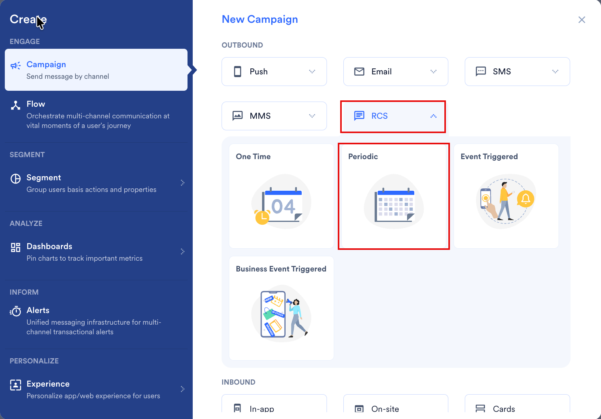
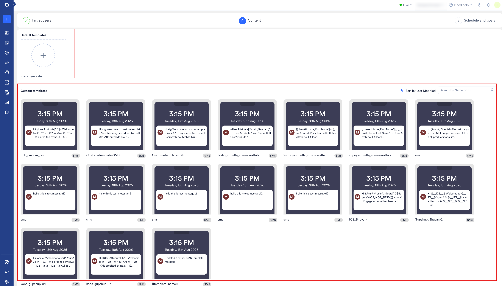
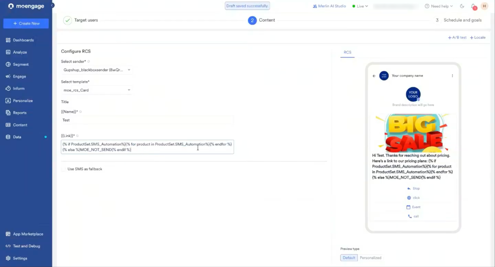
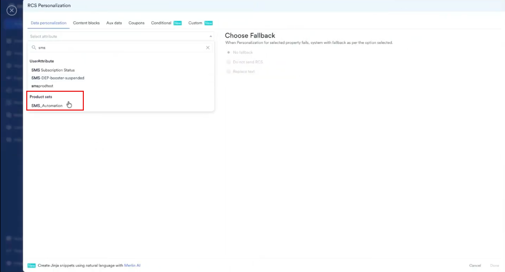
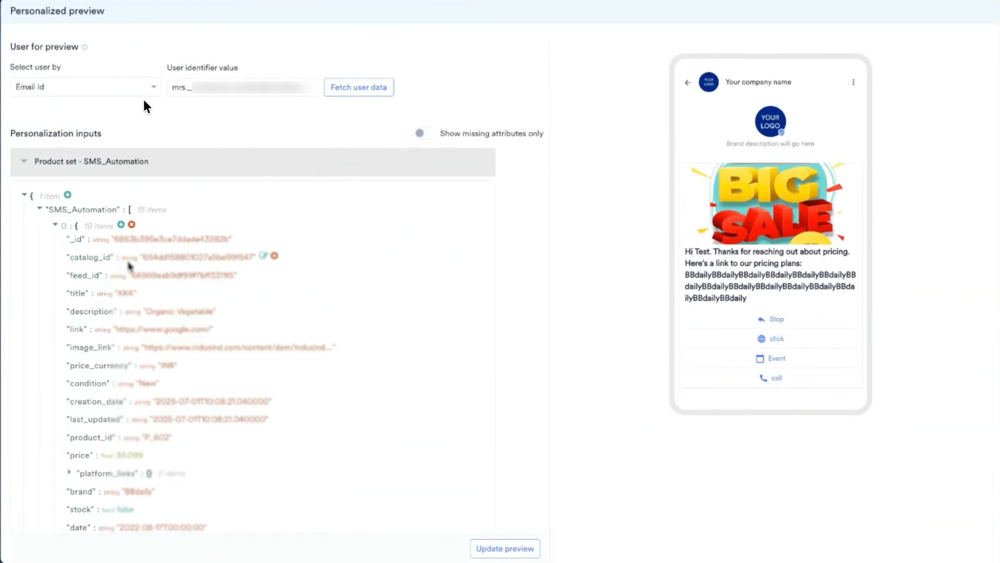

RCS キャンペーンにレコメンデーションを追加すると、全員に同じメッセージを送信するのではなく、各ユーザーの関心に合った商品を送信できます。RCS チャネルでは、レコメンデーションは [Jinja テンプレート言語](/ja/user-guide/campaigns-and-channels/getting-started/message-personalization/jinja-templating-language)を使用してメッセージに挿入されます。

MoEngage では、RCS キャンペーンの作成は 3 つのステップで行います。

1. Target users
2. Content
3. Schedule and Goals

2 番目のステップ「Content」で、レコメンデーションを使用してキャンペーンをパーソナライズできます。それでは、レコメンデーションを使用してパーソナライズした RCS キャンペーンを作成してみましょう。

<Warning>
  目的のレコメンデーションが作成済みであることを確認してください。キャンペーンのパーソナライズには、アクティブなレコメンデーションのみを使用できます。[レコメンデーションの作成と管理](/ja/user-guide/content/recommendations)の方法を確認してください。
</Warning>

# レコメンデーションを使用した RCS キャンペーンの作成

レコメンデーションを使用した RCS キャンペーンを作成するには、次の手順を実行します。

1. MoEngage のサイドバーメニューで、Engage メニュー項目  にカーソルを合わせます。**Engage** メニューが表示されます。
2. **+ New Campaign** をクリックします。 **Engage** メニューの **All Campaigns** をクリックし、All campaigns ページで **\+ Create campaign** をクリックすることもできます。
3. **New Campaign** ダイアログボックスの **OUTBOUND** で、**RCS** をクリックします。
4. **Periodic** キャンペーンをクリックします。他の RCS キャンペーンタイプでも同じ手順を実行できます。配信タイプの詳細については、[配信タイプ](/ja/user-guide/campaigns-and-channels/getting-started/introduction/delivery-types-moengage-channels)を参照してください。
5. ステップ 1「Target users」でキャンペーンの基本情報を入力してオーディエンスを定義し、**Next** をクリックします。
6. ステップ 2 の **Content** タブで、**Default templates** の **Blank Template** をクリックするか、**Custom templates** からテンプレートを選択します。
7. **Select sender** リストで送信者を選択します。
8. **Select template** リストでテンプレートを選択します。
9. **{{Link}}** などのプレースホルダーフィールドで、レコメンデーションを表示する位置に「@」と入力します。**RCS Personalization** ウィンドウが開きます。
10. **Data personalization** タブの **Select attribute** リストで、レコメンデーションを検索し、**Product sets** の下で選択します。
11. **Choose Fallback** でフォールバックを選択し、**Done** をクリックします。
    **Choose Fallback** オプションは、ユーザーのパーソナライズが失敗した場合にそのユーザーが受け取る内容を制御します。

    | フォールバック | 動作 |
    | --- | --- |
    | **No fallback** | レコメンデーションは空の値に置き換えられます。 |
    | **Do not send RCS** | そのユーザーには RCS メッセージが送信されません。 |
    | **Replace text** | レコメンデーションは入力したテキストに置き換えられます。 |
12. レコメンデーションから利用可能なすべてのアイテムリストを取得する Jinja コードが自動的に入力されます。ユースケースに合わせてコードを変更できます。たとえば、次は 1 つのアイテムを表示するように変更したコードです。
    <CodeGroup>
    ```jinja Item Title
    
    
    {{product.title}}
    
    
    MOE_NOT_SEND
    
    ```

    ```jinja Item Image Link
    
    
    {{product.image_link}}
    
    
    MOE_NOT_SEND
    
    ```
    </CodeGroup>
    <Note>
      `MOE_NOT_SEND` は、ユーザーのプロダクトセットが空の場合にメッセージの送信を停止するため、商品が欠けたメッセージを受け取るユーザーはいません。
    </Note>
13. アイテムの属性を表示するには、`for` ループ内にカーソルを置いて「@」と入力し、**Select attribute** リストで属性を選択します。属性はループ内に挿入されます (例: `{{product['price']}}`)。
14. 残りの各レコメンデーションについて、手順 9 ～ 13 を繰り返します。メッセージの部分ごとに、レコメンデーションによるパーソナライズまたは静的なテキストコンテンツを選択できます。
15. 設定が完了したら、**Preview type** で **Personalized** をクリックします。MoEngage がユーザーを選択し、実際の値でメッセージを表示します。
16. 特定のユーザーのメッセージをプレビューするには、編集アイコン  をクリックします。**Personalized preview** スライドアウトが開きます。
17. **Select user by** リストで、使用する識別子を選択します。
18. **User identifier value** フィールドに、ユーザーの識別子を入力します。
19. **Fetch user data** をクリックします。**Personalization inputs** の下に、そのユーザーが利用できるアイテムを含むプロダクトセットが JSON として表示されます。
20. プレビューしたい内容に合わせて JSON を変更します。(任意)
21. **Update preview** をクリックします。
    <Note>
      アカウントで **Update preview** を有効にするには、MoEngage の CSM または Support チームにお問い合わせください。詳細については、[パーソナライズされたプレビュー](/ja/user-guide/campaigns-and-channels/getting-started/message-personalization/personalized-preview)を参照してください。
    </Note>
22. すべてのユーザーに対してスケジュールする前に、テストキャンペーンを配信してエンドツーエンドの配信を確認することもできます。
23. レコメンデーションを使用したコンテンツの設定が完了したら、下部の **Next** をクリックし、キャンペーン設定のステップ 3 である「Schedule and Goals」に進みます。
24. **Schedule and Goals** で適切な設定を行い、キャンペーンを公開します。

# 関連記事

- [RCS キャンペーンの作成](/ja/user-guide/campaigns-and-channels/sms-mms-and-rcs/rcs/create-an-rcs-campaign)
- [レコメンデーションを使用したコンテンツのパーソナライズ](/ja/user-guide/campaigns-and-channels/getting-started/message-personalization/personalize-content-using-recommendations)
- [SMS でのレコメンデーションの使用](/ja/user-guide/content/recommendations/personalize-campaign-with-recommendations/using-recommendations-in-sms)
- [WhatsApp でのレコメンデーションの使用](/ja/user-guide/content/recommendations/personalize-campaign-with-recommendations/using-recommendations-in-whatsapp)
