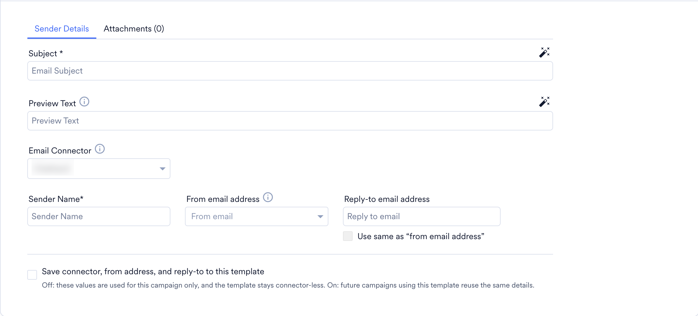
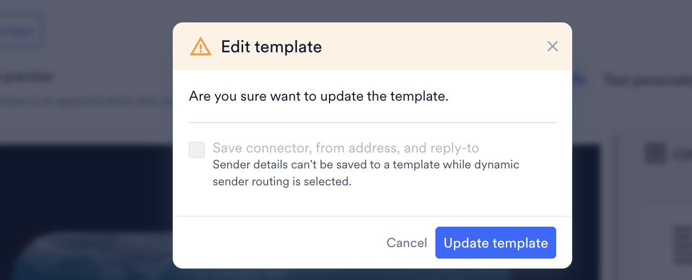
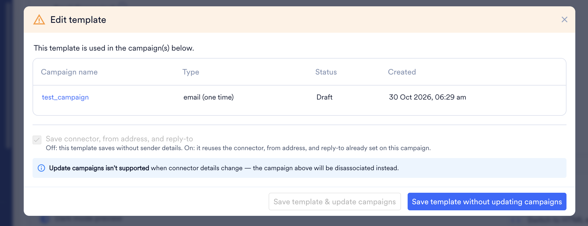

import { AcademyCourse } from "/snippets/academy-course.jsx";
import FeatureAvailability from '/ja/snippets/feature-availability.mdx';

<AcademyCourse
  title="テンプレート"
  href="https://academy.moengage.com/student/activity/3134515-templates" />

<FeatureAvailability />

# はじめに

MoEngage の _Templates_ 機能は、効果的なツールを提供することで、コンテンツの作成と管理を効率化します。テンプレートを管理することで、ブランディングの一貫性を確保し、整理にかかる時間と労力を節約し、チームでのコラボレーションを促進できます。

この _Templates_ ページは、テンプレートに関するあらゆるものを集約する中心的なハブであり、複数のチャネルのすべてのテンプレートを 1 か所でまとめて整理・管理し、手間なく取得できます。

この機能を使用すると、次のことが可能です。

- さまざまなチャネル向けのテンプレートを作成する。
- **Drag and drop** エディターまたは **Custom HTML editor** を使用して、要件に合わせてテンプレートを編集する。
- テンプレートをフォルダーで管理し、フォルダーをチーム間で共有する。
- テンプレートを個別にチーム間で共有する。
- ユーザーに送信する前にテンプレートをプレビューする。
- パーソナライズされたコミュニケーションのためにテンプレートを複製してカスタマイズする。
- 好みに応じてテンプレートを表示・並べ替える。
- テンプレートのバージョン履歴を確認する。

# テンプレートの管理

## テンプレートの作成

さまざまなチャネル向けのテンプレートを作成し、1 か所で管理できます。

<Info>
  **Template** 機能は、Email チャネルと On-site チャネルでのみサポートされています。
</Info>

1. MoEngage のサイドバーメニューで、Content メニュー項目  にカーソルを合わせます。**Content** メニューが表示されます。
2. **Templates** をクリックします。 Templates ページが表示されます。
3. ウィンドウの右上にある **\+** **Create template** をクリックします。**Email** と **On-site** のテンプレートを作成できます。テンプレートを作成するチャネルを選択します。

<Tabs>
  <Tab title="メール用テンプレートの作成">
    1. **Choose Template:** 次のエディターに基づいて、事前構築済みのテンプレートまたは保存済みのテンプレートからテンプレートを選択できます: [**Drag and drop**](/ja/user-guide/campaigns-and-channels/email/create/create-content-with-the-drag-and-drop-editor) エディターまたは [**Custom HTML editor**](/ja/user-guide/campaigns-and-channels/email/create/create-content-with-custom-html-editor)。
    2. **Template details:** 次の **Template details** を入力します。
       <ol style={{ listStyleType: 'decimal' }}>
         <li>**Name:** テンプレートの名前を入力します。</li>
         <li>**Tag:** **Tags** リストで、テンプレートに追加するタグを選択できます。</li>
         <li>**Message Type:** ユーザーに送信する内容に応じて、メッセージタイプとして **Promotional/Marketing** または **Transactional** を選択します。</li>
         <li>**Team:** このテンプレートにアクセスできるチームを選択します。</li>
         <li>**Destination to save:** このテンプレートの保存先を選択します。フォルダー内に保存することも、フォルダーを使用せずに直接保存することもできます。</li>
         <li>**Communication Type:** コミュニケーションタイプとして **Engage** または **Inform** を選択します。</li>
       </ol>
    3. **Email details:** 次の **Email details** を入力します。
    4. **Sender Details:** メールの送信者に関する次の詳細を入力します。
       <ol style={{ listStyleType: 'decimal' }}>
         <li>**Preview text:** ユーザーの受信トレイに表示されるプレビューテキストを入力します。</li>
         <li>**Email connector:** このテンプレートで使用するメールコネクター (SendGrid や Amazon SES のコネクターなど) を選択します。リストには、メール設定で構成されているコネクターが表示されます。詳細については、[メールチャネルの設定](/ja/user-guide/campaigns-and-channels/email/getting-started-with-email/configure-email-channel)を参照してください。</li>
         <li>**Sender name:** 送信者の名前を入力します。</li>
         <li>**From email address:** **From email address** リストで、選択したコネクターにマッピングされているメールアドレスを選択します。</li>
         <li>**Reply-to email address:** 返信の送信先となるメールアドレスを入力します。送信元アドレスを返信先アドレスとして使用するには、**Use same as from address** チェックボックスをオンにします。</li>
         <li>**Save connector, from address, and reply-to to this template:** このチェックボックスをオンにすると、メールコネクター、送信元メールアドレス、返信先メールアドレスがテンプレートとともに保存されます。このテンプレートを使用するキャンペーンでは、同じ詳細が再利用されます。このチェックボックスをオフにすると、これらの値はテストにのみ使用され、テンプレートはコネクターの詳細なしで保存されます。</li>
       </ol>
       

       <Note>
         テンプレートへのコネクターの詳細の保存は段階的に展開されており、お使いのワークスペースではまだ利用できない場合があります。テンプレートに **From email address** フィールドのみが表示される場合、アドレスはデフォルトのコネクターから読み取られ、テンプレートのテストにのみ使用されます。コネクターの詳細の保存を有効にするには、MoEngage の Customer Success Manager (CSM) または Support チームにお問い合わせください。
       </Note>

       コネクターの詳細をテンプレートとともに保存する場合、次のルールが適用されます。
       * **すべてのフィールドがまとめて保存されます:** メールコネクター、送信元メールアドレス、返信先メールアドレスは 1 つのセットとして保存されます。一部のみを保存することはできません。
       * **検証:** テンプレートを保存するときに、MoEngage は次の点を確認します。
         * 選択したコネクターがワークスペースに存在すること。
         * 送信元メールアドレスが選択したコネクターにマッピングされていること。
         * 送信元メールアドレスが検証済みであること。

         <Note>
           送信元メールアドレスをパーソナライズした場合、MoEngage はそのアドレスに対するマッピングと検証のチェックをスキップします。これは、ダッシュボードから保存したテンプレートと API を通じて保存したテンプレートの両方に適用されます。
         </Note>
       * **コネクターの詳細は更新できますが、削除はできません:** コネクターの詳細をテンプレートとともに保存した後は、それらを変更できますが、そのテンプレートから削除することはできません。コネクターの詳細を含まないバージョンを作成するには、**Save as new and Publish** を使用し、**Save connector, from address, and reply-to to this template** チェックボックスをオフにします。
       * **Dynamic Sender Routing (Inform):** Inform のメールアラートの設定中に [Dynamic Sender Routing](/ja/user-guide/inform/advanced-concepts/dynamic-sender-routing) を使用するコネクターを選択した場合、テンプレートの保存時に次のルールが適用されます。
         * **テンプレートにコネクターの詳細がない場合:** テンプレートは保存できますが、コネクターの詳細は保存されません。その他のフィールドはすべて保存されます。
         * **テンプレートにすでにコネクターの詳細がある場合:** コネクターを Dynamic Sender Group コネクターに変更すると、テンプレートを保存できません。保存済みのコネクターを Dynamic Sender Group コネクターに置き換えることはできません。

         
    5. **Attachments:** **Local file**、添付ファイルの **URL** から添付ファイルを追加するか、**Personalized attachments** を追加できます。詳細については、[こちら](/ja/user-guide/campaigns-and-channels/email/create/personalize-email-content)を参照してください。この <Icon icon="list" /> アイコンをクリックすると、メールの詳細を非表示にできます。
    6. **Template Editor:** 提供されているツールを使用してテンプレートを設定します。詳細については、[こちら](/ja/user-guide/campaigns-and-channels/email/create/create-content-with-the-drag-and-drop-editor)を参照してください。
    7. テンプレートエディターウィンドウの右上にある **Preview** をクリックすると、テンプレートとそのパーソナライゼーションをプレビューできます。詳細については、[こちら](/ja/user-guide/campaigns-and-channels/getting-started/message-personalization/personalized-preview)を参照してください。
    8. **Test Campaigns:** ユーザーに送信する前に、キャンペーンをテストして、テンプレートが設定どおりに表示されることを確認できます。
       1. **Custom Segment** を選択するか、カンマで区切った複数のメールアドレスを入力して、作成したキャンペーンをテストします。
       2. パーソナライズされたデータがユーザーに対して正しくレンダリングされるかどうかをテストするには、カスタムセグメントでテンプレートをテストする必要があります。
          <Info>
            任意のカスタムセグメントを使用したテストキャンペーンは、選択したカスタムセグメントから最大 50 人のユーザーを対象とします。
          </Info>
       3. テンプレートでパーソナライズしたサンプルデータをテストに使用するには、**Use sample data from the personalized preview for the text** トグルをオンにします。
    9. **Save and Publish** をクリックしてこのテンプレートをキャンペーンで使用するか、**Save as draft** をクリックして後で編集を続けます。

    <Info>
      下書き状態のテンプレートはキャンペーンで使用できません
    </Info>
  </Tab>
  <Tab title="On-site Messaging 用テンプレートの作成">
    On-site を選択すると、希望するプラットフォームとして Web、Mobile Web、またはその両方を選択するよう求められます。

    1. **Choose Template:** テンプレートを一から作成するか、既存のテンプレートを変更できます。
    2. 次の **Template details** を入力します。
       1. **Name:** テンプレートの名前を入力します。
       2. **Tags:** 必要に応じて、テンプレートに **Tags** を追加できます。
       3. **Platforms:** テンプレートの対象プラットフォームを選択します。利用可能なプラットフォームは Web、Mobile Web、TV です。
          <Info>
            ダッシュボードで TV プラットフォームを利用できない場合は、MoEngage の Customer Success Manager (CSM) または Support チームにお問い合わせください[。](/ja/user-guide/contact-support/raise-a-support-ticket-through-moengage-dashboard)
          </Info>
       4. **Team:** このテンプレートにアクセスできるチームを選択します。
       5. **Destination to save:** テンプレートを保存する保存先フォルダーを選択できます。
    3. **Template Editor:** **Drag & drop editor** または **Custom** **HTML editor** を使用してテンプレートを作成できます。詳細については、こちらを参照してください。
    4. **Display Settings:** このオプションでは、キャンペーンの表示設定を構成できます。
       <Info>
         設定オプションはテンプレートタイプによって異なる場合があります。各設定の説明は次の表のとおりです。
       </Info>
       | 表示設定 | テンプレートタイプ | 説明 |
       | --- | --- | --- |
       | **Show this message if another campaign is already displayed on the webpage.** | Popups、Nudges、Banners | このチェックボックスを選択すると、ページ上に別の OSM がすでに表示されている場合でも、この OSM キャンペーンを表示できます。注: これを機能させるには、OSM をトリガーするキャンペーンイベントが異なっている必要があります。 |
       | **Keep this message in place on scroll.** | Banner | このチェックボックスを選択すると、Banner を固定表示にできます。 |
       | **This message will push the contents of the page down.** | Banner | このチェックボックスを選択すると、Banner がウェブサイトのコンテンツと重ならずに、ウェブサイト上部のスペースを占有します。これを機能させるには、選択した Banner が上部に配置されている必要があり、ウェブサイトのヘッダーが固定 (sticky) でないことが必要です。 |
    5. **Save and Publish** をクリックしてこのテンプレートをキャンペーンで使用するか、**Save as a draft** をクリックして後で編集を続けます。

    <Info>
      下書き状態のテンプレートはキャンペーンで使用できません。
    </Info>
  </Tab>
</Tabs>

## テンプレートの並べ替え

要件に応じてテンプレートを並べ替えて表示できます。テンプレートは、次の選択内容に基づいて表示されます。

- **All:** チャネルに関係なく、利用可能なすべてのテンプレートを表示します。
- **Email:** Email 用に作成されたテンプレートを表示します。
- **On-site:** On-site 用に作成されたテンプレートを表示します。

1. **View by:** テンプレートを **Folders and templates** または **Templates only** で表示できます。
   - **Folders and templates:** このオプションでは、フォルダー内のテンプレートとフォルダーに含まれないテンプレートを表示できます。
   - **Templates only:** このオプションでは、フォルダーに関係なくすべてのテンプレートを表示できます。
2. **Sort by:** テンプレートを **Name** と **Last modified** で並べ替えることができます。
   - **Name:** このオプションでは、テンプレート名のアルファベット順にテンプレートを並べます。この <Icon icon="arrow-down-arrow-up" /> アイコンを使用して、昇順 (A-\>Z) または降順 (Z-\>A) を選択できます。
     - **Ascending (A-\>Z):** この並べ替えオプションでは、テンプレート名に基づいてテンプレートを昇順で表示します。
     - **Descending (Z-\>A):** この並べ替えオプションでは、テンプレート名に基づいてテンプレートを降順で表示します。
   - **Last Modified:** このオプションでは、テンプレートに対して行われた最近の変更に基づいてテンプレートを並べます。この <Icon icon="arrow-up-arrow-down" /> アイコンを使用して、Old to New または New to Old を選択してテンプレートを並べ替えることができます。
     - **Old to New:** この並べ替えオプションでは、過去の変更 (Old) から最近の変更 (New) の順にテンプレートを表示します。
     - **New to Old:** この並べ替えオプションでは、最近の変更 (New) から過去の変更 (Old) の順にテンプレートを表示します。

## フィルター

次のフィルターを使用して、必要に応じてテンプレートを絞り込むことができます。

1. **Template source:** テンプレートを絞り込むテンプレートソースを選択できます。All templates、Saved templates、API templates からテンプレートを絞り込めます。
2. **Tags:** 絞り込みたいテンプレートに関連付けられたタグを選択できます。
3. **Message Type (Only for Email):** メッセージタイプに基づいてテンプレートを絞り込めます。
4. **Status:** 絞り込みたいテンプレートのステータスを選択できます。
5. **Last updated by:** 最近テンプレートを更新したユーザーに基づいてテンプレートを取得できます。
6. **Team:** テンプレートにアクセスできるチームに基づいてテンプレートを絞り込めます。
7. **Communication type:** 次のオプションからコミュニケーションを絞り込めます: **All、Engage**、**Inform**。
8. **Editor:** テンプレートが作成されたエディターに基づいてテンプレートを絞り込めます。
9. **Platform (only for On-site):** **Web、Mobile**、**TV** などのプラットフォームに基づいてテンプレートを絞り込めます。
10. **Content (only for On-site):** Timers、carousels などのコンテンツに基づいてテンプレートを絞り込めます。
11. **Template type (only for On-site):** Banner、pop-up などのテンプレートタイプに基づいてテンプレートを絞り込めます。
12. **Use case (only for On-site):** テンプレートに関連付けられたユースケースに基づいてテンプレートを絞り込めます。
13. **Show shared items only:** このオプションを有効にすると、他のチームと共有されているテンプレートとフォルダーを絞り込めます。

## テンプレートのアクション

フォルダー内のこの <Icon icon="ellipsis-stroke-vertical" /> アイコンをクリックすると、テンプレートに対して次のアクションを実行できます。

テンプレート内のこの <Icon icon="ellipsis-stroke-vertical" /> アイコンをクリックします。次のアクションが表示されます。

1. **Preview:** プレビューアクションを選択すると、左側のウィンドウペインにテンプレートの一覧が表示され、いずれかを選択してプレビューできます。横にある矢印 <Icon icon="circle-chevron-right" /> アイコンをクリックすると、テンプレートを切り替えられます。ウィンドウの右側では、バージョン履歴や作成者の詳細などを確認できます。メイン画面に表示されている既存のテンプレートを直接クリックしてプレビューすることもできます。
2. **Share:** このオプションでは、テンプレートを複数のチームと共有できます。フォルダー/テンプレートを複数のチームと共有すると、それらのチームはテンプレートにアクセスして使用したり、複製して要件に合わせてさらに編集したりできます。テンプレートを他のチームと共有すると、チームメンバーはテンプレートが共有されたことを知らせるメールを受け取ります。
3. **Edit:** 作成した既存のテンプレート、または利用可能な事前構築済みのテンプレートを選択して、テンプレートを編集できます。
   1. 編集するテンプレートを選択します。Name、Tags、Teams、Destination、Platform などのテンプレートの詳細を編集できます。
   2. メールテンプレートの場合は、**Sender details** (テンプレートとともに保存されている場合はコネクターの詳細を含む) や **Attachments** などのメールの詳細を編集します。詳細については、[こちら](/ja/user-guide/campaigns-and-channels/email/create/create-an-email-campaign)を参照してください。
   3. On-site テンプレートの場合は、提供されているツールを使用して編集できます。詳細については、[こちら](/ja/user-guide/campaigns-and-channels/on-site-message/create/osm-editor)を参照してください。
   4. **Save as new and Publish** をクリックして新しいテンプレートとして保存するか、**Update and Publish** をクリックして変更内容でテンプレートを更新します。
      <Note>
        テンプレートにすでにコネクターの詳細が保存されている場合、**Update and Publish** をクリックすると、**Save connector, from address, and reply-to to this template** チェックボックスはオンになっており、オフにすることはできません。コネクター、送信元メールアドレス、返信先メールアドレスは引き続き変更できます。コネクターの詳細なしでテンプレートを保存するには、**Save as new and Publish** をクリックしてチェックボックスをオフにします。
      </Note>
   5. **Editing templates associated with campaigns:** テンプレートがアクティブ、スケジュール済み、または下書きのキャンペーンの一部である場合、**Edit template** ダイアログに関連付けられたキャンペーンが一覧表示されます。次のいずれかを選択します。
      * **Save template & update campaigns:** テンプレートを保存し、関連付けられたメールキャンペーンに変更を適用します。
      * **Save template without updating campaigns:** 関連付けられたキャンペーンを変更せずにテンプレートを保存します。

      <Warning>
        テンプレートのコネクターの詳細を変更した場合、**Save template & update campaigns** は無効になります。**Save template without updating campaigns** をクリックすると、関連付けられたキャンペーンはテンプレートとの関連付けが解除されます。それらのキャンペーンは現在のコネクターの詳細を保持し、以降のテンプレートの更新は適用されなくなります。コンテンツ、件名、送信者名など、その他のフィールドへの変更は、引き続き **Save template & update campaigns** で関連付けられたキャンペーンに適用できます。
      </Warning>

      <Info>
        On-site messaging では、アクティブまたはスケジュール済みのキャンペーンに関連付けられたテンプレートは編集できません
      </Info>
      
4. **Duplicate:** このオプションでは、テンプレートを複製してさらに編集できます。現在のテンプレートの複数のバージョンを管理できます。たとえば、同じテンプレートの複数のバージョンを管理して、地域に基づき、現地の言語や季節のテーマで顧客をターゲットにできます。
5. **Rename:** このオプションでは、テンプレートの名前を変更できます。
6. **Move:** このオプションでは、テンプレートをフォルダーへ、またはフォルダー間で移動できます。
7. **Delete:** このオプションでは、テンプレートを削除できます。アクティブなキャンペーンの一部ではないテンプレートを削除すると、直接削除されます。
   - **Delete templates associated with the email campaigns:** アクティブまたはスケジュール済みのキャンペーンに関連付けられたテンプレートを削除しようとすると、キャンペーンの詳細を示すプロンプトが表示され、削除する前に該当するテンプレートを停止するよう求められます。
     <Info>
       On-site messaging では、アクティブまたはスケジュール済みのキャンペーンに関連付けられたテンプレートは削除できません。
     </Info>
     

# フォルダーの管理

フォルダーを作成して、個別のキャンペーンやチャネルのテンプレートを管理し、チーム間で共有できます。たとえば、メールキャンペーンからプロモーションメッセージを送信するには、メッセージタイプとしてプロモーションを選択してテンプレートを作成し、_email_ という名前のフォルダーで管理できます。また、トランザクションテンプレート用に別のサブフォルダーを管理することもできます。

<Info>
  フォルダー内で管理できるサブフォルダーは 1 階層のみです
</Info>

1. タイトルバーから **Create folder** をクリックします。
2. **Create folder** ダイアログボックスで次の詳細を入力します。
   1. フォルダーの名前を入力します。
   2. **Teams** リストで、チームを選択します。
   3. **Tag(s)** リストで、フォルダーのタグを選択し、**Create** をクリックします。

## フォルダーのアクション

フォルダー内のこの <Icon icon="ellipsis-stroke-vertical" /> アイコンをクリックすると、フォルダーに対して次のアクションを実行できます。

1. **Share:** このオプションでは、フォルダーを複数のチームと共有できます。フォルダーを複数のチームと共有すると、それらのチームはテンプレートのフォルダーにアクセスし、複製して要件に合わせてさらに編集できます。フォルダーを他のチームと共有すると、チームのメンバーはそのフォルダーに関するメール通知を受け取ります。
2. **Edit:** このオプションでは、フォルダー名とフォルダーに関連付けられたタグを編集できます。
3. **Move:** このオプションでは、現在のフォルダーを別のフォルダーに移動できます。
4. **View details:** このオプションでは、フォルダーの詳細を確認できます。
5. **Delete:** このオプションでは、フォルダーを削除できます。アクティブなキャンペーンの一部ではないフォルダーを削除すると、フォルダーは直接削除されます。
   - **Deleting folders associated with email campaigns:** 削除しようとしているテンプレートのいずれかがアクティブまたはスケジュール済みのキャンペーンの一部である場合、キャンペーンの詳細が表示され、削除する前にキャンペーンを停止するよう求められます。**Move above templates outside and delete folder** チェックボックスを選択すると、アクティブまたはスケジュール済みのキャンペーンに関連付けられたテンプレートをフォルダーから取り出し、**Templates** で管理できます。
     <Info>
       On-site messaging では、アクティブまたはスケジュール済みのキャンペーンに関連付けられたフォルダーは削除できません。
     </Info>

# キャンペーン作成におけるテンプレートの使用

**Templates** 機能は、キャンペーンの作成時に、テンプレートの作成と管理の機能によって重要な役割を果たします。詳細については、[こちら](/ja/user-guide/campaigns-and-channels/email/create/create-an-email-campaign)を参照してください。

- キャンペーンの作成時には、該当するチャネル向けに作成したテンプレートが表示されます。また、キャンペーンに追加したタグを持つテンプレートも表示されます。たとえば、メールキャンペーンの作成時に _New customer_ というタグを追加すると、_New customer_ というタグを持つメールテンプレートが表示されます。
- 各チャネルで利用可能なオプションに基づいてテンプレートを絞り込めます。
- キャンペーンの作成時には、テンプレートが作成されたエディターに基づいてテンプレートを選択できます。
- **Templates** 機能では、キャンペーンの作成中に作成したテンプレートも管理されます。キャンペーン作成フローで作成したテンプレートは、**Templates** から取得して編集できます。

<Info>
  テンプレートの編集、削除、保存、公開の権限は、ロールに基づいて決定されます。詳細については、[こちら](/ja/user-guide/settings/account/team-management/access-roles)を参照してください。
</Info>

# FAQ

<AccordionGroup>
  <Accordion title="下書きとして保存されたテンプレートをキャンペーンで使用できますか？" icon="sparkles">
    いいえ。下書きのテンプレートはキャンペーンで使用できません。テンプレートをキャンペーンで使用するには、**Save and Publish** をクリックします。
  </Accordion>
  <Accordion title="テンプレートの編集、削除、保存、公開は誰が行えますか？" icon="sparkles">
    テンプレートの編集、削除、保存、公開の権限は、ロールによって決まります。詳細については、[Access Roles](/ja/user-guide/settings/account/team-management/access-roles) を参照してください。
  </Accordion>
  <Accordion title="メールテンプレートにはどの送信者の詳細を保存できますか？" icon="sparkles">
    **Save connector, from address, and reply-to to this template** チェックボックスをオンにすると、メールコネクター、送信元メールアドレス、返信先メールアドレスを保存できます。このテンプレートを使用するキャンペーンでは、同じ詳細が再利用されます。チェックボックスをオフにすると、これらの値はテストにのみ使用され、テンプレートはコネクターの詳細なしで保存されます。
  </Accordion>
  <Accordion title="コネクターのみ、または送信元メールアドレスのみを保存できますか？" icon="sparkles">
    いいえ。メールコネクター、送信元メールアドレス、返信先メールアドレスは 1 つのセットとして保存されます。
  </Accordion>
  <Accordion title="送信者の詳細をテンプレートとともに保存するとき、MoEngage は何を確認しますか？" icon="sparkles">
    MoEngage は、コネクターがワークスペースに存在すること、および送信元メールアドレスがそのコネクターにマッピングされ、検証済みであることを確認します。送信元メールアドレスをパーソナライズした場合、MoEngage はそのアドレスに対するマッピングと検証のチェックをスキップします。
  </Accordion>
  <Accordion title="Email connector フィールドが表示されないのはなぜですか？" icon="sparkles">
    テンプレートへのコネクターの詳細の保存は段階的に展開されています。テンプレートに **From email address** フィールドのみが表示される場合、アドレスはデフォルトのコネクターから読み取られ、テンプレートのテストにのみ使用されます。コネクターの詳細の保存を有効にするには、MoEngage の Customer Success Manager (CSM) または Support チームにお問い合わせください。
  </Accordion>
  <Accordion title="テンプレートとともに保存した送信者の詳細を後から削除できますか？" icon="sparkles">
    いいえ。変更はできますが、削除はできません。コネクターの詳細を含まないバージョンを作成するには、**Save as new and Publish** をクリックし、**Save connector, from address, and reply-to to this template** チェックボックスをオフにします。
  </Accordion>
  <Accordion title="Dynamic Sender Routing のコネクターをテンプレートとともに保存できますか？" icon="sparkles">
    いいえ。テンプレートにコネクターの詳細がない場合、テンプレートは保存できますが、コネクターの詳細は保存されません。テンプレートにすでにコネクターの詳細がある場合、Dynamic Sender Group コネクターでテンプレートを保存することはできません。
  </Accordion>
  <Accordion title="メールテンプレートを使用する前にテストするにはどうすればよいですか？" icon="sparkles">
    カスタムセグメント、またはカンマ区切りのメールアドレスでテストします。パーソナライズされたデータが正しく表示されることを確認するには、カスタムセグメントでテストします。カスタムセグメントを使用したテストでは、そのセグメントから最大 50 人のユーザーがターゲットになります。
  </Accordion>
  <Accordion title="Save as new and Publish と Update and Publish の違いは何ですか？" icon="sparkles">
    **Save as new and Publish** は、変更内容を新しいテンプレートとして保存します。**Update and Publish** は、変更内容で既存のテンプレートを更新します。
  </Accordion>
  <Accordion title="Save template & update campaigns が利用できないのはなぜですか？" icon="sparkles">
    テンプレートのコネクターの詳細を変更したためです。**Save template without updating campaigns** をクリックしてください。関連付けられたキャンペーンはテンプレートとの関連付けが解除され、現在のコネクターの詳細を保持します。コンテンツ、件名、送信者名など、その他のフィールドへの変更は、引き続き **Save template & update campaigns** で適用できます。
  </Accordion>
  <Accordion title="キャンペーンで使用されている On-site テンプレートを編集または削除できますか？" icon="sparkles">
    いいえ。On-site messaging では、アクティブまたはスケジュール済みのキャンペーンに関連付けられたテンプレートを編集または削除することはできません。
  </Accordion>
  <Accordion title="テンプレートを他のチームと共有するにはどうすればよいですか？" icon="sparkles">
    テンプレートまたはフォルダーで **Share** を使用します。共有されたチームは、テンプレートにアクセスして使用したり、複製してさらに編集したりできます。テンプレートまたはフォルダーが共有されると、チームメンバーにメールが届きます。
  </Accordion>
  <Accordion title="フォルダーは何階層まで作成できますか？" icon="sparkles">
    フォルダー内で管理できるサブフォルダーは 1 階層のみです。
  </Accordion>
  <Accordion title="キャンペーンの作成中に作成したテンプレートを見つけることはできますか？" icon="sparkles">
    はい。キャンペーン作成フローで作成したテンプレートも **Templates** で管理されており、そこで取得して編集できます。
  </Accordion>
</AccordionGroup>
