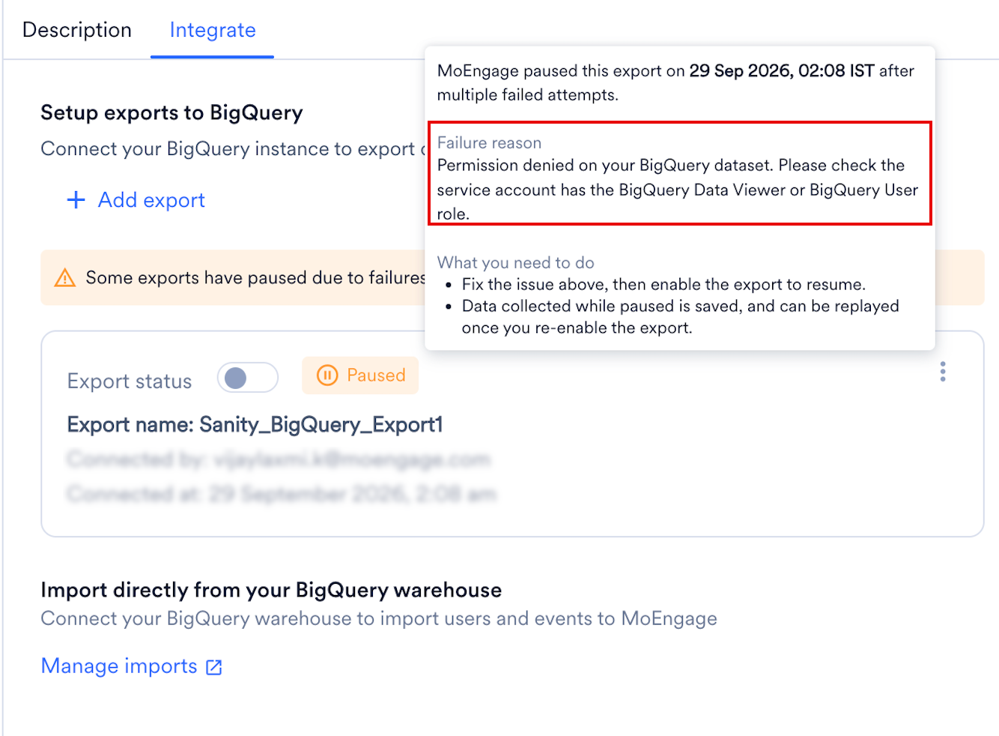
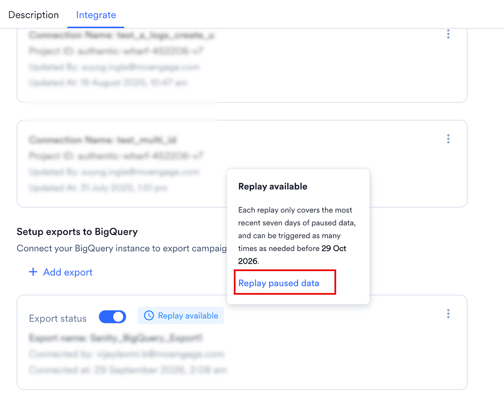

import StreamsAddOn from '/ja/snippets/streams-add-on.mdx';
import ExportFailureFaqs from '/ja/snippets/exports-faq-failure.mdx';
import ExportGeneralFaqs from '/ja/snippets/exports-faq-general.mdx';

<StreamsAddOn />

## 概要

[BigQuery](https://cloud.google.com/bigquery) は、Google Cloud Platform (GCP) で利用できるフルマネージドのサーバーレスデータウェアハウスです。インフラストラクチャを管理することなく、テラバイト規模のデータに対してリアルタイムで複雑な分析を実行できます。

## MoEngage は BigQuery とどのように連携しますか?

MoEngage と BigQuery の連携により、ユーザーデータとイベントデータを Google BigQuery に直接転送し、高度な分析を行うことができます。

<Note>
  これは直接連携であり、データのエクスポートに Google Cloud Storage (GCS) は必要ありません。
</Note>

## 連携

<Tip>
  - BigQuery インスタンス、ロール、ポリシーを作成/編集するために必要な権限を持つ BigQuery アカウントがあることを確認してください。
  - 新しいユーザーの作成は任意です。ただし、BigQuery データベースで新しいユーザーを作成する権限が必要です。
  - システムで IP ホワイトリストが必要な場合は、MoEngage の IP を許可リストに追加する必要があります。詳細については、[こちら](/ja/user-guide/settings/account/security/ip-whitelisting-in-moengage)を参照してください。
  - App Marketplace に BigQuery 接続があることを確認してください。
</Tip>

BigQuery 接続を作成するには、[Google BigQuery](/ja/partner-guide/data-and-analytics/data-warehouses/google-bigquery) を参照してください。

### MoEngage から BigQuery へのイベントのエクスポート

#### ステップ 1: ユーザーに割り当てられたロールに必要な権限があることを確認する

BigQuery エクスポートを正常に設定して実行するには、実行するアクションに応じて、サービスアカウントまたはユーザーに次の権限が必要です。

- **接続を作成する場合**: MoEngage App Marketplace 内で新しい BigQuery 接続を確立するには、ユーザーに _BigQuery Data Viewer_ ロールと _BigQuery Job User_ ロールが必要です。これにより、MoEngage はプロジェクトとデータセットの詳細を検証できます。詳細については、[こちら](/ja/user-guide/data/imports/setting-up-a-data-warehouse-import)を参照してください。
- **エクスポートを実行する場合**: 実際のデータ転送を実行するには、サービスアカウントに _BigQuery Data Editor_ ロールを割り当てる必要があります。これにより、MoEngage は特定の BigQuery テーブルに対してデータの読み取りと書き込みを行うために必要な権限を得られます。

#### ステップ 2: MoEngage App Marketplace で新しい BigQuery エクスポートを追加する

<Info>
  - イベントと属性の完全なリストについては、[Data Exports Glossary](/ja/user-guide/data/exports/events/data-export-glossary) を参照してください。
  - エクスポートされたイベントの `event_time` は常に UTC です。
  - MoEngage は現在、履歴データのエクスポートをサポートしていません。
</Info>

新しい BigQuery エクスポートを追加するには、次の手順を実行します。

1. MoEngage UI の左側のナビゲーションメニューで、**App marketplace** をクリックします。
2. App Marketplace ページで、**BigQuery** を検索します。 
3. **Google BigQuery** タイルをクリックします。
4. Google BigQuery ページで、**Integrate** タブに移動し、**\+Add Export** をクリックします。
5. 次の詳細を入力します。
   | フィールド | 必須 | 説明 |
   | --- | --- | --- |
   | **Export name** | はい | BigQuery エクスポートの名前を入力します。エクスポート名は 3 文字以上にしてください。 |
   | **BigQuery connection** | はい | BigQuery 接続を選択します。 |
   | **Dataset ID** | はい | データのエクスポート先となる BigQuery の特定のデータセットを選択します。 |
   | **Table name** | 任意 | エクスポートテーブルの名前を入力します。空白のままにすると、MoEngage が接頭辞 _moe\_events_ を付けた名前を作成します。  **注:** エラーを避けるため、このテーブルは MoEngage に自動作成させてください。 |
   | **User Properties** | 任意 | エクスポートに含める特定のユーザープロパティを選択します。 |
   | **Select events** | はい | BigQuery にエクスポートするイベントを選択します。既存のイベントと MoEngage に新たに取り込まれるイベントを含むすべてのイベントをエクスポートするか、エクスポートする特定のイベントを手動で選択するかを選べます。 |
   |  |  |  |
6. **Save export** をクリックします。

これで、MoEngage は新しく作成されたテーブルに 1 時間ごとにイベントを入力します。

#### エクスポートのプロセスと頻度

エクスポートを保存すると、MoEngage はデータセット内に宛先テーブルを作成します。その後、新しいイベントデータが 1 時間間隔でこの同じテーブルに追加されます。

**初回のアクション**: MoEngage は、最初のエクスポートがトリガーされたときにテーブルを作成します。

**定期的なアクション**: MoEngage は 1 時間ごとに同じテーブルにデータを追加 (追記) します。

#### テーブル構造のサンプル

エクスポート設定でテーブル名を指定しない場合、MoEngage は次の形式を使用してデータセット内に単一のテーブルを作成します。\
`moe_events_<table_creation_timestamp>`

<Note>
  このテーブルは接続ごとに 1 回作成されます。この接続で設定されたすべての 1 時間ごとのエクスポートと異なるイベントタイプは統合され、この特定のテーブルに追加されます。
</Note>

テーブルの全体的な構造は、すべてのイベントタイプで固定されています。エクスポートされる新しいユーザープロパティまたはイベントプロパティは、それぞれ user\_attributes 列または event\_attributes 列に含まれます。すべてのイベントは、分析しやすいように、イベント名やイベント時刻などの必要な情報を含む単一のテーブルに統合されます。

| フィールド | 型 | NULL |
| --- | --- | --- |
| app\_name | VARCHAR | NOT NULL |
| event\_name | VARCHAR | NOT NULL |
| event\_code | VARCHAR | NOT NULL |
| event\_uuid | VARCHAR | NOT NULL |
| event\_time | TIMESTAMP | NOT NULL |
| event\_type | VARCHAR | NOT NULL |
| event\_source | VARCHAR | NOT NULL |
| uid | VARCHAR | NULL |
| user\_attributes\_moengage\_user\_id | VARCHAR | NULL |
| device\_attributes\_moengage\_device\_id | VARCHAR | NULL |
| push\_id | VARCHAR | NULL |
| email\_address | VARCHAR | NULL |
| mobile\_number | VARCHAR | NULL |
| event\_attributes\_app\_version | VARCHAR | NULL |
| event\_attributes\_sdk\_version | VARCHAR | NULL |
| event\_attributes\_platform | VARCHAR | NULL |
| event\_attributes\_campaign\_id | VARCHAR | NULL |
| event\_attributes\_campaign\_name | VARCHAR | NULL |
| event\_attributes\_campaign\_type | VARCHAR | NULL |
| event\_attributes\_campaign\_channel | VARCHAR | NULL |
| event\_attributes\_readable\_campaign\_id | VARCHAR | NULL |
| event\_attributes\_parent\_campaign\_id | VARCHAR | NULL |
| event\_attributes\_parent\_flow\_id | VARCHAR | NULL |
| event\_attributes\_parent\_flow\_name | VARCHAR | NULL |
| event\_attributes\_variation\_id | VARCHAR | NULL |
| event\_attributes\_locale\_id | VARCHAR | NULL |
| event\_attributes\_locale\_name | VARCHAR | NULL |
| event\_attributes\_url | VARCHAR | NULL |
| event\_attributes\_timestamp | TIMESTAMP | NULL |
| event\_attributes\_first\_session | BOOLEAN | NULL |
| event\_attributes\_logged\_in\_status | STRING | NULL |
| event\_attributes | JSON | NULL |
| user\_attributes | JSON | NULL |
| device\_attributes | JSON | NULL |

## エクスポート失敗時のポリシー

MoEngage は、失敗が続くエクスポートを一時停止します。一時停止中、MoEngage はエクスポートで配信されるはずだったイベントを収集し、問題を修正した後にそれらをリプレイできます。

### MoEngage がエクスポートを一時停止するタイミング

BigQuery へのエクスポートは 1 時間ごとに実行されます。MoEngage は、エクスポートを失敗としてマークする前に複数回再試行します。スケジュールされたエクスポートが 3 回連続で失敗すると、エクスポートは一時停止されます。

MoEngage はエクスポートを一時停止すると、アラートで通知し、App Marketplace でエクスポートを **Paused** と表示します。

### エクスポートの一時停止中に起こること

MoEngage はエクスポートで配信されるはずだったイベントを収集し、直近 7 日分のみを保持します。エクスポートが 1 週間を超えて一時停止したままの場合、新しい日のデータが入るにつれて、MoEngage は最も古い日のデータを破棄します。

リプレイする前にエクスポートが複数回一時停止した場合、MoEngage はそれらすべての一時停止中のデータを、7 日間の期間内に収まる範囲で結合します。

### エクスポートを再開する

#### 失敗の理由を確認する

App Marketplace で **Integrate** タブをクリックし、エクスポートの **Paused** ラベルにカーソルを合わせます。MoEngage は、宛先テーブルへの書き込み権限がないことなど失敗の理由と、その修正方法を表示します。

#### エクスポートを有効にする

お客様側で原因を修正してから、エクスポートの **Export status** をオンにします。エクスポートが一時停止している間も 7 日間の期間は移動し続けるため、できるだけ早く実施してください。

エクスポートを有効にすると、MoEngage は収集を停止し、それまでに収集したデータ（一時停止中のデータの直近 7 日分、または一時停止がそれより短い場合はそのすべて）を確保します。これがリプレイできるデータです。このデータはそれ以降固定され、リプレイまでに時間が経っても減少することはありません。

### 一時停止中のデータをリプレイする

#### リプレイをリクエストする

MoEngage は、エクスポートの一時停止中に収集したデータを保存します。リプレイ待ちのデータがあるエクスポートには、**Integrate** タブに **Replay available** ラベルが表示されます。

リプレイするには、次の手順を実行します。

1. **Replay available** ラベルにカーソルを合わせるか、エクスポートのケバブメニューを開きます。
2. **Replay paused data** をクリックします。

   
3. **Replay paused data** ダイアログボックスで、**Confirm** をクリックします。

   

リプレイでは、エクスポートの一時停止中に MoEngage が収集したすべてのデータが送信されます。MoEngage はデータを宛先テーブルに追加します。

一時停止中の最も古いデータが収集された日から 30 日以内であれば、いつでもリプレイできます。それ以降は、データを利用できなくなります。

<Note>
  エクスポートが再び一時停止する前にリプレイしてください。リプレイする前に 2 回目の一時停止が発生した場合、MoEngage は新しい一時停止中のデータを、1 回目の一時停止からリプレイ待ちになっているデータに追加します。結合されたデータは直近 7 日分に切り詰められるため、2 回の一時停止の間隔が 7 日を超える場合、古いデータは失われます。

  たとえば、1 日目にエクスポートが一時停止したとします。エクスポートを有効にしましたが、リプレイはしませんでした。20 日目にエクスポートが再び一時停止しました。19 日後であるため、1 日目のデータは 30 日間のリプレイ期間が終了していないにもかかわらず、7 日間の期間外となり失われます。2 回目の一時停止が 1 回目から 7 日以内に発生していた場合、1 日目のデータは引き続き含まれていました。
</Note>

#### リプレイの結果

リプレイが完了すると、MoEngage はリクエストしたユーザーに、次のいずれかの結果をメールで通知します。

| 結果 | 意味 |
| --- | --- |
| Successful | MoEngage は収集したすべてのデータを配信しました。リプレイオプションは利用できなくなります。 |
| Partially Successful | MoEngage は収集したデータの一部を配信した後、エラーが発生しました。リプレイは停止し、MoEngage はエクスポートを再び一時停止します。メールには、リプレイが完了しなかった理由が記載されています。原因を修正し、エクスポートを有効にしてから、再度リプレイしてください。リプレイできるデータについては、[エクスポートの一時停止中に起こること](#what-happens-while-an-export-is-paused)を参照してください。 |
| Failed | エラーのため、MoEngage は収集したデータを一切配信しませんでした。リプレイは停止し、MoEngage はエクスポートを再び一時停止します。メールには、リプレイが完了しなかった理由が記載されています。原因を修正し、エクスポートを有効にしてから、再度リプレイしてください。リプレイできるデータについては、[エクスポートの一時停止中に起こること](#what-happens-while-an-export-is-paused)を参照してください。 |

リプレイは、1 つのエクスポートにつき一度に 1 つのみ実行できます。

#### 重複データを回避する

MoEngage は重複排除を行わないため、リプレイのたびに収集されたデータ全体が再送信されます。複数回リプレイする場合は、イベントごとに一意である `event_uuid` フィールドに基づいて、お客様側で重複を排除してください。エクスポートのフィールドについては、[データエクスポート用語集](/ja/user-guide/data/exports/events/data-export-glossary)を参照してください。

### エクスポート一時停止アラート

MoEngage はエクスポートを一時停止するとアラートで通知するため、問題を修正し、エクスポートの一時停止中に収集されたデータをリプレイできます。

デフォルトでは、MoEngage はワークスペースの管理者を Data Exports システムアラートに登録し、エクスポートを作成または更新したユーザーを追加します。他のユーザーの登録または登録解除を行うには、Alert Management ページに移動します。登録または登録解除によって変更されるのはそのユーザーの通知のみであり、他のユーザーの登録には影響しません。

## よくある質問

<AccordionGroup>
  <ExportFailureFaqs />
  <ExportGeneralFaqs />
</AccordionGroup>
