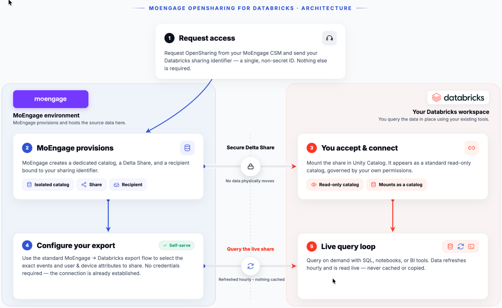
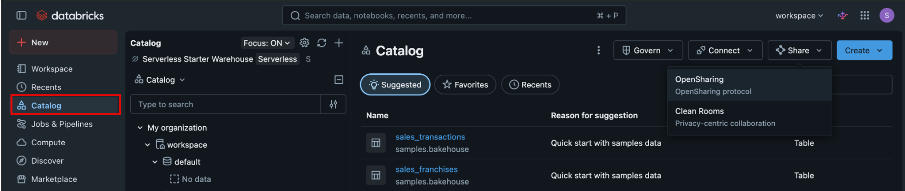
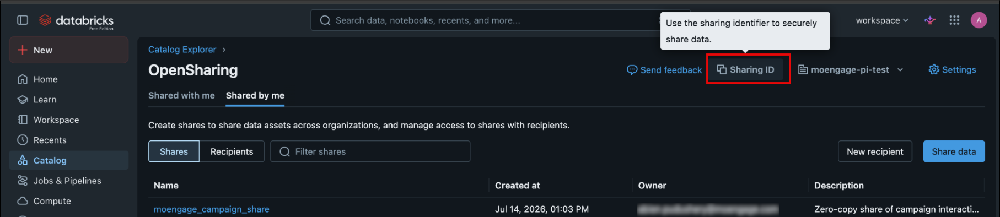
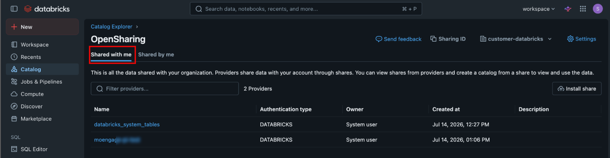
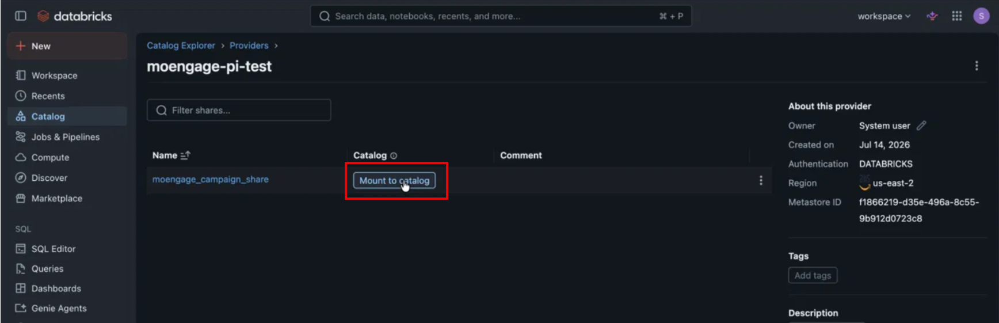
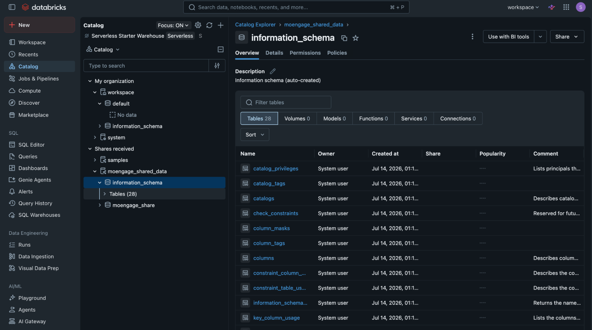
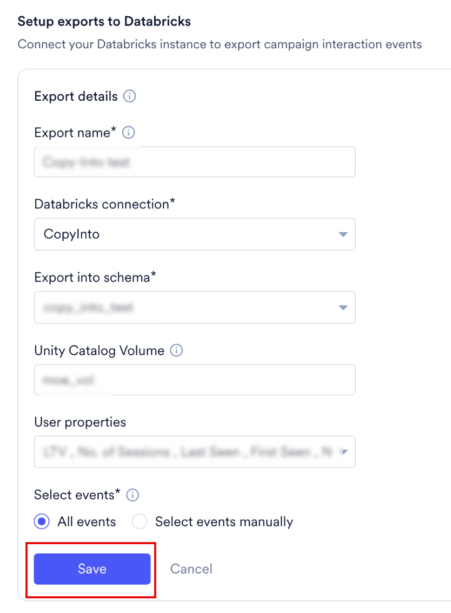
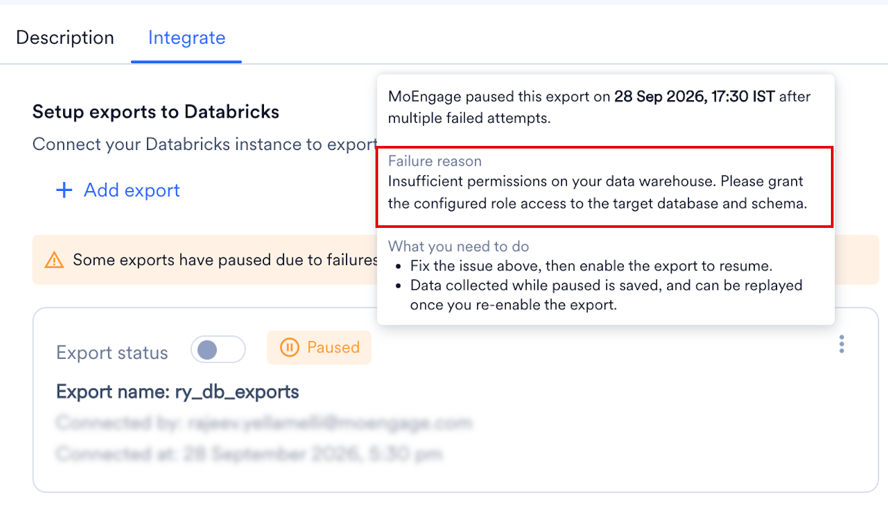
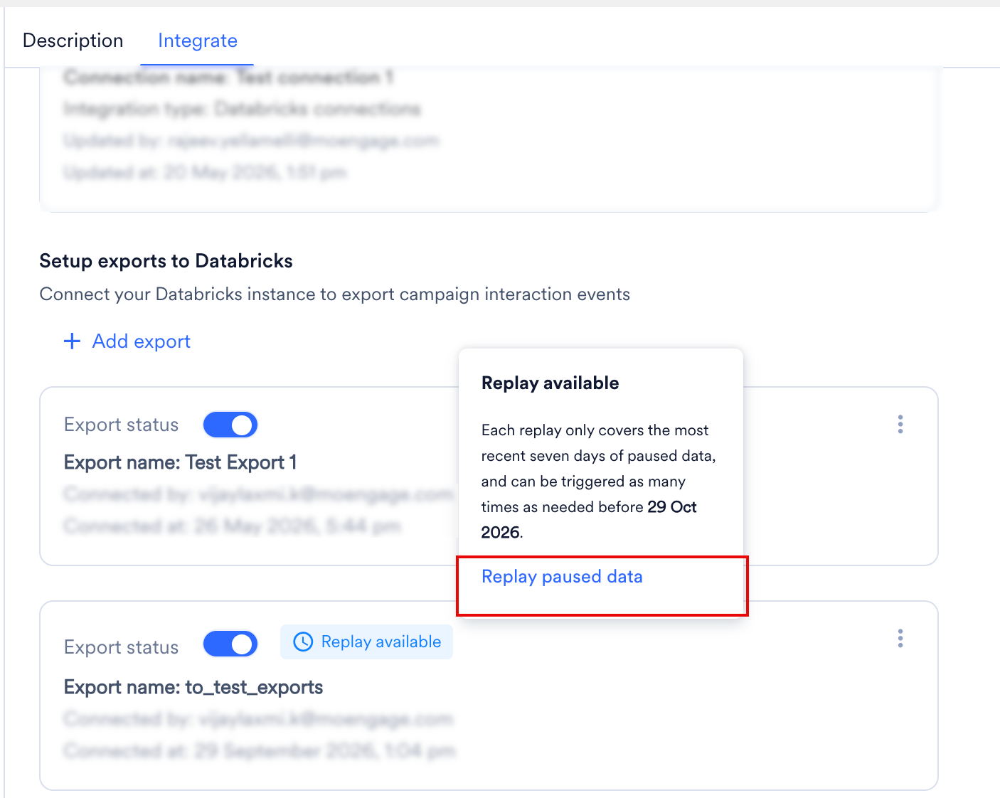

import StreamsAddOn from '/ja/snippets/streams-add-on.mdx';
import ExportFailureFaqs from '/ja/snippets/exports-faq-failure.mdx';
import ExportGeneralFaqs from '/ja/snippets/exports-faq-general.mdx';

<StreamsAddOn />

## 概要

[Databricks](https://www.databricks.com/resources/ebook/maximize-your-organizations-potential-data-and-ai?scid=7018Y000001Fi1AQAS&utm_medium=paid+search&utm_source=google&utm_campaign=15418435374&utm_adgroup=130717555576&utm_content=ebook&utm_offer=maximize-your-organizations-potential-data-and-ai&utm_ad=703594935116&utm_term=databricks&gad_source=1&gclid=CjwKCAjwvr--BhB5EiwAd5YbXpGh4ugWZyyOwJrqbfr-c5cZhP9HVrGMKQmBuZRlVcC_BRLco-zKVxoCmZkQAvD_BwE) は、組織が大量の構造化データおよび半構造化データを、高いスケーラビリティと効率性で保存、分析、処理できるプラットフォームです。独自のアーキテクチャにより、組織はデータを統合し、迅速な分析を実行して、すべてのユーザーがアクセスできる価値あるデータドリブンなインサイトを得ることができます。

## MoEngage は Databricks とどのように連携しますか?

この統合により、キャンペーンインタラクションイベントのデータをDatabricksテーブルにエクスポートできます。

### 配信方法

MoEngageは、次の2つの方法でイベントデータをDatabricksに配信します。

- **OpenSharing（ゼロコピー共有）**: ワークスペースから、Delta Sharingプロトコルを通じてMoEngageがホストするデータをその場でクエリします。こちらが推奨される方法です。
- **直接エクスポート**: MoEngageがお客様自身のスキーマ内のテーブルにイベントを書き込みます。ワークスペースでUnity Catalogが有効になっていない場合は、この方法を使用します。

どちらの方法でも同じテーブルスキーマが生成され、1時間ごとに更新されます。次の表で両者を比較します。

| | OpenSharing（ゼロコピー共有） <br /> | 直接エクスポート |
| --- | --- | --- |
| **データの到着方法** | ワークスペースから、Delta Sharingプロトコルを通じてMoEngageがホストするデータをライブでクエリします。 | MoEngageがお客様のスキーマ内のテーブルにイベントを書き込みます。 |
| **MoEngageが必要とする認証情報** | 不要です。共有識別子を提供しますが、これは秘密情報ではありません。 | Databricksのカタログとスキーマへの `WRITE` アクセス権。 |
| **IP許可リスト登録** | 不要です。 | システムで強制されている場合は必要です。 |
| **データの保存場所** | お客様がマウントする、MoEngageがホストする専用カタログ内。 | お客様自身のカタログとスキーマ内。 |
| **Unity Catalogの要否** | 必要です。 | 不要です。 |
| **セットアップ時間** | 状況により異なります。ワークスペースの設定と有効化の状況によっては、セットアップに数週間以上かかる場合があります。 | App Marketplaceでセルフサービス。 |

<Note>
  2つの方法は別々のストレージレイヤーを使用します。直接エクスポートで既に配信されたレコードはOpenSharingカタログには表示されず、その逆も同様です。方法を切り替えるには、MoEngageカスタマーサクセスマネージャー（CSM）にお問い合わせください。ワークスペースの設定によっては、OpenSharingのセットアップに数週間以上かかる場合があるため、計画的に進めてください。
</Note>

## 統合

### 前提条件

前提条件は、選択する配信方法によって異なります。該当する方法のタブをクリックしてください。

<Tabs>
  <Tab title="OpenSharing（ゼロコピー共有）">
    - DatabricksワークスペースでUnity Catalogが有効になっていることを確認してください。
    - `<cloud>:<region>:<metastore-id>` 形式の共有識別子を取得してください。詳細については、[ステップ1: 有効化をリクエストする](/ja/user-guide/data/exports/events/data-warehouse/databricks-exports#set-up-your-export)を参照してください。
  </Tab>
  <Tab title="直接エクスポート">
    - Databricksインスタンス、ロール、ポリシーを作成・編集するための適切な権限を持つDatabricksアカウントがあることを確認してください。新しいユーザーの作成は任意ですが、作成する場合はDatabricksデータベースで新しいユーザーを作成するアクセス権が必要です。
    - システムでIPホワイトリスト登録が必要な場合は、MoEngageのIPをホワイトリストに登録する必要があります。詳細については、[こちら](/ja/user-guide/settings/account/security/ip-whitelisting-in-moengage)を参照してください。
    - App Marketplaceで[Databricks接続](/ja/partner-guide/data-and-analytics/data-warehouses/databricks)があることを確認してください。
  </Tab>
</Tabs>

### エクスポートを設定する

<Info>
  - イベントと属性の完全なリストについては、[データエクスポート用語集](/ja/user-guide/data/exports/events/data-export-glossary)を参照してください。
  - エクスポートされるイベントのevent\_timeは常にUTCです。
  - MoEngageは過去のデータのエクスポートをサポートしていません。データはエクスポートを有効にした時点から送信されます。
</Info>

セットアップ手順は配信方法によって異なります。使用する方法のタブをクリックしてください。

<Tabs>
  <Tab title="OpenSharing（ゼロコピー共有）">
    OpenSharingでは、ファイルベースのエクスポートを受け取る代わりに、ワークスペースからDelta Sharingプロトコルを通じてMoEngageがホストするデータを直接クエリします。認証情報や書き込みトークンをやり取りする必要はなく、クエリは常に最新のデータを読み取ります。既存のSQLエディター、ノートブック、BIダッシュボードから、標準的なUnity Catalogのワークフローを通じて共有カタログをクエリできます。

    次の図は、MoEngageとワークスペースの間でデータがどのように移動するかを示しています。

    

    **ステップ1: 有効化をリクエストする**

    OpenSharingをリクエストするには、次の手順を実行します。

    1. Databricksワークスペースのサイドバーで、**Catalog** をクリックします。
    2. **Share** をクリックし、**OpenSharing** をクリックします。

       

    3. **OpenSharing** ページで、**Sharing ID** をクリックして共有識別子をコピーします。

       

    共有識別子をMoEngage CSMに送信します。

    **ステップ2: 共有を承認する**

    MoEngageは通常、7営業日以内に共有をプロビジョニングします。その後、CSMからデータ共有の名前が送られてきます。

    共有を承認するには、次の手順を実行します。

    1. Databricksワークスペースで、**Catalog** \> **OpenSharing** をクリックし、**Shared with me** タブをクリックします。

       

    2. CSMから送られてきた名前に一致するMoEngageプロバイダーをクリックします。
    3. 共有の横にある **Mount to catalog** をクリックします。

       

    4. カタログ名（例: `moengage_shared_data`）を入力し、確定します。

    **ステップ3: エクスポートを設定する**

    MoEngageでエクスポートを設定するには、次の手順を実行します。

    1. MoEngageダッシュボードの左側のナビゲーションメニューで、**App marketplace** をクリックします。
    2. **App marketplace** ページで **Databricks** を検索し、**Databricks** タイルをクリックします。
    3. **Integrate** タブをクリックします。

    [MoEngage App Marketplaceで新しいDatabricksエクスポートを追加する](/ja/user-guide/data/exports/events/data-warehouse/databricks-exports#add-a-new-databricks-export-on-the-moengage-app-marketplace)の説明に従ってエクスポートを作成します。**Export into schema** リストで、共有カタログのスキーマを選択します。リストには、CSMから共有されたものと同じ値が表示されます。

    OpenSharingでは接続が自動的にプロビジョニングされるため、MoEngageから接続、サービスプリンシパルの認証情報、書き込みアクセス権の入力を求められることはありません。

    **ステップ4: データをクエリする**

    共有カタログに最初の行が表示されるまでに最大30分かかる場合があります。データを確認するには、次の手順を実行します。

    1. 次のクエリを実行します。

       ```sql
       SELECT * FROM <your_catalog_name>.<schema>.<table_name>;
       ```

       プレースホルダーを、お使いのカタログ名、スキーマ名、テーブル名に置き換えてください。

    2. **Catalog Explorer** をクリックします。

       

    3. テーブルをクリックし、**Sample Data** をクリックします。

    Catalog Explorerでは、共有カタログがそのスキーマとテーブルとともに **Shares received** の下に一覧表示されます。**Sample Data** ビューでは、レコードと属性の定義をプレビューできます。

    MoEngageにスキーマの説明を依頼したい場合は、CSMに技術的なスキーマレビューをリクエストしてください。

    **ステップ5: 組織内のアクセスを管理する**

    共有カタログはお客様自身のインフラストラクチャ内にあるため、Unity Catalogを通じてアクセスを制御します。データを必要とするユーザーまたはグループに、`USE CATALOG` 権限と `SELECT` 権限を割り当ててください。

    MoEngageはカタログへの書き込みアクセス権を持たず、どちらの当事者もいつでも接続を終了できます。ワークスペースの設定や共有識別子を変更すると配信が中断される可能性があるため、変更がある場合はCSMにお知らせください。
  </Tab>
  <Tab title="直接エクスポート">
    **ステップ1: ユーザーのロールに必要な権限を付与する**

    MoEngageがデータを保存するには、Databricksデータベースへの `WRITE` アクセス権が必要です。これらの権限は、既存のデータベースユーザーに付与することも、MoEngage用に新しいデータベースユーザーを作成することもできます。

    次のコードを使用して、Databricksデータベースにデータを保存するための書き込みアクセス権を設定します。

    ```text wrap
    GRANT USE CATALOG ON CATALOG `<CATALOG_NAME>` TO `<EMAIL_ID_OF_THE_USER>`;
    GRANT USE SCHEMA, CREATE TABLE ON SCHEMA `<CATALOG_NAME>`.`<SCHEMA_NAME>` TO `<EMAIL_ID_OF_THE_USER>`;
    ```

    次の値を変更してください。

    - `<CATALOG_NAME>` - カタログの名前。
    - `<SCHEMA_NAME>` - データベースまたはスキーマの名前。
    - `<EMAIL_ID_OF_THE_USER>` - トークンを作成したユーザーのメールID。

    **ステップ2: Unity Catalogボリュームを使用してエクスポートを高速化する（推奨）**

    この手順は任意です。MoEngageはUnity Catalogボリュームを使用して、より効率的にデータをエクスポートできます。この方法を使用するには、専用のボリュームを作成し、MoEngageにアクセス権を付与します。

    次のコードを使用して、ボリュームを作成し、アクセス権を付与します。

    ```sql wrap
    -- Create the volume. This is a one-time activity, and Databricks provisions the storage.
    CREATE VOLUME IF NOT EXISTS <CATALOG_NAME>.<SCHEMA_NAME>.<VOLUME_NAME>;

    -- Grant MoEngage read and write access on the volume.
    GRANT READ VOLUME, WRITE VOLUME ON VOLUME <CATALOG_NAME>.<SCHEMA_NAME>.<VOLUME_NAME>
      TO `<GRANTEE>`;
    ```

    次の値を変更してください。

    - `<CATALOG_NAME>` - カタログの名前。
    - `<SCHEMA_NAME>` - データベースまたはスキーマの名前。
    - `<VOLUME_NAME>` - 作成するボリュームの名前。
    - `<GRANTEE>` - サービスプリンシパルのアプリケーションID（OAuthまたはService Principal PATを使用する場合）、またはユーザーのメールアドレス（User PATを使用する場合）。

    エクスポートを追加する際に、**Unity Catalog Volume** フィールドにボリューム名を入力します。

    **ステップ3: App Marketplaceでエクスポートを追加する**

    下記の[MoEngage App Marketplaceで新しいDatabricksエクスポートを追加する](/ja/user-guide/data/exports/events/data-warehouse/databricks-exports#add-a-new-databricks-export-on-the-moengage-app-marketplace)に進みます。
  </Tab>
</Tabs>

#### MoEngage App Marketplaceで新しいDatabricksエクスポートを追加する

この手順は両方の配信方法で使用します。OpenSharingでは接続が既に存在するため、スキーマ、イベント、属性を選択するだけです。

新しいDatabricksエクスポートを追加するには、次の手順を実行します。

1. MoEngageダッシュボードの左側のナビゲーションメニューで、**App marketplace** をクリックします。
2. **App marketplace** ページで **Databricks** を検索します。

   

3. **Databricks** タイルをクリックします。
4. **Databricks** ページで **Integrate** タブをクリックし、**+ Add Export** をクリックします。
5. 次の詳細を入力します。

   | フィールド | 必須 | 説明 |
   | --- | --- | --- |
   | **Export name** | はい | Databricksエクスポートの名前を入力します。 |
   | **Databricks connection** | はい | Databricks接続を選択します。 |
   | **Export into schema** | はい | MoEngageが新しいテーブルを作成し、イベントをエクスポートするスキーマを選択します。 |
   | **Unity Catalog Volume** | 任意 | MoEngage用に作成したボリュームの名前を入力します。ボリュームを使用しない場合は空欄のままにします。ボリュームを作成してMoEngageにアクセス権を付与するには、[エクスポートを設定する](/ja/user-guide/data/exports/events/data-warehouse/databricks-exports#set-up-your-export)の **直接エクスポート** タブを参照してください。 |
   | **User properties** | 任意 | イベントとともにエクスポートするユーザープロパティ（ユーザープロパティとデバイスプロパティ）を選択します。 |
   | **Select events** | はい | Databricksにエクスポートするイベントを選択します。既存のイベントとMoEngageに新たに取り込まれるイベントを含むすべてのイベントをエクスポートするか、エクスポートする特定のイベントを手動で選択するかを選べます。 |

   

6. **Save** をクリックします。

### エクスポートのプロセスと頻度

どちらの配信方法も1時間ごとに更新され、手動で同期ジョブを実行する必要はありません。

直接エクスポートの場合、MoEngageはエクスポートを保存した後にお客様のスキーマ内に宛先テーブルを作成し、1時間間隔で新しいイベントデータを追加します。

- **初回のアクション**: 最初のエクスポートがトリガーされたときに、MoEngageがテーブルを作成します。
- **定期的なアクション**: MoEngageは1時間ごとに同じテーブルにデータを追加します。

OpenSharingの場合、MoEngageは共有データセットを1時間ごとに更新します。クエリはデータの現在の状態を読み取るため、お客様側にMoEngageが書き込むテーブルはありません。

### テーブル構造のサンプル

MoEngageは、次の形式で単一のテーブルを作成します。\
`moe_events_<table_creation_timestamp>`

直接エクスポートの場合、このテーブルはお客様のスキーマ内に作成されます。OpenSharingの場合は、マウントした共有カタログ内に表示されます。

<Note>
  このテーブルは接続ごとに作成されます。この接続で設定されたすべての1時間ごとのエクスポートと異なるイベントタイプは、この特定のテーブルに統合されて追加されます。
</Note>

テーブルの全体的な構造は、すべてのイベントタイプで固定されています。新たにエクスポートされるユーザープロパティやイベントプロパティは、それぞれuser\_attributes列またはevent\_attributes列に含まれます。すべてのイベントは、分析しやすいように、イベント名やイベント時刻などの必要な情報を含む単一のテーブルに統合されます。

| フィールド | 型 | NULL |
| --- | --- | --- |
| app\_name | VARCHAR | NOT NULL |
| event\_name | VARCHAR | NOT NULL |
| event\_code | VARCHAR | NOT NULL |
| event\_uuid | VARCHAR | NOT NULL |
| event\_time | TIMESTAMP | NOT NULL |
| event\_type | VARCHAR | NOT NULL |
| event\_source | VARCHAR | NOT NULL |
| uid | VARCHAR | NULL |
| user\_attributes\_moengage\_user\_id | VARCHAR | NULL |
| device\_attributes\_moengage\_device\_id | VARCHAR | NULL |
| push\_id | VARCHAR | NULL |
| email\_address | VARCHAR | NULL |
| mobile\_number | VARCHAR | NULL |
| event\_attributes\_app\_version | VARCHAR | NULL |
| event\_attributes\_sdk\_version | VARCHAR | NULL |
| event\_attributes\_platform | VARCHAR | NULL |
| event\_attributes\_campaign\_id | VARCHAR | NULL |
| event\_attributes\_campaign\_name | VARCHAR | NULL |
| event\_attributes\_campaign\_type | VARCHAR | NULL |
| event\_attributes\_campaign\_channel | VARCHAR | NULL |
| event\_attributes\_readable\_campaign\_id | VARCHAR | NULL |
| event\_attributes\_parent\_campaign\_id | VARCHAR | NULL |
| event\_attributes\_parent\_flow\_id | VARCHAR | NULL |
| event\_attributes\_parent\_flow\_name | VARCHAR | NULL |
| event\_attributes\_variation\_id | VARCHAR | NULL |
| event\_attributes\_locale\_id | VARCHAR | NULL |
| event\_attributes\_locale\_name | VARCHAR | NULL |
| event\_attributes\_url | VARCHAR | NULL |
| event\_attributes\_timestamp | TIMESTAMP | NULL |
| event\_attributes\_first\_session | BOOLEAN | NULL |
| event\_attributes\_logged\_in\_status | VARCHAR | NULL |
| event\_attributes | VARIANT | NULL |
| user\_attributes | VARIANT | NULL |
| device\_attributes | VARIANT | NULL |

スキーマは両方の配信方法で同じです。列名のカスタマイズはサポートされていません。

## エクスポート失敗時のポリシー

MoEngage は、失敗が続くエクスポートを一時停止します。一時停止中、MoEngage はエクスポートで配信されるはずだったイベントを収集し、問題を修正した後にそれらをリプレイできます。

### MoEngage がエクスポートを一時停止するタイミング

Databricks へのエクスポートは 1 時間ごとに実行されます。MoEngage は、エクスポートを失敗としてマークする前に複数回再試行します。スケジュールされたエクスポートが 3 回連続で失敗すると、エクスポートは一時停止されます。

MoEngage はエクスポートを一時停止すると、アラートで通知し、App Marketplace でエクスポートを **Paused** と表示します。

### エクスポートの一時停止中に起こること


MoEngage はエクスポートで配信されるはずだったイベントを収集し、直近 7 日分のみを保持します。エクスポートが 1 週間を超えて一時停止したままの場合、新しい日のデータが入るにつれて、MoEngage は最も古い日のデータを破棄します。

リプレイする前にエクスポートが複数回一時停止した場合、MoEngage はそれらすべての一時停止中のデータを、7 日間の期間内に収まる範囲で結合します。

### エクスポートを再開する

#### 失敗の理由を確認する

App Marketplace で **Integrate** タブをクリックし、エクスポートの **Paused** ラベルにカーソルを合わせます。MoEngage は、宛先テーブルへの書き込み権限がないことなど失敗の理由と、その修正方法を表示します。



#### エクスポートを有効にする

お客様側で原因を修正してから、エクスポートの **Export status** をオンにします。エクスポートが一時停止している間も 7 日間の期間は移動し続けるため、できるだけ早く実施してください。

エクスポートを有効にすると、MoEngage は収集を停止し、それまでに収集したデータ（一時停止中のデータの直近 7 日分、または一時停止がそれより短い場合はそのすべて）を確保します。これがリプレイできるデータです。このデータはそれ以降固定され、リプレイまでに時間が経っても減少することはありません。

### 一時停止中のデータをリプレイする

#### リプレイをリクエストする

MoEngage は、エクスポートの一時停止中に収集したデータを保存します。リプレイ待ちのデータがあるエクスポートには、**Integrate** タブに **Replay available** ラベルが表示されます。

リプレイするには、次の手順を実行します。

1. **Replay available** ラベルにカーソルを合わせるか、エクスポートのケバブメニューを開きます。
2. **Replay paused data** をクリックします。

   
3. **Replay paused data** ダイアログボックスで、**Confirm** をクリックします。

   

リプレイでは、エクスポートの一時停止中に MoEngage が収集したすべてのデータが送信されます。MoEngage はデータを宛先テーブルに追加します。

一時停止中の最も古いデータが収集された日から 30 日以内であれば、いつでもリプレイできます。それ以降は、データを利用できなくなります。

<Note>
  エクスポートが再び一時停止する前にリプレイしてください。リプレイする前に 2 回目の一時停止が発生した場合、MoEngage は新しい一時停止中のデータを、1 回目の一時停止からリプレイ待ちになっているデータに追加します。結合されたデータは直近 7 日分に切り詰められるため、2 回の一時停止の間隔が 7 日を超える場合、古いデータは失われます。

  たとえば、1 日目にエクスポートが一時停止したとします。エクスポートを有効にしましたが、リプレイはしませんでした。20 日目にエクスポートが再び一時停止しました。19 日後であるため、1 日目のデータは 30 日間のリプレイ期間が終了していないにもかかわらず、7 日間の期間外となり失われます。2 回目の一時停止が 1 回目から 7 日以内に発生していた場合、1 日目のデータは引き続き含まれていました。
</Note>

#### リプレイの結果

リプレイが完了すると、MoEngage はリクエストしたユーザーに、次のいずれかの結果をメールで通知します。

| 結果 | 意味 |
| --- | --- |
| Successful | MoEngage は収集したすべてのデータを配信しました。リプレイオプションは利用できなくなります。 |
| Partially Successful | MoEngage は収集したデータの一部を配信した後、エラーが発生しました。リプレイは停止し、MoEngage はエクスポートを再び一時停止します。メールには、リプレイが完了しなかった理由が記載されています。原因を修正し、エクスポートを有効にしてから、再度リプレイしてください。リプレイできるデータについては、[エクスポートの一時停止中に起こること](#what-happens-while-an-export-is-paused)を参照してください。 |
| Failed | エラーのため、MoEngage は収集したデータを一切配信しませんでした。リプレイは停止し、MoEngage はエクスポートを再び一時停止します。メールには、リプレイが完了しなかった理由が記載されています。原因を修正し、エクスポートを有効にしてから、再度リプレイしてください。リプレイできるデータについては、[エクスポートの一時停止中に起こること](#what-happens-while-an-export-is-paused)を参照してください。 |

リプレイは、1 つのエクスポートにつき一度に 1 つのみ実行できます。

#### 重複データを回避する

MoEngage は重複排除を行わないため、リプレイのたびに収集されたデータ全体が再送信されます。複数回リプレイする場合は、イベントごとに一意である `event_uuid` フィールドに基づいて、お客様側で重複を排除してください。エクスポートのフィールドについては、[データエクスポート用語集](/ja/user-guide/data/exports/events/data-export-glossary)を参照してください。

### エクスポート一時停止アラート

MoEngage はエクスポートを一時停止するとアラートで通知するため、問題を修正し、エクスポートの一時停止中に収集されたデータをリプレイできます。

デフォルトでは、MoEngage はワークスペースの管理者を Data Exports システムアラートに登録し、エクスポートを作成または更新したユーザーを追加します。他のユーザーの登録または登録解除を行うには、Alert Management ページに移動します。登録または登録解除によって変更されるのはそのユーザーの通知のみであり、他のユーザーの登録には影響しません。


## よくある質問

<AccordionGroup>
  <ExportFailureFaqs />
  <ExportGeneralFaqs />

  <Accordion title="直接エクスポートからOpenSharingに移行できますか？">
    はい。配信方法を変更するには、MoEngage CSMにお問い合わせください。2つの方法は同じスキーマを使用しますが、ストレージレイヤーは別々であるため、直接エクスポートで既に配信されたレコードはOpenSharingカタログには表示されません。
  </Accordion>

  <Accordion title="OpenSharingカタログの列名やテーブル名を変更できますか？">
    いいえ。スキーマは標準化されており、名前のカスタマイズはサポートされていません。[ステップ3: エクスポートを設定する](/ja/user-guide/data/exports/events/data-warehouse/databricks-exports#set-up-your-export)で説明されているように、設定時にエクスポートするイベントと属性を選択します。
  </Accordion>

  <Accordion title="OpenSharing接続が稼働した後は誰に連絡すればよいですか？">
    接続の維持、技術的な質問の解決、データ要件の調整については、MoEngage CSMが主な連絡先となります。
  </Accordion>
</AccordionGroup>
