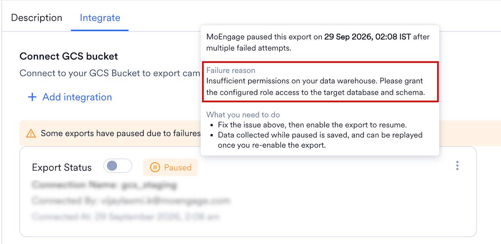
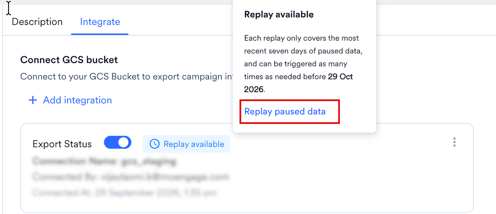

import StreamsAddOn from '/ja/snippets/streams-add-on.mdx';
import ExportFailureFaqs from '/ja/snippets/exports-faq-failure.mdx';
import ExportGeneralFaqs from '/ja/snippets/exports-faq-general.mdx';

<StreamsAddOn />

## 概要

[Google Cloud Storage](https://cloud.google.com/storage) は、大規模な非構造化データセットを格納できるエンタープライズ向けパブリッククラウドストレージプラットフォームです。

## MoEngage は GCS とどのように連携しますか?

MoEngageとGCSの統合により、キャンペーンインタラクションイベントをGoogle Cloud Storageバケットにエクスポートできます。これらのファイルをBigQueryにインポートして、さらに処理・分析を行うことができます。

## 統合

### 前提条件

- 新しいバケットとサービスアカウントを作成する権限を持つGoogle Cloud Platformアカウントがあることを確認してください。
- システムでIPホワイトリスト登録が必要な場合は、MoEngageのIPをホワイトリストに登録する必要があります。詳細については、[こちら](/ja/user-guide/settings/account/security/ip-whitelisting-in-moengage)を参照してください。
- App Marketplaceに[GCS接続](/ja/partner-guide/data-and-analytics/cloud-storage/google-cloud-storage)があることを確認してください。

### エクスポートを設定する

<Info>
  - イベントと属性の完全なリストについては、[データエクスポート用語集](/ja/user-guide/data/exports/events/data-export-glossary)を参照してください。
  - エクスポートされるイベントのevent\_timeは常にUTCです。
</Info>

#### MoEngage App Marketplaceで新しいGCSエクスポートを追加する

1. MoEngageダッシュボードで、**App Marketplace** に移動します。
2. **Google Cloud Storage** を検索します。
3. **Integrate** タブに移動し、**\+ Add Integration** をクリックします。
   
4. 接続に識別しやすい名前を付けます。
5. バケット名を入力します。
6. 必要に応じて、バケットのリージョンを選択します。リージョンはBucket Detailsページで確認できます。
7. 先ほどダウンロードしたサービスアカウントの認証情報JSONファイルをアップロードします。アップロード時に、Client IDとClient Emailを確認できます。
8. エクスポートするイベントを選択します。デフォルトでは、各イベントは標準の属性とともにエクスポートされます。
   
9. 必要に応じて、接続をテストできます。MoEngageは、入力された詳細が正しいかどうかを検証します。問題がある場合はエラーが表示されるので、修正してください。

### データを正しく受信していることを確認する

MoEngageは、次のパス構造を使用してファイルをアップロードします。

```text wrap
gs://<your-bucket-name>/event-exports/<your_app_name>/<connection_id>/export_day=YYYY-MM-DD/export_hour=HH/<file-name>.json.gz
```

バケットに移動し、ファイルが存在することを確認します。


### エクスポートのプロセスと頻度

MoEngageは1時間ごとにデータをダンプします。

### サンプルファイル

エクスポートされるファイルは `.json.gz` 形式です。構造を確認するには、[サンプルファイルをダウンロード](https://app-cdn.moengage.com/partners-integration-ui/app-marketplace-public/helpdoc/event_exports_sample_files.json.gz)してください。実際の内容は、エクスポート対象として選択したイベントと属性によって異なります。

```json JSON
{
  "app_name": "App Name",
  "export_hour": "6",
  "db_name": "MoEngage App Name",
  "event": {
    "uid": "user id",
    "event_type": "CAMPAIGN_EVENT",
    "event_code": "MOE_EMAIL_SENT",
    "event_name": "Email Sent",
    "user_attributes": {
      "moengage_user_id": "userid1",
      "user_attr1": "value1",
      "user_attr2": "value2"
    },
    "event_source": "MOENGAGE",
    "email_id": "test@xyz.com",
    "event_attributes": {
      "campaign_name": "Campaign name",
      "moe_campaign_tags": [
        "Tag1",
        "Tag2"
      ],
      "campaign_type": "GENERAL",
      "moe_campaign_channel": "Email",
      "moe_delivery_type": "One Time",
      "campaign_id": "moengage campaign id",
      "campaign_channel": "EMAIL"
    },
    "event_uuid": "3b918064-08dc-47ae-b674-c23797475a8d",
    "event_time": 1653022310,
    "device_attributes": {
      "moengage_device_id": "device id if applicable"
    }
  },
  "export_day": "2022-05-20"
}
```

サポートされているイベントと属性のリストについては、[データエクスポート用語集](https://www.moengage.com/docs/user-guide/data/exports/events/data-export-glossary)を参照してください。

## エクスポート失敗時のポリシー

MoEngage は、失敗が続くエクスポートを一時停止します。一時停止中、MoEngage はエクスポートで配信されるはずだったイベントを収集し、問題を修正した後にそれらをリプレイできます。

### MoEngage がエクスポートを一時停止するタイミング

Google Cloud Storage へのエクスポートは 1 時間ごとに実行されます。MoEngage は、エクスポートを失敗としてマークする前に複数回再試行します。スケジュールされたエクスポートが 3 回連続で失敗すると、エクスポートは一時停止されます。

MoEngage はエクスポートを一時停止すると、アラートで通知し、App Marketplace でエクスポートを **Paused** と表示します。

### エクスポートの一時停止中に起こること


MoEngage はエクスポートで配信されるはずだったイベントを収集し、直近 7 日分のみを保持します。エクスポートが 1 週間を超えて一時停止したままの場合、新しい日のデータが入るにつれて、MoEngage は最も古い日のデータを破棄します。

リプレイする前にエクスポートが複数回一時停止した場合、MoEngage はそれらすべての一時停止中のデータを、7 日間の期間内に収まる範囲で結合します。

### エクスポートを再開する

#### 失敗の理由を確認する

App Marketplace で **Integrate** タブをクリックし、エクスポートの **Paused** ラベルにカーソルを合わせます。MoEngage は、宛先バケットへの書き込み権限がないことなど失敗の理由と、その修正方法を表示します。



#### エクスポートを有効にする

お客様側で原因を修正してから、エクスポートの **Export status** をオンにします。エクスポートが一時停止している間も 7 日間の期間は移動し続けるため、できるだけ早く実施してください。

エクスポートを有効にすると、MoEngage は収集を停止し、それまでに収集したデータ（一時停止中のデータの直近 7 日分、または一時停止がそれより短い場合はそのすべて）を確保します。これがリプレイできるデータです。このデータはそれ以降固定され、リプレイまでに時間が経っても減少することはありません。

### 一時停止中のデータをリプレイする

#### リプレイをリクエストする

MoEngage は、エクスポートの一時停止中に収集したデータを保存します。リプレイ待ちのデータがあるエクスポートには、**Integrate** タブに **Replay available** ラベルが表示されます。

リプレイするには、次の手順を実行します。

1. **Replay available** ラベルにカーソルを合わせるか、エクスポートのケバブメニューを開きます。
2. **Replay paused data** をクリックします。

   
3. **Replay paused data** ダイアログボックスで、**Confirm** をクリックします。

   

リプレイでは、エクスポートの一時停止中に MoEngage が収集したすべてのデータが送信されます。MoEngage は、データを新しい場所に書き込むのではなく、本来書き込まれるはずだった日付フォルダにバックフィルします。

一時停止中の最も古いデータが収集された日から 30 日以内であれば、いつでもリプレイできます。それ以降は、データを利用できなくなります。

<Note>
  エクスポートが再び一時停止する前にリプレイしてください。リプレイする前に 2 回目の一時停止が発生した場合、MoEngage は新しい一時停止中のデータを、1 回目の一時停止からリプレイ待ちになっているデータに追加します。結合されたデータは直近 7 日分に切り詰められるため、2 回の一時停止の間隔が 7 日を超える場合、古いデータは失われます。

  たとえば、1 日目にエクスポートが一時停止したとします。エクスポートを有効にしましたが、リプレイはしませんでした。20 日目にエクスポートが再び一時停止しました。19 日後であるため、1 日目のデータは 30 日間のリプレイ期間が終了していないにもかかわらず、7 日間の期間外となり失われます。2 回目の一時停止が 1 回目から 7 日以内に発生していた場合、1 日目のデータは引き続き含まれていました。
</Note>

#### リプレイの結果

リプレイが完了すると、MoEngage はリクエストしたユーザーに、次のいずれかの結果をメールで通知します。

| 結果 | 意味 |
| --- | --- |
| Successful | MoEngage は収集したすべてのデータを配信しました。リプレイオプションは利用できなくなります。 |
| Partially Successful | MoEngage は収集したデータの一部を配信した後、エラーが発生しました。リプレイは停止し、MoEngage はエクスポートを再び一時停止します。メールには、リプレイが完了しなかった理由が記載されています。原因を修正し、エクスポートを有効にしてから、再度リプレイしてください。リプレイできるデータについては、[エクスポートの一時停止中に起こること](#what-happens-while-an-export-is-paused)を参照してください。 |
| Failed | エラーのため、MoEngage は収集したデータを一切配信しませんでした。リプレイは停止し、MoEngage はエクスポートを再び一時停止します。メールには、リプレイが完了しなかった理由が記載されています。原因を修正し、エクスポートを有効にしてから、再度リプレイしてください。リプレイできるデータについては、[エクスポートの一時停止中に起こること](#what-happens-while-an-export-is-paused)を参照してください。 |

リプレイは、1 つのエクスポートにつき一度に 1 つのみ実行できます。

#### 重複データを回避する

MoEngage は重複排除を行わないため、リプレイのたびに収集されたデータ全体が再送信されます。複数回リプレイする場合は、イベントごとに一意である `event_uuid` フィールドに基づいて、お客様側で重複を排除してください。エクスポートのフィールドについては、[データエクスポート用語集](/ja/user-guide/data/exports/events/data-export-glossary)を参照してください。

### エクスポート一時停止アラート

MoEngage はエクスポートを一時停止するとアラートで通知するため、問題を修正し、エクスポートの一時停止中に収集されたデータをリプレイできます。

デフォルトでは、MoEngage はワークスペースの管理者を Data Exports システムアラートに登録し、エクスポートを作成または更新したユーザーを追加します。他のユーザーの登録または登録解除を行うには、Alert Management ページに移動します。登録または登録解除によって変更されるのはそのユーザーの通知のみであり、他のユーザーの登録には影響しません。

## よくある質問

<AccordionGroup>
  <ExportFailureFaqs />
  <ExportGeneralFaqs />
</AccordionGroup>
