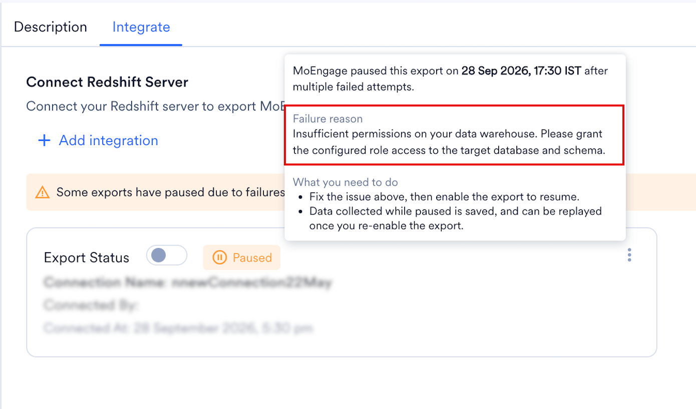
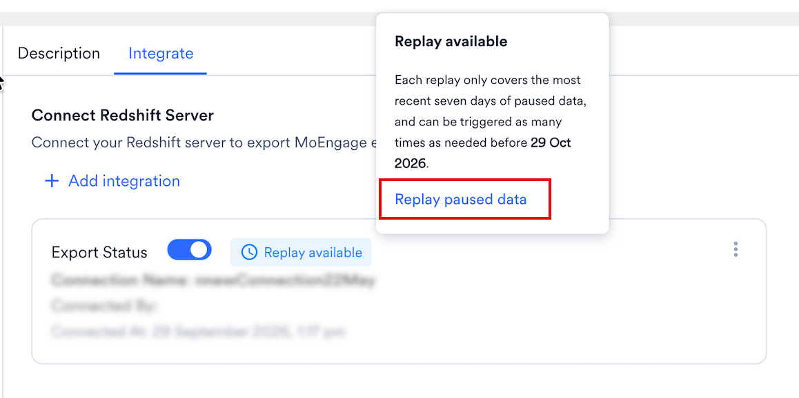

import StreamsAddOn from '/ja/snippets/streams-add-on.mdx';
import ExportFailureFaqs from '/ja/snippets/exports-faq-failure.mdx';
import ExportGeneralFaqs from '/ja/snippets/exports-faq-general.mdx';

<StreamsAddOn />

## 概要

[Amazon Redshift](https://aws.amazon.com/redshift/) は、高速かつ強力なフルマネージド型のペタバイト規模のデータウェアハウスサービスで、クラウドコンピューティングプラットフォームであるAmazon Web Servicesの一部を構成しています。

## MoEngage は Redshift とどのように連携しますか?

MoEngageとRedshiftの統合により、キャンペーンインタラクションイベントのデータをAmazon Redshiftクラスターに直接エクスポートできます。

## 統合

### 前提条件

- Redshiftクラスター、ロール、ポリシーを作成・編集する権限を持つAmazon Web Servicesアカウントがあることを確認してください。
- 新しいユーザーの作成は任意ですが、作成する場合はRedshiftクラスターで新しいユーザーを作成するアクセス権が必要です。
- システムでIPホワイトリスト登録が必要な場合は、MoEngageのIPをホワイトリストに登録する必要があります。詳細については、[こちら](/ja/user-guide/settings/account/security/ip-whitelisting-in-moengage)を参照してください。
- App Marketplaceに[Redshift接続](/ja/partner-guide/data-and-analytics/data-warehouses/amazon-redshift)があることを確認してください。

### エクスポートを設定する

<Info>
  - イベントと属性の完全なリストについては、[データエクスポート用語集](/ja/user-guide/data/exports/events/data-export-glossary)を参照してください。
  - エクスポートされるイベントのevent\_timeは常にUTCです。
</Info>

#### MoEngage App Marketplaceで新しいRedshiftエクスポートを追加する

1. MoEngageダッシュボードで、App Marketplaceに移動します。
2. 「Redshift」を検索します。
3. 「Integrate」タブに移動し、「\+ Add Integration」をクリックします。

4. Redshiftクラスターの接続の詳細を入力します。

| フィールド | 説明 | 例 |
| --- | --- | --- |
| Connection Name | この接続に識別しやすい名前を付けます。 | `My Redshift Instance 1` |
| Host Name | AWSコンソールで、Redshiftクラスターに移動します。**General information** の下に、ホスト名がRedshiftエンドポイントとして表示されています。コロン `:` より前の部分を貼り付けます。 たとえば、エンドポイントが `redshift-cluster-1.xxxxxxxzgxxx.us-east-1.redshift.amazonaws.com:5439/dev` の場合、Host Nameは `redshift-cluster-1.xxxxxxxzgxxx.us-east-1.redshift.amazonaws.com` になります。    | 形式は `[name].[id].[region].redshift.amazonaws.com` である必要があります |
| Port | ポート番号を入力します。AWSコンソールで、Redshiftクラスターに移動します。**Properties** タブの **Database configurations** で、ポート番号とデータベース名を確認します。デフォルトでは、Redshiftのポート番号は5439です。    | `5439` |
| Database | Redshiftデータベースの名前。 | `moengage_exports` |
| Username | MoEngageが接続に使用するユーザー名を入力します。既存のユーザー、または[ステップ2](/ja/partner-guide/data-and-analytics/data-warehouses/amazon-redshift#step-2-create-a-new-database-user-for-moengage)で作成したユーザーのいずれかを使用できます。 | — |
| Password | データベースユーザーのパスワードを入力します。 | — |
| IAM Role ARN | [ステップ5](/ja/partner-guide/data-and-analytics/data-warehouses/amazon-redshift#step-5-create-a-new-redshift-iam-role)で作成したIAMロールのARNを入力します。ARNを確認するには、AWSコンソールでIAMコンソールに移動します。サイドメニューのAccess Managementの下にある **Roles** をクリックします。[ステップ5](/ja/partner-guide/data-and-analytics/data-warehouses/amazon-redshift#step-5-create-a-new-redshift-iam-role)で作成したIAMロールを選択します。**Summary** セクションにARNが表示されています。これをコピーして入力フィールドに貼り付けます。    | 形式は `arn:aws:iam::[aws-account-id]:role/[role-name]` である必要があります |
| Export into schema | MoEngageは、指定されたスキーマにテーブルを作成します。特に設定していない限り、スキーマ名には通常「public」を使用します。 | — |
| Select events to export | Redshiftクラスターにエクスポートするイベントを選択します。 | — |

5. 必要に応じて、接続をテストできます。MoEngageは、入力された詳細が正しいかどうかを検証します。問題がある場合はエラーが表示されるので、修正してください。
6. 接続テストが成功したら、接続の詳細を保存できます。MoEngageはまもなくRedshiftクラスターへのイベントのエクスポートを開始します。

### データを正しく受信していることを確認する

MoEngageは、スキーマに次の2つのテーブルを作成します。

1. `test_connection_moengage` - 接続の詳細が有効かどうかを定期的に検証するために、このテーブルを使用します。
2. `moengage_events` - すべてのイベントをこのテーブルにダンプ（追加）します。

`moengage_events` テーブルをクエリして、データがウェアハウスに正しく流れているかどうかを確認できます。

### エクスポートのプロセスと頻度

MoEngageは1時間ごとにデータをダンプします。

### サンプルテーブル構造

最終的なテーブル定義は、エクスポートの具体的な設定によって異なります。

| フィールド | 型 | NL |
| --- | --- | --- |
| `app_name` | character varying(256) | NN |
| `event_name` | character varying(256) | NN |
| `event_code` | character varying(256) | NN |
| `event_uuid` | character varying(256) | NN |
| `event_time` | bigint | NN |
| `event_type` | character varying(256) | NN |
| `event_source` | character varying(256) | NN |
| `uid` | character varying(256) | NULL |
| `user_attributes_moengage_user_id` | character varying(256) | NULL |
| `device_attributes_moengage_device_id` | character varying(256) | NULL |
| `push_id` | character varying(512) | NULL |
| `email_address` | character varying(256) | NULL |
| `mobile_number` | character varying(256) | NULL |
| `event_attributes_app_version` | character varying(256) | NULL |
| `event_attributes_sdk_version` | character varying(256) | NULL |
| `event_attributes_platform` | character varying(256) | NULL |
| `event_attributes_campaign_id` | character varying(256) | NULL |
| `event_attributes_campaign_name` | character varying(256) | NULL |
| `event_attributes_campaign_type` | character varying(256) | NULL |
| `event_attributes_campaign_channel` | character varying(256) | NULL |
| `event_attributes_readable_campaign_id` | character varying(256) | NULL |
| `event_attributes_parent_campaign_id` | character varying(256) | NULL |
| `event_attributes_parent_flow_id` | character varying(256) | NULL |
| `event_attributes_parent_flow_name` | character varying(256) | NULL |
| `event_attributes_variation_id` | character varying(256) | NULL |
| `event_attributes_locale_id` | character varying(256) | NULL |
| `event_attributes_locale_name` | character varying(256) | NULL |
| `event_attributes_url` | character varying(256) | NULL |
| `event_attributes_timestamp` | bigint | NULL |
| `event_attributes_first_session` | boolean | NULL |
| `event_attributes_logged_in_status` | character varying(256) | NULL |
| `event_attributes` | super | NULL |
| `user_attributes` | super | NULL |
| `device_attributes` | super | NULL |
| `created_at` | character varying(256) | NULL |

## エクスポート失敗時のポリシー

MoEngage は、失敗が続くエクスポートを一時停止します。一時停止中、MoEngage はエクスポートで配信されるはずだったイベントを収集し、問題を修正した後にそれらをリプレイできます。

### MoEngage がエクスポートを一時停止するタイミング

Redshift へのエクスポートは 1 時間ごとに実行されます。MoEngage は、エクスポートを失敗としてマークする前に複数回再試行します。スケジュールされたエクスポートが 3 回連続で失敗すると、エクスポートは一時停止されます。

MoEngage はエクスポートを一時停止すると、アラートで通知し、App Marketplace でエクスポートを **Paused** と表示します。

### エクスポートの一時停止中に起こること

MoEngage はエクスポートで配信されるはずだったイベントを収集し、直近 7 日分のみを保持します。エクスポートが 1 週間を超えて一時停止したままの場合、新しい日のデータが入るにつれて、MoEngage は最も古い日のデータを破棄します。

リプレイする前にエクスポートが複数回一時停止した場合、MoEngage はそれらすべての一時停止中のデータを、7 日間の期間内に収まる範囲で結合します。

### エクスポートを再開する

#### 失敗の理由を確認する

App Marketplace で **Integrate** タブをクリックし、エクスポートの **Paused** ラベルにカーソルを合わせます。MoEngage は、宛先テーブルへの書き込み権限がないことなど失敗の理由と、その修正方法を表示します。

#### エクスポートを有効にする

お客様側で原因を修正してから、エクスポートの **Export status** をオンにします。エクスポートが一時停止している間も 7 日間の期間は移動し続けるため、できるだけ早く実施してください。

エクスポートを有効にすると、MoEngage は収集を停止し、それまでに収集したデータ（一時停止中のデータの直近 7 日分、または一時停止がそれより短い場合はそのすべて）を確保します。これがリプレイできるデータです。このデータはそれ以降固定され、リプレイまでに時間が経っても減少することはありません。

### 一時停止中のデータをリプレイする

#### リプレイをリクエストする

MoEngage は、エクスポートの一時停止中に収集したデータを保存します。リプレイ待ちのデータがあるエクスポートには、**Integrate** タブに **Replay available** ラベルが表示されます。

リプレイするには、次の手順を実行します。

1. **Replay available** ラベルにカーソルを合わせるか、エクスポートのケバブメニューを開きます。
2. **Replay paused data** をクリックします。

   
3. **Replay paused data** ダイアログボックスで、**Confirm** をクリックします。

   

リプレイでは、エクスポートの一時停止中に MoEngage が収集したすべてのデータが送信されます。MoEngage はデータを宛先テーブルに追加します。

一時停止中の最も古いデータが収集された日から 30 日以内であれば、いつでもリプレイできます。それ以降は、データを利用できなくなります。

<Note>
  エクスポートが再び一時停止する前にリプレイしてください。リプレイする前に 2 回目の一時停止が発生した場合、MoEngage は新しい一時停止中のデータを、1 回目の一時停止からリプレイ待ちになっているデータに追加します。結合されたデータは直近 7 日分に切り詰められるため、2 回の一時停止の間隔が 7 日を超える場合、古いデータは失われます。

  たとえば、1 日目にエクスポートが一時停止したとします。エクスポートを有効にしましたが、リプレイはしませんでした。20 日目にエクスポートが再び一時停止しました。19 日後であるため、1 日目のデータは 30 日間のリプレイ期間が終了していないにもかかわらず、7 日間の期間外となり失われます。2 回目の一時停止が 1 回目から 7 日以内に発生していた場合、1 日目のデータは引き続き含まれていました。
</Note>

#### リプレイの結果

リプレイが完了すると、MoEngage はリクエストしたユーザーに、次のいずれかの結果をメールで通知します。

| 結果 | 意味 |
| --- | --- |
| Successful | MoEngage は収集したすべてのデータを配信しました。リプレイオプションは利用できなくなります。 |
| Partially Successful | MoEngage は収集したデータの一部を配信した後、エラーが発生しました。リプレイは停止し、MoEngage はエクスポートを再び一時停止します。メールには、リプレイが完了しなかった理由が記載されています。原因を修正し、エクスポートを有効にしてから、再度リプレイしてください。リプレイできるデータについては、[エクスポートの一時停止中に起こること](#what-happens-while-an-export-is-paused)を参照してください。 |
| Failed | エラーのため、MoEngage は収集したデータを一切配信しませんでした。リプレイは停止し、MoEngage はエクスポートを再び一時停止します。メールには、リプレイが完了しなかった理由が記載されています。原因を修正し、エクスポートを有効にしてから、再度リプレイしてください。リプレイできるデータについては、[エクスポートの一時停止中に起こること](#what-happens-while-an-export-is-paused)を参照してください。 |

リプレイは、1 つのエクスポートにつき一度に 1 つのみ実行できます。

#### 重複データを回避する

MoEngage は重複排除を行わないため、リプレイのたびに収集されたデータ全体が再送信されます。複数回リプレイする場合は、イベントごとに一意である `event_uuid` フィールドに基づいて、お客様側で重複を排除してください。エクスポートのフィールドについては、[データエクスポート用語集](/ja/user-guide/data/exports/events/data-export-glossary)を参照してください。

### エクスポート一時停止アラート

MoEngage はエクスポートを一時停止するとアラートで通知するため、問題を修正し、エクスポートの一時停止中に収集されたデータをリプレイできます。

デフォルトでは、MoEngage はワークスペースの管理者を Data Exports システムアラートに登録し、エクスポートを作成または更新したユーザーを追加します。他のユーザーの登録または登録解除を行うには、Alert Management ページに移動します。登録または登録解除によって変更されるのはそのユーザーの通知のみであり、他のユーザーの登録には影響しません。

## よくある質問

<AccordionGroup>
  <ExportFailureFaqs />
  <ExportGeneralFaqs />
</AccordionGroup>
