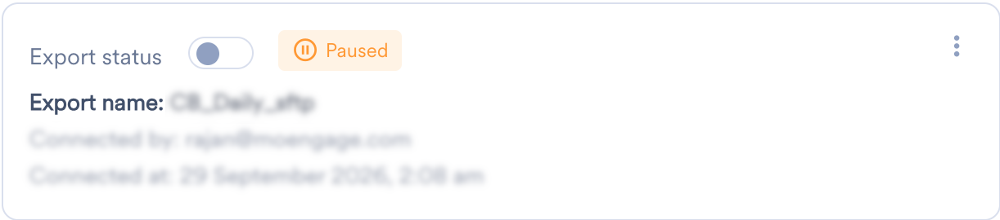
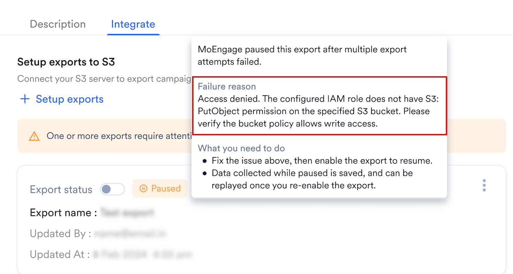
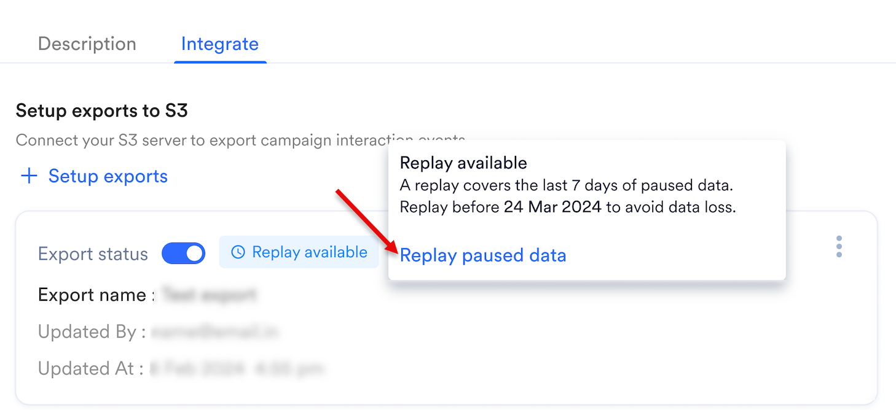
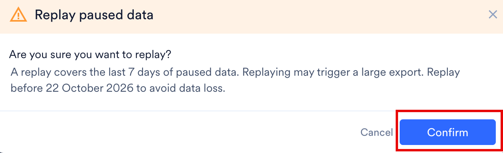

import StreamsAddOn from '/ja/snippets/streams-add-on.mdx';
import ExportFailureFaqs from '/ja/snippets/exports-faq-failure.mdx';

<StreamsAddOn />

## 概要

S3エクスポートを使用すると、MoEngageが受信または生成するすべてのユーザーイベントとキャンペーンイベントをエクスポートできます。エクスポートしたデータを分析して、ユーザーの行動、キャンペーンとのインタラクション、顧客の嗜好を把握できます。

## MoEngage は S3 とどのように連携しますか?

[Amazon S3](https://aws.amazon.com/s3/) は、Amazon Web Servicesが提供する拡張性の高いストレージシステムです。S3バケットを統合すると、MoEngageはデータの定期的なエクスポートをJSON形式で共有できます。

## 統合

<Tip>
  - ネットワーク構成でIPホワイトリスト登録が必要な場合は、データエクスポート用のS3統合を設定する前に[こちら](/ja/user-guide/settings/account/security/ip-whitelisting-in-moengage)を参照してください。
</Tip>

S3統合を設定するには、次の手順を実行します。

### ステップ1: S3バケットを作成する

既にS3バケットをお持ちの場合でも、厳格な最小権限のセキュリティ境界を適用するため、MoEngageのデータ転送専用に新しいバケットを作成することをお勧めします。

1. [AWS S3コンソール](https://console.aws.amazon.com/s3/)を開き、サインインするか、AWSアカウントを作成します。
2. **Storage** カテゴリから **S3** を選択します。
3. **Create Bucket** をクリックし、識別しやすい名前を入力して、希望する物理リージョンを選択します。

### ステップ2: App Marketplaceでエクスポートを追加する

[App MarketplaceでS3バケットを接続](/ja/partner-guide/data-and-analytics/cloud-storage/amazon-s3#step-3-connect-amazon-s3-on-the-app-marketplace)した後、**Amazon S3** ページを開きます。**Setup exports to S3** セクションで **\+ Add export** をクリックして、**Export details** パネルを開きます。

1. 次のパラメーターを使用してエクスポートを設定します。
   | フィールド | 必須 | 説明 |
   | --- | --- | --- |
   | **Export name** | はい | エクスポートの一意で識別しやすい名前を入力します（例: `File-exports2`）。 |
   | **S3 connection** | はい | ドロップダウンリストから保存済みの接続を選択します。接続でIAMポリシー認証方式を使用する場合は、先にAWSアカウントでIAMポリシーを設定してください。MoEngageはこの権限を使用して、エクスポート時にS3バケットにファイルを配信します。詳細については、[認証を設定する](/ja/partner-guide/data-and-analytics/cloud-storage/amazon-s3#step-1-set-up-authentication)を参照してください。 |
   | **Folder path** | はい | MoEngageがファイルをエクスポートする対象フォルダーへのパスを入力します。文字列の先頭と末尾にスラッシュを付けないでください。  <br />日付でパーティション分割されたサブフォルダーではなく、単一のフォルダーにすべてのエクスポートを書き込むには、**Export all files in one folder** チェックボックスをオンにします。解決されたファイルパスはフィールドの下にリアルタイムで表示されるため、保存前に配信先を確認できます。形式はチェックボックスを選択したかどうかによって異なります。 <ul><li>**単一フォルダー（チェックボックスがオン）:** `s3://<your-bucket-name>/[<folder_path>]/<connection_name>/event_exports_<file_tag>.json.gz`</li><li>**日付パーティション（チェックボックスがオフ）:** `s3://<your-bucket-name>/[<folder_path>_]<connection_name>/export_day=YYYY-MM-DD/event_exports_<UNIQUE_ID>.json.gz`</li></ul> **フォルダーパスの確認方法**<br />**S3** バケット内のオブジェクト一覧から、ファイルを格納するフォルダーを開きます。**Properties** タブで、フォルダーの **S3 URI** を確認します。フォルダーパスは、`s3://[your-bucket-name]/` の後の部分から末尾のスラッシュを除いたものです。 |
   | **User properties** | いいえ | 各エクスポートでイベントレコードとともに含めるユーザープロパティとデバイスプロパティをリストから選択します。 |
   | **Select events** | はい | 既存および今後のすべてのイベントをエクスポートするには **All events** を選択し、リストからイベントを選ぶには **Select events manually** を選択します。 |
   | **Frequency** | はい | MoEngageがこれらのイベントをエクスポートする頻度を選択します。 <ul><li>**Every 15 mins**: MoEngageは15分間隔でファイルをエクスポートします。</li><li>**Daily**: MoEngageは毎日の終わり、02:00 UTCにファイルをエクスポートします。</li><li>**Weekly**: MoEngageは毎週月曜日の02:00 UTCにファイルをエクスポートします。</li></ul> 保存後にエクスポート頻度を変更することはできません。別の頻度を使用するには、新しいエクスポートを作成してください。 |
   | **File encryption** | いいえ | PGPを使用してエクスポートされるすべてのファイルを暗号化するには、**File encryption** チェックボックスをオンにします。MoEngageはGZIP圧縮されたファイルを公開鍵で暗号化し、`.gpg` 拡張子を付加します（例: `event-exports_1735198203.json.gz.gpg`）。  <br />ファイルを復号した後、解凍してエクスポートされた内容を表示します。 |
2. **Test** をクリックします。  \
   MoEngageは一時的なプレースホルダーファイルの書き込みを試行して、S3バケットの設定、フォルダーパス、書き込み権限を検証します。
3. テストに合格したら、**Save** をクリックします。MoEngageは、頻度が固定されることを示す確認ポップアップを表示します。メッセージを確認し、もう一度 **Save** をクリックしてエクスポートを有効化します。
4. 保存せずに設定を破棄するには、**Cancel** をクリックします。 

## イベントと属性

MoEngageとS3の統合により、MoEngageに取り込まれるすべてのイベントをS3バケットにエクスポートできます。デフォルトでは、MoEngageはSDKを通じて標準イベントとユーザープロパティをトラッキングします。[標準イベントと属性についてはこちら](/ja/user-guide/data/event-data/derived-events-and-attributes)をお読みください。MoEngageでトラッキングしている任意のカスタムユーザー定義イベントもエクスポートできます。

## データエクスポート形式

- **ファイル形式**: JSON
- **圧縮タイプ**: GZip
- **エクスポート頻度**: 15分ごと、毎日、または毎週
- **フォルダーパスの例**:
  - _日付パーティション_: `s3://<your-bucket-name>/[<folder_path>_]<connection_name>/export_day=2025-10-28/event_exports_<UNIQUE_ID>.json.gz`
  - _単一フォルダー_: `s3://<your-bucket-name>/[<folder_path>]/<connection_name>/event_exports_<UNIQUE_ID>.json.gz`
  MoEngageは、各エクスポートファイルの一意の識別子として `<UNIQUE_ID>` を生成します。

## エクスポートデータのサンプル

<CodeGroup>

```json User Action Event
{
    "app_name": "App Name",
    "export_hour": "10",
    "db_name": "MoEngage App Name",
    "event": {
        "uid": "user id",
        "event_type": "USER_ACTION_EVENT",
        "event_code": "VIEW_RADAR",
        "event_name": "VIEW_RADAR",
        "user_attributes": {
            "moengage_user_id": "userid1",
            "user_attr1": "value1",
            "user_attr2": "value2"
        },
        "event_source": "MOENGAGE",
        "event_attributes": {
            "event_attr1": "value1",
            "event_attr2": "value2"
        },
        "event_uuid": "62045d15-8d5e-4cfd-ac49-5919bffb401d",
        "event_time": 1652820710,
        "device_attributes": {
            "moengage_device_id": "device id"
        }
    },
    "export_day": "2022-05-20"
}
```

```json Campaign Event
{
    "app_name": "App Name",
    "export_hour": "6",
    "db_name": "MoEngage App Name",
    "event": {
        "uid": "user id",
        "event_type": "CAMPAIGN_EVENT",
        "event_code": "MOE_EMAIL_SENT",
        "event_name": "Email Sent",
        "user_attributes": {
            "moengage_user_id": "userid1",
            "user_attr1": "value1",
            "user_attr2": "value2"
        },
        "event_source": "MOENGAGE",
        "email_id": "test@xyz.com",
        "event_attributes": {
            "campaign_name": "Campaign name",
            "moe_campaign_tags": [
                "Tag1",
                "Tag2"
            ],
            "campaign_type": "GENERAL",
            "moe_campaign_channel": "Email",
            "moe_delivery_type": "One Time",
            "campaign_id": "moengage campaign id",
            "campaign_channel": "EMAIL"
        },
        "event_uuid": "3b918064-08dc-47ae-b674-c23797475a8d",
        "event_time": 1653022310,
        "device_attributes": {
            "moengage_device_id": "device id if applicable"
        }
    },
    "export_day": "2022-05-20"
}
```

</CodeGroup>

サンプルファイルは[こちら](https://app-cdn.moengage.com/partners-integration-ui/app-marketplace-public/helpdoc/event_exports_sample_files.json.gz)からダウンロードできます。これはGZIP圧縮されたファイルのため、内容を表示する前に展開してください。

## AWS Key Management ServiceとAmazon S3の統合

1. AWS Management Console、AWS CLI、またはAWS SDKを使用して、AWS Key Management Service（KMS）のカスタマーマスターキー（CMK）を作成します。AWS KMSキーを既に生成している場合は、この手順をスキップしてください。
2. AWS KMSキーポリシーに権限を追加して、S3でAWS KMSキーを使用できるようにします。次のキーポリシーの例では、S3の暗号化にキーを使用することを許可しています。
   ```json wrap
   {
      "Version": "2012-10-17",
      "Id": "key-policy",
      "Statement": [
          {
            "Sid": "Allow use of the key for S3 encryption",
            "Effect": "Allow",
            "Principal": {
                "AWS": "arn:aws:iam::612427630422:role/service-role/core_s3_export-role-e1qw8ulf"
            },
            "Action": [
                "kms:Encrypt",
                "kms:Decrypt",
                "kms:ReEncrypt*",
                "kms:GenerateDataKey*",
                "kms:DescribeKey"
            ],
            "Resource": [
                "arn:aws:s3:::your-bucket",
                "arn:aws:s3:::your-bucket/*"
            ]
          }
      ]
    }
   ```
3. 暗号化にAWS KMSキーを使用するようにS3バケットを設定します。これは、バケットの作成時またはバケットのプロパティを変更することで行えます。
4. S3 Management Consoleで、サーバー側の暗号化を有効にするバケットに移動します。
5. **Properties** タブをクリックし、**Default encryption** セクションまでスクロールします。
6. **Encryption** で **Server-side encryption with AWS Key Management Service keys (SSE-KMS)** を選択し、ドロップダウンメニューから作成したAWS KMSキーを選択します。KMSキーのAWS KMS ARNのみを使用してください。
7. **Save** をクリックして、暗号化設定をバケットに適用します。S3は、統合したAWS KMSキーを使用してオブジェクトを自動的に暗号化します。
8. MoEngageがホワイトリストに登録できるよう、AWS KMSキーのARNをMoEngageに提供します。

<Info>
  **KMSキーARNのホワイトリスト登録が必要な理由**

  - AWS KMSキーARN（Amazon Resource Name）は、アクセスを許可するKMSキーを一意に識別するものであるため、MoEngageはホワイトリスト登録にこれを必要とします。
  - KMSキーARNをホワイトリストに登録すると、その特定のキーへのアクセス権を持つ承認済みのエンティティまたはサービスのみが暗号化または復号の操作を実行できるように指定されます。
  - KMSキーARNをホワイトリストに登録することで、承認されたリソースのみがキーとやり取りできるようになり、セキュリティレイヤーが追加されて、データ侵害や不正アクセスのリスクが低減されます。
  - ホワイトリストでKMSキーARNを指定することで、どのリソースがキーにアクセスして使用できるかをきめ細かく制御でき、キー管理と暗号化プロセス全体のセキュリティが向上します。
</Info>

## エクスポート失敗時のポリシー

MoEngage は、失敗が続くエクスポートを一時停止します。一時停止中、MoEngage はエクスポートで配信されるはずだったイベントを収集し、問題を修正した後にそれらをリプレイできます。

### MoEngage がエクスポートを一時停止するタイミング

MoEngage は、エクスポートを失敗としてマークする前に複数回再試行します。選択したエクスポート頻度に応じて、スケジュールされたエクスポートが複数回失敗すると、エクスポートは一時停止されます。

| エクスポート頻度 | 条件 |
| --- | --- |
| 15 分 | スケジュールされたエクスポートが 3 回連続で失敗 |
| 毎日 | スケジュールされたエクスポートが 1 回失敗 |
| 毎週 | スケジュールされたエクスポートが 1 回失敗 |

MoEngage はエクスポートを一時停止すると、アラートで通知し、App Marketplace でエクスポートを **Paused** と表示します。

### エクスポートの一時停止中に起こること



MoEngage はエクスポートで配信されるはずだったイベントを収集し、直近 7 日分のみを保持します。エクスポートが 1 週間を超えて一時停止したままの場合、新しい日のデータが入るにつれて、MoEngage は最も古い日のデータを破棄します。

リプレイする前にエクスポートが複数回一時停止した場合、MoEngage はそれらすべての一時停止中のデータを、7 日間の期間内に収まる範囲で結合します。

### エクスポートを再開する

#### 失敗の理由を確認する

App Marketplace で **Integrate** タブをクリックし、エクスポートの **Paused** ラベルにカーソルを合わせます。MoEngage は、宛先バケットへの書き込み権限がないことなど失敗の理由と、その修正方法を表示します。



#### エクスポートを有効にする

お客様側で原因を修正してから、エクスポートの **Export status** をオンにします。エクスポートが一時停止している間も 7 日間の期間は移動し続けるため、できるだけ早く実施してください。

エクスポートを有効にすると、MoEngage は収集を停止し、それまでに収集したデータ（一時停止中のデータの直近 7 日分、または一時停止がそれより短い場合はそのすべて）を確保します。これがリプレイできるデータです。このデータはそれ以降固定され、リプレイまでに時間が経っても減少することはありません。

### 一時停止中のデータをリプレイする

#### リプレイをリクエストする

MoEngage は、エクスポートの一時停止中に収集したデータを保存します。リプレイ待ちのデータがあるエクスポートには、**Integrate** タブに **Replay available** ラベルが表示されます。

リプレイするには、次の手順を実行します。

1. **Replay available** ラベルにカーソルを合わせるか、エクスポートのケバブメニューを開きます。
2. **Replay paused data** をクリックします。

   
3. **Replay paused data** ダイアログボックスで、**Confirm** をクリックします。

   

リプレイでは、エクスポートの一時停止中に MoEngage が収集したすべてのデータが送信されます。MoEngage は、データを新しい場所に書き込むのではなく、本来書き込まれるはずだった日付フォルダにバックフィルします。

一時停止中の最も古いデータが収集された日から 30 日以内であれば、いつでもリプレイできます。それ以降は、データを利用できなくなります。

<Note>
  エクスポートが再び一時停止する前にリプレイしてください。リプレイする前に 2 回目の一時停止が発生した場合、MoEngage は新しい一時停止中のデータを、1 回目の一時停止からリプレイ待ちになっているデータに追加します。結合されたデータは直近 7 日分に切り詰められるため、2 回の一時停止の間隔が 7 日を超える場合、古いデータは失われます。

  たとえば、1 日目にエクスポートが一時停止したとします。エクスポートを有効にしましたが、リプレイはしませんでした。20 日目にエクスポートが再び一時停止しました。19 日後であるため、1 日目のデータは 30 日間のリプレイ期間が終了していないにもかかわらず、7 日間の期間外となり失われます。2 回目の一時停止が 1 回目から 7 日以内に発生していた場合、1 日目のデータは引き続き含まれていました。
</Note>

#### リプレイの結果

リプレイが完了すると、MoEngage はリクエストしたユーザーに、次のいずれかの結果をメールで通知します。

| 結果 | 意味 |
| --- | --- |
| Successful | MoEngage は収集したすべてのデータを配信しました。リプレイオプションは利用できなくなります。 |
| Partially Successful | MoEngage は収集したデータの一部を配信した後、エラーが発生しました。リプレイは停止し、MoEngage はエクスポートを再び一時停止します。メールには、リプレイが完了しなかった理由が記載されています。原因を修正し、エクスポートを有効にしてから、再度リプレイしてください。リプレイできるデータについては、[エクスポートの一時停止中に起こること](#what-happens-while-an-export-is-paused)を参照してください。 |
| Failed | エラーのため、MoEngage は収集したデータを一切配信しませんでした。リプレイは停止し、MoEngage はエクスポートを再び一時停止します。メールには、リプレイが完了しなかった理由が記載されています。原因を修正し、エクスポートを有効にしてから、再度リプレイしてください。リプレイできるデータについては、[エクスポートの一時停止中に起こること](#what-happens-while-an-export-is-paused)を参照してください。 |

リプレイは、1 つのエクスポートにつき一度に 1 つのみ実行できます。

#### 重複データを回避する

MoEngage は重複排除を行わないため、リプレイのたびに収集されたデータ全体が再送信されます。複数回リプレイする場合は、イベントごとに一意である `event_uuid` フィールドに基づいて、お客様側で重複を排除してください。エクスポートのフィールドについては、[データエクスポート用語集](/ja/user-guide/data/exports/events/data-export-glossary)を参照してください。

### エクスポート一時停止アラート

MoEngage はエクスポートを一時停止するとアラートで通知するため、問題を修正し、エクスポートの一時停止中に収集されたデータをリプレイできます。

デフォルトでは、MoEngage はワークスペースの管理者を Data Exports システムアラートに登録し、エクスポートを作成または更新したユーザーを追加します。他のユーザーの登録または登録解除を行うには、Alert Management ページに移動します。登録または登録解除によって変更されるのはそのユーザーの通知のみであり、他のユーザーの登録には影響しません。

## よくある質問

<AccordionGroup>
  <ExportFailureFaqs />
  <Accordion title="S3バケットでデータを受信し始めるまでにどのくらいかかりますか？">
    通常、MoEngageがアカウントの自動データエクスポートを設定し、バケットにデータが表示されるまでに最大30分かかります。
  </Accordion>

  <Accordion title="後から追加のイベントをエクスポートできますか？">
    はい。後から新しいイベントをエクスポートする必要がある場合は、App Marketplaceでエクスポート設定を編集して新しいイベントを追加してください。
  </Accordion>

  <Accordion title="既存のS3エクスポートの頻度を変更できますか？">
    いいえ。Amazon S3エクスポートの頻度は、作成後に変更できません。エクスポート頻度を変更する場合（例: DailyからWeeklyへ）は、目的の頻度設定で新しいS3エクスポートを作成してください。新しい設定によって生成される新しいファイルパスからデータを受信できるよう、ストレージバケットを準備しておいてください。
  </Accordion>

  <Accordion title="エクスポート頻度を変更するとどうなりますか？">
    高頻度のエクスポートから低頻度のエクスポートに変更した場合、変更直後に一時的なデータの重複が発生する可能性があります。低頻度のエクスポートから高頻度のエクスポートに変更した場合、大量のデータを扱うケースではまれにデータ損失が発生する可能性があります。
  </Accordion>

  <Accordion title="自動データエクスポートを使用して過去のデータをエクスポートできますか？">
    現在、自動データエクスポートを設定する前のデータはエクスポートできません。エクスポートを設定すると、MoEngageはエクスポートを有効にした時点から各イベントのデータのエクスポートを開始します。
  </Accordion>

  <Accordion title="自動データエクスポートには料金がかかりますか？">
    自動データエクスポートが課金プランに含まれておらず、後から有効にしたい場合は、カスタマーサクセスマネージャーに連絡してプランに含めてください。MoEngageがS3バケットに格納する月間データ量に応じて、追加料金が発生する場合があります。
  </Accordion>

  <Accordion title="データエクスポートでは最新のユーザープロパティが保証されますか？">
    いいえ。データエクスポートは主にイベントをほぼリアルタイムでエクスポートするものであり、MoEngageはユーザープロパティを非同期で更新します。そのため、現時点ではエクスポートされたファイル内のユーザープロパティ値が最新であることをMoEngageは保証できません。
  </Accordion>
</AccordionGroup>
