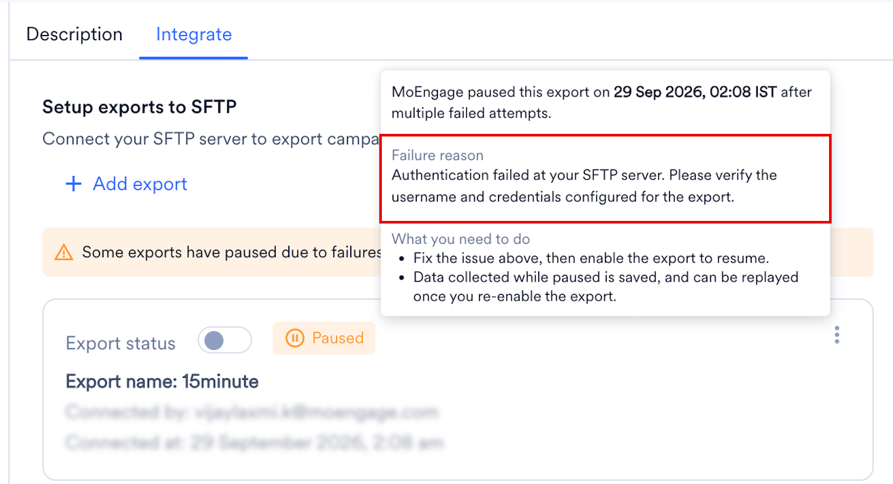
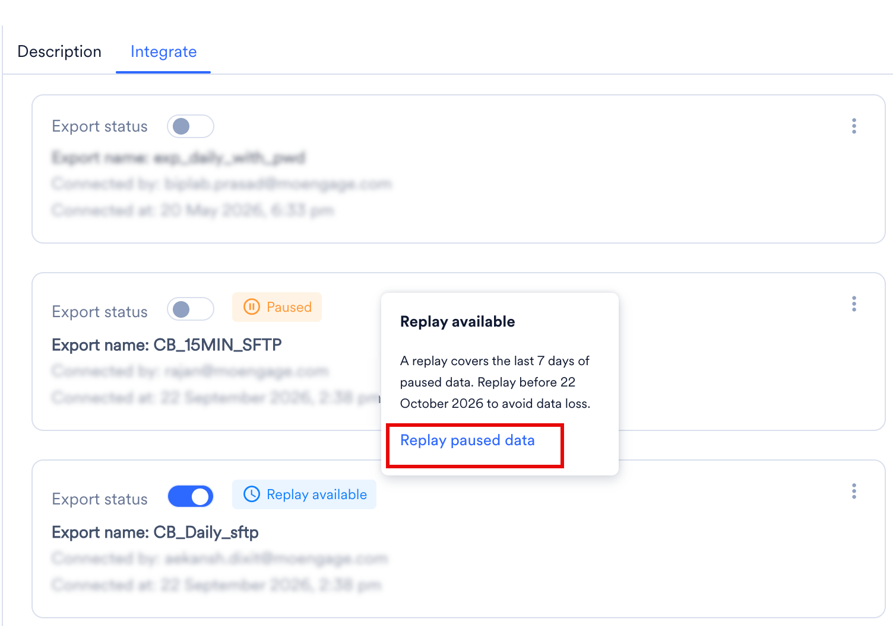

import StreamsAddOn from '/ja/snippets/streams-add-on.mdx';
import ExportFailureFaqs from '/ja/snippets/exports-faq-failure.mdx';
import ExportGeneralFaqs from '/ja/snippets/exports-faq-general.mdx';

<StreamsAddOn />

## 概要

Secure File Transfer Protocol（SFTP）は、信頼性の高い任意のデータストリーム上で、大容量ファイルや機密データに安全にアクセスし、転送・管理するためのネットワークプロトコルです。Internet Engineering Task ForceによってSecure Shell（SSH）バージョン2.0の拡張として設計されたSFTPは、安全なファイル転送機能を提供します。

## MoEngageとSFTPの連携方法

MoEngageでは、お客様のSFTPサーバーからユーザーとイベントを自動的にインポートしたり、フラットファイルを通じてMoEngageからイベントをエクスポートしたりできます。

SFTPサーバーとの統合により、MoEngageは次のことが可能になります。

- キャンペーンインタラクションイベントの定期的なエクスポートをJSON形式で共有する。
- ユーザー名とパスワードによる認証をサポートする。
- ホストのVPC/プライベートエンドポイントをサポートする。

MoEngageが受信または生成したすべてのユーザーイベントとキャンペーンイベントをSFTPサーバーにエクスポートできます。エクスポートしたデータをさらに分析することで、ユーザーの行動や嗜好などに関するインサイトを得ることができます。

<Info>
MoEngageは、Paramiko（4.0.0）ライブラリを使用してSFTPサーバーへのネイティブ接続を確立します。この定期的なアップグレードにより、すべての統合が堅牢性を維持し、最新の暗号化標準に準拠することが保証されます。
</Info>

## 統合

### 前提条件

- SFTPサーバーへの接続アクセス権があることを確認してください。接続を作成するには、[新しいSFTP接続を設定する](/ja/partner-guide/data-and-analytics/cloud-storage/sftp#configure-a-new-sftp-connection)を参照してください。
- エクスポートオプションは、少なくとも1つの接続を設定した場合にのみ有効になります。
- MoEngageには、SFTPサーバー上でフォルダを作成し、ファイルを書き込む権限が必要です。SFTPサーバー上のMoEngage専用ディレクトリに完全な書き込みアクセス権を付与してください。
- システムでIPホワイトリスト登録が必要な場合は、[こちら](/ja/user-guide/settings/account/security/ip-whitelisting-in-moengage)を参照してください。

### エクスポートを設定する

<Info>
  - エクスポートオプションは、少なくとも1つの接続を設定した場合にのみ有効になります。
  - MoEngageには、SFTPサーバー上でフォルダを作成し、ファイルを書き込む権限が必要です。SFTPサーバー上のMoEngage専用ディレクトリに完全な書き込みアクセス権を付与することをお勧めします。
  - SFTPへのエクスポートはStreamsアドオンの一部です。アカウントで有効にするには、担当のMoEngage CSM（カスタマーサクセスマネージャー）にお問い合わせください。
</Info>

MoEngage App MarketplaceでSFTPエクスポートを有効にするには、次の手順を実行します。

1. MoEngage UIで、App Marketplaceに移動します。
2. 「SFTP」を検索します。
3. **Integrate** タブに移動し、**\+ Add export** をクリックします。
4. エクスポートの詳細を入力します。

   

   | フィールド | 説明 | 例 |
   | --- | --- | --- |
   | Export name | エクスポートの名前を入力します。 | SFTP Export |
   | SFTP connection | [新しいSFTP接続を設定する](/ja/partner-guide/data-and-analytics/cloud-storage/sftp#configure-a-new-sftp-connection)で作成した接続のリストから、既存のSFTP接続を選択します。 | SFTP Connection |
   | Folder path | MoEngageがファイルを書き込むフォルダパス。最終的なファイルパスのプレビューが下に表示されます。 | `/exports/` |
   | Export all files in one folder | MoEngageにすべてのファイルを1つのフォルダに書き込ませる場合は、このオプションを選択します。無効にすると、MoEngageは指定したフォルダパス内に日ごとに新しいフォルダを作成します。最終的なファイルパスのプレビューが下に表示されます。 | オン/オフの切り替え |
   | User properties | イベントとともにエクスポートするユーザープロパティ（ユーザープロパティとデバイスプロパティ）を選択します。デバイスプロパティやカスタムプロパティを含むユーザープロパティは、そのDatabase/AppのData Managementで確認できます。 | （ドロップダウン） |
   | Select events | SFTPサーバーにエクスポートするイベントを選択します。使用できるオプションは次のとおりです。 <ul><li>**All events**</li><li>**Select events manually**</li></ul> 「All events」（既存のイベントと、今後MoEngageに取り込まれる新しいイベント）をエクスポートするか、イベントを手動で選択してそれらのイベントのみをエクスポートするかを選べます。 | All events / Select events manually |
   | Select events（ドロップダウン） | このドロップダウンリストは、**Select events** で **Select events manually** を選択した場合にのみ表示されます。このドロップダウンリストのイベントには、そのワークスペースのData Managementにあるすべてのイベントが自動的に入力されます。 | （ドロップダウン） |
   | Frequency | これらのイベントをエクスポートする頻度を選択します。MoEngageには3つの頻度があります。 <ul><li>**Every 15 mins**: MoEngageは15分間隔でファイルを書き込みます。</li><li>**Daily**: MoEngageは毎日の終わり、02:00 UTCにファイルを書き込みます。</li><li>**Weekly**: MoEngageは毎週月曜日の02:00 UTCにファイルを書き込みます。</li></ul> DailyとWeeklyの場合は、次回の書き込みのプレビューが表示されます。 | Every 15 mins / Daily / Weekly |
   <Warning>
     データの損失や重複が発生する可能性があるため、MoEngageではエクスポート頻度を頻繁に変更することは推奨していません。
   </Warning>
5. **Save export** をクリックします。エクスポートが保存され、**Export status** トグルがオンになると、MoEngageは選択したエクスポート頻度に基づいて、SFTPサーバー上の指定したフォルダパスへのファイルのエクスポートを開始します。

<Info>
  MoEngageは、Paramiko（4.0.0）ライブラリを使用してSFTPサーバーへのネイティブ接続を確立します。この定期的なアップグレードにより、すべての統合が堅牢性を維持し、最新の暗号化標準に準拠することが保証されます。
</Info>

### イベントと属性

MoEngageとSFTPの統合により、MoEngageに取り込まれるすべてのイベントをSFTPサーバーにエクスポートできます。デフォルトでは、MoEngageはSDKを通じていくつかの標準イベントとユーザープロパティを追跡します。[標準イベントと属性についてはこちら](/ja/user-guide/data/event-data/derived-events-and-attributes)をご覧ください。MoEngageで追跡している任意のカスタムユーザー定義イベントもエクスポートできます。

### データエクスポート形式

| 情報 | 説明 |
| --- | --- |
| ファイル形式 | JSON |
| 圧縮タイプ | GZip |
| エクスポート頻度 | 15分ごと、毎日、または毎週 |
| サンプルフォルダパス | `sftp://<host_name>/[<folder_path>/]<connection_name>/export_date={DD-MM-YYYY}/{filename=event_export}_<unique_string>[_<file_number>].json.gz` |

サンプルフォルダパスの各要素は次のとおりです。

- `<folder_path>` は、お客様が指定したプレフィックスのフォルダパスです。
- `<connection_name>` は、お客様が入力した接続名をスラッグ化したものです。
- ファイル番号は、ファイルを分割する場合に付与されるオプションの要素です。

**注**: ファイル命名規則の変更は2025年12月25日から有効になります。エクスポートのファイル命名形式は、エポックタイムスタンプから一意の文字列に更新されます。データパイプラインが新しい形式に対応するように設定されていることを確認してください。

- **現在の名前（エポックタイムスタンプ）**: export\_day=2025-10-28/event\_exports\_1761689701.json.gz
- **新しい名前（一意の文字列）** : export\_day=2025-10-28/event\_exports\_50492790da7cc2a0674fb51fa5046e3c.json.gz

サンプルファイルは[こちら](https://app-cdn.moengage.com/partners-integration-ui/app-marketplace-public/helpdoc/event_exports_sample_files.json.gz)からダウンロードできます。これはGZIP圧縮されたファイルであるため、ファイルを表示する前に展開する必要があります。

エクスポートされるイベントと属性の完全なリストについては、[データエクスポート用語集](/ja/user-guide/data/exports/events/data-export-glossary)を参照してください。

## エクスポート失敗時のポリシー

MoEngage は、失敗が続くエクスポートを一時停止します。一時停止中、MoEngage はエクスポートで配信されるはずだったイベントを収集し、問題を修正した後にそれらをリプレイできます。

### MoEngage がエクスポートを一時停止するタイミング

MoEngage は、エクスポートを失敗としてマークする前に複数回再試行します。選択したエクスポート頻度に応じて、スケジュールされたエクスポートが複数回失敗すると、エクスポートは一時停止されます。

| エクスポート頻度 | 条件 |
| --- | --- |
| 15 分 | スケジュールされたエクスポートが 3 回連続で失敗 |
| 毎日 | スケジュールされたエクスポートが 1 回失敗 |
| 毎週 | スケジュールされたエクスポートが 1 回失敗 |

MoEngage はエクスポートを一時停止すると、アラートで通知し、App Marketplace でエクスポートを **Paused** と表示します。

### エクスポートの一時停止中に起こること

MoEngage はエクスポートで配信されるはずだったイベントを収集し、直近 7 日分のみを保持します。エクスポートが 1 週間を超えて一時停止したままの場合、新しい日のデータが入るにつれて、MoEngage は最も古い日のデータを破棄します。

リプレイする前にエクスポートが複数回一時停止した場合、MoEngage はそれらすべての一時停止中のデータを、7 日間の期間内に収まる範囲で結合します。

### エクスポートを再開する

#### 失敗の理由を確認する

App Marketplace で **Integrate** タブをクリックし、エクスポートの **Paused** ラベルにカーソルを合わせます。MoEngage は、ログインユーザーに宛先フォルダへの書き込み権限がないことなど失敗の理由と、その修正方法を表示します。

#### エクスポートを有効にする

お客様側で原因を修正してから、エクスポートの **Export status** をオンにします。エクスポートが一時停止している間も 7 日間の期間は移動し続けるため、できるだけ早く実施してください。

エクスポートを有効にすると、MoEngage は収集を停止し、それまでに収集したデータ（一時停止中のデータの直近 7 日分、または一時停止がそれより短い場合はそのすべて）を確保します。これがリプレイできるデータです。このデータはそれ以降固定され、リプレイまでに時間が経っても減少することはありません。

### 一時停止中のデータをリプレイする

#### リプレイをリクエストする

MoEngage は、エクスポートの一時停止中に収集したデータを保存します。リプレイ待ちのデータがあるエクスポートには、**Integrate** タブに **Replay available** ラベルが表示されます。

リプレイするには、次の手順を実行します。

1. **Replay available** ラベルにカーソルを合わせるか、エクスポートのケバブメニューを開きます。
2. **Replay paused data** をクリックします。

   
3. **Replay paused data** ダイアログボックスで、**Confirm** をクリックします。

   

リプレイでは、エクスポートの一時停止中に MoEngage が収集したすべてのデータが送信されます。MoEngage は、データを新しい場所に書き込むのではなく、本来書き込まれるはずだった日付フォルダにバックフィルします。

一時停止中の最も古いデータが収集された日から 30 日以内であれば、いつでもリプレイできます。それ以降は、データを利用できなくなります。

<Note>
  エクスポートが再び一時停止する前にリプレイしてください。リプレイする前に 2 回目の一時停止が発生した場合、MoEngage は新しい一時停止中のデータを、1 回目の一時停止からリプレイ待ちになっているデータに追加します。結合されたデータは直近 7 日分に切り詰められるため、2 回の一時停止の間隔が 7 日を超える場合、古いデータは失われます。

  たとえば、1 日目にエクスポートが一時停止したとします。エクスポートを有効にしましたが、リプレイはしませんでした。20 日目にエクスポートが再び一時停止しました。19 日後であるため、1 日目のデータは 30 日間のリプレイ期間が終了していないにもかかわらず、7 日間の期間外となり失われます。2 回目の一時停止が 1 回目から 7 日以内に発生していた場合、1 日目のデータは引き続き含まれていました。
</Note>

#### リプレイの結果

リプレイが完了すると、MoEngage はリクエストしたユーザーに、次のいずれかの結果をメールで通知します。

| 結果 | 意味 |
| --- | --- |
| Successful | MoEngage は収集したすべてのデータを配信しました。リプレイオプションは利用できなくなります。 |
| Partially Successful | MoEngage は収集したデータの一部を配信した後、エラーが発生しました。リプレイは停止し、MoEngage はエクスポートを再び一時停止します。メールには、リプレイが完了しなかった理由が記載されています。原因を修正し、エクスポートを有効にしてから、再度リプレイしてください。リプレイできるデータについては、[エクスポートの一時停止中に起こること](#what-happens-while-an-export-is-paused)を参照してください。 |
| Failed | エラーのため、MoEngage は収集したデータを一切配信しませんでした。リプレイは停止し、MoEngage はエクスポートを再び一時停止します。メールには、リプレイが完了しなかった理由が記載されています。原因を修正し、エクスポートを有効にしてから、再度リプレイしてください。リプレイできるデータについては、[エクスポートの一時停止中に起こること](#what-happens-while-an-export-is-paused)を参照してください。 |

リプレイは、1 つのエクスポートにつき一度に 1 つのみ実行できます。

#### 重複データを回避する

MoEngage は重複排除を行わないため、リプレイのたびに収集されたデータ全体が再送信されます。複数回リプレイする場合は、イベントごとに一意である `event_uuid` フィールドに基づいて、お客様側で重複を排除してください。エクスポートのフィールドについては、[データエクスポート用語集](/ja/user-guide/data/exports/events/data-export-glossary)を参照してください。

### エクスポート一時停止アラート

MoEngage はエクスポートを一時停止するとアラートで通知するため、問題を修正し、エクスポートの一時停止中に収集されたデータをリプレイできます。

デフォルトでは、MoEngage はワークスペースの管理者を Data Exports システムアラートに登録し、エクスポートを作成または更新したユーザーを追加します。他のユーザーの登録または登録解除を行うには、Alert Management ページに移動します。登録または登録解除によって変更されるのはそのユーザーの通知のみであり、他のユーザーの登録には影響しません。

## よくある質問

<AccordionGroup>
  <ExportFailureFaqs />
  <ExportGeneralFaqs />
</AccordionGroup>
