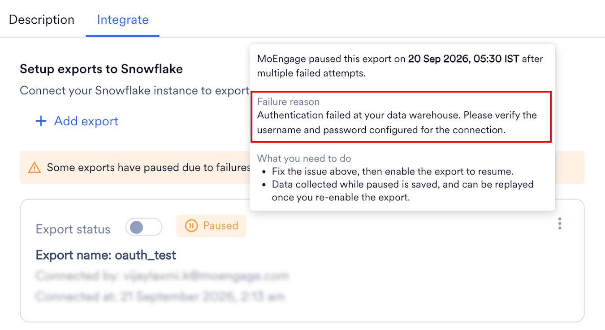
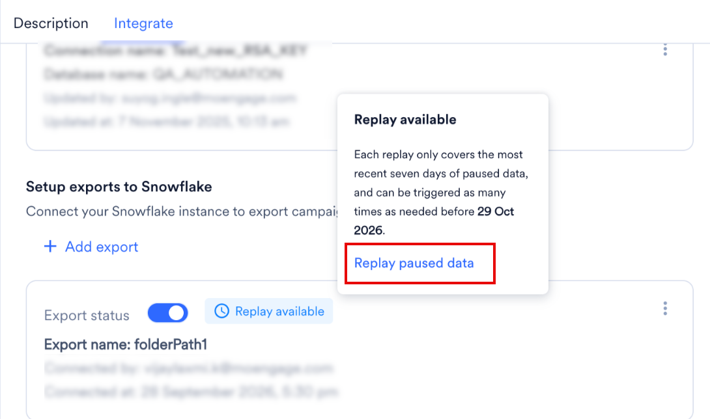

import StreamsAddOn from '/ja/snippets/streams-add-on.mdx';
import ExportFailureFaqs from '/ja/snippets/exports-faq-failure.mdx';
import ExportGeneralFaqs from '/ja/snippets/exports-faq-general.mdx';

<StreamsAddOn />

## 概要

[Snowflake](https://docs.snowflake.com/en/user-guide-getting-started) は、組織が大量の構造化データおよび半構造化データを、高いスケーラビリティと効率性で保存、分析、処理できるデータプラットフォームです。独自のアーキテクチャにより、Snowflakeを使用すると、組織はデータを統合し、迅速な分析を実行して、すべてのユーザーがアクセスできる価値あるデータドリブンなインサイトを得ることができます。

## MoEngage は Snowflake とどのように連携しますか?

MoEngageとSnowflakeの統合により、キャンペーンインタラクションイベントのデータをSnowflakeテーブルに直接エクスポートできます。

## 統合

### 前提条件

- Snowflakeインスタンス、ロール、ポリシーを作成・編集するための適切な権限を持つSnowflakeアカウントがあることを確認してください。新しいユーザーの作成は任意ですが、Snowflakeデータベースで新しいユーザーを作成するアクセス権が必要です。
- システムでIPホワイトリスト登録が必要な場合は、MoEngageのIPをホワイトリストに登録する必要があります。詳細については、[こちら](/ja/user-guide/settings/account/security/ip-whitelisting-in-moengage)を参照してください。
- App Marketplaceに[Snowflake接続](/ja/partner-guide/data-and-analytics/data-warehouses/snowflake)があることを確認してください。
- App MarketplaceのSnowflakeの **Add Integration** オプションは、ワークスペースでStreamsアドオンが有効になった後にのみ表示されます（上記の注記を参照）。

### エクスポートを設定する

<Info>
  - イベントと属性の完全なリストについては、[データエクスポート用語集](/ja/user-guide/data/exports/events/data-export-glossary)を参照してください。
  - エクスポートされたイベントのevent\_timeは常にUTCです。
</Info>

#### ステップ1: 必要な権限を付与する

MoEngageがSnowflakeデータベースにデータを書き込めるように、データベースへの `WRITE` アクセス権が必要です。これらの権限は、既存のデータベースユーザーに付与するか、MoEngage専用の新しいデータベースユーザーを作成して付与できます。

```sql wrap
-- Create a role for the MoEngage user
CREATE ROLE MOENGAGE_ROLE;
-- Allow the user to run queries in the warehouse
GRANT USAGE ON WAREHOUSE <YOUR_WAREHOUSE_NAME> TO ROLE MOENGAGE_ROLE;
-- Let the user see this database
GRANT USAGE ON DATABASE <YOUR_DATABASE_NAME> TO ROLE MOENGAGE_ROLE;
-- Let the user see all schemas in this database
GRANT USAGE ON SCHEMA <YOUR_DATABASE_NAME>.<YOUR_SCHEMA_NAME> TO ROLE MOENGAGE_ROLE;
-- Let the user create a table in your schema
GRANT CREATE TABLE ON SCHEMA <YOUR_DATABASE_NAME>.<YOUR_SCHEMA_NAME> TO ROLE MOENGAGE_ROLE;
-- Let the user insert data in your tables
GRANT INSERT, SELECT ON ALL TABLES IN SCHEMA <YOUR_DATABASE_NAME>.<YOUR_SCHEMA_NAME> TO ROLE MOENGAGE_ROLE;

-- Create the MoEngage user (MOENGAGE_USER is username here)
CREATE USER MOENGAGE_USER WITH DEFAULT_ROLE = MOENGAGE_ROLE DEFAULT_WAREHOUSE = <YOUR_WAREHOUSE_NAME> PASSWORD = '<YOUR_PASSWORD>';
-- Grant the role to the user
GRANT ROLE MOENGAGE_ROLE TO USER MOENGAGE_USER;
```

次の値を必ず変更してください。

1. `<YOUR_WAREHOUSE_NAME>` - クエリの実行時にMoEngageに使用させるウェアハウスの名前。
2. `<YOUR_DATABASE_NAME>` - データのインポート元となるデータベースの名前。
3. `<YOUR_PASSWORD>` - 新しく作成したデータベースユーザーに設定する強力なパスワード。

#### ステップ2: App Marketplaceで新しいエクスポートを作成する

<Info>
  - エクスポートされるイベントと属性の完全なリストについては、[データエクスポート用語集](/ja/user-guide/data/exports/events/data-export-glossary)を参照してください。
  - エクスポートされたイベントの `event_time` は常にUTCであることに注意してください。
</Info>


MoEngageダッシュボードで、**App Marketplace** \> **Snowflake** に移動します。

1. **Integrate** \> **Add Integration** をクリックします。
2. Snowflake接続を選択します。
3. MoEngageが新しいテーブルを作成し、イベントをエクスポートするスキーマを選択します。
4. Snowflakeにエクスポートするイベントと追加のユーザープロパティを選択します。
5. **Save Export** をクリックします。

MoEngageは、新しく作成されたテーブルへのイベントの書き込みを1時間ごとに開始します。

### エクスポートのプロセスと頻度

エクスポートを保存すると、MoEngageはスキーマ内に宛先テーブルを作成します。その後、新しいイベントデータが1時間間隔でこの同じテーブルに追加されます。

- **初回のアクション**: MoEngageは、最初のエクスポートがトリガーされたときにテーブルを作成します。
- **定期的なアクション**: MoEngageは1時間ごとに同じテーブルにデータを追加（追記）します。

MoEngageは1時間間隔でデータをエクスポートします。

### テーブル構造のサンプル

MoEngageは、次の形式を使用してスキーマ内に単一のテーブルを作成します。

`moe_events_<table_creation_timestamp>`

<Note>
  このテーブルは接続ごとに1回作成されます。1つの接続で設定されたすべての1時間ごとのエクスポートと異なるイベントタイプは統合され、この同じテーブルに追加されます。
</Note>

テーブルの全体的な構造は、すべてのイベントタイプで固定されています。エクスポートされる新しいユーザープロパティまたはイベントプロパティは、それぞれ `user_attributes` 列または `event_attributes` 列に含まれます。すべてのイベントは、分析しやすいように、イベント名やイベント時刻などの必要な情報を含む単一のテーブルに統合されます。

| フィールド | 型 | NL |
| --- | --- | --- |
| `app_name` | VARCHAR | NN |
| `event_name` | VARCHAR | NN |
| `event_code` | VARCHAR | NN |
| `event_uuid` | VARCHAR | NN |
| `event_time` | TIMESTAMP\_NTZ | NN |
| `event_type` | VARCHAR | NN |
| `event_source` | VARCHAR | NN |
| `uid` | VARCHAR | NULL |
| `user_attributes_moengage_user_id` | VARCHAR | NULL |
| `device_attributes_moengage_device_id` | VARCHAR | NULL |
| `push_id` | VARCHAR | NULL |
| `email_address` | VARCHAR | NULL |
| `mobile_number` | VARCHAR | NULL |
| `event_attributes_app_version` | VARCHAR | NULL |
| `event_attributes_sdk_version` | VARCHAR | NULL |
| `event_attributes_platform` | VARCHAR | NULL |
| `event_attributes_campaign_id` | VARCHAR | NULL |
| `event_attributes_campaign_name` | VARCHAR | NULL |
| `event_attributes_campaign_type` | VARCHAR | NULL |
| `event_attributes_campaign_channel` | VARCHAR | NULL |
| `event_attributes_readable_campaign_id` | VARCHAR | NULL |
| `event_attributes_parent_campaign_id` | VARCHAR | NULL |
| `event_attributes_parent_flow_id` | VARCHAR | NULL |
| `event_attributes_parent_flow_name` | VARCHAR | NULL |
| `event_attributes_variation_id` | VARCHAR | NULL |
| `event_attributes_locale_id` | VARCHAR | NULL |
| `event_attributes_locale_name` | VARCHAR | NULL |
| `event_attributes_url` | VARCHAR | NULL |
| `event_attributes_timestamp` | TIMESTAMP\_NTZ | NULL |
| `event_attributes_first_session` | BOOLEAN | NULL |
| `event_attributes_logged_in_status` | VARCHAR | NULL |
| `event_attributes` | VARIANT | NULL |
| `user_attributes` | VARIANT | NULL |
| `device_attributes` | VARIANT | NULL |

## エクスポート失敗時のポリシー

MoEngage は、失敗が続くエクスポートを一時停止します。一時停止中、MoEngage はエクスポートで配信されるはずだったイベントを収集し、問題を修正した後にそれらをリプレイできます。

### MoEngage がエクスポートを一時停止するタイミング

Snowflake へのエクスポートは 1 時間ごとに実行されます。MoEngage は、エクスポートを失敗としてマークする前に複数回再試行します。スケジュールされたエクスポートが 3 回連続で失敗すると、エクスポートは一時停止されます。

MoEngage はエクスポートを一時停止すると、アラートで通知し、App Marketplace でエクスポートを **Paused** と表示します。

### エクスポートの一時停止中に起こること


MoEngage はエクスポートで配信されるはずだったイベントを収集し、直近 7 日分のみを保持します。エクスポートが 1 週間を超えて一時停止したままの場合、新しい日のデータが入るにつれて、MoEngage は最も古い日のデータを破棄します。

リプレイする前にエクスポートが複数回一時停止した場合、MoEngage はそれらすべての一時停止中のデータを、7 日間の期間内に収まる範囲で結合します。

### エクスポートを再開する

#### 失敗の理由を確認する

App Marketplace で **Integrate** タブをクリックし、エクスポートの **Paused** ラベルにカーソルを合わせます。MoEngage は、宛先テーブルへの書き込み権限がないことなど失敗の理由と、その修正方法を表示します。



#### エクスポートを有効にする

お客様側で原因を修正してから、エクスポートの **Export status** をオンにします。エクスポートが一時停止している間も 7 日間の期間は移動し続けるため、できるだけ早く実施してください。

エクスポートを有効にすると、MoEngage は収集を停止し、それまでに収集したデータ（一時停止中のデータの直近 7 日分、または一時停止がそれより短い場合はそのすべて）を確保します。これがリプレイできるデータです。このデータはそれ以降固定され、リプレイまでに時間が経っても減少することはありません。

### 一時停止中のデータをリプレイする

#### リプレイをリクエストする

MoEngage は、エクスポートの一時停止中に収集したデータを保存します。リプレイ待ちのデータがあるエクスポートには、**Integrate** タブに **Replay available** ラベルが表示されます。

リプレイするには、次の手順を実行します。

1. **Replay available** ラベルにカーソルを合わせるか、エクスポートのケバブメニューを開きます。
2. **Replay paused data** をクリックします。

   
3. **Replay paused data** ダイアログボックスで、**Confirm** をクリックします。

   

リプレイでは、エクスポートの一時停止中に MoEngage が収集したすべてのデータが送信されます。MoEngage はデータを宛先テーブルに追加します。

一時停止中の最も古いデータが収集された日から 30 日以内であれば、いつでもリプレイできます。それ以降は、データを利用できなくなります。

<Note>
  エクスポートが再び一時停止する前にリプレイしてください。リプレイする前に 2 回目の一時停止が発生した場合、MoEngage は新しい一時停止中のデータを、1 回目の一時停止からリプレイ待ちになっているデータに追加します。結合されたデータは直近 7 日分に切り詰められるため、2 回の一時停止の間隔が 7 日を超える場合、古いデータは失われます。

  たとえば、1 日目にエクスポートが一時停止したとします。エクスポートを有効にしましたが、リプレイはしませんでした。20 日目にエクスポートが再び一時停止しました。19 日後であるため、1 日目のデータは 30 日間のリプレイ期間が終了していないにもかかわらず、7 日間の期間外となり失われます。2 回目の一時停止が 1 回目から 7 日以内に発生していた場合、1 日目のデータは引き続き含まれていました。
</Note>

#### リプレイの結果

リプレイが完了すると、MoEngage はリクエストしたユーザーに、次のいずれかの結果をメールで通知します。

| 結果 | 意味 |
| --- | --- |
| Successful | MoEngage は収集したすべてのデータを配信しました。リプレイオプションは利用できなくなります。 |
| Partially Successful | MoEngage は収集したデータの一部を配信した後、エラーが発生しました。リプレイは停止し、MoEngage はエクスポートを再び一時停止します。メールには、リプレイが完了しなかった理由が記載されています。原因を修正し、エクスポートを有効にしてから、再度リプレイしてください。リプレイできるデータについては、[エクスポートの一時停止中に起こること](#what-happens-while-an-export-is-paused)を参照してください。 |
| Failed | エラーのため、MoEngage は収集したデータを一切配信しませんでした。リプレイは停止し、MoEngage はエクスポートを再び一時停止します。メールには、リプレイが完了しなかった理由が記載されています。原因を修正し、エクスポートを有効にしてから、再度リプレイしてください。リプレイできるデータについては、[エクスポートの一時停止中に起こること](#what-happens-while-an-export-is-paused)を参照してください。 |

リプレイは、1 つのエクスポートにつき一度に 1 つのみ実行できます。

#### 重複データを回避する

MoEngage は重複排除を行わないため、リプレイのたびに収集されたデータ全体が再送信されます。複数回リプレイする場合は、イベントごとに一意である `event_uuid` フィールドに基づいて、お客様側で重複を排除してください。エクスポートのフィールドについては、[データエクスポート用語集](/ja/user-guide/data/exports/events/data-export-glossary)を参照してください。

### エクスポート一時停止アラート

MoEngage はエクスポートを一時停止するとアラートで通知するため、問題を修正し、エクスポートの一時停止中に収集されたデータをリプレイできます。

デフォルトでは、MoEngage はワークスペースの管理者を Data Exports システムアラートに登録し、エクスポートを作成または更新したユーザーを追加します。他のユーザーの登録または登録解除を行うには、Alert Management ページに移動します。登録または登録解除によって変更されるのはそのユーザーの通知のみであり、他のユーザーの登録には影響しません。

## よくある質問

<AccordionGroup>
  <ExportFailureFaqs />
  <ExportGeneralFaqs />
</AccordionGroup>
