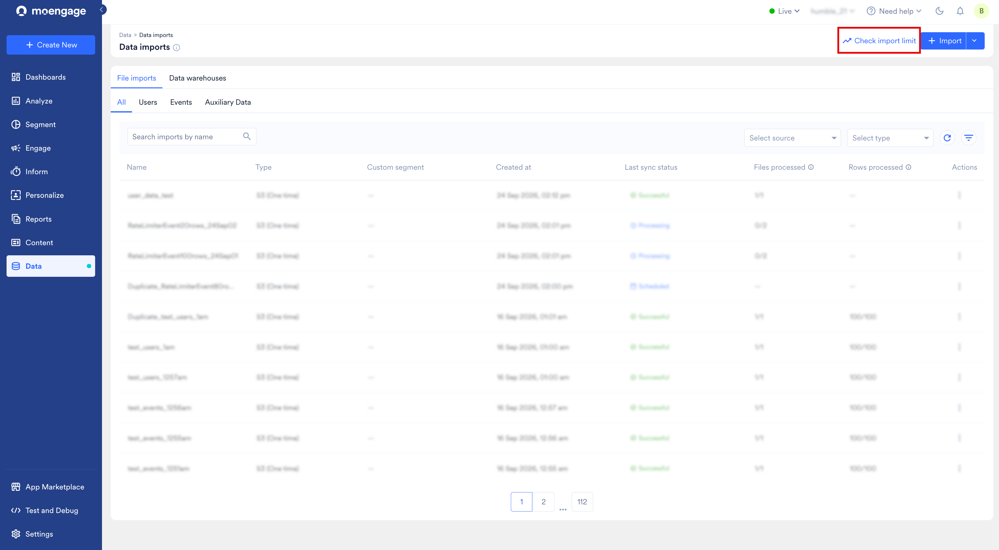
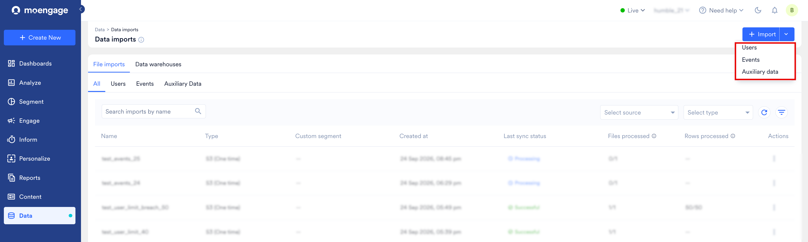
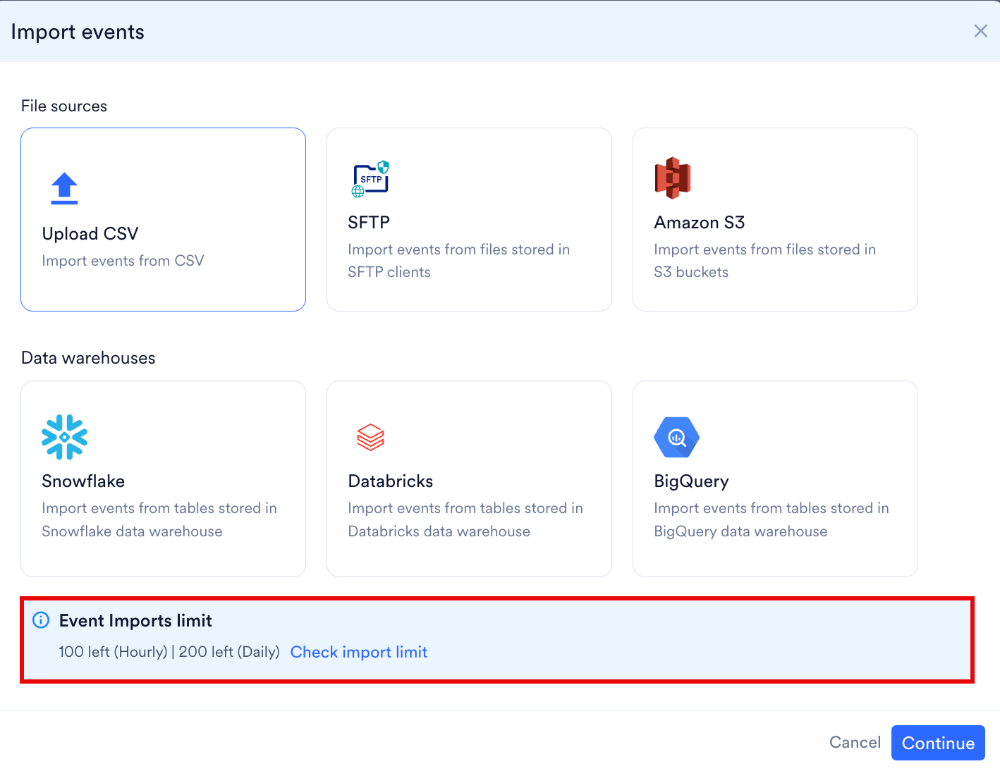
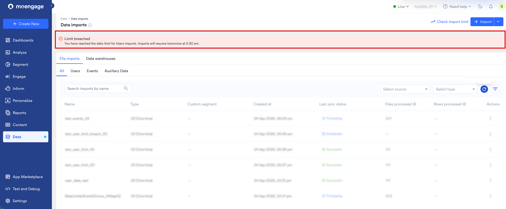
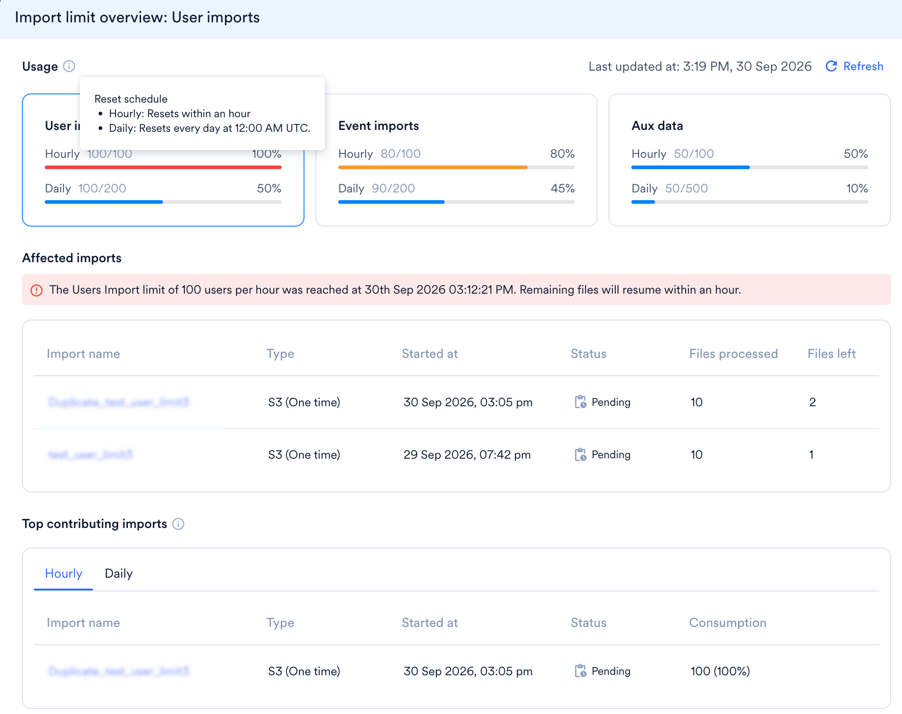
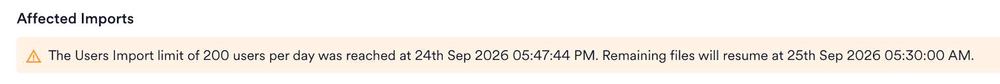
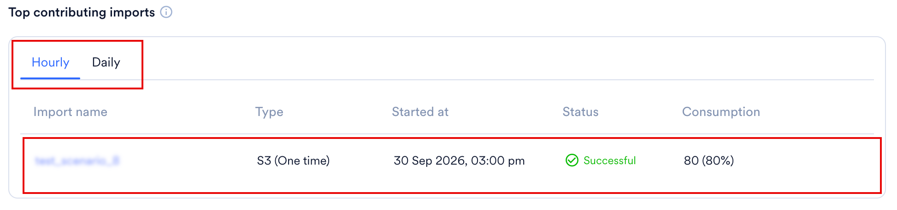

import UniversalImportFaqs from '/ja/snippets/imports-faq-universal.mdx';
import MappingFileConcept from '/ja/snippets/imports-mapping-file-concept.mdx';
import DatetimeFormats from '/ja/snippets/imports-datetime-formats.mdx';
import TimezoneDisplayNote from '/ja/snippets/imports-timezone-display-note.mdx';

# はじめに

MoEngageでは、ファイル (Amazon S3、SFTP、または手動CSVアップロード) から、またデータウェアハウス (Snowflake、BigQuery、またはDatabricks) から直接、ユーザー、イベント、Auxiliary Dataをワークスペースにインポートできます。このページは、ユースケースに適したソースを選択するのに役立ちます。方法を選択すると、専用のセットアップページでプロセス全体を順を追って確認できます。

<Info>
  システムでIPホワイトリスト登録が必要な場合は、データインポートを設定する前に [MoEngageでのIPホワイトリスト登録](/ja/user-guide/settings/account/security/ip-whitelisting-in-moengage) を参照してください。
</Info>

# ソースとサポートされているエンティティ

ソースごとにサポートされるエンティティタイプが異なります。このマトリックスを使用して、必要なデータをソースからインポートできるかを確認してください。

**ファイルソース**

| ソース | Registered Users | Anonymous Users | Events | Auxiliary Data |
| --- | :---: | :---: | :---: | :---: |
| Amazon S3 | ✅ | ✅ | ✅ | ✅ |
| SFTP | ✅ | ✅ | ✅ | ✅ |
| 手動アップロード (CSV) | ✅ | ✅ | ✅ | ✅ |

**データウェアハウス**

| ソース | Registered Users | Anonymous Users | Events | Auxiliary Data |
| --- | :---: | :---: | :---: | :---: |
| Snowflake | ✅ | ✅ | ✅ | ❌ |
| BigQuery | ✅ | ✅ | ✅ | ❌ |
| Databricks | ✅ | ✅ | ✅ | ❌ |

**エンティティタイプ:**

- **Registered Users**: MoEngageにすでに登録されているユーザーです。既存ユーザーの一括更新にも使用します。
- **Anonymous Users**: MoEngageにまだ登録されていないユーザーです。
- **Events** (標準およびユーザー定義): Campaign Interaction Eventsなどの標準イベントと、独自のユーザー定義イベントです。
- **Auxiliary Data**: 特定のビジネス目的のために一時的にMoEngageに取り込まれるユーザーデータです。ファイルベースのソース (S3、SFTP、手動アップロード) でのみ利用でき、データウェアハウスでは利用できません。

# インポート方法を選択する

データの保存場所に合ったインポート方法を選択してください。

<CardGroup cols={2}>
  <Card title="ファイルインポートを設定する" href="/ja/user-guide/data/imports/setting-up-a-file-import" icon="folder">
    Amazon S3またはSFTPサーバーに配置されたファイルからのインポートを、1回限りまたは定期的なスケジュールで自動化します。
  </Card>
  <Card title="データウェアハウスインポートを設定する" href="/ja/user-guide/data/imports/setting-up-a-data-warehouse-import" icon="database">
    Snowflake、BigQuery、またはDatabricksのテーブルやビューから直接インポートします。接続ベースで、1回限りまたは定期的な同期が可能です。
  </Card>
  <Card title="手動アップロード" href="/ja/user-guide/data/imports/manual-uploads" icon="upload">
    ユーザーまたはイベントのCSVをダッシュボードで直接アップロードします。1回限りのみで、定期的なスケジュール設定はできません。
  </Card>
  <Card title="Auxiliary Data" href="/ja/user-guide/data/imports/auxiliary-data" icon="table">
    シンプルなプライマリキーマッピングモデルを使用して、S3、SFTP、またはCSV経由で補助データをインポートします。
  </Card>
</CardGroup>

# インポートの仕組み

以下の仕組みは、すべてのインポートソースに共通です。ソース固有のセットアップ手順、制限、失敗時の動作については、各ソースのセットアップページを参照してください。

## インポートダッシュボード

Data Importsダッシュボードには、すべてのインポートとその主な詳細が一覧表示されます。

| **列** | **説明** |
| --- | --- |
| **Name** | セットアップ時にインポートに付けた名前。 |
| **Type** | インポートのソース (S3、SFTP、CSV、Snowflake、BigQuery、またはDatabricks)。インポートタイプ (One-TimeまたはPeriodic) は括弧内に表示されます。 |
| **Custom Segment** | ユーザーインポートがセグメントに保存される場合、そのセグメント名がここに表示されます。 |
| **Created at** | インポートが作成された日時。 |
| **Last Sync Status** | 直近のインポート実行全体のステータス。その実行内の最後のファイルのステータスではありません (以下のステータスを参照)。 |
| **Files Processed** | これまでに処理されたファイルの数。 |
| **Rows Processed** | これまでに処理された行の合計数。 |
| **Actions** | インポートのView Details、Edit、Duplicate、Delete。 |

<TimezoneDisplayNote />

## インポートステータス

ダッシュボード上の各インポートには、次のいずれかのステータスが表示されます。

- **Scheduled**: 実行は将来実行されるようにスケジュールされています。
- **Pending**: 1時間あたりまたは1日あたりのインポート制限に達したため、実行内の1つ以上のファイルが保留されています。制限に空きができると実行は自動的に再開されるため、対応は不要です。
- **Processing**: 実行は進行中です。
- **Successful**: 実行内のすべてのファイルが成功しました。
- **Partial Success**: 実行は、成功したファイルと失敗したファイルが混在した状態で終了しました。
- **Failed**: 実行内のすべてのファイルが失敗しました。ステータスにカーソルを合わせると理由が表示されます。
- **Archived**: 誰かがインポートをアーカイブしました。アーカイブはMoEngageが自動的に行うものではなく手動の操作であり、元に戻すことはできないため、アーカイブされたインポートは復元できません。アーカイブされたインポートの実行履歴とファイル履歴は引き続き利用できます。
- **Expired**: インポートが終了日を過ぎました。このステータスはMoEngageが自動的に設定するもので、この点が **Archived** との違いです。

MoEngageは、実行内のファイルに基づいて、次の順序で実行ステータスを決定します。

| 条件 | 実行ステータス |
| --- | --- |
| いずれかのファイルが処理中、またはスケジュールされたファイルがまだキューにある | Processing |
| 制限に達したため、または内部的な再試行が進行中であるため、いずれかのファイルが保留中である | Pending |
| すべてのファイルが最終状態に達し、すべて成功した | Successful |
| すべてのファイルが最終状態に達し、すべて失敗した | Failed |
| すべてのファイルが最終状態に達し、成功と失敗が混在している | Partial Success |

保留中のファイルが残っている実行は、同じ実行内の他のファイルがすでに失敗している場合でも **Pending** のままです。実行がPartial Successになるのは、すべてのファイルが最終状態に達した後のみです。

スケジュールされた各実行の結果を確認するには、**Actions** の下にあるケバブメニューをクリックし、**View** をクリックします。詳細については、[実行履歴](/ja/user-guide/data/imports/setting-up-a-file-import#run-history)を参照してください。インポートされたファイルのコピーは最大60日間エクスポートできます。MoEngageからのファイルの再ダウンロードには期限があり、保証されていないため、インポートするファイルのコピーはご自身で保管してください。

## インポート制限を確認する

MoEngageは、**User imports**、**Event imports**、**Aux data** の3つのカテゴリに対して、1時間あたりおよび1日あたりのインポート制限を個別に適用します。Import limit overviewでは、各制限の消費量、制限がリセットされるタイミング、保留されているインポート、および最も多く消費したインポートを確認できます。

これらの制限は、Amazon S3、SFTP、CSVアップロードからのファイルインポートに適用されます。データウェアハウスインポートには、このドロワーの対象外である別の制限プールが使用されます。

### Import Limit Overviewを開く

Import limit overviewは、Data importsページから、またはインポートの設定中に開くことができます。

Data importsページから開くには、次の手順を実行します。

1. **Import** の横にある **Check import limit** をクリックします。

   

インポートの設定中に開くには、次の手順を実行します。

1. **\+ Import** をクリックし、**Users**、**Events**、または **Auxiliary data** をクリックします。

   
2. ダイアログボックスで、**Check import limit** をクリックします。

   

ダイアログボックスには、開始前に1時間あたりおよび1日あたりの制限の残量も表示されるため、インポートを設定する前に遅延が発生しそうかどうかを判断できます。

### 制限に達する前に把握する

MoEngageは制限に近づくと通知するため、インポートが保留される前に再スケジュールできます。制限の80%に達すると、新しいインポートが遅延する可能性があることを警告するバナーがData importsページの上部に表示されます。また、制限に達したときにも、カテゴリとインポートが再開されるタイミングを示すバナーが表示されます。複数の制限に達した場合、影響を受ける制限はそれぞれ異なるタイミングでリセットされる可能性があるため、バナーには再開時刻が表示されません。各制限を確認するには、Import limit overviewを開いてください。

バナーはすべてのタブに表示されるため、あるカテゴリで制限に達した場合、別のカテゴリを表示しているときにも確認できます。すべての制限で80%未満の場合、MoEngageはバナーを表示しません。

### 消費量を確認する

Import limit overviewには、カテゴリごとに1枚のカードが表示され、上部に1時間あたりの使用量、下部に1日あたりの使用量が表示されます。各カードのプログレスバーには、その制限の消費量が、制限に対する量とパーセンテージで表示されます。

使用量を確認するには、次のいずれかの操作を実行します。

1. **Usage** の横にある情報アイコンにカーソルを合わせると、各制限がリセットされるタイミングが表示されます。
2. **Refresh** をクリックすると、数値が更新されます。
3. **User imports**、**Event imports**、または **Aux data** カードをクリックすると、そのカテゴリの詳細が表示されます。

1時間あたりの制限は固定時刻ではなくローリングのルックバック期間でリセットされるため、使用量は徐々に期限切れになります。1日あたりの制限は毎日午前12時 (UTC) にリセットされます。ドロワーは自動的に更新されないため、**Last updated at** のタイムスタンプには、数値が最後に読み込まれた日時が表示されます。カードを選択すると、下の **Affected imports** セクションと **Top contributing imports** セクションがそのカテゴリに適用されます。

### 影響を受けるインポートを確認する

**Affected imports** には、制限によって保留されているインポートが一覧表示され、到達した制限と保留中のファイルが再開されるタイミングを示すバナーが表示されます。

テーブルには次の情報が表示されます。

| 列 | 説明 |
| --- | --- |
| Import name | 影響を受けるインポートの名前。詳細ページにリンクしています。 |
| Type | インポートのソースとスケジュール (例: SFTP (Periodic))。 |
| Started at | インポートが開始された日時、または開始予定の日時。 |
| Status | ファイルが保留されているインポートの場合は **Pending**、まだ開始されていないインポートの場合は **Scheduled**。 |
| Files processed | 現在処理中またはこれまでに処理が完了したファイルの数。開始されていないインポートの場合は `--` と表示されます。 |
| Files left | まだ保留中のファイルの数。開始されていないインポートの場合は `--` と表示されます。 |

テーブルには、制限に達したために保留されているすべてのインポートが一覧表示されます。1時間あたりの制限に達した場合、それらのインポートは制限に空きができ次第再開されます。1日あたりの制限に達した場合、その日の保留中およびスケジュール済みのインポートは翌日に再開されます。

### 最も多く消費したインポートを確認する

**Top contributing imports** には、制限を最も多く使用したインポートが表示されるため、インポートを追加または再スケジュールする前に原因を特定できます。**Top contributing imports** は、カテゴリ内の少なくとも1つのインポートが実行を完了した後に表示されます。

**Hourly** タブと **Daily** タブで、テーブルの対象期間を切り替えます。

- 現在のローリング1時間の期間内に実行されたインポートを表示するには、**Hourly** をクリックします。
- 午前12時 (UTC) の最後のリセット以降に実行されたインポートを表示するには、**Daily** をクリックします。

テーブルには次の情報が表示されます。

| 列 | 説明 |
| --- | --- |
| Import name | インポートの名前。詳細ページにリンクしています。 |
| Type | インポートのソースとスケジュール。 |
| Started at | インポートが開始された日時。 |
| Status | インポートのステータス。 |
| Consumption | インポートが消費した量。絶対数と、そのカテゴリおよび期間の制限全体に対するパーセンテージで表示されます。 |

MoEngageは、各インポートが消費した量でテーブルを並べ替え、上位5件を表示します。各パーセンテージは、そのカテゴリおよび期間の制限に対するそのインポートの割合です。

## インポートをトリガーする

インポートは次の方法でトリガーできます。

1. **手動**: インポートページで **Actions** をクリックして、定期インポートをトリガーします。スケジュールされた時刻の5分以内にインポートをトリガーすると、エラーが発生する場合があります。
2. **API**: [File Imports Trigger API](https://www.moengage.com/docs/api/file-import/trigger-file-imports) を使用してインポートをトリガーします。データウェアハウスは現在これらのAPIをサポートしていません。

# マッピングファイルとデータマッピング

<MappingFileConcept />

# サポートされている日時フォーマット

これらのフォーマットは、マッピングファイルの `datetime_format` フィールドで、またはセットアップ時に日時列を設定する際に使用します。

<DatetimeFormats />

# よくある質問

<UniversalImportFaqs />

