データウェアハウスにはテーブルがあり、各テーブルには列があります。Warehouse Schema は、それらのテーブルと列が何を表しているかを MoEngage に伝えるもので、これにより MoEngage はお客様に代わってそれらをクエリできます。

マッピングは次の 2 つのレベルで行われます。

- **テーブル**は、**ユーザースキーマ**または**イベントスキーマ**のいずれかになります。
- そのテーブル内の**列**は、テーブルが属するスキーマの種類に応じて、**ユーザープロパティ**または**イベントプロパティ**になります。

マッピングが完了すると、それらのプロパティと属性がセグメントビルダーのドロップダウンに表示され、マーケターは SQL を記述せずにウェアハウスセグメントを作成できます。

Warehouse Schema の設定は一度だけ行います。その後、マーケターはその結果を使用してオーディエンスを作成します。詳細については、[Create a Warehouse Segment Using Filters](/ja/user-guide/segment/create-segments/warehouse-segments/create-using-filters) を参照してください。

<Info>
  **前提条件**

  - 接続済みのデータウェアハウス。接続手順と MoEngage が必要とする読み取り権限は、ウェアハウスによって異なります。詳細については、[Connect Your Data Warehouse](/ja/user-guide/segment/create-segments/warehouse-segments/connect-your-warehouse) を参照してください。
  - Admin または Developer ロール。これらのロールには、デフォルトで Warehouse Schema へのアクセス権が含まれています。その他のロールには、カスタムロールを通じてアクセス権を付与する必要があります。
</Info>

<Note>
  Warehouse Schema は **BigQuery** と **Databricks** をサポートしています。
</Note>

# Warehouse Schema の仕組み

MoEngage はウェアハウスのデータをコピーしません。スキーマ定義を読み取り、セグメントビルダーで選択されたフィルターから SQL クエリを作成し、セグメントが評価されるときにそのクエリをウェアハウスに対して実行します。

各スキーマは、ウェアハウス内の 1 つのテーブルまたはビューをマッピングします。スキーマには次の 2 種類があります。

| スキーマ | 対象となるテーブル | 列の変換先 | 数 |
| --- | --- | --- | --- |
| **ユーザースキーマ** | 一意のユーザーの完全なセットを保持するユーザーマスターテーブル | ユーザープロパティ | 接続ごとに 1 つ |
| **イベントスキーマ** | イベントの発生ごとに 1 行、ユーザーごとに複数行を持つイベントテーブル | イベントプロパティ | 複数 |

最初にユーザースキーマを作成してください。イベントスキーマはユーザー ID 列でユーザースキーマに結合されるため、ユーザースキーマが存在するまでは結合する対象がありません。

## ユーザーの照合方法

すべてのスキーマはユーザー ID 列を基準としており、同じ列が結合の両側で機能する必要があります。つまり、その列はウェアハウス内のユーザーを識別し、その値は MoEngage のユーザーの customer ID と一致する必要があります。

セグメント化できるのは、一致するユーザーのみです。クエリがウェアハウスから 100 件のユーザー ID を返し、そのうち 50 件が MoEngage に存在する場合、セグメントにはその 50 件が含まれます。残りの 50 件は、MoEngage にターゲットとなるユーザーが存在しないため、スキップされます。

スキーマをマッピングしてもユーザーが作成されることはありません。新しいユーザーを MoEngage に取り込むには、[Imports](/ja/user-guide/data/imports/overview-imports) を使用してください。

# イベントのルックバック期間の設定

最初のテーブルをマッピングする前に、**Max event look-back** を設定します。これは、MoEngage がこのウェアハウスからイベントデータを読み取る期間（日数）です。デフォルトは **60 日**で、必須項目です。

この設定はその接続上のすべてのスキーマに適用されるため、スキーマごとではなく一度だけ設定します。ユーザーマスターテーブルは時間ベースではないため、この設定はイベントテーブルのみを制限します。後から同じフィールドで変更できます。

<Tip>
  ルックバック期間を長くすると、クエリごとにスキャンするデータ量が増えるため、コストが増加し、時間も長くかかります。利用可能な最長の期間ではなく、マーケターが実際にセグメント化に使用する最も古いイベントに合わせて設定してください。
</Tip>

<Warning>
  接続を削除すると、その接続に依存するすべてのスキーマとセグメントが **Broken** 状態になり、それらのセグメントを使用しているキャンペーンにフラグが付けられます。接続を削除する前に依存関係を確認してください。
</Warning>

# ユーザースキーマの作成

ユーザースキーマは、セグメント化に使用するすべてのユーザー ID を保持する単一のテーブルであるユーザーマスターテーブルを参照します。各接続にはユーザースキーマが 1 つだけあり、イベントスキーマより前に作成する必要があります。

ユーザースキーマを作成するには、次の手順を実行します。

1. MoEngage のサイドバーメニューで、**Settings** をクリックします。Settings ページが表示されます。
2. **Data** で、**Warehouse Schema** をクリックします。Warehouse schema ページが表示されます。
   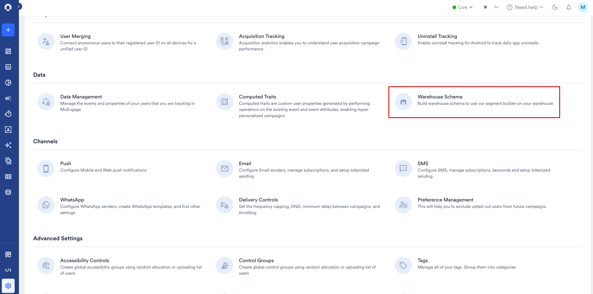
3. ページタイトルの横にあるドロップダウンから接続を選択します。
4. **Max event look-back** に、MoEngage がこのウェアハウスから読み取るイベント履歴の日数を入力します。デフォルトは 60 日です。詳細については、[イベントのルックバック期間の設定](/ja/user-guide/data/warehouse-schemas#set-the-event-look-back-window) を参照してください。
5. **Create user schema** をクリックします。**Create user schema** ページが表示されます。
   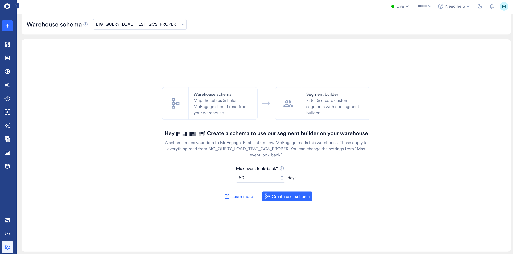

このプロセスには、**Source and format** と **Mapping** の 2 つのステップがあります。

## ステップ 1: Source and Format

まず、MoEngage に読み取らせるテーブルを指定し、想定どおりのデータが含まれていることを確認します。

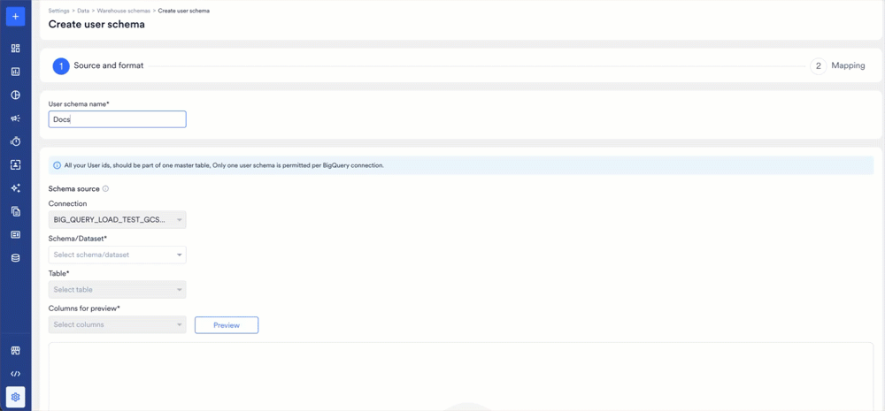

1. **User schema name:** スキーマの名前を入力します。この名前は Warehouse schema ページや、セグメントが失敗したときのエラーメッセージでスキーマを識別するために使用されるため、わかりやすい名前を使用してください。
2. **Connection:** ページを開いた接続があらかじめ入力されています。ユーザースキーマは接続ごとに 1 つしか許可されないため、ここでは変更できません。
3. **Schema/Dataset:** ユーザーマスターテーブルを保持するスキーマまたはデータセットを選択します。BigQuery の場合、これはデータセットです。リストは接続から入力されます。
4. **Table:** ユーザーマスターテーブルを選択します。リストは選択したスキーマまたはデータセットから入力されます。

   セグメント化に使用するすべてのユーザー ID が、この単一のテーブルに含まれている必要があります。MoEngage は 2 つのテーブルのユーザー ID を結合できないため、完全なセットを保持するテーブルを選択してください。
5. **Columns for preview:** プレビューに表示する列を選択します。

   テーブルを確認するのに必要な列のみを選択してください。プレビューのたびにウェアハウスに対してライブクエリが実行されるため、不要な列をプレビューすると時間とコストがかかります。**Select all** は最初の 5,000 列までに制限されており、推奨されません。
6. **Preview** をクリックします。MoEngage はウェアハウスにクエリを実行し、選択した列について上位最大 100 行を表示します。

   続行する前に値を確認してください。プレビューで予期しないデータが返される場合は、通常、誤ったテーブルが選択されています。マッピングが完了した後よりも、今修正するほうがはるかに低コストです。
7. **Next** をクリックします。**Mapping** ステップが表示されます。

## ステップ 2: Mapping

次に、各列が何を意味するかを MoEngage に伝えます。ここでマッピングした列のみがセグメントビルダーに表示されます。

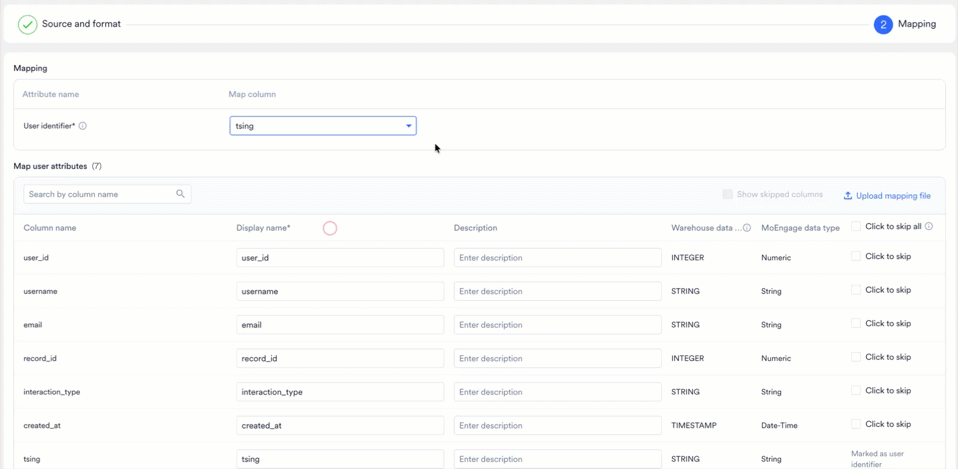

1. **User identifier:** ユーザー ID を保持する列を選択します。MoEngage はこの列の値を既存の MoEngage ユーザーの customer ID と照合します。これにより、ウェアハウスの行がターゲット可能なユーザーになります。

   ユーザー識別子として使用できる列は 1 つだけです。2 つ以上の列で構成される複合識別子はサポートされていません。

   <Warning>
     識別子が null、空、または MoEngage に存在しないユーザーはスキップされます。ウェアハウスセグメントは、MoEngage がすでに認識しているユーザーをターゲットにします。スキーマを作成しても新しいユーザーはインポートされません。
   </Warning>
2. **Map user attributes** で、セグメント化に使用する各列を設定します。見出しには、テーブルの列数が表示されます。各列について、次の操作を行います。
   - **Display name:** 必須です。マーケターがセグメントビルダーで表示する名前を入力します。デフォルトは元の列名ですが、マーケターが検索する名前であることはほとんどありません。`usr_ltv_amt` を `Lifetime Value` に、`dob_dt` を `Date of Birth` に、`cust_city_nm` を `City` に変更してください。
   - **Description:** 任意で、列に含まれる内容を説明します。説明はセグメントビルダーで属性の横に表示されるため、チームへの問い合わせを減らすことができます。
   - **Warehouse data type:** ウェアハウスが報告する列のネイティブデータ型です。読み取り専用です。
   - **MoEngage data type:** MoEngage が正規化したデータ型です。読み取り専用で、セグメントビルダーでその属性に使用できる演算子を決定します。マッピングの全体については、[データ型](/ja/user-guide/data/warehouse-schemas#data-types) を参照してください。
   - **Click to skip:** このチェックボックスを選択すると、列を除外します。スキップされた列は読み取られず、セグメントビルダーにも表示されません。

   すべての列を一度に除外するには、ヘッダー行で **Click to skip all** を選択します。列数の多いテーブルで特定の列を見つけるには、**Search by column name** を使用します。

   ユーザー識別子はスキップできません。ユーザー識別子は上で個別にマッピングされ、チェックボックスの代わりに **Marked as user identifier** と表示されます。
3. 除外した列を確認するには、**Show skipped columns** を選択します。スキップされた列は、デフォルトではリストに表示されません。
4. 大きなテーブルを列ごとに作業せずにマッピングするには、**Upload mapping file** をクリックし、マッピングを JSON ファイルとして指定します。ファイル形式については、[ファイルによる列のマッピング](/ja/user-guide/data/warehouse-schemas#map-columns-with-a-file) を参照してください。
5. **Create schema** をクリックします。MoEngage はウェアハウスに対して検証クエリを実行し、ユーザー識別子の列が null ではなく一意であることを確認します。

   成功すると、ユーザースキーマが作成され、ウェアハウスセグメントを使用してカスタムセグメントを作成できるようになったことが MoEngage によって確認されます。

<Note>
  MoEngage がサポートしていないデータ型の列は、MoEngage data type として `--` が表示され、自動的にスキップされます。これらの列はマッピングできません。サポートされているデータ型の一覧については、[データ型](/ja/user-guide/data/warehouse-schemas#data-types) を参照してください。
</Note>

# イベントスキーマの作成

イベントスキーマは、イベントの発生ごとに 1 行、ユーザーごとに複数行を持つ行動データのテーブルを参照します。イベントテーブルの数だけイベントスキーマを作成できます。

イベントスキーマを作成するには、次の手順を実行します。

1. MoEngage のサイドバーメニューで、**Settings** をクリックします。Settings ページが表示されます。
2. **Data** で、**Warehouse Schema** をクリックします。Warehouse schema ページが表示されます。
3. 右上の **+ Event schema** をクリックします。その接続で最初のイベントスキーマを作成する場合は、ページ中央の **Create an event schema** をクリックすることもできます。**Create event schema** ページが表示されます。
   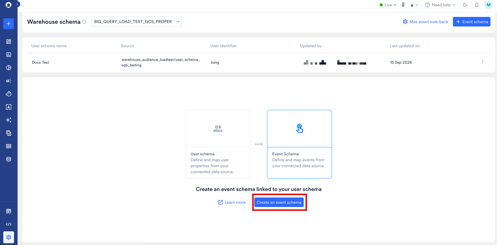

   <Note>
     これらのオプションは、接続にユーザースキーマが存在する場合にのみ表示されます。イベントスキーマはユーザースキーマに結合されるため、ユーザースキーマが作成されるまでは結合する対象がありません。
   </Note>

このプロセスには、**Source and format** と **Mapping** の 2 つのステップがあります。

## ステップ 1: Source and Format

まず、MoEngage にイベントテーブルを指定し、マーケターに表示されるイベント名を付けます。

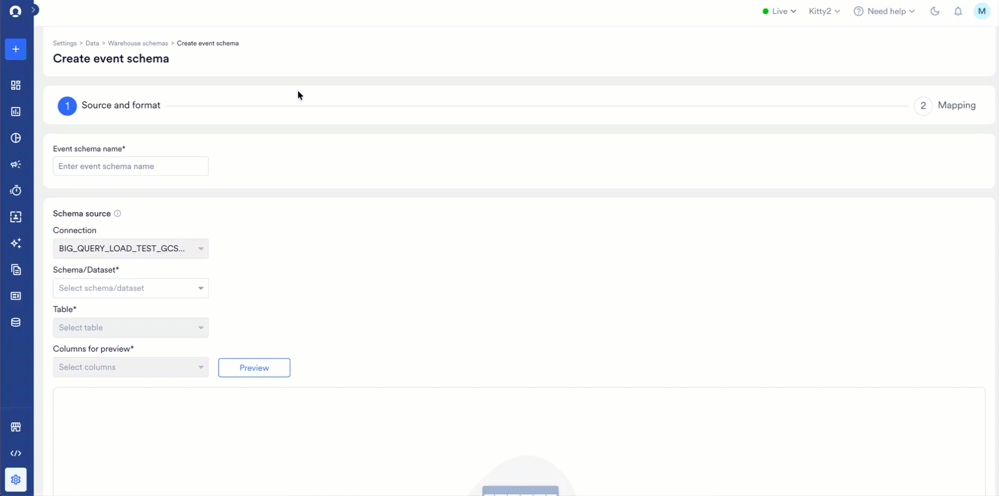

1. **Event schema name:** スキーマの名前を入力します。この名前は、Warehouse schema ページや、セグメントが失敗したときのエラーメッセージでスキーマを識別するために使用されます。
2. **Connection:** ページを開いた接続があらかじめ入力されています。
3. **Schema/Dataset:** イベントテーブルを保持するスキーマまたはデータセットを選択します。
4. **Table:** イベントテーブルを選択します。

   別のスキーマですでに使用されているテーブルはグレー表示され、選択できません。テーブルは、ユーザースキーマかイベントスキーマかにかかわらず、1 つのスキーマにのみ属することができます。
5. **Columns for preview:** プレビューに表示する列を選択します。選択をリセットするには、**Clear all** を使用します。

   テーブルを確認するのに必要な列のみを選択してください。プレビューのたびにウェアハウスに対してライブクエリが実行されるため、不要な列をプレビューすると時間とコストがかかります。**Select all** は最初の 5,000 列までに制限されており、推奨されません。
6. **Preview** をクリックします。MoEngage は返された行を最大 100 行まで表示します。
7. **Map event** で、MoEngage でマッピングするイベント名をテーブルに付けます。
   - **Table name:** ソーステーブルです。読み取り専用です。
   - **Event display name:** 必須です。マーケターがセグメントビルダーでこのイベントを選択するときに表示される名前を入力します。デフォルトはテーブル名ですが、マーケターが探す名前であることはほとんどありません。`bq_event_order_placed_staging` はマーケターにとって意味を持ちませんが、`Order Placed` であれば理解できます。
   - **Event description:** 任意で、イベントが記録する内容を説明します。説明はセグメントビルダーでイベントの横に表示されます。

   <Note>
     1 つのテーブルは 1 つのイベントにマッピングされます。1 つのテーブルから複数のイベントをマッピングすることはできないため、すべての行が同じイベントを表すテーブルを選択してください。
   </Note>
8. **Next** をクリックします。**Mapping** ステップが表示されます。

## ステップ 2: Mapping

次に、どの列がユーザーを識別するか、どの列がイベント時刻を保持するか、残りの列が何を意味するかを MoEngage に伝えます。

1. **User identifier:** このテーブルで各ユーザーを一意に識別する列を選択します。MoEngage はこの列を使用してウェアハウスの行を MoEngage のユーザーと照合するため、値はユーザースキーマのユーザー識別子と一致している必要があります。
2. **Event time:** イベントが発生した日時を記録する列を選択します。`TIMESTAMP` 列など、MoEngage の Date-Time 型にマッピングされる列である必要があります。

   <Warning>
     イベントの日時は UTC で保存されている必要があります。MoEngage はセグメントの実行時に、それらをアプリのタイムゾーンに変換します。現地時間で保存された列を使用すると、イベントが誤った時刻に表示され、誤った日付範囲に含まれてしまいます。
   </Warning>
3. **Partitioned identifier column:** 任意です。イベントテーブルがパーティション分割されている場合は、パーティションの基準となる列を選択します。MoEngage はこの列を使用して、テーブル全体をスキャンする代わりに各クエリを必要なパーティションに限定します。これにより、このイベントに基づいて作成されるすべてのセグメントのコストと時間が削減されます。

   多くの場合、これはイベント時刻と同じ列です。両方の役割を持つ列には、下の属性テーブルでその旨のラベルが付けられます。
4. **Map event attributes** で、残りの各列を設定します。見出しには、テーブルの列数が表示されます。各列について、次の操作を行います。
   - **Display name:** 必須です。マーケターがセグメントビルダーで表示する名前を入力します。
   - **Description:** 任意で、列に含まれる内容を説明します。
   - **Warehouse data type:** ウェアハウスが報告する列のネイティブデータ型です。読み取り専用です。
   - **MoEngage data type:** MoEngage が正規化したデータ型で、セグメントビルダーで使用できる演算子を決定します。読み取り専用です。マッピングの全体については、[データ型](/ja/user-guide/data/warehouse-schemas#data-types) を参照してください。
   - **Click to skip:** このチェックボックスを選択すると、列を除外します。

   ユーザー識別子とイベント時刻はスキップできません。これらは上で個別にマッピングされ、チェックボックスの代わりに **Marked as user identifier** と **Marked as event time** が表示されます。
5. 大きなテーブルを列ごとに作業せずにマッピングするには、**Upload mapping file** をクリックし、マッピングを JSON ファイルとして指定します。ファイル形式については、[ファイルによる列のマッピング](/ja/user-guide/data/warehouse-schemas#map-columns-with-a-file) を参照してください。
6. **Test Join** で、**Test join** をクリックします。MoEngage はユーザー ID 列でこのテーブルをユーザーマスターテーブルに結合し、サンプル行を返します。

   ユーザー識別子をマッピングするまでは結合する対象がないため、**Test join** は無効のままです。

   結合で何も返されない場合、MoEngage は **No rows returned** と表示し、テストに合格するまでスキーマを作成できません。

   <Note>
     通常の原因は、誤った列をユーザー識別子としてマッピングしていることです。イベントテーブルには、行を識別する注文 ID や購入 ID と、人物を識別するユーザー ID など、複数の ID が含まれていることがよくあります。ユーザーマスターテーブルと一致するのはユーザー ID のみです。
   </Note>
   結合はウェアハウスに対して実行されるため、データのサイズによっては数秒かかる場合があります。
7. **Create schema** をクリックし、**Create** をクリックして確定します。ユーザー識別子とイベント時刻がマッピングされ、テスト結合に合格するまで、このボタンは無効のままです。

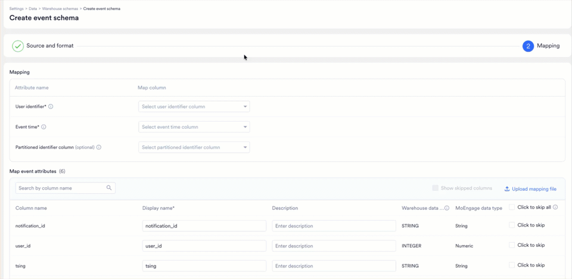

# ファイルによる列のマッピング

列数の多いテーブルを 1 行ずつマッピングするのは時間がかかります。いずれかのウィザードの **Mapping** ステップで、**Upload mapping file** をクリックし、代わりに JSON ファイルを指定します。これはユーザースキーマとイベントスキーマで同じように機能します。

ファイルには、列ごとに 1 つのオブジェクトを持つ `mapping` 配列が含まれます。

```json
{
  "mapping": [
    {
      "column_name": "ID",
      "display_name": "Customer ID",
      "description": "The unique identifier assigned by the user to represent a customer",
      "is_skipped": true
    },
    {
      "column_name": "FIRST_NAME",
      "display_name": "First Name",
      "description": "Given name as captured at signup",
      "is_skipped": false
    },
    {
      "column_name": "LAST_NAME",
      "display_name": "Last Name"
    }
  ]
}
```

| フィールド | 必須 | 説明 |
| --- | --- | --- |
| `column_name` | はい | マッピングするウェアハウスの列です。大文字と小文字を含め、ウェアハウスの列名と完全に一致する必要があります。 |
| `display_name` | いいえ | マーケターがセグメントビルダーで表示する名前です。 |
| `description` | いいえ | 列に含まれる内容を説明します。セグメントビルダーでプロパティまたは属性の横に表示されます。 |
| `is_skipped` | いいえ | `true` に設定すると、列をスキーマから除外します。 |

指定しない値の扱いは、次の 2 つのルールによって決まります。

- **フィールドを省略する**と、現在の値はそのまま維持されます。上の `LAST_NAME` の例では、説明は既存の値が維持されます。
- **フィールドを `null` または `""` に設定する**と、値がクリアされます。不要になった表示名や説明を削除する場合に使用します。

ファイル内の値は、テーブルですでにマッピングされている値を上書きします。ファイルに記載されていない列はそのまま残るため、一部の列のみを対象とするファイルをアップロードしても、残りの列に影響はありません。

ファイルをアップロードするには、次の手順を実行します。

1. **Mapping** ステップで、**Upload mapping file** をクリックします。**Upload mapping file** ダイアログが表示されます。
   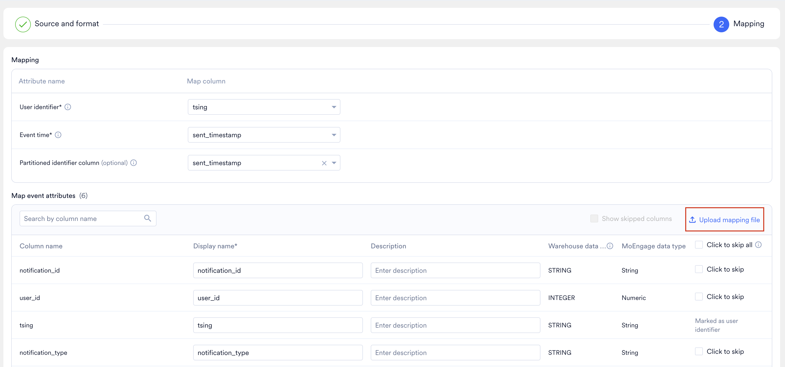
2. ファイルを自分で作成する代わりにテンプレートから始めるには、**Sample file** をクリックします。編集可能な JSON ファイルがダウンロードされます。
   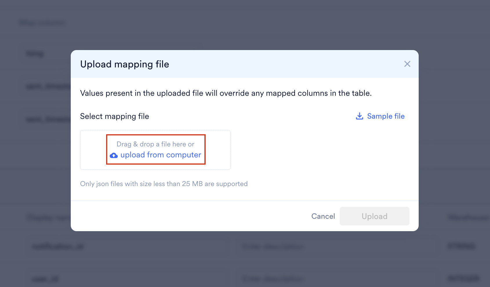
3. ファイルをダイアログにドラッグするか、**upload from computer** をクリックしてファイルを選択します。ファイルは JSON 形式で、25 MB 未満である必要があります。
4. **Upload** をクリックします。
   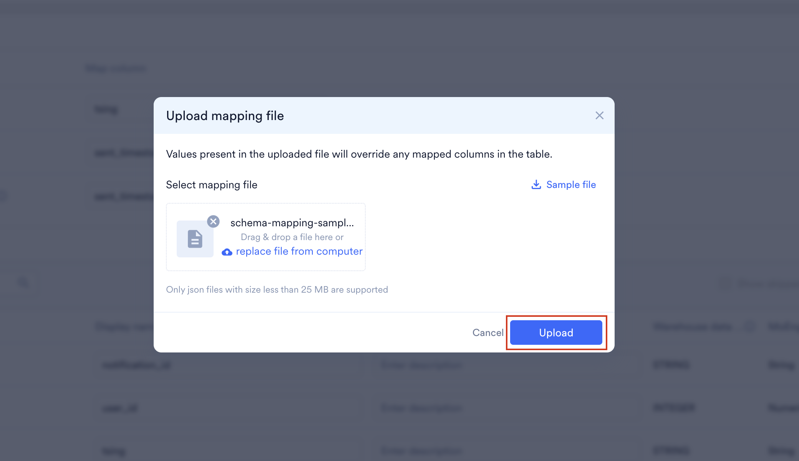

# スキーマの同期を維持する

MoEngage はウェアハウスのメタデータをライブではなく、スケジュールに従って読み取ります。メタデータには、データベース、テーブル、列が含まれます。ページを読み込むたびに大規模なウェアハウスを探索すると時間がかかり、お客様側のクエリコストも増加するため、メタデータはキャッシュされます。

**メタデータは 6 時間ごとに自動的に更新されます。** 今作成したテーブルや列は、その期間内に MoEngage に表示されます。より早く反映させるには、**Force refresh** を使用します。これにより、バックグラウンドでメタデータが再読み取りされます。

新しい列が自動的にマッピングされることはありません。列をマッピングするかスキップ済みとしてマークするまで、その列はセグメントビルダーに表示されません。マッピング画面で **Show unmapped columns** フィルターを使用すると、まだ判断が必要な列のみを表示できます。

# スキーマの管理

Warehouse schema ページには、一度に 1 つの接続のスキーマが一覧表示されます。ページタイトルの横にあるドロップダウンから接続を選択します。

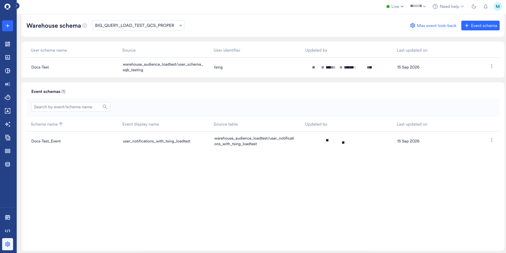

このページには次の 2 つのセクションがあります。

- その接続の**ユーザースキーマ**。スキーマ名、ソース、ユーザー識別子、最終更新者、最終更新日時が表示されます。
- **イベントスキーマ**。スキーマ名、イベント表示名、ソーステーブル、最終更新者、最終更新日時が表示されます。検索ボックスを使用してイベント名またはスキーマ名でスキーマを検索したり、スキーマ名で並べ替えたりできます。

**Max event look-back** と **+ Event schema** は、ページの右上にあります。

スキーマに対して操作を行うには、その行の省略記号アイコンをクリックし、**View**、**Edit**、または **Delete** を選択します。

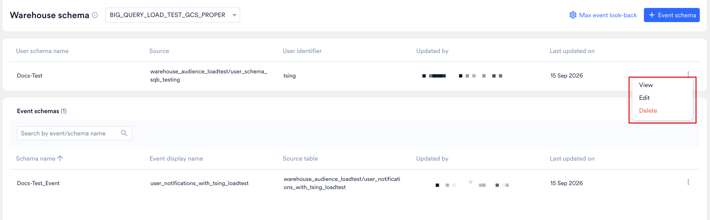

## スキーマの表示

**View** を選択すると、スキーマ名、ソース、イベント表示名と説明、最終更新者、最終更新日時を示す読み取り専用パネルが開きます。

その下の **User properties mapped** または **Event attributes mapped** には、スキーマ内のすべての項目が、表示名、説明、MoEngage データ型とともに一覧表示されます。編集フローを開かずに、マーケターに表示される内容を確認するために使用します。説明のない項目には `--` が表示されます。

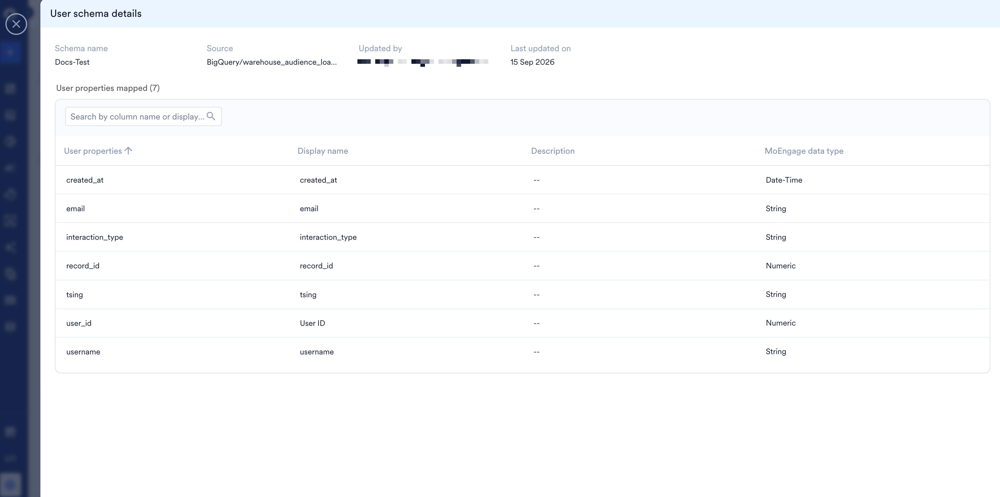

## スキーマの編集

**Edit** を選択すると、Create schema の代わりに **Update schema** が表示された 2 ステップのウィザードが再度開きます。変更できる内容はフィールドによって異なります。

| フィールド | 編集可否 |
| --- | --- |
| スキーマ名 | はい |
| イベント表示名と説明 | はい |
| 属性の表示名と説明 | はい |
| スキップされた列 | はい |
| Columns for preview | はい |
| Connection、Schema/Dataset、Table | いいえ |
| User identifier | いいえ |
| Event time | いいえ |

構造に関するフィールドは、変更するとそのスキーマに基づいて作成されたすべてのセグメントの背後にあるクエリが書き換えられるため、ロックされています。別のテーブルや別のユーザー識別子が必要な場合は、スキーマを削除して再度作成してください。

## スキーマの削除

スキーマは、その行の省略記号メニューから削除します。

イベントはユーザースキーマを通じてユーザーと照合されるため、ユーザースキーマを削除すると、それに基づいて作成されたすべてのイベントスキーマを含め、その接続のすべてが削除されます。確定するには、大文字で `DELETE` と入力します。

<Danger>
  スキーマを削除すると、それに基づいて作成されたすべてのものが機能しなくなります。そのスキーマに依存するセグメントは失敗し始め、それらのセグメントを使用しているキャンペーンも機能しなくなります。
</Danger>

別の構造が必要な場合は、編集で対応するのではなく、スキーマを再作成することを計画してください。

# ウェアハウスの変更時にセグメントを機能させ続ける

Warehouse Schema に基づいて作成されたセグメントは、基になるテーブルがマッピングされた状態のままであることに依存しています。列の名前を変更したり、テーブルを削除したり、データ型を変更したりすると、MoEngage がセグメント用に生成するクエリを実行できなくなります。接続が削除された場合も同様です。

<Tip>
  Warehouse Schema が変更された場合は、それに基づいて作成されたウェアハウスセグメントを確認してください。MoEngage はこれらの変更についてアラートを送信しないため、簡単に確認することで、キャンペーンが適切なオーディエンスに確実に届くようにできます。
</Tip>

セグメントが引き続き機能するかどうかを確認するには、セグメントを開いて実行します。セグメントがカウントを返さない場合は、**Settings** > **Data** > **Warehouse Schema** でマッピングを更新してから、セグメントを再度実行してください。

ウェアハウスのテーブルや列を変更する前に、MoEngage のセグメントを管理している担当者に知らせて、影響を受けるセグメントを確認できるようにしてください。

# 制限

| 制限 | 値 |
| --- | --- |
| 接続あたりのスキーマ数 | 250（ユーザースキーマを含むため、イベント用は 249） |
| 接続あたりのユーザースキーマ数 | 1 |
| プレビューで選択できる列数 | 5,000 |
| 返されるプレビュー行数 | 100 |
| プロパティまたは属性の名前の長さ | 200 文字 |
| プロパティまたは属性の説明の長さ | 512 文字 |

スキーマの制限は設定可能です。制限を引き上げるには、[MoEngage Support](https://help.moengage.com/hc/en-us/requests/new) にお問い合わせください。

# 権限と監査ログ

**Admin** ロールと **Developer** ロールには、デフォルトで Warehouse Schema へのアクセス権が含まれています。別のロールにアクセス権を付与したり、アクセス権を持つロールから削除したりするには、[カスタムロール](/ja/user-guide/settings/account/team-management/access-roles) を使用します。

ユーザースキーマとイベントスキーマの作成、更新、削除は監査ログに記録されます。ウェアハウス接続自体の変更は対象外です。

# データ型

ウェアハウスは、MoEngage が必要とするよりもはるかに多くのデータ型を使用します。各列は MoEngage のデータ型に正規化され、そのデータ型によって、セグメントビルダーでその属性に使用できる演算子が決まります。

マッピング画面には両方のデータ型が並べて表示されるため、公開する前に確認できます。

| ウェアハウスのデータ型 | MoEngage のデータ型 |
| --- | --- |
| `STRING` | String |
| `INTEGER`, `FLOAT`, `NUMERIC`, `BIGNUMERIC` | Numeric |
| `BOOLEAN` | Boolean |
| `TIMESTAMP` | Date-Time |
| `ARRAY<STRING>` | Array String |
| `ARRAY<INTEGER>`, `ARRAY<NUMERIC>` | Array Double |

上記のウェアハウスのデータ型は BigQuery の名前です。他のウェアハウスの同等のデータ型も同じ方法で正規化されます。`VARCHAR`、`CHAR`、`TEXT` 列はすべて MoEngage の String になります。

## サポートされていないデータ型

次のデータ型の列はマッピングできません。MoEngage data type として `--` が表示され、自動的にスキップされます。

| ウェアハウスのデータ型 | 理由 |
| --- | --- |
| `DATE`, `TIME` | 属性として使用できません。代わりに、Date-Time にマッピングされるタイムスタンプ列を使用してください。 |
| `ARRAY<DATE>`, `ARRAY<TIMESTAMP>` | 日付と時刻の配列はサポートされていません。 |
| `GEOGRAPHY` | 位置情報および地理空間データ型はサポートされていません。 |
| `RECORD`, `ARRAY<RECORD>`, `JSON` | ネストされたデータ型およびオブジェクト型はサポートされていません。 |

必要な列がサポートされていない場合は、ウェアハウスのビューでサポートされているデータ型にキャストし、代わりにそのビューをマッピングしてください。
