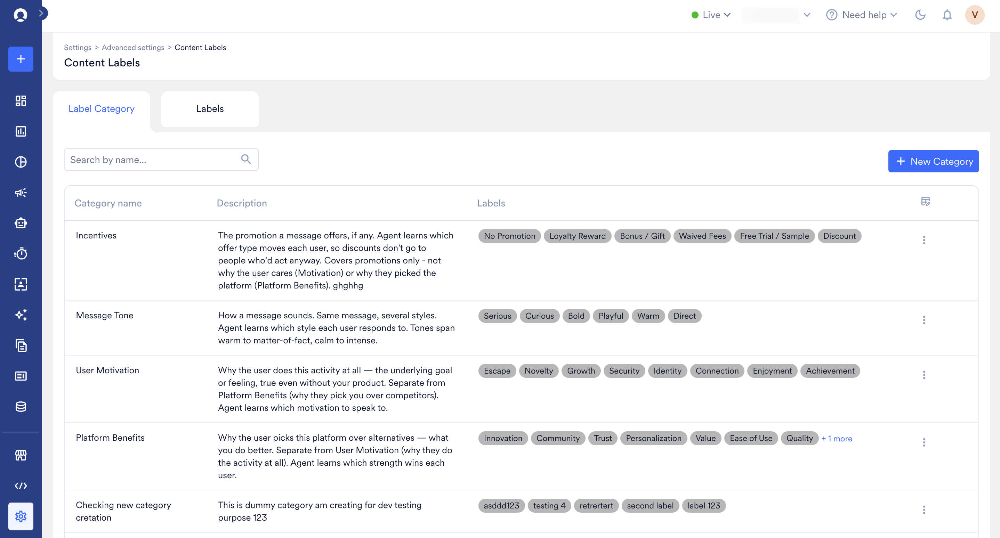
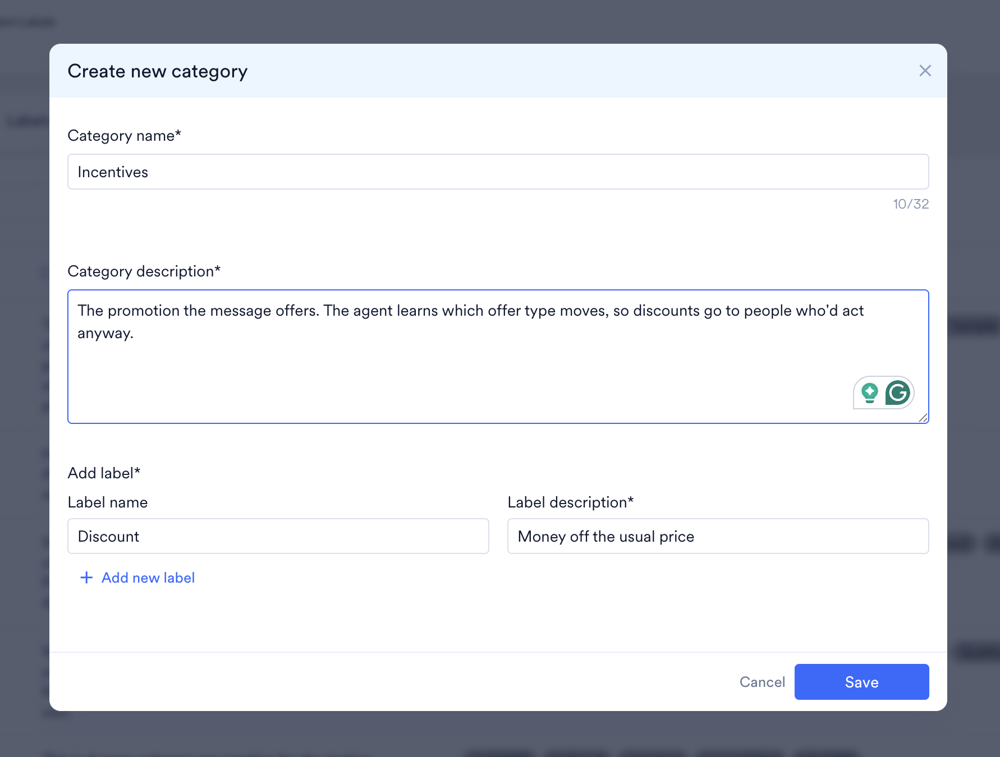
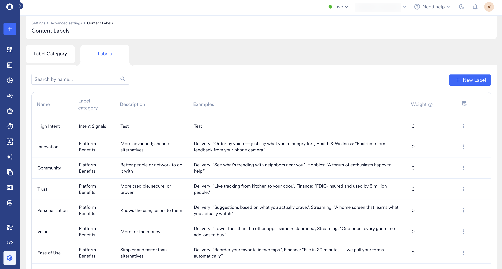
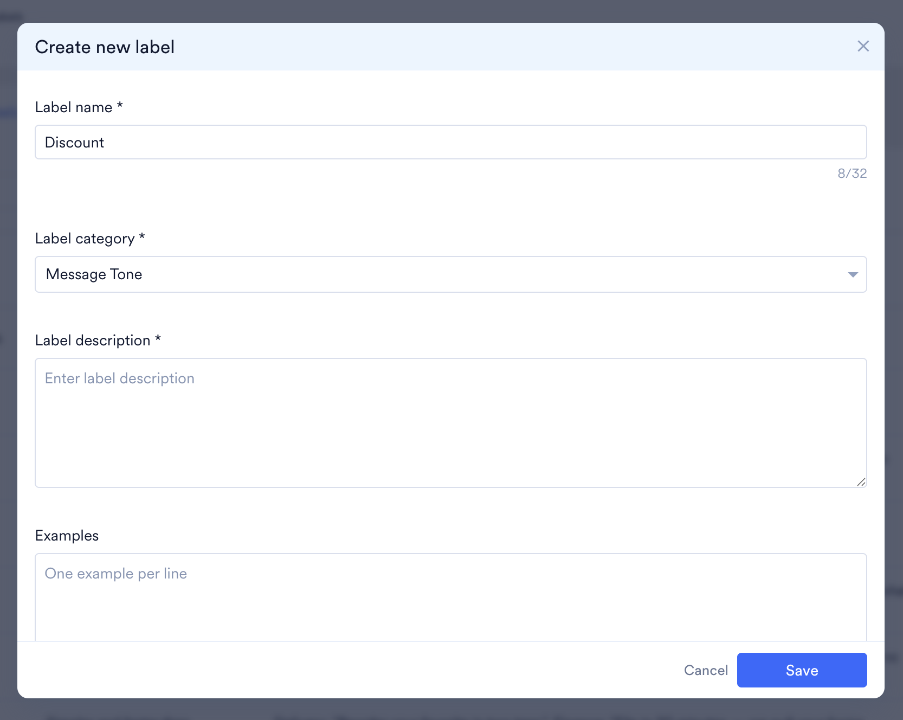

<Note>
**Early Access**

AI Campaign DecisioningはPushでのみ利用できます。ワークスペースでこの機能を有効にするには、MoEngageのカスタマーサクセスマネージャー（CSM）またはサポートチームにお問い合わせください。
</Note>

Content Labelsは、AI Campaign Decisioningがメッセージのコピーを理解するために使用する語彙です。作成した各メッセージバリエーションにはこの語彙を使用してラベルが付けられ、AIがエンドユーザーごとにどのタイプのコンテンツが効果的かを学習するのに役立ちます。

- **Label Category：** Message Toneなどのテーマです。
- **Label：** Playfulなど、カテゴリ内の値です。

MoEngageダッシュボードで、**Settings** > **Advanced settings** > **Content Labels** に移動します。

**Content Labels** ページには、次のタブがあります。

- **Label category**
- **Labels**

# 構造とルール

Content Labelsは次のように機能します。

- 階層は1レベルのみです。Label CategoryにはLabelが含まれ、サブレベルはありません。
- 最大25個のラベルカテゴリを作成できます。
- 各カテゴリには最大20個のラベルを含めることができます。
- すべてのカテゴリ全体で最大120個のラベルを作成できます。
- 各ラベルは1つのカテゴリにのみ属します。
- 各ラベルには-100から+100までのウェイトがあります。デフォルト値は0です。
- Content Labelsはキャンペーンタグとは別のものであり、共有されません。

MoEngageには、次の標準のLabel Categoryが用意されています。

- Incentives
- Message Tone
- User Motivation
- Platform Benefits

各カテゴリには、事前定義されたラベルが含まれています。独自のカテゴリやラベルを作成することもできます。

# Label Categoryの作成

Label Categoryを作成するには、次の手順を実行します。

1. MoEngageダッシュボードの左側のナビゲーションメニューで、**Settings** > **Advanced settings** > **Content Labels** に移動します。
2. **Label category** タブをクリックします。

   

3. **+ New Category** をクリックします。
4. Create new categoryダイアログボックスで、カテゴリ名（必須、最大50文字）とカテゴリの説明（最大500文字）を入力します。

   

5. **Add label** セクションで、各ラベルの **Label name** と **Label description** を入力します。
6. ラベルをさらに追加するには、**+ Add new label** をクリックします。
7. **Save** をクリックします。

<Note>
ラベルとラベルの説明は、モデルが最適なラベルを割り当て、エンドユーザーに最適なバリアントを送信するのに役立ちます。
</Note>

# Labelの作成

Labelを作成するには、次の手順を実行します。

1. MoEngageダッシュボードの左側のナビゲーションメニューで、**Settings** > **Advanced settings** > **Content Labels** に移動します。
2. **Labels** タブをクリックします。

   

3. **+ New Label** をクリックします。
4. Create new labelダイアログボックスで、ラベル名（必須、最大50文字）、カテゴリ、ラベルの説明（最大500文字）、例（最大500文字）、およびラベルのウェイトを入力します。スライダーを使用して、Low（-100）からNeutral（0）、High（100）までの値を設定します。

   

5. **Save** をクリックします。

# Labelの例

以下は、適切に記述されたラベルの説明とメッセージの例です。各例は `title | body` の形式で記述されています。

## フライト

- **Labelカテゴリ：** Platform Benefits
- **Labelの説明：** プラットフォームのフライト予約機能を訴求します。フライトの検索、比較、予約、運賃アラート、座席指定やWebチェックインなどのフライト固有の機能が対象です。ホテル、鉄道、バス、ホリデーパッケージは対象外です。これらはそれぞれ専用のPlatform Benefitsラベルに属します。フライトの割引やクーポンコードも対象外です。これらはIncentivesに属します。

**例：**

- Your next trip starts here ✈️ | Compare fares across 500+ airlines in one search
- Skip the airport queue | Web check-in & pick your seat right in the app
- Fares just dropped on your route 📉 | Delhi → Goa, tap to see today's lowest

## 手頃な価格

- **Labelカテゴリ：** User Motivation
- **Labelの説明：** 費用対効果の高さを訴求します。毎日の低価格、予算に優しい商品、「₹X以下」のコレクション、手頃な価格で手に入る品質などが対象です。期間限定セール、クーポンコード、割引率を示すお得な情報は対象外です。これらはIncentivesに属します。プレミアムやラグジュアリーのポジショニングも対象外です。

**例：**

- Style on a budget 👗 | Everything under ₹499, every day
- Look good, spend less | Our best-value basics are back
- Why pay more? | Same quality, half the price tag

## 緊急性

- **Labelカテゴリ：** Message Tone
- **Labelの説明：** 希少性、高い需要、「なくなる前に」という表現、またはすぐに行動を促す直接的な後押しによって、後回しにせず今すぐ行動するようユーザーに働きかけます。今すぐ行動する理由がなく、単に興奮や勢いを感じさせるだけのメッセージは対象外です。割引やオファーそのものも対象外です。これらはIncentivesに属します。

**例：**

- Almost sold out 🔥 | Today's special is going fast, grab yours
- Everyone's ordering this | Kitchens near you are filling up, order now
- Don't miss this one | Once it's gone, it's gone 🍱
- Still thinking? | Your cart won't wait forever, check out now

# Content Labelsの表示と管理

Content Labelsの一部のフィールドは編集できますが、変更できないフィールドもあります。

| 操作 | カテゴリ | ラベル |
| --- | --- | --- |
| 説明の編集 | はい | はい |
| 例の編集 | — | はい |
| ウェイトの編集 | — | はい |
| 名前の変更 | いいえ | いいえ |
| ラベルが属するカテゴリの変更 | — | いいえ |
| カテゴリのラベルの変更 | いいえ | — |
| 削除またはアーカイブ | いいえ | いいえ |

<Note>
定期キャンペーンの場合、ラベルのウェイト、説明、または例への変更は、次回の実行以降に反映されます。
</Note>
