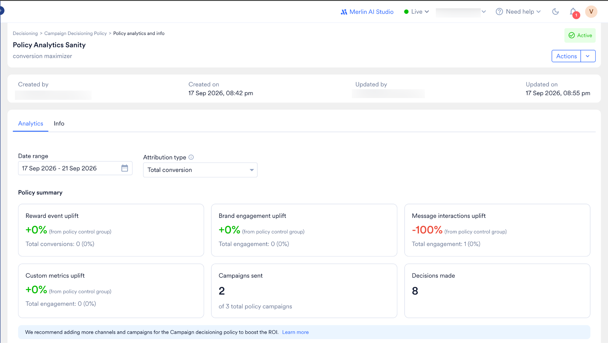
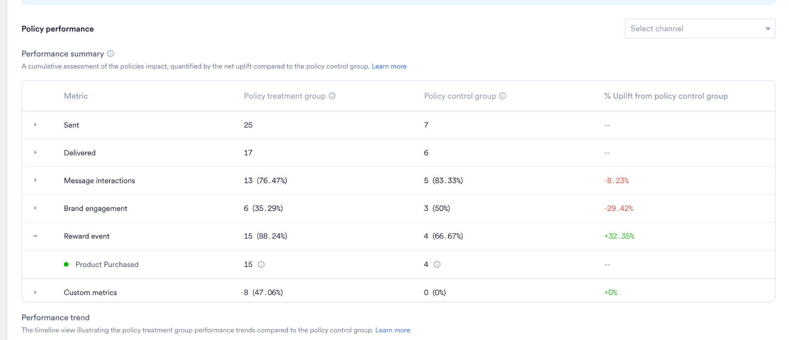
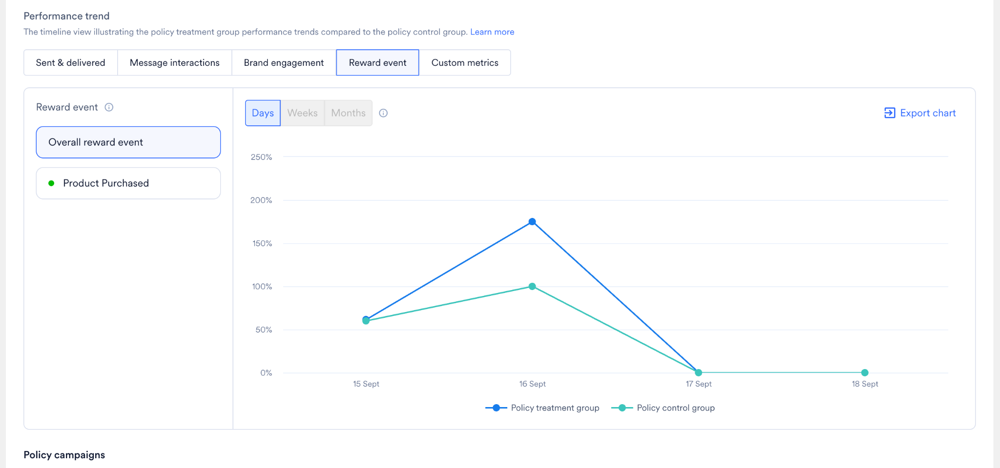
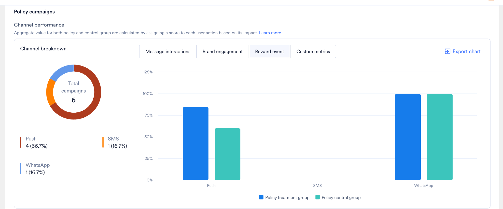
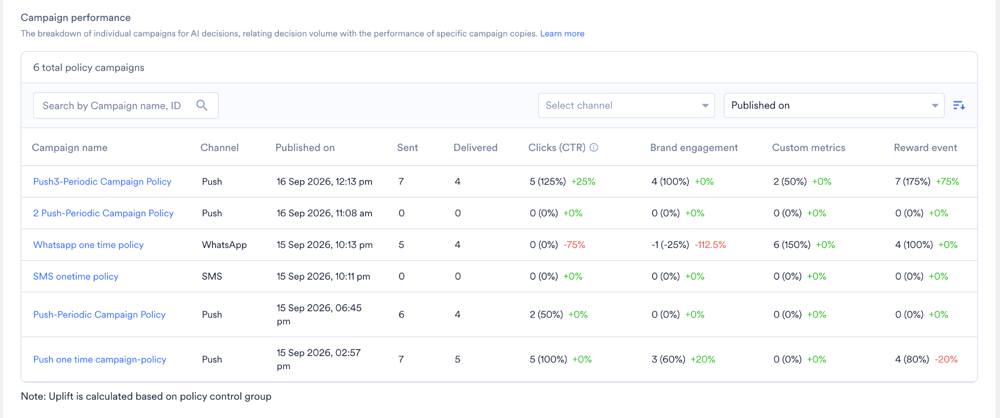
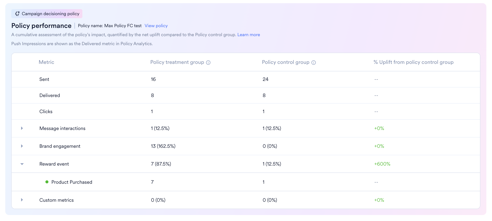

<Note>
**Early Access**

AI Campaign DecisioningはPushでのみ利用できます。ワークスペースでこの機能を有効にするには、MoEngageのカスタマーサクセスマネージャー（CSM）またはサポートチームにお問い合わせください。
</Note>

# 概要

ポリシーアナリティクスには、Campaign Decisioning Policyを使用するすべてのキャンペーンにわたる、そのポリシーのパフォーマンスが表示されます。パフォーマンスはアップリフトとして測定されます。アップリフトとは、ポリシートリートメントグループとポリシーコントロールグループの差です。

- ポリシートリートメントグループには、ポリシーのキャンペーンを受信するエンドユーザーが含まれます。
- ポリシーコントロールグループは、ポリシーからランダム化されたメッセージを受信する、ランダムに選択されたユーザーグループです。このグループは、AIによる増分効果を測定するためのベースラインとして使用されます。

# ポリシーアナリティクスへのアクセス

ポリシーアナリティクスにアクセスするには、次の手順を実行します。

1. MoEngageダッシュボードの左側のナビゲーションメニューで **Decisioning** をクリックし、**Campaign decisioning policy** をクリックします。
2. リストから、分析するポリシーをクリックします。
3. **Analytics** タブをクリックします。

# ポリシーアナリティクス

## データのフィルタリング

ポリシーアナリティクスは、日付範囲と、クリックスルーアトリビューションなどのアトリビューションタイプでフィルタリングできます。

## ポリシーサマリー

**Policy summary** カードには、コントロールグループと比較したポリシーの影響の概要が表示されます。これらのカードには、報酬イベントのアップリフト、ブランドエンゲージメントのアップリフト、メッセージインタラクションのアップリフト、カスタム指標のアップリフト、送信されたキャンペーン数、および実行された意思決定数が表示されます。各アップリフト指標は、ポリシーコントロールグループに対する割合として表示されます。

## ポリシーのパフォーマンス

**Performance summary** テーブルでは、ポリシートリートメントグループとポリシーコントロールグループを比較します。テーブルには、Metric、Policy treatment group、Policy control group、% Upliftの列があります。指標はReward event、Brand engagement、Message interactions、Custom metricsの下にグループ化されており、各グループを展開すると個々のイベントが表示されます。

## Performance Trend

**Performance trend** チャートには、ポリシートリートメントグループとポリシーコントロールグループの時系列でのパフォーマンスが表示されます。イベントカテゴリでフィルタリングしたり、Days、Weeks、Monthsでデータを表示したり、チャートをエクスポートしたりできます。

## Policy Campaigns

**Policy campaigns** セクションには、チャネル全体および個々のキャンペーン全体でのポリシーのパフォーマンスが表示されます。このセクションは、Channel performanceとCampaign performanceの2つの部分で構成されています。

### Channel performance

Channel performanceでは、チャネルごとにポリシートリートメントグループとポリシーコントロールグループを比較します。両グループの集計値は、各ユーザーアクションにその影響度に基づいてスコアを割り当てることで算出されます。

- **Channel breakdown** には、ポリシー内のキャンペーンの総数と、それらがチャネル（Push、SMS、WhatsAppなど）間でどのように分かれているかが表示されます。
- チャネル別の **棒グラフ** では、チャネルごとにトリートメントグループとコントロールグループを比較します。Message interactions、Brand engagement、Reward event、Custom metricsを切り替えたり、チャートをエクスポートしたりできます。

### Campaign performance

Campaign performanceでは、ポリシーを使用した個々のキャンペーンを分類し、意思決定の量を特定のキャンペーンコピーのパフォーマンスと関連付けます。テーブルには、各キャンペーンの名前、チャネル、公開日、およびSent、Delivered、Clicks（CTR）、Brand engagement、Custom metrics、Reward eventなどの指標が表示されます。キャンペーン名またはIDで検索したり、チャネルと公開日でフィルタリングしたりできます。

# ポリシー情報

Infoタブには、ターゲット、送信制限、時間枠、コントロールグループ、パフォーマンス指標など、ポリシーの構成が表示されます。

# キャンペーン内のポリシーパフォーマンス

Campaign Decisioning Policyを使用して送信されたキャンペーンでは、キャンペーンアナリティクスに標準のキャンペーン統計とともに **Policy Performance** セクションが表示されます。

このセクションには、次の内容が表示されます。

- **ポリシー名**
- **View Policy** リンク
- 同じ指標カテゴリについて、**ポリシートリートメントグループ** と **ポリシーコントロールグループ** を比較するテーブル

<Note>
Policy PerformanceセクションはStandardキャンペーンでは利用できません。
</Note>
