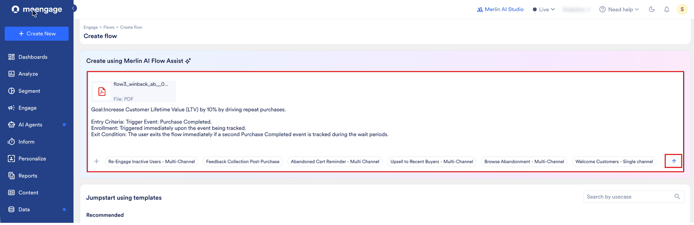
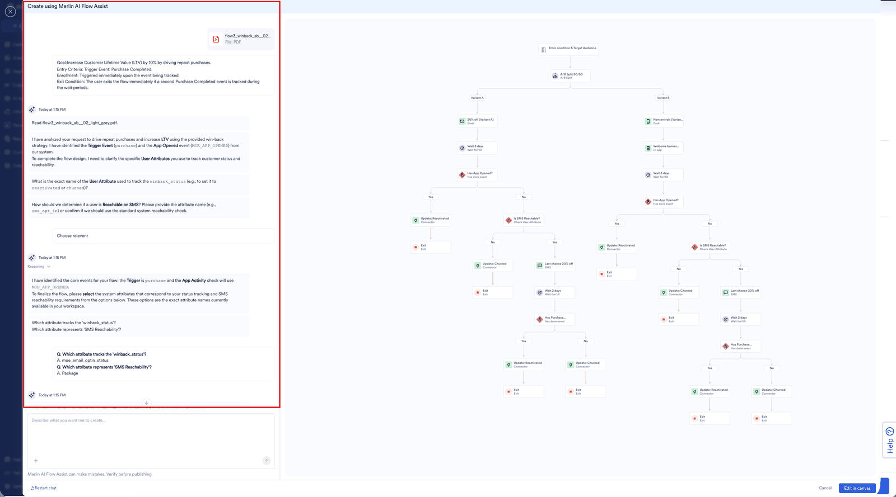
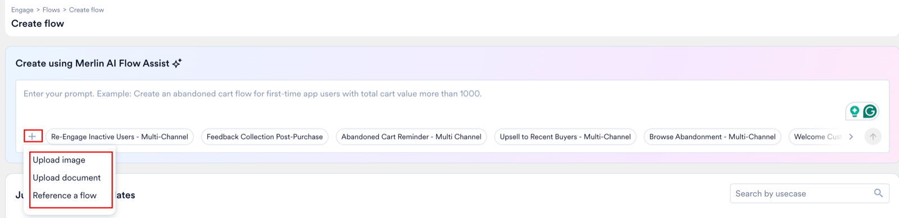
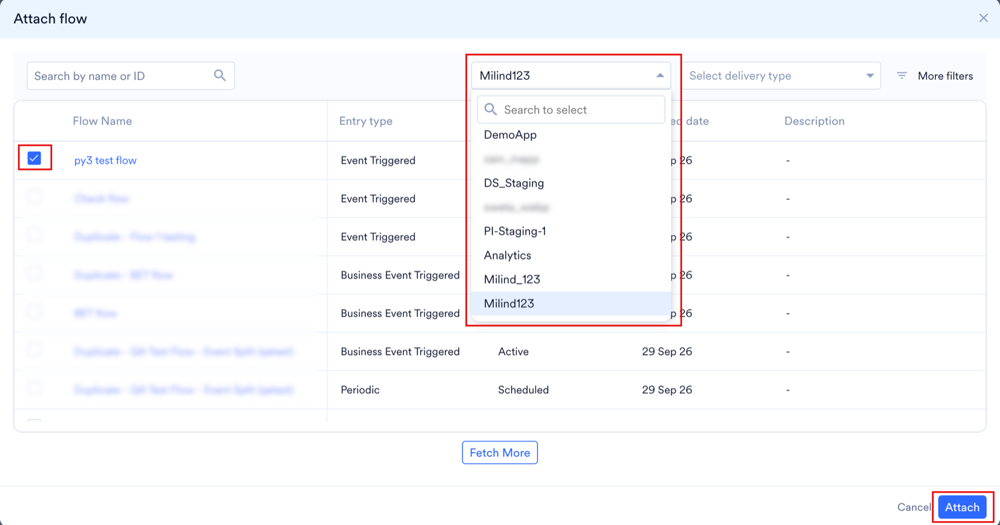
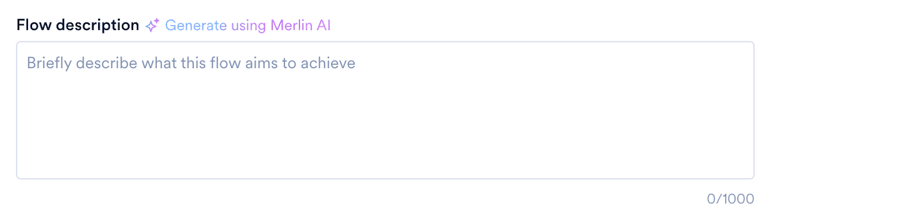

AI Flows Assist は、MoEngage のキャンバスに直接組み込まれた強力な対話型エージェントです。シンプルな自然言語のプロンプトで、高レベルのマーケティング戦略をすぐにデプロイ可能なカスタマージャーニーに変換できます。

Merlin AI はブレインストーミングのパートナーとして機能し、お客様のデータベースに基づいて最も関連性の高いイベント、属性、タイミングを自動的に選択することで、手動での Flow マッピングにかかる時間を数日から数分に短縮します。

Flows AI Assist の基盤となるロジックについては、[Merlin AI Flows Assist](/ja/user-guide/ai-and-intelligence/merlin-ai/merlin-ai-flows-assist) を参照してください。

<Note>
  これは Early Access 機能です。お客様のアカウントで有効にするには、MoEngage のカスタマーサクセスマネージャー (CSM) またはサポートチームにお問い合わせください。
</Note>

## **ステップ 1: Merlin AI Assist を開始する**

作成プロセスの開始時に AI アシスタントにアクセスできます。

1. MoEngage UI の左側のナビゲーションメニューで、**Engage \>** **Flow** をクリックします。
2. **Create flow** ページで、**Create using Merlin AI Flow Assist** フィールドにプロンプトを入力します。用意されているサンプルプロンプトから選択することもできます。
   <Frame>
     
   </Frame>

## **ステップ 2: Flow を定義する (プロンプト)**

<Info>
  現在、AI で生成された Flow では、ターゲットオーディエンスがデフォルトで **All Users** に設定されます。必要に応じて「Who will enter the flow」セクションを確認し、特定のセグメントフィルターを適用してください。
</Info>

Flow の要件を平易な言葉で記述します。Merlin AI は推論モデルを使用し、お客様の業界とデータベーススキーマに基づいて意図を解釈します。

.gif)

1. **プロンプトを入力する**: トリガー、アクションのシーケンス、ゴールを記述します。**例**: _Added to Cart_ を行ったが購入しなかったユーザーの _Product Purchase_ を 15% 向上させる Flow を構築してください。Email と Push を使用し、その間に 24 時間の遅延を設けてください。
2. **プロンプトを送信する**: 送信アイコンをクリックします。
3. **確認**: プロンプトがあいまいな場合 (たとえば、「purchase」と記述したものの購入イベントが複数ある場合)、Merlin AI は Flow が技術的に正確になるよう追加の質問をします。
4. **戦略を確認する**: Merlin AI は構築しようとしているロジックを説明します。この概要を注意深く確認してください。

プロンプトですべてを記述する代わりに、以前に公開した Flow や、目的のジャーニーを説明するドキュメントまたは画像を添付することもできます。詳細については、[参照を添付する](#attach-a-reference) を参照してください。

プロンプトを送信すると、キャンバスの横に Flows Assist チャットが開きます。Merlin AI は追加された添付ファイルを読み取り、ワークスペース内のイベントと属性を確認し、ステータスを追跡する正確なユーザープロパティなど、まだ必要な情報を質問します。チャットで回答すると、それに合わせてキャンバス上に Flow のドラフトが構築されます。

## **ステップ 3: フォローアッププロンプトでドラフトを改善する**

Merlin AI がプロンプトから最初の Flow ドラフトを生成した後も、対話形式で改善を続けることができます。プロンプトで希望する変更を記述すると、Merlin AI はそれまでのコンテキストを保持したまま変更を適用します。

1. **生成されたドラフトを確認する**: Merlin AI が Flow のドラフトを返したら、提案された構造、チャネル、タイミング、ゴールを確認します。
2. **変更内容を記述する**: 同じ会話内で、調整したい内容を説明するフォローアッププロンプトを入力します。小さな調整から大きな構造変更まで依頼できます。たとえば、チャネルの追加や削除、遅延の変更、ステージの並べ替え、エントリー条件の調整、コンバージョンゴールの更新などです。
3. **Merlin AI が Flow を更新する**: Merlin AI は最初からやり直すのではなく、指示に基づいて現在のドラフトを編集するため、Flow の残りの部分はそのまま維持されます。
4. **納得できるまで繰り返す**: このプロンプトと改善のループを必要な回数だけ繰り返します。ドラフトが意図どおりになったら、キャンバスに進みます。

<Info>
  反復的な改善は、Flow をキャンバスに反映する前に、対話型アシスタント内で行われます。キャンバス上ではいつでも[手動で変更](#step-4:-design-on-canvas)することもできます。
</Info>

## **ステップ 4: キャンバスでデザインする**

ロジックを確認すると、Merlin AI は会話内容を視覚的な構造に変換します。

1. **Edit in Canvas**: **Edit in canvas** をクリックすると、ステージが MoEngage のキャンバスに配置されます。
2. **手動での調整**: ステージが表示された後も、手動でドラッグ、ドロップ、削除できます。
3. **コンテンツを構成する**: Merlin AI は構造を構築しますが、各 Action Stage (Email、Push など) をクリックして、具体的なメッセージテンプレートとクリエイティブコンテンツを選択する必要があります。

## **ステップ 5: Flow の詳細とゴールを構成する**

AI を使用する場合でも、Flow のメタデータとトラッキングが正しく構成されていることを確認する必要があります。キャンバス上の Settings アイコンをクリックして、以下を確認します。

1. **Flow Details**: Flow の名前 (5 文字以上) を入力し、Flow タグを最大 5 つまで選択します。
2. **Conversion Goals**: 成功の定義を設定します (例: Event: Product Purchased)。ゴールは最大 5 つまで追加できます。
3. **Flow Controls**: Control Groups を有効にして、効果 (アップリフト) を正確に測定します。

## **ステップ 6: 公開する**

**Publish** をクリックすると、構成した設定に従って Flow が有効になります。承認フローの詳細については、[Campaign Approval Workflow](/ja/user-guide/settings/account/team-management/campaign-approval-workflow) を参照してください。

## 参照を添付する

Flow を一から記述する代わりに、既存のものを添付して、Merlin AI にそれを基に構築させることができます。以前に公開した Flow や、目的のジャーニーを説明するドキュメントまたは画像を添付できます。

<Note>
  添付はベータ機能です。アカウントで有効にするには、MoEngage のカスタマーサクセスマネージャー (CSM) またはサポートチームにお問い合わせください。
</Note>

### 添付できるもの

| 添付ファイル | 形式 | 会話あたりの上限 |
| --- | --- | --- |
| Flow | 所属する任意のワークスペースの公開済み Flow | 1 |
| ドキュメント | PDF、TXT、MD | 1 |
| 画像 | 任意の画像形式 | 5 |

これらは組み合わせることができます。たとえば、同じ会話で 1 つの Flow、1 つの PDF、2 つのスクリーンショットを添付できます。MoEngage は DOC、DOCX、PPT、XLS をサポートしておらず、各ファイルは 10 MB 未満である必要があります。3 種類とも、Flows Assist チャットの追加アイコンから開始します。

### Flow を添付する

Flow を添付するには、次の手順を実行します。

1. Flows Assist チャットで追加アイコンをクリックし、**Reference a flow** をクリックします。
2. **Attach flow** ダイアログボックスで、Flow の取得元のワークスペースを選択します。
3. 目的の Flow の横にあるチェックボックスを選択し、**Attach** をクリックします。

目的の Flow を見つけるには、次を使用します。

- **Workspace**: Flow の取得元のワークスペースを選択します。ドロップダウンには所属するすべてのワークスペースが一覧表示されるため、別のチームが構築した Flow や、別のワークスペースでテスト中に作成した Flow を取り込むことができます。**Search to select** を使用すると、長いリストからワークスペースを検索できます。
- **Search by name or ID**: 名前または ID で Flow を検索します。
- **Select delivery type**: 配信タイプでリストをフィルタリングします。
- **More filters**: 作成日とステータスでリストをフィルタリングします。
- **Fetch More**: 残りの Flow を読み込みます。
- **Description**: 各 Flow の説明を読んで、類似した Flow を区別します。

リストには、アクティブ、スケジュール済み、停止済みのいずれであっても、公開済みの Flow のみが含まれます。一度も公開されていない下書きのみの Flow は添付できません。また、Flow に複数の公開済みバージョンがある場合、MoEngage は最新のバージョンを使用します。

### MoEngage が Flow からコピーするもの

MoEngage は構造と構成を再構築します。

- ステージの種類と実行順序
- トリガーの構成
- エントリーと再エントリーのルール
- 待機と遅延の期間
- 分岐ロジックとその条件
- コンバージョンゴール
- コントロールグループの設定

MoEngage はメッセージのコンテンツ (メールの本文、プッシュのテキスト、WhatsApp テンプレート、SMS の本文) はコピーしません。公開する前にコンテンツを追加してください。

Flow の説明は、結果が完全なコピーである場合にのみ引き継がれます。再構築された Flow には説明がありません。

### Merlin AI がコピーではなく再構築する場合

現在のワークスペースから Flow を添付すると、オーディエンス、コンバージョンゴール、説明を含め、ステージごとに元の Flow と一致する完全なコピーが作成されます。指示をまったく追加しない場合でも、「Copy this」や「Replicate this as is」のようにコピーを求める指示を追加した場合でも、このコピーが作成されます。

次の場合、Merlin AI は代わりに Flow を再構築します。これは完全な一致ではなく、ベストエフォートとなります。

- 別のワークスペースから Flow を添付した場合。
- Flow で使用しているチャネルがオフになっている、または Flow が依存しているイベントやユーザープロパティが存在しなくなったために、Flow がワークスペースに適合しなくなった場合。
- Flow を添付し、ステージの追加や削除、ステージの再構成など、Flow を変更する指示も入力した場合。Merlin AI はまず Flow を再構築して表示し、その後指示を適用して 2 番目のバージョンを作成します。

再構築された Flow では、オーディエンスが **All Users** に設定され、説明は含まれません。そのため、公開する前に **Who will enter the flow** セクションを確認してください。

### Flow を別のワークスペースに移動する

別のワークスペースの Flow を参照することで、ワークスペース間で Flow を移行できます。たとえば、テストワークスペースで構築してテストした Flow を本番ワークスペースに移動したり、ブランドや地域をまたいでジャーニーを再構築せずに再利用したりできます。

開始する前に、次の点を確認してください。

- 両方のワークスペースのユーザーであり、両方のワークスペースが同じデータセンターにあること。
- 移動元のワークスペースの Flow に対して、少なくとも **View** 権限があること。
- 移動先のワークスペースの Flow に対して、**Create and Manage** 権限があること。

Flow を別のワークスペースに移動するには、次の手順を実行します。

1. Flow を配置したい移動先のワークスペースに切り替えます。Flow は移動元のワークスペースから送り出すのではなく、このワークスペースに取り込みます。
2. 左側のナビゲーションメニューで **Engage \> Flow** をクリックし、**Create flow** ページで Flows Assist チャットを開きます。
3. 追加アイコンをクリックし、**Reference a flow** をクリックします。
4. **Attach flow** ダイアログボックスで移動元のワークスペースを選択し、Flow の横にあるチェックボックスを選択して、**Attach** をクリックします。
5. 指示なしで、または「Replicate this flow」などの指示を付けてプロンプトを送信します。Merlin AI は移動先のワークスペースで Flow を再構築します。
6. 移動先のワークスペースに存在しないイベント、ユーザー属性、またはチャネルを Flow が使用している場合、Merlin AI は代替を選択するよう求めます。ワークスペースに最適なオプションを選択してください。

移動元のワークスペースの元の Flow は変更されません。Merlin AI は、構造、トリガー、エントリーと再エントリーのルール、遅延、分岐、コンバージョンゴール、コントロールグループの設定を引き継ぎます。新しい Flow を公開する前に、次の作業を完了してください。

- **Audience**: オーディエンスは **All Users** に設定されています。**Who will enter the flow** セクションで、Flow にエントリーするユーザーを定義します。
- **Message content**: MoEngage はメールの本文、プッシュのテキスト、WhatsApp テンプレート、SMS の本文をコピーしないため、すべてのチャネルステージにコンテンツを追加します。
- **Team**: Teams 機能が有効になっている場合、Flow はデフォルトのチームに追加されます。チームを確認し、Flow を適切なチームにマッピングします。
- **Description**: 再構築された Flow には説明がありません。必要に応じて追加してください。詳細については、[Flow の説明を追加する](#add-a-flow-description) を参照してください。

### ドキュメントまたは画像を添付する

添付するには、Flows Assist チャットで追加アイコンをクリックし、**Upload image** または **Upload document** をクリックします。

ドキュメントや画像はプロンプトと同じように機能します。Merlin AI はそれを読み取り、不明な点があれば質問し、その後 Flow を構築します。各添付ファイルは一度だけ読み取られ、ファイルから抽出された内容に基づいて処理されます。そのため、ファイルが目的のジャーニーを正確に記述しているほど結果は意図に近くなり、ファイルであいまいな部分は Flow でもあいまいなままになります。

### 途中で添付する

ファイルは会話の開始時だけでなく、任意の時点で添付できます。Merlin AI が Flow を生成した後に新しい添付ファイルを追加すると、それは最初からやり直す要求ではなく、その Flow を変更する指示として扱われます。そのため、ドラフトは維持され、Merlin AI がそれを編集します。[添付できるもの](#what-you-can-attach) の上限は会話全体に適用されるため、後から追加した添付ファイルも、開始時に追加したものと同じ上限にカウントされます。Merlin AI は添付ファイル自体を会話内に保持しません。添付ファイルから作成した概要を保持し、以降の指示はその概要に基づいて処理されるため、同じ Flow やファイルを参照するために再度添付する必要はありません。

## Flow の説明を追加する

Flow の説明は、Flow の機能の簡単な概要です。誰かが Flows Assist でこの Flow を参照する際に **Attach flow** ダイアログボックスの **Description** 列に表示されるほか、Flow 設定にも表示されるため、お客様とチームは Flow を開かなくても区別できます。

<Note>
  Flow の説明はベータ機能です。アカウントで有効にするには、MoEngage のカスタマーサクセスマネージャー (CSM) またはサポートチームにお問い合わせください。
</Note>

説明は任意で、最大 1,000 文字まで入力できます。説明を追加するには、次の手順を実行します。

1. Flow を開き、設定アイコンをクリックします。
2. **Flow description** フィールドで、次のいずれかの操作を実行します。

   - 自分で作成する場合は、説明を入力します。
   - 作成を任せる場合は、**Generate using Merlin AI** をクリックし、生成されたドラフトを編集します。
3. **Save** をクリックします。

説明は Flow 全体ではなく、バージョンに属します。新しいバージョンを作成すると、MoEngage は説明を引き継ぎます。新しいバージョンで動作が異なる場合は、説明を確認して更新してください。この機能より前に作成された Flow には説明がありません。MoEngage が自動的に説明を作成することはないため、Flow に説明が付くのは、自分で入力するか **Generate using Merlin AI** をクリックした場合のみです。

**Generate using Merlin AI** は公開済みの Flow だけでなく下書きでも機能するため、Flow が公開される前に説明を作成できます。Create and Manage アクセス権を持つユーザーは説明を編集でき、閲覧のみのアクセス権を持つユーザーは説明を読むことができます。
