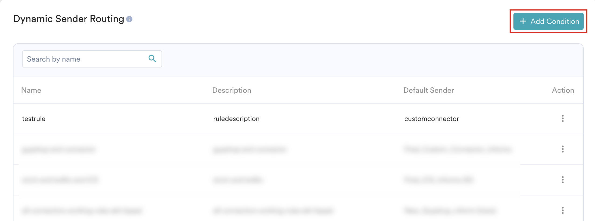
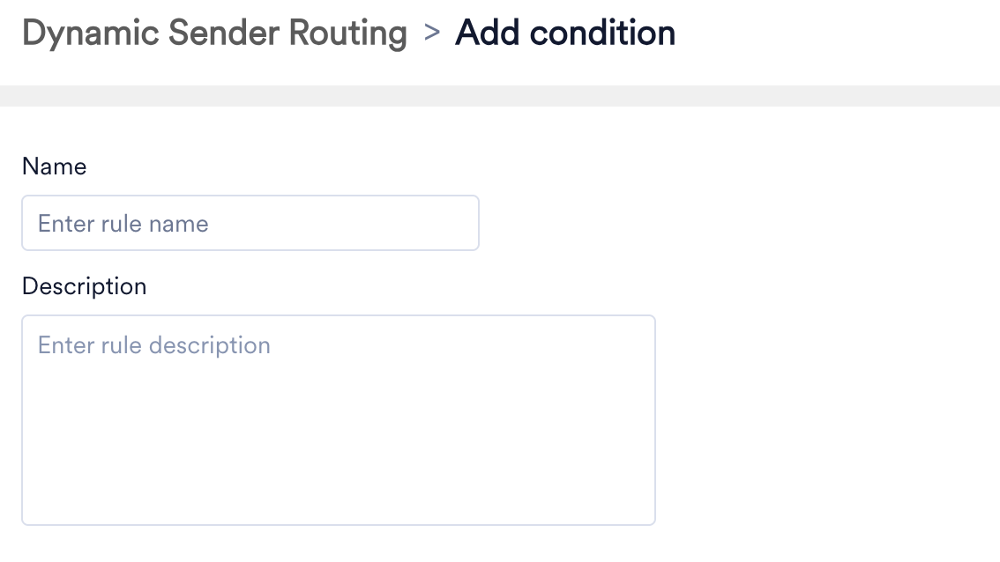
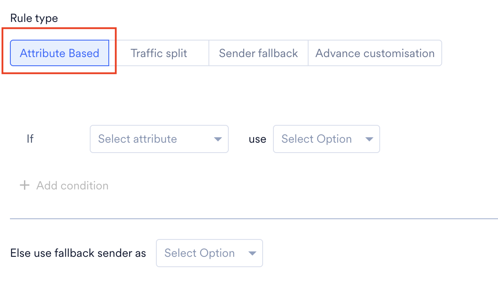
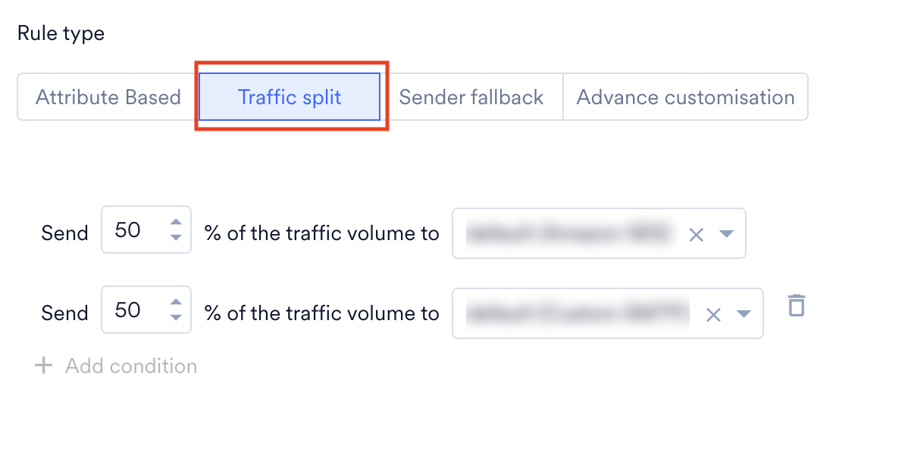
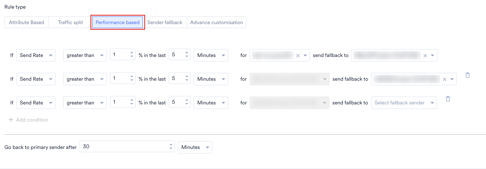
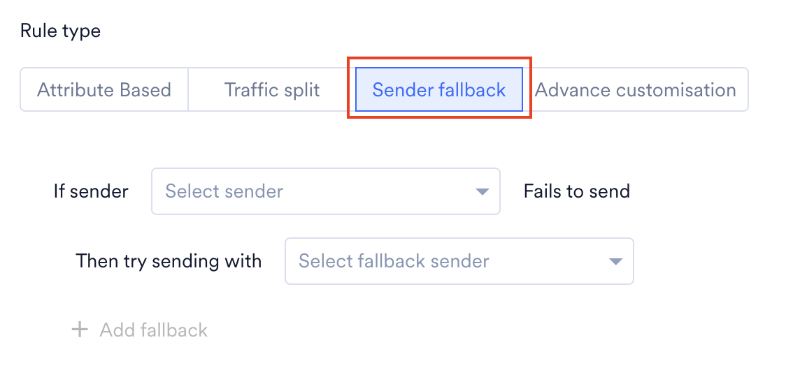
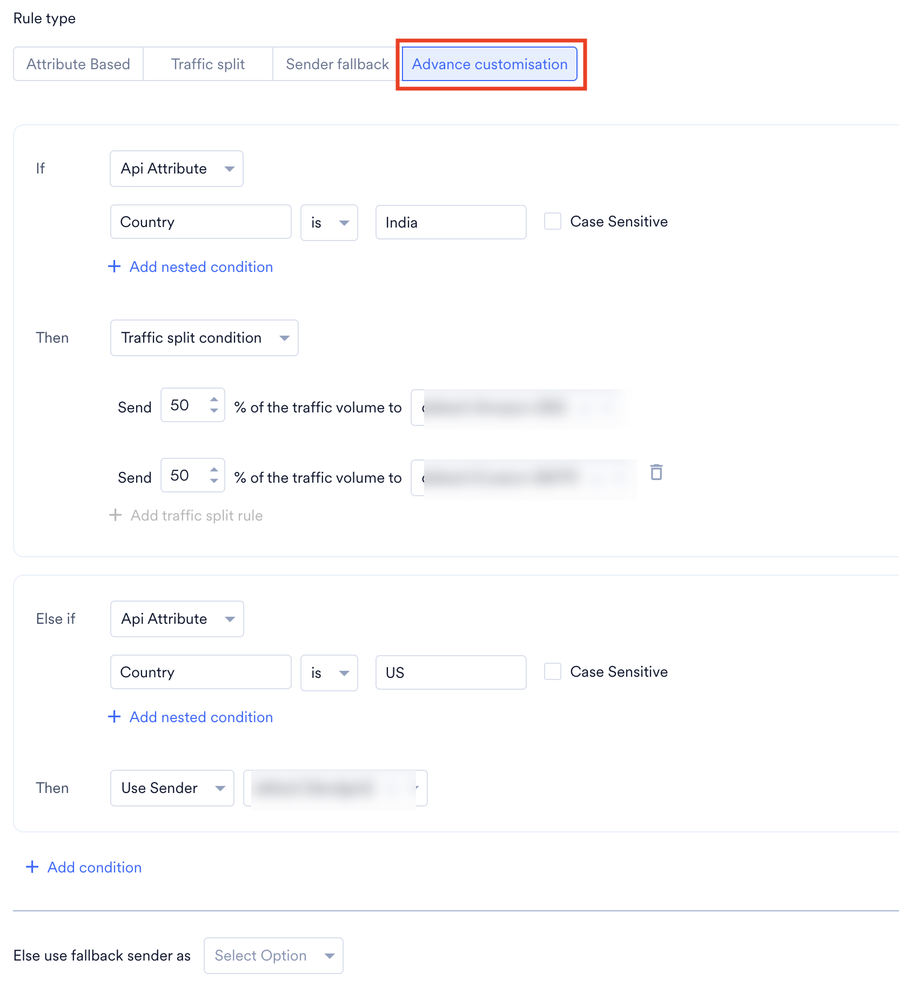

import FeatureAvailability from '/ja/snippets/feature-availability.mdx';

<FeatureAvailability />

# 概要

_Dynamic Sender Routing_ は、APIリクエストごとに最適な送信者を自動的に選択するカスタマイズされたルーティングシステムです。ユーザープロパティまたはAPI属性に基づいてカスタムルーティングルールを定義することで、配信率の向上、送信コストの管理、および各地域の規制への準拠を実現できるようにメッセージングを最適化できます。Dynamic Sender Routingを設定すると、送信者を手動で選択する必要がなくなり、大規模なコミュニケーションを管理するための強力かつ柔軟なソリューションが得られます。

<Info>
  この機能は、[SMS](/ja/user-guide/campaigns-and-channels/sms-mms-and-rcs/sms/getting-started-with-sms/configure-an-sms-sender)チャネルと[Email](/ja/user-guide/campaigns-and-channels/email/getting-started-with-email/configure-email-channel)チャネルでのみサポートされています。
</Info>

# ユースケース

- **地域ベースのルーティング**: ユーザーの国コードに基づいて、メッセージを現地の送信者経由で自動的にルーティングします（例: \+1の番号には米国の送信者を、\+91の番号にはインドの送信者を使用）。これにより、現地での配信率が向上し、コストを最適化できます。
- **コストの最適化**: 特定の地域で最もコスト効率の高い送信者を優先するようにルーティングを設定します。これにより、送信量やその他の料金基準に基づいて送信者を動的に選択し、メッセージングコストを最適化できます。たとえば、メッセージあたりのコストが\$0.01である米国宛てのすべてのメッセージにSender Aを使用するルーティングルールを設定できます。米国宛ての月間メッセージ量が10,000件を超えた場合は、メッセージあたり\$0.008の大量送信料金を提供するSender Bを使用するルールがトリガーされ、総送信コストを最小限に抑えられます。
- **送信者のA/Bテスト**: キャンペーンのトラフィックのごく一部を新しい送信者に送るルーティングルールを作成します。これにより、オーディエンス全体に展開する前に、新しい送信者のパフォーマンスをテストできます。

# Dynamic Sender Routingを設定する

Dynamic Sender Routingのルールを設定するには、次の手順を実行します。

1. MoEngageダッシュボードにログインし、左側のパネルで **Settings** に移動します。
2. **Channels** で、必要なチャネルを選択します。この機能はSMSチャネルとEmailチャネルでのみサポートされているため、要件に応じてチャネルを選択してください。
3. 次のページで、**Dynamic Sender Routing** タブをクリックします。
4. **Dynamic Sender Routing** ページで、**\+ Add Condition** をクリックします。  
   <Frame>
     
   </Frame>
5. **Add condition** ページで、次の詳細を入力します。
   - **Name**: 条件名を入力します。この名前は条件の識別と管理に役立ち、アラートの作成時に使用できます。
   - **Description**: ルールをどこでどのように使用するかを示す、条件の説明を追加します。
   - **Rule type**: このフィールドでは、送信者の選択に必要なルールを選択できます。次のルールタイプを使用できます。  
     <Frame>
       
     </Frame>
   - **Attribute Based**: このルールタイプでは、ユーザープロファイルに保存されている属性に基づいて送信者を選択できます。たとえば、_moe\_mobile_（属性）が _\+1_ で始まる場合は _Sender\_A_（送信者）を使用し、そうでなく _moe\_mobile_（属性）が _\+91_ で始まる場合は _Sender\_B_（別の送信者）を使用します。このルールの条件は次のとおりです。
     - **If** 条件: 最初の条件を定義します。たとえば、ユーザーの _moe\_mobile_ 属性が _\+1_ で始まる場合は _Sender\_A_ を使用します。
     - **\+ Add condition**: **\+ Add condition** をクリックして、_Else if_ 条件を追加します。最初の **If** 条件が満たされない場合、MoEngageはこの条件を確認します。たとえば、_moe\_mobile_ 属性が _\+91_ で始まる場合は _Sender\_B_ を使用します。
     - **Else use fallback sender as**: _If_ 条件もいずれの _Else If_ 条件も満たされない場合、システムは指定されたフォールバック送信者をデフォルトとして使用します。  
       <Frame>
         
       </Frame>
   - **Traffic split**: このルールタイプでは、複数の送信者を選択してトラフィックを分割できます。たとえば、トラフィックの50%をSender Aに、50%をSender Bに送信します。最大5つの送信者を追加できます。  
     <Frame>
       
     </Frame>
   - **Performance based**: このルールタイプでは、固定された順序に従うのではなく、リアルタイムのパフォーマンスに基づいて送信者を自動的に切り替えます。最大5つの送信者を設定でき、定義したモニタリング期間内に、Sent RateまたはDelivery Rateで測定される送信者のパフォーマンスが設定したしきい値を下回った場合、システムは自動的に次の送信者に切り替えます。
     たとえば、直近5分間でSender 1のDelivery Rateが80%を下回った場合、トラフィックはSender 2に切り替わります。次のモニタリング期間中にSender 2のDelivery Rateも80%を下回った場合、トラフィックはSender 3に切り替わり、以降も同様に処理されます。
     設定した期間が経過すると、システムはルーティングの順序をリセットしてトラフィックをプライマリ送信者に戻し、順序を最初からやり直します。
     <Frame>
       
     </Frame>
   - **Sender fallback**: このルールタイプでは、複数の送信者をフォールバックオプションとして設定できます。プライマリ送信者による送信が失敗した場合、システムは設定された順序で次の送信者による送信を自動的に試行します。たとえば、Sender 1が失敗した場合はSender 2を試し、Sender 2が失敗した場合はSender 3を試します。順序には最大5つの送信者を設定できます。
     <Frame>
       
     </Frame>
   - **Advance customisation**: このオプションでは、API属性（API呼び出しの一部としてMoEngageに渡されるものの、ユーザープロファイルの永続的な一部としては保存されないデータ）とユーザープロパティを組み合わせて、送信者を選択するルールを作成できます。このルールの条件は次のとおりです。
     - **If** 条件: ルールを適用するために満たす必要がある主要な条件を定義します。
       - **Select Attribute**: 条件に使用するユーザー属性またはAPI属性を選択します。
       - Select attribute value: 選択した属性の特定の値を入力または選択します。
       - Operator: 論理演算子を選択します。
       - **Case Sensitive**: 値の比較で大文字と小文字を区別する場合は、このチェックボックスをオンにします。
       - **\+ Add nested condition**: ANDまたはORロジックを使用して、既存の条件と組み合わせる条件を追加します。
     - **Then** 条件: _If_ 条件が満たされたときに選択する送信者を定義します。
       - **Select User Property/Sender:** 条件に使用するユーザープロパティまたは送信者を選択します。
       - **\+ Add sub-condition**: 送信者を選択するための特定のサブ条件を定義します。_Then_ ブロック内に送信者選択の複数の条件を追加します。
       - **Else if**: **\+ Add sub-condition** をクリックして、同じ _Then_ ブロック内で _Else if_ を使用した代替のサブ条件を追加します。MoEngageはこれらのサブ条件を順番に評価し、最初にtrueとなったサブ条件のアクションを実行して、残りは無視します。
     - **\+ Add condition**: **\+ Add condition** をクリックして複数の _Else If-Then_ ルールブロックを追加し、複雑なルーティングロジックを作成します。システムはこれらのブロックを表示順に評価し、条件が最初に満たされたルールによって、特定の送信者、フォールバックシーケンス、またはPerformance-Based Monitoringのいずれであるかにかかわらず送信者が決まります。
     - **Else use fallback sender as**: 定義した条件がいずれも満たされない場合、システムは指定されたフォールバック送信者を使用します。  
       <Frame>
         
       </Frame>
   <Info>
     Advance customisationでは、Traffic splitとSender fallbackを条件として使用することもできます。これらは、上記で説明したそれぞれのルールタイプと同様に機能します。
   </Info>
   ### サンプルルール
   以下は、異なるユーザープロパティ、異なるAPI属性、およびユーザープロパティとAPI属性の組み合わせを使用して作成したサンプルルールです。
   <Accordion title="異なるユーザープロパティを使用して作成したサンプルルール">
     ユーザーの _moe\_country\_code_ が _US_ で、かつ _LTV_（Lifetime Value）が _500_ より大きい場合は、_Sender\_A_ を使用します。_moe\_country\_code_ が _US_ でも _LTV_ が500以下の場合は、_Sender\_B_ を使用します。\
     このルールの条件:\
     **If** moe\_country\_code（ユーザープロパティ）が _US_ **AND** _LTV_（ユーザープロパティ）が500より大きい場合、**then** _Sender\_A_ を使用します。\
     **Else if** _LTV_（ユーザープロパティ）が500と等しい場合、**then** _Sender\_B_ を使用します。

     
   </Accordion>
   <Accordion title="異なるAPI属性を使用して作成したサンプルルール">
     _campaign\_type_（API属性）が _Promotional_ で、かつ _priority_（API属性）が _low_ の場合は、_Sender\_A_ を使用します。_campaign\_type_（API属性）が _Transactional_ で、かつ _priority_（API属性）が _high_ の場合は、_Sender\_B_ を使用します。\
     このルールの条件:\
     **If** _campaign\_type_（API属性）が _Promotional_ **AND** _priority_（API属性）が _low_ の場合、**then** _Sender A_ を使用します。\
     **Else if** campaign\_type（API属性）が _Transactional_ **AND** _priority_（API属性）が _high_ の場合、**then** _Sender B_ を使用します。

     
   </Accordion>
   <Accordion title="ユーザープロパティとAPI属性の組み合わせを使用して作成したサンプルルール">
     _Region_（API属性）が _North America_ の場合、携帯電話番号が\+1で始まるユーザーには _Sender A_ を使用し、携帯電話番号が存在するその他すべてのユーザーには _Sender B_ を使用します。\
     このルールの条件:\
     メインの条件が満たされた場合（リージョンがNorth America）、ネストされた条件は次のとおりです。\
     **If** Mobile Number（ユーザープロパティ）が\+1で始まる場合、**then** Sender Aを使用します。\
     **Else if** Mobile Number（ユーザープロパティ）が存在する場合、**then** Sender Bを使用します。

     
   </Accordion>
6. **Save** をクリックします。保存後、作成したすべてのルーティング条件が **Dynamic Sender Routing** タブに一覧表示されます。
7. 各条件の横にある省略記号アイコンをクリックすると、その条件を編集できます。

# よくある質問

<Accordion title="フォールバック送信者とは何ですか？">
  フォールバック送信者とは、メッセージが定義したいずれのルールの条件にも一致しない場合に自動的に使用されるデフォルトの送信者です。これにより、特定のルーティングロジックに一致しない場合でも、メッセージが常に送信されます。
</Accordion>

<Accordion title="1つのルールでユーザー属性とAPI属性の両方を使用できますか？">
  はい、使用できます。"Advance Customisation" ルールタイプはこの目的のために設計されており、API属性（メッセージリクエストとともに送信）とユーザープロパティ（ユーザープロファイルから取得）を組み合わせて、非常に具体的なルーティングロジックを作成できます。
</Accordion>

<Accordion title="一致する可能性のあるルールが複数ある場合、システムはどのように処理しますか？">
  システムはルーティングルールを上から順に処理します。最初に完全に一致したルールのアクションを実行し、そこで処理を停止します。そのため、ルールの順序が非常に重要です。意図したロジックに従って処理されるよう、最も具体的なルールから最も一般的なルールの順に並べてください。
</Accordion>

<Accordion title="パフォーマンスベースの送信者選択の反応時間はどのくらいですか？">
  送信者のパフォーマンスは、ルールの最初の評価期間が完了した後にのみ評価されます。この期間の長さは、設定したルールによって異なります（例: 5分）。最初の期間が完了するまで、システムは設定された送信基準を満たしていない場合でも、*Sender 1* を通じてメッセージを送信し続けます。その後、システムは最新データのローリングウィンドウを使用して、1分ごとに送信者のパフォーマンスを評価します。*Sender 1* が送信基準を満たしている場合、システムは引き続きその送信者を使用し、満たしていない場合は次の送信者に切り替えます。たとえば、ルールが午後12:00に開始された場合、午後12:00から午後12:05まではパフォーマンスは評価されず、メッセージは *Sender 1* を通じて送信されます。午後12:06には午後12:01から午後12:06までの期間のパフォーマンスが評価され、午後12:07には午後12:02から午後12:07までの期間が評価されます。
</Accordion>

# 次のステップ

1. [アラートを作成する](/ja/user-guide/inform/create/create-alert)
2. [アラート分析](/ja/user-guide/inform/analyze/alert-analytics)
