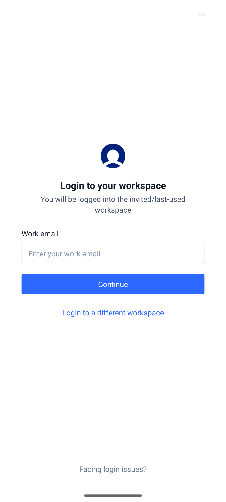
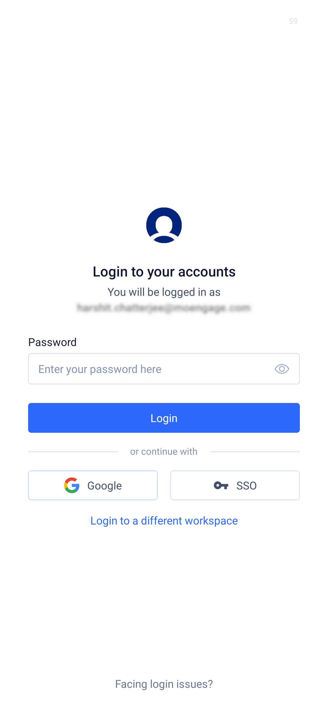
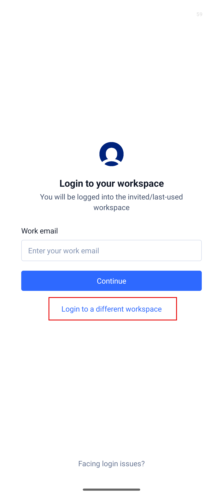
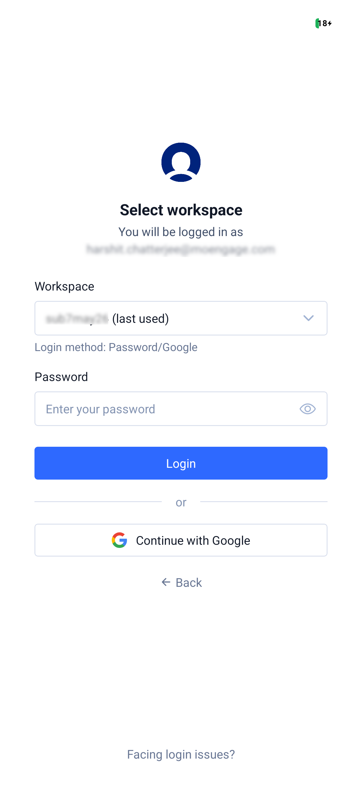
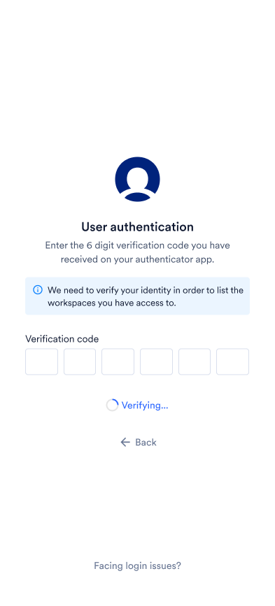
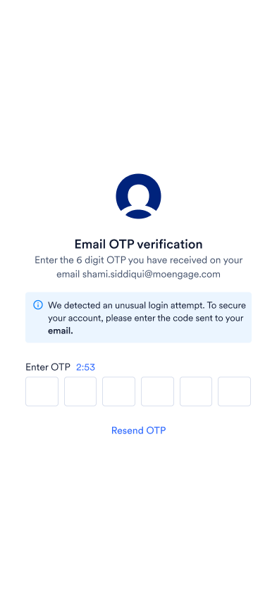
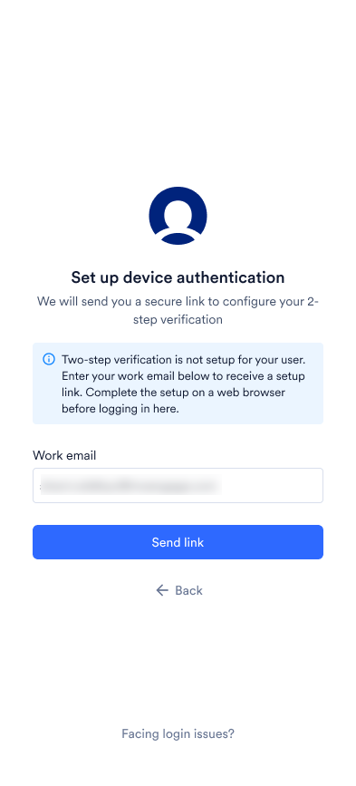
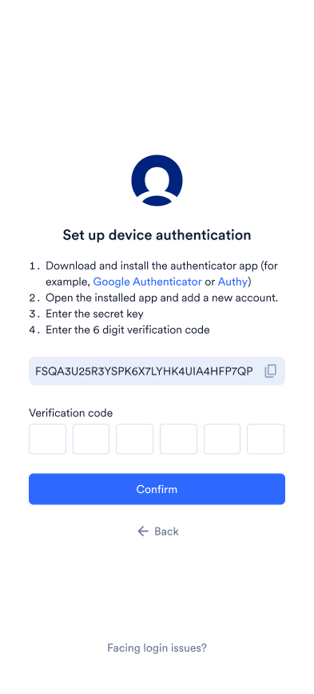
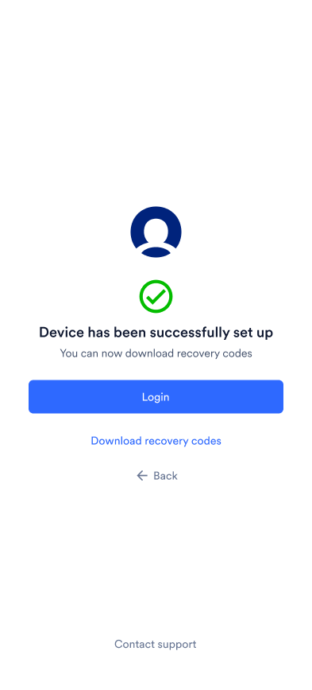

このページでは、開始前に必要なもの、アプリのインストール方法、初回サインインの方法について説明します。

## 前提条件

アプリを使用するには、以下が必要です。

- Web ダッシュボードにアクセスできる既存の MoEngage アカウント。このアプリは、すでに Web で MoEngage を使用しているユーザー向けです。同じアカウントとワークスペースでサインインします。アプリ内での個別のサインアップはありません。
- 監視したいキャンペーンを表示する権限。アプリには、お客様のアカウントが Web でアクセスできるものと同じキャンペーンとデータが表示されます。
- アカウントで 2 段階認証が有効になっている場合は、デバイスで設定されている必要があります。詳細については、[2 段階認証の設定](#set-up-2-step-verification)を参照してください。
- キャンペーンを承認する場合は、Web ダッシュボードでチームのキャンペーン承認フローが有効になっている必要があります。

## アプリのインストール

MoEngage Go アプリは iOS と Android で利用できます。App Store/Google Play を使用するか、以下の QR コードをスキャンして、モバイルデバイスにアプリをダウンロードします。

### App Store または Google Play からダウンロード

### QR コードを使用してダウンロード

<Tabs>
  <Tab title="iOS (App Store)">
    
  </Tab>
  <Tab title="Android (Google Play)">
    
  </Tab>
</Tabs>

## サインイン

既存の MoEngage アカウントでアプリにサインインします。メールアドレスを入力すると、招待されたワークスペースまたは最後に使用したワークスペースに移動します。アクセス権のある別のワークスペースにサインインするには、**Login to a different workspace** をタップします。表示されるサインインオプションは、ワークスペースで許可されているログイン方法（パスワード、Google、または SSO）によって異なります。

### 最後に使用したワークスペースにサインインする

1. **Login to your workspace** 画面で、**Work email** ボックスにメールアドレスを入力し、**Continue** をタップします。
   
2. **Login to your accounts** 画面で、**You will be logged in as** の下に表示されているメールアドレスを確認し、ワークスペースで利用できる方法でサインインします。
   * **Password**: **Password** ボックスにパスワードを入力し、**Login** をタップします。
   * **Google**: **Google** をタップし、Google アカウントを選択します。
   * **SSO**: **SSO** をタップし、ブラウザで組織の ID プロバイダーを使用して認証します。認証後、アプリに戻ります。

   
3. アカウントで 2 段階認証が有効になっている場合は、認証画面が開きます。コードを入力します。詳細については、[本人確認](#verify-your-identity)を参照してください。
   アカウントで 2 段階認証が有効になっていない場合、この手順はスキップされます。
4. サインインすると、アプリはワークスペースの **Campaigns** 画面を開きます。

### 別のワークスペースにサインインする

1. **Login to your workspace** 画面で、**Work email** ボックスにメールアドレスを入力し、**Login to a different workspace** をタップします。
   
2. アカウントで 2 段階認証が有効になっている場合は、認証画面が開きます。コードを入力します。詳細については、[本人確認](#verify-your-identity)を参照してください。
   アカウントで 2 段階認証が有効になっていない場合、この手順はスキップされます。

   <Note>
     複数のワークスペースにアクセスできる場合は、最後に使用したワークスペース用の認証アプリのエントリに表示されるコードを入力します。
   </Note>
3. **Select workspace** 画面で、**Workspace** ボックスをタップし、サインインするワークスペースを選択します。最近使用したワークスペースには **(last used)** というラベルが付いています。選択したワークスペースで利用できるログイン方法がボックスの下に表示されます。
      
4. ワークスペースで利用できる方法でサインインします。
   * **Password**: **Password** ボックスにパスワードを入力し、**Login** をタップします。
   * **Google**: **Continue with Google** をタップし、Google アカウントを選択します。
   * **SSO**: **Continue with SSO** をタップし、ブラウザで組織の ID プロバイダーを使用して認証します。認証後、アプリに戻ります。
5. サインインすると、アプリは選択したワークスペースの **Campaigns** 画面を開きます。

<Note>
  * パスワードを入力した後に別のワークスペースを選択すると、パスワードはクリアされます。新しいワークスペース用に再度入力してください。
  * SSO を使用するワークスペースでは、管理者には **Password** ボックスも表示されます。SSO の設定に問題が発生した場合にロックアウトされないよう、管理者はパスワードログインを利用できます。
  * 前の画面に戻るには、**Back** をタップします。
</Note>

### 本人確認

アカウントで 2 段階認証が有効になっている場合は、サインイン中に認証画面が開きます。2 段階認証が有効になっているもののまだ設定されていない場合は、代わりに **Set up device authentication** 画面が開きます。詳細については、[2 段階認証の設定](#set-up-2-step-verification)を参照してください。

認証には、認証アプリの OTP またはメールの OTP のいずれかを使用します。どちらを使用するかはアカウントの ID およびアクセス管理 (IAM) 設定によって決まり、選択することはできません。

* **認証アプリの OTP**: **User authentication** 画面で、認証アプリに表示される 6 桁のコードを **Verification code** ボックスに入力します。

  
* **メールの OTP**: **Email OTP verification** 画面で、メールに送信された 6 桁の OTP を **Enter OTP** ボックスに入力します。画面にはカウントダウンタイマーが表示されます。新しいコードを取得するには、いつでも **Resend OTP** をタップできます。

  

最後の桁を入力すると、アプリに **Verifying...** と表示され、コードが確認されます。

### 2 段階認証の設定

ワークスペースで 2 段階認証が必須であり、まだ設定していない場合は、サインインの認証ステップで **Set up device authentication** 画面が開きます。アプリからメールに設定用リンクが送信され、そのリンクからアプリを開いて設定を完了します。

1. **Set up device authentication** 画面で、**Work email** ボックスのメールアドレスを確認し、**Send link** をタップします。
   
2. モバイルデバイスで設定用のメールを開き、リンクをタップします。MoEngage Go アプリで、シークレットキーが表示された **Set up device authentication** 画面が開きます。
3. Google Authenticator や Authy などの認証アプリをダウンロードしてインストールします。
4. 認証アプリを開いて新しいアカウントを追加し、シークレットキーを入力します。キーをコピーするには、キーの横にあるコピーアイコンをタップします。
5. 認証アプリに表示される 6 桁の認証コードを **Verification code** ボックスに入力します。最後の桁を入力すると、アプリがコードを確認します。
   
6. **Device has been successfully set up** というメッセージが表示されたら、**Download recovery codes** をタップし、コードを安全な場所に保管します。
   
7. **Login** をタップします。**Login to your workspace** 画面が開きます。メールアドレスで再度サインインします。

<Note>
  設定用リンクを送信せずにメールの画面に戻るには、**Back** をタップします。
</Note>

### アプリからサインインできないワークスペース

ワークスペースがアプリで利用できない場合は、サインインしようとしたときにメッセージが表示されます。

* **Login to your accounts** 画面では、最後に使用したワークスペースについてアラートが表示されます。別のワークスペースにサインインするには、**Login to a different workspace** をタップします。
* **Select workspace** 画面では、サインインオプションの代わりにメッセージが表示されます。別のワークスペースを選択してください。

Web ダッシュボードでそのワークスペースにサインインすることもできます。

| ワークスペース | 表示されるメッセージ |
| - | - |
| ブロックされたワークスペース | This workspace is blocked. Contact your customer success manager. |
| Test 環境のワークスペース | Test environment access for this workspace is limited to the web. Select another workspace to proceed or continue on the web. |

### ログインに問題がある場合

サインインできない場合は、サインイン画面の下部にある **Facing login issues?** をタップします。

* **パスワードのリセット**: アプリではパスワードをリセットできません。パスワードをリセットするには、デスクトップブラウザで MoEngage ダッシュボードを使用してください。
* **その他のヘルプ**: カスタマーサクセスマネージャー (CSM) に問い合わせるか、[pm@moengage.com](mailto:pm@moengage.com) にメールでお問い合わせください。

## プッシュ通知の有効化

デバイスで通知を受け取るには、アプリからプロンプトが表示されたときに通知を許可します。この手順をスキップした場合でも、後でデバイスのアプリ設定で通知を有効にできます。通知が有効になっていない場合でも、通知は Notifications タブに表示されますが、届いたときに通知されません。

## 次のステップ

- [MoEngage Go を使用してキャンペーンを監視および管理する方法を学びます](/ja/user-guide/moengage-go/moengage-go-monitor-and-manage-campaigns)。
