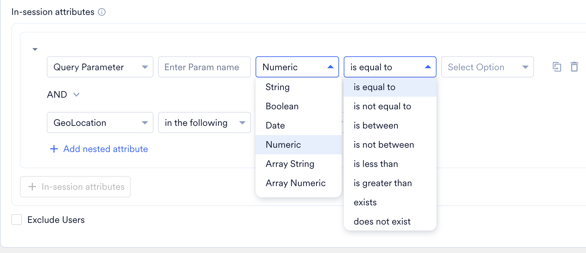
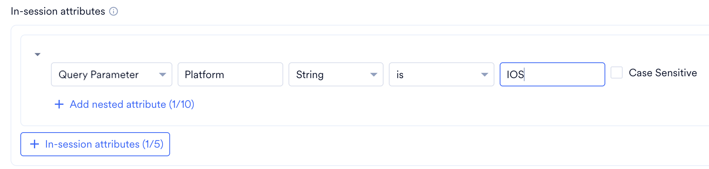
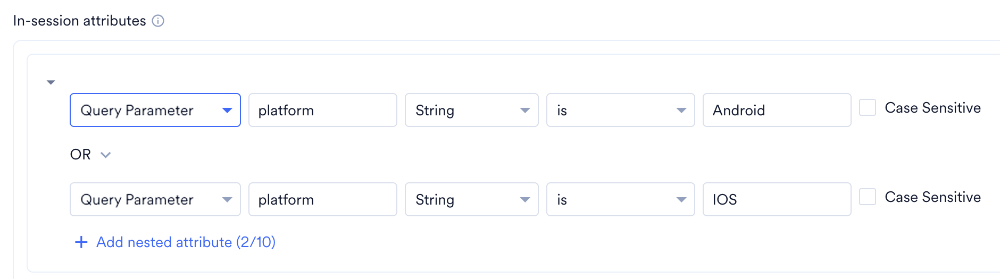
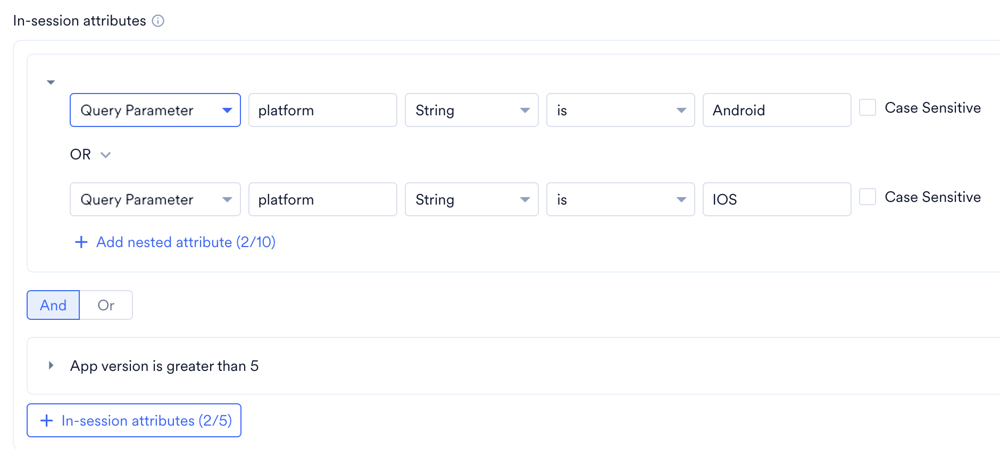
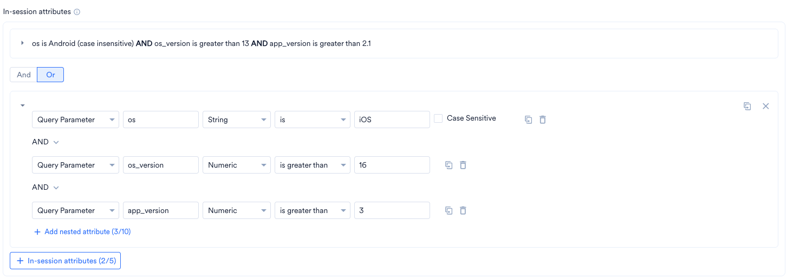

# 概要

MoEngage Personalize を使用すると、コンバージョンを加速させるリアルタイムでつながったエクスペリエンスを作成できます。これにより、顧客のニーズとブランドエクスペリエンスを結び付けることができます。

サーバーサイドパーソナライゼーションエクスペリエンスを作成するには、次の場所に移動します。

**Personalize** **\>** **All Experiences** に移動し、**\+Experience** **\>** **Web & App (API)** をクリックします。

# サーバーサイドエクスペリエンスの作成手順

新しい**サーバーサイドエクスペリエンス**の作成は、次の 3 つのステップで構成されます。

1. [**Target Users**](/ja/user-guide/personalize/server-side-personalization/create-server-side-personalization-experience#step-1-target-users): Web エクスペリエンスのオーディエンスを指定します。
2. [**Content**](/ja/user-guide/personalize/server-side-personalization/create-server-side-personalization-experience#step-2-content): 選択したユーザー向けのバリエーションとパーソナライズされたコンテンツを指定します。
3. [**Schedule and goals**](/ja/user-guide/personalize/server-side-personalization/create-server-side-personalization-experience#step-3-schedule-and-goals): エクスペリエンスの配信スケジュールとコンバージョン目標を指定します。

# Step 1: Target Users

このセクションには次の内容が含まれます。

### Experience Details

- **Experience name** - エクスペリエンスを管理および識別するための名前を入力します。エクスペリエンス名は 5 文字以上 256 文字以内である必要があります。
- **Experience tags** - ドロップダウンリストからエクスペリエンスタグを選択します。タグを使用すると、エクスペリエンスにコンテキストを追加できます。たとえば、プラットフォームやアプリへのユーザーのオンボーディング用に作成したエクスペリエンスには、「onboarding」というタグを追加できます。詳細については、[Tags](/ja/user-guide/campaigns-and-channels/getting-started/introduction/campaign-tags) を参照してください。
- **Experience key** - エクスペリエンスを一意に識別するためのエクスペリエンスキーを指定します。エクスペリエンスキーは、サーバーサイドエクスペリエンスを取得する API リクエストの一部として使用されます。エクスペリエンスキーは 5 文字以上 50 文字以内である必要があります。**サーバーサイドエクスペリエンスの公開後は、エクスペリエンスキーを更新できません。**

### Target Audience

**\+Add Audience** を選択して、エクスペリエンスのターゲットユーザーセグメントを定義します。

<Accordion title="ターゲットオーディエンスの定義">
  エクスペリエンスには複数のオーディエンス（最大 10 個）を追加できます。たとえば、スキンケア製品を販売するブランドの場合を考えてみましょう。マーケターが次のオーディエンスセグメントを作成すると、各セグメントに合わせてエクスペリエンスをパーソナライズできます。

  - 香水を閲覧した、または香水に関心を示したユーザー - マーケターは、ページ上で主に香水が表示され、新着商品、割引、今後のセール、お客様の声、有名人のレビューなどが紹介されるように、アプリや Web サイトをパーソナライズできます。
  - スキンケア製品の割引オファーをクリックしたユーザー - マーケターは、ページ上で主にスキンケア製品のオファーや割引が表示されるように、アプリや Web サイトをパーソナライズできます。
  - ナチュラルスキンケア製品に関心を示したユーザー - マーケターは、ページ上で主にナチュラルでクルエルティフリーの製品が表示されるように、アプリや Web サイトをパーソナライズできます。

  \+_Add Audience_ をクリックすると、エクスペリエンスのターゲットオーディエンスを指定するためのさまざまなオプションが表示されます。次の操作を行えます。

  1. ドロップダウンに表示される追加済みのオーディエンスのいずれかを選択して、既存のオーディエンスを追加します。下部の _Select_ をクリックして、オーディエンスをエクスペリエンスに追加します。
  2. 既存のオーディエンスを複製して編集します。ドロップダウンでオーディエンスを選択し、右下の _Duplicate and Edit_ をクリックして詳細を変更します。
  3. _\+ New Audience_ をクリックして、新しいオーディエンスを追加します。

  New Audience ポップアップでは、次のフィールドを指定できます。

  1. **Audience Name** - オーディエンスを識別する一意の名前です。
  2. **Segmentation criteria** - オーディエンスを定義するためのセグメンテーションフィルターです。このセクションでは、ターゲットユーザーを選択するための条件を追加できます。たとえば、カートに商品を追加したものの購入を完了していないユーザーや、過去「x」日間に通知を受信していない、またはアプリを開いていないユーザーなどを追加または削除する場合に使用します。
     <Tabs>
       <Tab title="All Users">
         アプリのすべてのユーザーにキャンペーンを送信できます。このオプションを使用する場合、複数のフィルターを追加することはできません。
       </Tab>
       <Tab title="User Property">
         初回表示日時、最終表示日時、都市などのユーザープロパティに基づいてユーザーをターゲティングできます。User Properties を選択し、次の操作を行います。
         1. 目的のユーザープロパティとフィルター条件を選択します。
         2. フィルター値を指定してルールを作成します。詳細については、[Create Segments](/ja/user-guide/segment/create-segments/rule-based-filter-segments) を参照してください。
       </Tab>
       <Tab title="User Behavior">
         アプリ/サイトの起動、商品の閲覧など、ユーザーの行動やイベントに基づいてユーザーをターゲティングできます。User Behavior を選択し、次の操作を行います。
         1. 実行条件と目的のユーザーアクティビティ（イベント）を選択します。
         2. イベントの頻度とイベント実行の期間を指定します。
         3. フィルター条件付きのイベントプロパティを追加します。
         4. フィルター値を指定してルールを作成します。詳細については、[Create Segments](/ja/user-guide/segment/create-segments/rule-based-filter-segments) を参照してください。
       </Tab>
       <Tab title="User Affinity">
         Affinity Segments は、特定の属性値でアクションを実行したユーザーに基づいて作成されるユーザーグループです。詳細については、[User Affinity](/ja/user-guide/segment/create-segments/affinity-segments) を参照してください。User Affinity を選択し、次の操作を行います。
         1. 目的のユーザーイベントまたは属性を選択します。
         2. 次の中からユーザーアフィニティパラメーターを選択します。
            - Predominantly: フィルター条件付きのアフィニティ属性を選択し、アフィニティ値を指定します。
            - Minimum of: フィルター条件付きのアフィニティ属性を選択し、アフィニティ値を指定します。
            - Most number of times: ユーザーの上位または下位のパーセンテージを入力するか、矢印を使用して指定します。
            - Least number of times: ユーザーの上位または下位のパーセンテージを入力するか、矢印を使用して指定します。
         3. イベント実行の期間を入力するか、矢印を使用して指定します。
         4. Attribute ボタンをクリックして、フィルターに属性を追加します。
       </Tab>
       <Tab title="Custom Segment">
         Custom Segment セクションを選択し、目的のカスタムセグメントを選択してルールを作成します。詳細については、[Custom Segments](/ja/user-guide/segment/create-segments/manage-segments) を参照してください。
       </Tab>
     </Tabs>
  3. **In-session attributes** - 特定の条件に基づいて訪問者をグループ化できます。次のセッション内属性を追加できます。
     | フィールド | 説明 |
     | --- | --- |
     | Query Parameter | Query Parameter フィールドでは、カスタムのキーと値のペアを使用して、特定のターゲットオーディエンスに含めるユーザーを識別できます。これらのキーと値のペアは、すでに定義されているセグメンテーションルールを補完する、追加のターゲティング条件として機能します。  **例:** アプリが英語とスペイン語など複数の言語のコンテンツをサポートしている場合、_language\_preference_ というキーを定義し、対応する値を設定できます。**en**: 英語のコンテンツを好むユーザーをターゲティングします。**es**: スペイン語のコンテンツを好むユーザーをターゲティングします。  このフィールドを活用することで、ユーザーの好みや属性に基づいて適切なオーディエンスにユーザーを割り当て、よりパーソナライズされたコンテキストに沿ったエクスペリエンスを提供できます。 |
     | Day of the week | このフィールドでは、曜日に基づいてユーザーをセグメント化できます。 |
     | Time of the day | このフィールドでは、時間帯に基づいてユーザーをセグメント化できます。ドロップダウンで使用可能な 1 日のうちの任意の 1 時間枠から選択できます。 |
     | Geolocation | このフィールドでは、ユーザーがアプリや Web サイトにアクセスした地理的位置に基づいてユーザーをセグメント化できます。ユーザーが所在する国、州/地域、都市を選択したり、特定の国を除外したりできます。 |
     | Device Type | このフィールドでは、ユーザーがアプリや Web サイトにアクセスしたデバイスに基づいてユーザーをセグメント化できます。Mobile、Desktop、Tablet のいずれか、またはその組み合わせを含めたり除外したりできます。 |
     **クエリパラメーターのデータ型**

     クエリパラメーターの条件を追加する際は、データ型を選択します。データ型によって、利用できる演算子が決まります。

     

     <Tabs>
       <Tab title="String">
         | 演算子 | 説明 |
         | --- | --- |
         | is | 保存値がいずれかのフィルター値と一致します。 |
         | is not | 保存値がどのフィルター値とも一致しません。このフィルターは、利用できない値（Key is not set）を含む、属性のすべての値に適用されます。 |
         | contains | 保存値にいずれかのフィルター値が含まれています。 |
         | contains spaces | 保存値にスペースが含まれています。スペースは値の先頭、途中、末尾のいずれにあってもかまいません。これには、Empty String や N/A を含むすべての値が含まれます。 |
         | does not contain | 保存値がどのフィルター値とも部分一致しません（含まれていません）。このフィルターは、利用できない値（Key is not set）を含む、保存された属性のすべての値に適用されます。 |
         | starts with | 保存値がいずれかのフィルター値で始まります。 |
         | does not start with | 保存値がどのフィルター値でも始まりません。このフィルターは、利用できない値（Key is not set）を含む、属性のすべての値に適用されます。 |
         | ends with | 保存値がいずれかのフィルター値で終わります。 |
         | does not end with | 保存値がどのフィルター値でも終わりません。このフィルターは、利用できない値（Key is not set）を含む、属性のすべての値に適用されます。 |
         | exists | 保存値が存在します。これには、Empty String や N/A を含むすべての値が含まれます。 |
         | does not exist | 保存値が存在しません。このフィルターは、利用できない値（Key is not set）を含む、属性のすべての値に適用されます。 |
         | is empty | 保存値が "" です（Key は設定されており、値は null です）。 |
         | is not empty | Key が設定されているかどうかにかかわらず、保存値が "" ではありません（保存値が null ではありません）。 |
       </Tab>
       <Tab title="Array String">
         | 演算子 | 説明 |
         | --- | --- |
         | (any of) is | いずれかの保存値が、少なくとも 1 つのフィルター値と完全に一致します。 |
         | (all of) is | 配列のすべての保存値が、すべてのフィルター値と一致します。 |
         | is not | 配列のすべての保存値が、どのフィルター値とも一致しません。このフィルターは、利用できない値（Key is not set）を含む、属性のすべての値に適用されます。 |
         | (any of) contains | 配列の保存値の 1 つにフィルター値が含まれています。 |
         | (all of) contains | すべての保存値にフィルター値が含まれています。 |
         | (any of) contains spaces | 配列の保存値の 1 つにスペースが含まれています。 |
         | (all of) contains spaces | すべての保存値にスペースが含まれています。 |
         | does not contain | すべての保存値にフィルター値が含まれていません。このフィルターは、利用できない値（Key is not set）を含む、属性のすべての値に適用されます。 |
         | (any of) starts with | いずれかの保存値がフィルター値で始まります。 |
         | (all of) starts with | すべての保存値がフィルター値で始まります。 |
         | does not start with | すべての保存値がフィルター値で始まりません。このフィルターは、利用できない値（Key is not set）を含む、属性のすべての値に適用されます。 |
         | (any of) ends with | いずれかの保存値がフィルター値で終わります。 |
         | (all of) ends with | すべての保存値がフィルター値で終わります。 |
         | does not end with | すべての保存値がフィルター値で終わりません。このフィルターは、利用できない値（Key is not set）を含む、属性のすべての値に適用されます。 |
         | exists | 保存値が存在します。これには、Empty Array や N/A を含むすべての値が含まれます。 |
         | does not exist | 保存値が存在しません。このフィルターは、利用できない値（Key is not set）を含む、属性のすべての値に適用されます。 |
         | (any of) is empty | 配列の保存値の少なくとも 1 つが空文字列です。 |
         | (all of) is empty | 配列のすべての保存値が空文字列です。 |
         | is not empty | 保存値が空ではありません。String インスタンスの長さが 0 より大きいです。このフィルターは、利用できない値（Key is not set）を含む、属性のすべての値に適用されます。 |
       </Tab>
       <Tab title="Numeric">
         | 演算子 | 説明 |
         | --- | --- |
         | is equal to | 保存値がいずれかのフィルター値と一致します。 |
         | is not equal to | 保存値がどのフィルター値とも一致しません。このフィルターは、利用できない値（Key is not set）を含む、属性のすべての値に適用されます。 |
         | is between | 保存値が 1 番目のフィルター値と 2 番目のフィルター値の間にあります。N1 \<= 保存値 AND 保存値 \< N2。N1 と N2 はそれぞれ 1 番目と 2 番目のフィルター値です。 |
         | is not between | 保存値が 1 番目のフィルター値と 2 番目のフィルター値の間にありません。N1 \> 保存値 OR 保存値 \>= N2。N1 と N2 はそれぞれ 1 番目と 2 番目のフィルター値です。 |
         | is less than | 保存値がフィルター値より小さいです。保存値 \< フィルター値。 |
         | is greater than | 保存値がフィルター値より大きいです。保存値 \> フィルター値。 |
         | exists | 保存値が存在します。これには、Empty Numeric や N/A を含むすべての値が含まれます。 |
         | does not exist | 保存値が存在しません。このフィルターは、利用できない値（Key is not set）を含む、属性のすべての値に適用されます。 |
       </Tab>
       <Tab title="Array Numeric">
         | 演算子 | 説明 |
         | --- | --- |
         | (any of) is equal to | いずれかの保存値が、少なくとも 1 つのフィルター値と完全に一致します。 |
         | (all of) is equal to | 保存値がすべてのフィルター値と完全に一致します。 |
         | is not equal to | いずれかの保存値が、どのフィルター値とも一致しません。このフィルターは、利用できない値（Key is not set）を含む、属性のすべての値に適用されます。 |
         | (any of) is between | 配列の保存値の 1 つが、1 番目のフィルター値と 2 番目のフィルター値の間にあります。N1 \<= 配列の保存値の少なくとも 1 つ AND 同じ値が \< N2。N1 と N2 はそれぞれ 1 番目と 2 番目のフィルター値です。 |
         | (all of) is between | 配列のすべての保存値が、1 番目のフィルター値と 2 番目のフィルター値の間にあります。N1 \<= 配列のすべての保存値 AND 配列のすべての保存値 \< N2。N1 と N2 はそれぞれ 1 番目と 2 番目のフィルター値です。 |
         | is not between | 配列のどの保存値も、1 番目のフィルター値と 2 番目のフィルター値の間にありません。N1 \> 配列のすべての保存値 OR 配列のすべての保存値 \>= N2。N1 と N2 はそれぞれ 1 番目と 2 番目のフィルター値です。 |
         | (any of) is less than | 配列の保存値の 1 つがフィルター値より小さいです。 |
         | (all of) is less than | 配列のすべての保存値がフィルター値より小さいです。 |
         | (any of) is greater than | 配列の保存値の 1 つがフィルター値より大きいです。 |
         | (all of) is greater than | 配列のすべての保存値がフィルター値より大きいです。 |
         | exists | 保存値が存在します。これには、Empty Array や N/A を含むすべての値が含まれます。 |
         | does not exist | 保存値がフィルター値に存在しません（Key not set）。 |
       </Tab>
       <Tab title="Date">
         | 演算子 | 説明 |
         | --- | --- |
         | on | 保存値は   From = Start of day (Date chosen)、   To = End of day (Date chosen)   例: Now = 11:30:30 AM, 7 Sep 2022 で、選択した日付が今日の場合。   From = 12:00:00 AM, 7 Sep 2022。   To = 11:30:30 AM, 7 Sep 2022。 |
         | is between | 保存値は   From = Start of day(Date 1)、   To = End of day(Date 2)。   Date 1 と Date 2 はそれぞれ開始日と終了日です。   例: 選択した Date1 = 7 Sep 2022、Date2 = 15 Sep 2022 の場合。   From = 12:00:00 AM, 7 Sep 2022。   To = 11:59:59 PM, 15 Sep 2022。 |
         | before | 保存値は   To = End of day (Date chosen - 1 day)   例: Now = 11:30:30 AM, 7 Sep 2022 で、選択した日付が今日の場合。   To = 11:59:59 PM, 6 Sep 2022。 |
         | after | 保存値は   From = Start of day (Date chosen \+ 1 day)、   例: Now = 11:30:30 AM, 7 Sep 2022 で、選択した日付が今日の場合。   From = 12:00:00 AM, 8 Sep 2022。 |
         | in the next | 保存値は   From = Now、   To = End of day(now \+ N days)。   N はフィルター値です。   例: Now = 11:30:30 AM, 7 Sep 2022 かつ N =3 の場合。   From = 11:30:30 AM, 7 Sep 2022。   To = 11:59:59 PM, 10 Sep 2022。 |
         | in the last | 保存値は   From = Start of day(Now - N days)、   To = Now。   N はフィルター値です。   例: Now = 11:30:30 AM, 7 Sep 2022 かつ N = 3 の場合。   From = 12:00:00 AM, 4 Sep 2022。   To = 11:30:30 AM, 7 Sep 2022。 |
         | is today | 保存値は   From = Start of day(Today)、   To = Now   例: Now = 11:30:30 AM, 7 Sep 2022 の場合。   From = 12:00:00 AM, 7 Sep 2022。   To = 11:30:30 AM, 7 Sep 2022。 |
         | exists | 保存値が存在します。これには、Empty Date Time や N/A を含むすべての値が含まれます。 |
         | does not exist | 保存値が存在しません。   このフィルターは、利用できない値（Key is not set）を含む、属性のすべての値に適用されます。 |
       </Tab>
       <Tab title="Boolean">
         | 演算子 | 説明 |
         | --- | --- |
         | is | 保存値がフィルター値と完全に一致します。 |
         | is not | 保存値がフィルター値と一致しません。保存値には、値が存在しない（Key is not set）属性も含まれます。 |
         | exists | 保存値が存在します。これには、Empty Boolean や N/A を含むすべての値が含まれます。 |
         | does not exist | 保存値が存在しません（Key is not set）。 |
       </Tab>
     </Tabs>

     データ型を変更すると、新しいデータ型で機能しない演算子や値はクリアされます。

     <Note>
     - この更新以前に追加したクエリパラメーターの条件では、String データ型が使用されます。演算子と値は変更されません。
     - 選択したデータ型は、このエクスペリエンスにのみ適用されます。別のエクスペリエンスやオファリングでは、同じ属性に異なるデータ型を指定できます。それぞれ個別にチェックされます。
     </Note>

     **クエリパラメーターのネストされたフィルター**

     ネストされたフィルターを使用して、クエリパラメーターの条件をグループ化します。例: (A AND B) OR (C AND D)。

     1. **\+ In-session attributes** をクリックして最初のグループを追加し、条件を入力します。

        

     2. 同じグループに別の条件を追加するには、**\+ Add nested attribute** をクリックします。

        

     3. 新しいグループを追加するには、もう一度 **\+ In-session attributes** をクリックします。

        

     4. **And** または **Or** を選択して、条件とグループを結合します。

     **例**

     あるフードデリバリーアプリが、ロック画面にライブ追跡ウィジェットを導入したいと考えています。

     ターゲティングロジック:

     - IF OS is iOS
       - AND IF OS Version is > 16
       - AND IF App Version is > 3

     **OR**

     - IF OS is Android
       - AND IF OS Version is > 13
       - AND IF App Version is > 2.1

     

     **制限**

     - 最初のグループを含め、最大 5 つのグループ。
     - 各グループに最大 10 個の条件。
     - グループを別のグループの中に入れることはできません。

     **AND/OR のルール**

     - グループ内の条件で AND を使用する場合、グループは OR で結合されます。グループ内の条件で OR を使用する場合、グループは AND で結合されます。
     - すべてのグループは同じ方法で結合する必要があります。グループ間で AND と OR を混在させることはできません。

     | 例 | 使用可否 |
     | --- | --- |
     | (A OR B) AND (C OR D) AND (E OR F) | 可 |
     | (A AND B) OR (C AND D) | 可 |
     | (A OR B) AND (C OR D) OR (E OR F) | 不可。グループが AND と OR の両方で結合されています。 |
     | (A OR B) AND (C AND D) | 不可。2 番目のグループの内部で AND が使用されており、グループも AND で結合されています。 |
     | ((A OR B) AND (C OR D)) OR (E AND F) | 不可。グループが別のグループの中にあります。 |

     空のグループは保存できません。保存しようとすると、次のエラーが表示されます: "Few input values are missing or incorrect for a Nested condition. Please check again!"

  4. **Exclude Users** - _Exclude Users_ をクリックし、_Select attribute_ ドロップダウンでセッション内属性を指定することで、特定のセッション内属性を持つユーザーを除外できます。
  5. ユーザーのセッション内行動を使用してパーソナライズするには、_\+In-session Behavior_ をクリックしてイベント条件（\_Has Executed/Has Not Executed\_）を追加し、_Select an event dropdown_ でイベントを選択します。**注**: セッション内行動のターゲティングでは、選択したユーザーアクションの直近 10 件のインスタンスのみが考慮されます。
  6. Save for later use チェックボックスはデフォルトでオンになっています。これにより、追加したオーディエンスが保存され、他のエクスペリエンスでも使用できるようになります。
  7. 画面右下の _Add_ をクリックして、オーディエンスを追加します。

  
</Accordion>

# Step 2: Content

このステップでは、A/B テストを追加し、API リクエストへのレスポンスとして返される各バリエーションのコンテンツを定義できます。

コンテンツ定義の一環として、オーディエンスごとに複数のバリエーションを作成し、バリエーション間の訪問者トラフィックの配分を制御できます。エクスペリエンスでターゲティングする各オーディエンスに対して、最大 5 つのバリエーションを作成できます。

|  |  |
| --- | --- |
| フィールド | 説明 |
| Variation | デフォルトで次の 2 つのオプションがあります。    1. Default Variation  2. Variation 1    画面左下の _\+ Variation_ をクリックして、別のバリエーションを追加できます。  注: ターゲットオーディエンスごとに最大 5 つのバリエーションを追加できます。 |
| Users (%total) | このフィールドでは、各バリエーションの訪問者トラフィックの配分を制御できます。 |

各バリエーションについて、API リクエストへのレスポンスで返される変数とその値のセットを定義できます。変数を使用すると、コードを何度も変更してデプロイすることなく、Web ページの要素を変更できます。たとえば、画像の URL とユーザーのリダイレクト先の Web ページを更新したい場合、画像の URL と対応する Web ページのアドレスを変数にすることで、ユーザーが簡単に変更できるようになります。

### 変数の型

各変数は、次のいずれかのデータ型である必要があります。

- Number
- String
- Boolean
- Float
- JSON

<Info>
  1 つのオーディエンスのすべてのバリエーション（Default を含む）で、同じ変数リストを維持することをお勧めします。
</Info>

### コンテンツのパーソナライゼーション

**User Properties、User Events、Product Sets、Decision Policies、Content APIs、Content Blocks** を使用してコンテンツをパーソナライズできます。

詳細については、次を参照してください。

- [MoEngage Templating Language (JINJA)](/ja/user-guide/campaigns-and-channels/getting-started/message-personalization/jinja-templating-language)
- [Catalogs](/ja/user-guide/content/recommendations/getting-started/catalogs)
- [Content APIs](/ja/user-guide/campaigns-and-channels/getting-started/campaign-content/content-apis)
- [Content Block](/ja/user-guide/content/content-blocks/content-blocks)
- [Decision Policies](/ja/user-guide/decisioning/offer-decisioning/decision-policy)
- [Auxiliary Data](/ja/user-guide/data/imports/auxiliary-data)

次の操作を行います。

1. 以下に示すように、テキスト領域内の任意の場所で **@** を押すと、コンテンツをパーソナライズできます。

2. **Data personalization** または **Content Block** のいずれかを選択します。
3. Data personalization タブをクリックし、ドロップダウンから次のいずれかを選択します。
   1. **User Properties**
   2. パーソナライゼーションの代替（フォールバック）として、次のいずれかを選択します。
      - **No Fallback**\
        パーソナライズされたコンテンツ用のオプションです。このオプションでは、パーソナライゼーションが機能しない場合に代替は使用されません。
      - **Do not send Web Personalization**\
        パーソナライゼーションが機能しない場合に、パーソナライズされたエクスペリエンスを配信しないオプションです。
      - **Replace Text**\
        パーソナライゼーションが機能しない場合に使用するテキストを入力または貼り付けます。
   3. **Product Sets**
   4. **Content API**
      1. Content API のパラメーターの値を変更します。
   5. **Content Block**
      1. 挿入するコンテンツブロックを選択します。
      2. 必要に応じて、**Insert only the content of the content block** を選択できます。
         <Info>
           このオプションを選択した場合
           - コンテンツのみが挿入されます
           - コンテンツはコンテンツブロックから切り離されます
           - コンテンツブロックでのコンテンツの更新は、挿入されたコンテンツには反映されません。
         </Info>
   6. **Decision Policies**
      1. 挿入する決定ポリシーを選択します。
4. **Done** をクリックします。

<Info>
  カスタム属性が MoEngage の標準属性と同じ名前にならないようにしてください。同じ名前のカスタム属性と標準属性をパーソナライゼーションに使用すると、誤ったパーソナライゼーションが行われる可能性があります。
</Info>

# Step 3: Schedule and goals

このステップでは、エクスペリエンスのスケジュール条件を設定します。エクスペリエンスの開始日時と終了日時を設定できます。

**Conversion Goals**

エクスペリエンスのビジネス指標を追跡するために、コンバージョン目標を追加できます。最大 5 つのコンバージョン目標を追跡できます。任意のアプリイベントをコンバージョン目標のアクティビティとして選択でき、複数のコンバージョン目標を設定できます。最初の目標がプライマリ目標として扱われます。

複数のコンバージョン目標を使用すると、複数のビジネス指標を追跡したり、ユーザーアクションのファネルを可視化したりできます。たとえば、次のような内容を確認したい場合、複数のコンバージョン目標を使用して確認できます。

1. 商品ページを閲覧したユーザーは何人か？
2. そのうち何人がその商品をカートに追加したか？
3. そのうち何人が注文を完了したか？

**Tracking Revenue Performance**

MoEngage を使用すると、キャンペーンの収益を非常に簡単に追跡できます。キャンペーンの収益と ROI を確認できます。たとえば、コミュニケーションを送信した後に商品がどれだけの収益を上げたかという質問に答えることができます。

コンバージョン目標を設定する際に、「Revenue Performance」トグルを有効にすることで、収益を追跡する目標を選択できます。以下の例では、**_orderSuccessful_** イベントの収益を追跡するために、「Revenue performance」トグルを有効にする必要があります。

収益の追跡は任意であり、必須ではありません。Revenue performance トグルを無効にすると、収益の追跡を無効にできます。目標を選択した後、注文の合計金額を取得する数値属性を選択できます。以下の例では、**_cartValue_** に注文の合計金額が含まれています。金額を報告する通貨を選択することもできます。

**Set Attribution window**

アトリビューションウィンドウ、つまりユーザーがキャンペーンを受信した時点から計算される、コンバージョン目標を特定のキャンペーンに帰属させる期間を設定することもできます。デフォルトでは 36 時間に設定されています。上記の例では、5 時間に設定したとします。

**Delivery Controls**

このオプションでは、エクスペリエンスに優先度を割り当てることができます。Low、Medium、High、Critical の優先度を割り当てることができます。**1 つの URL に複数のエクスペリエンスが作成されている場合、優先度の高いエクスペリエンスがユーザーに表示されます。**
