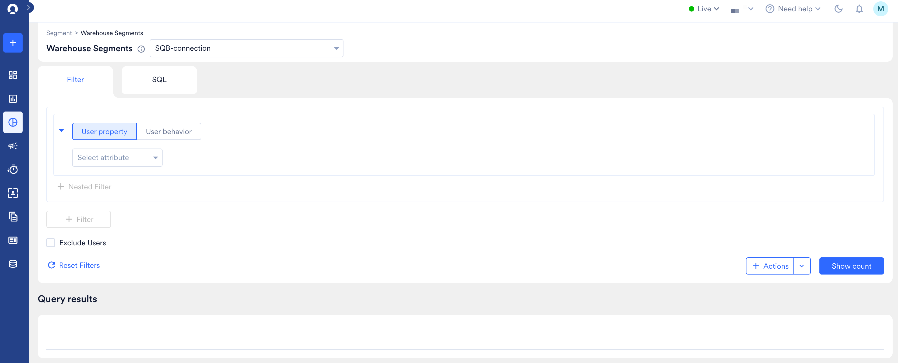
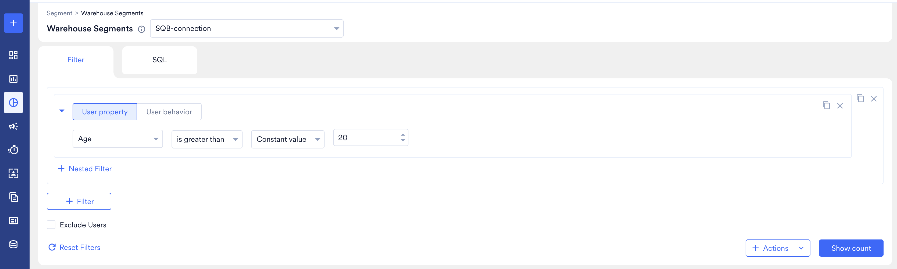
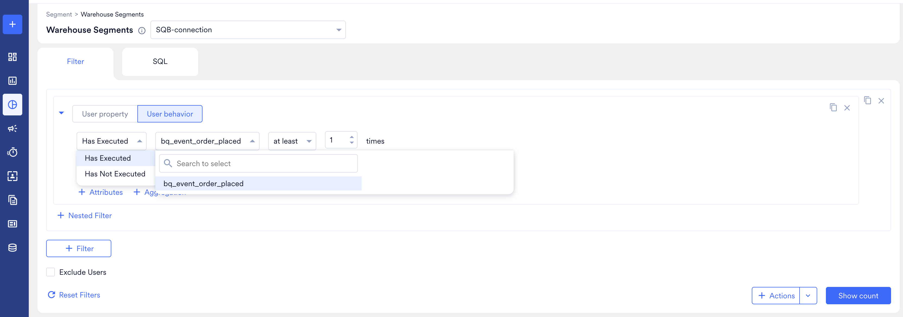
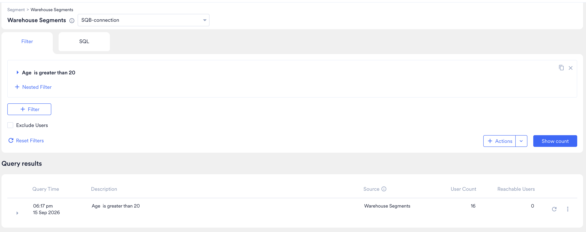
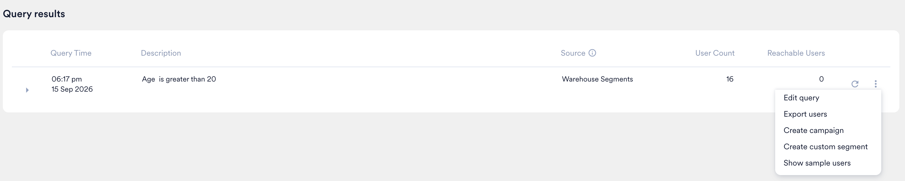

フィルタービルダーを使用すると、通常の MoEngage セグメントで使用するものと同じドロップダウンのフィルターを使用して、ウェアハウス内のデータからオーディエンスを作成できます。SQL クエリを作成する代わりにリストから属性とイベントを選択するため、セグメントの作成や変更のために分析チームに依頼する必要はありません。

MoEngage が SQL を自動で作成し、ウェアハウスに対して実行します。データはそのままの場所に保持されます。これは、ウェアハウスセグメントを作成する 2 つの方法のうちの 1 つです。SQL による方法との比較については、[ウェアハウスセグメント - 概要](/ja/user-guide/segment/create-segments/warehouse-segments)を参照してください。

<Info>
  **前提条件**

  - 接続済みのデータウェアハウス。詳細については、[データウェアハウスを接続する](/ja/user-guide/segment/create-segments/warehouse-segments/connect-your-warehouse)を参照してください。
  - MoEngage のユーザー、イベント、属性にマッピングされたウェアハウスのテーブル。データチームまたはエンジニアリングチームが [Warehouse Schema](/ja/user-guide/data/warehouse-schemas) で一度だけ設定します。ドロップダウンには、マッピングされた列のみが表示されます。
</Info>

<Note>
  フィルタービルダーは **BigQuery** と **Databricks** に対応しています。
</Note>

# セグメントを作成する

オーディエンスの作成と、そのオーディエンスに対するアクションは、2 つの別々のステップです。フィルターを定義して実行するとユーザー数が取得され、その結果が **Query results** に表示されます。そこから、結果をセグメント、キャンペーン、またはエクスポートに変換します。

ウェアハウスセグメントを作成するには、次の手順を実行します。

1. MoEngage のサイドバーメニューで、**Segment** \> **Warehouse Segments** をクリックします。Warehouse Segments ページが表示されます。
2. ページタイトルの横にあるドロップダウンから、ウェアハウス接続を選択します。その接続からマッピングされた属性とイベントが、フィルターのドロップダウンに読み込まれます。
3. **Filter** タブを選択します。
   
4. フィルターブロックでオーディエンスを作成します。各ブロックでは、**User property** または **User behavior** のいずれかでフィルタリングします。トグルを使用して切り替えます。
   - 同じブロックをさらに絞り込むには、**\+ Nested Filter** をクリックします。
   - 別の条件を追加するには、**\+ Filter** をクリックします。
   - 条件に一致するユーザーを含めるのではなく除外するには、**Exclude Users** を選択します。
   - 最初からやり直すには、**Reset Filters** をクリックします。
5. **Show count** をクリックします。MoEngage が SQL を作成してウェアハウスに対して実行し、下の **Query results** に行を追加します。
6. **Query results** で、行の省略記号アイコンをクリックし、オーディエンスに対して実行する操作を選択します。詳細については、[結果に対してアクションを実行する](/ja/user-guide/segment/create-segments/warehouse-segments/create-using-filters#act-on-the-result)を参照してください。

<Note>
  このページには保存ボタンがありません。ウェアハウスセグメントは、クエリ結果からカスタムセグメントを作成した場合にのみ再利用可能になります。
</Note>

# ユーザープロパティでフィルタリングする

フィルターブロックで **User property** を選択すると、ユーザーマスターテーブルからマッピングされたプロパティでフィルタリングできます。各行は、属性、演算子、値の順に構成されます。

値のドロップダウンでは、属性を入力した **Constant value** と比較するか、別の属性と比較できます。

ここには、データチームがマッピングしたプロパティのみが、データチームが付けた表示名で表示されます。マッピング時にスキップされた列は使用できません。想定しているプロパティが見つからない場合は、データチームに [Warehouse Schema](/ja/user-guide/data/warehouse-schemas) でマッピングするよう依頼してください。

# ユーザー行動でフィルタリングする

フィルターブロックで **User behavior** を選択すると、ユーザーが行ったことでフィルタリングできます。**Has Executed** または **Has Not Executed** を選択し、イベントを選択してから、回数と期間を設定します。

フィルターの下には 2 つのリンクが表示されます。

- **\+ Attributes** は、一定金額を超える注文など、特定のイベントプロパティの値にフィルターを絞り込みます。
- **\+ Aggregation** は、一致するイベントの数ではなく、一致するイベント全体で計算された値でフィルタリングします。

ここには、データチームがマッピングしたイベントと属性のみが表示されます。イベント名は、各イベントスキーマに設定された表示名です。

## イベント発生回数の演算子

ユーザーがイベントを実行した回数を設定します。

| 演算子 | 一致する対象 |
| --- | --- |
| **exactly** | ユーザーがイベントをちょうど n 回実行した。 |
| **at least** | ユーザーがイベントを n 回以上実行した。 |
| **at most** | ユーザーがイベントを n 回以下実行した。 |
| **for the first time** | ユーザーによるイベントの最初の発生が日付範囲内にあり、それより前に発生していない。 |
| **for the last time** | ユーザーによるイベントの最新の発生が日付範囲内にある。 |

<Note>
  **for the first time** と **for the last time** は、ウェアハウス接続で設定された **Max event look-back** ウィンドウ（デフォルトは 60 日）によって制限されます。そのウィンドウより前に最初に発生したイベントは、ウィンドウ内での最初の発生のように見えます。
</Note>

# データ型別の演算子

使用できる演算子は、チームが列をマッピングした MoEngage のデータ型によって異なります。

| データ型 | 演算子 |
| --- | --- |
| **String** | is, is not, contains, contains spaces, does not contain, starts with, does not start with, ends with, does not end with, exists, does not exist, is empty, is not empty |
| **Boolean** | is, is not, exists, does not exist |
| **Numeric** | is equal to, is not equal to, is between, is not between, is less than, is greater than, exists, does not exist |
| **Array (numeric)** | (any of / all of) is equal to, is not equal to, (any of / all of) is between, is not between, (any of / all of) is less than, (any of / all of) is greater than, exists, does not exist |
| **Array (string)** | (any of / all of) is, is not, (any of / all of) contains, (any of / all of) contains spaces, does not contain, (any of / all of) starts with, does not start with, (any of / all of) ends with, does not end with, exists, does not exist, (any of / all of) is empty, is not empty |
| **Date / time** | on, is between, before, after, in the next, in the last, is today, exists, does not exist |
| **Time of the day** | is, is between, in the following |
| **Day of the week** | is, is between, in the next, in the last, is today, in the following |
| **Day of the month** | is, is between, in the next, in the last, is today, in the following |
| **Month of the year** | is, is between, in the next, in the last, is this month, in the following |

ルールベースセグメントと同様に、ある属性を別の属性と比較したり、特別な日付フィルターを使用したりすることもできます。詳細については、[セグメンテーションのフィルター](/ja/user-guide/segment/advanced-concepts/filters-in-segmentation)を参照してください。

# クエリ結果を確認する

**Show count** をクリックするたびに、MoEngage は **Query results** に行を追加します。各行には、実行した内容と返された結果が記録されます。

| 列 | 意味 |
| --- | --- |
| **Query Time** | クエリが実行された日時。 |
| **Description** | フィルター条件をわかりやすい言葉で示したもので、実行を区別できます。 |
| **Source** | クエリの実行対象となったウェアハウス接続。 |
| **User Count** | ウェアハウスが返した行から MoEngage が解決できたユーザーの数。 |
| **Reachable Users** | それらのユーザーのうち、少なくとも 1 つのチャネルでキャンペーンを受信できるユーザーの数。 |

フィルターを作り直さずにクエリを再実行するには、更新アイコンをクリックします。

<Note>
  ユーザー数は通常、ウェアハウスで一致した行数よりも少なくなります。行がユーザーになるのは、そのユーザー識別子が MoEngage にすでに存在するユーザーと一致する場合のみです。ウェアハウスが 1,000 行を返し、そのうち 90 人のユーザーが MoEngage に存在する場合、ユーザー数は 90 になります。

  この数も固定ではありません。それらのユーザーが MoEngage で認識されるようになると、同じクエリでも後でより多くのユーザーに解決される場合があります。
</Note>

# 結果に対してアクションを実行する {#act-on-the-result}

クエリ結果の行にある省略記号アイコンをクリックして、オーディエンスに対して実行する操作を選択します。

| アクション | 動作 |
| --- | --- |
| **Create custom segment** | オーディエンスを再利用可能なカスタムセグメントとして保存します。これにより、ウェアハウスクエリを繰り返しターゲットにできるようになります。詳細については、[セグメントの管理](/ja/user-guide/segment/create-segments/manage-segments)を参照してください。 |
| **Create campaign** | このオーディエンスがあらかじめ選択された状態でキャンペーンを開始します。 |
| **Export users** | クエリで解決されたユーザーをエクスポートします。詳細については、[Outbound Segment Sync](/ja/user-guide/data/exports/segments/outbound-segment-sync) を参照してください。 |
| **Show sample users** | クエリに一致したユーザーのサンプルを表示します。アクションを実行する前に、オーディエンスが妥当かどうかを確認できます。 |
| **Edit query** | フィルターをビルダーに読み込み直し、変更して再実行できるようにします。 |

## クエリが実行されるタイミング

MoEngage は、次の 3 つのタイミングでウェアハウスに対してクエリを実行します。**Show count** をクリックしたとき、クエリ結果または保存済みのカスタムセグメントを再実行したとき、およびこの方法で作成されたセグメントを使用するキャンペーンの実行時に自動で実行されます。

<Warning>
  これらのクエリはデータウェアハウス上で直接実行されるため、ウェアハウスが請求するコンピューティングコストが発生します。セグメントの作成中にユーザー数を繰り返し確認すると、そのたびにクエリが実行されます。
</Warning>

# カスタムセグメントを作成した後

クエリ結果から作成したカスタムセグメントは、All Segments ページの他のカスタムセグメントと同様に動作し、タイプ **Warehouse - filter** として表示されます。これらのセグメントのみを表示するには、**Select Segment Type** リストでこのタイプを選択します。セグメントの表示、編集、複製、アーカイブ、およびセグメントからのキャンペーン作成が可能です。詳細については、[セグメントの管理](/ja/user-guide/segment/create-segments/manage-segments)を参照してください。

セグメントの詳細ページには、タイプ、ソース接続、作成日、最終実行日時、ユーザー数、リーチャビリティ、編集履歴が表示されます。このページからセグメントを実行すると、ウェアハウスに再度クエリが実行され、ユーザー数が更新されます。

エクスポートでは MoEngage の属性が返されます。MoEngage はエクスポート中にウェアハウスの属性値を解決できないため、ウェアハウスの列は含まれません。

# 制限事項

フィルタービルダーは、次の機能をサポートしていません。

- **All Users セグメント。** すべてのウェアハウスセグメントには、少なくとも 1 つのフィルターが必要です。
- **値の候補表示。** 属性値のドロップダウンは空のままのため、値を手動で入力してください。
- **Analyse。** ウェアハウスセグメントを分析のオーディエンスとして使用することはできません。
- ウェアハウスセグメント内での **カスタムセグメント、アフィニティ、分析のフィルター**。

## サポートされていない属性タイプ

次のタイプの属性はウェアハウススキーマでマッピングできないため、フィルタリングに使用できません。

- Object および Object 配列の属性。
- 位置情報の属性。
- Boolean 配列および日付配列。

マッピングできるものとできないものの完全な一覧については、[データ型](/ja/user-guide/data/warehouse-schemas#data-types)を参照してください。

## サポートされていない集計

ウェアハウスの属性に対する集計はまだ利用できません。次の集計はまったくサポートされていません。

- **Median。**
- **Change** および **percentage change。**

## 1 つのクエリにつき 1 つの接続

1 つのクエリは 1 つのウェアハウス接続から読み取ります。複数の接続のデータを組み合わせるには、接続ごとにカスタムセグメントを作成し、標準のセグメントビルダーでそれらを組み合わせます。

# セグメントが機能しなくなった場合

ウェアハウスセグメントは、その背後にあるウェアハウスのテーブルがマッピングされたときの状態のままであることを前提としています。列の名前が変更された場合、テーブルが削除された場合、またはデータ型が変更された場合、セグメントは機能しなくなります。

<Warning>
  このような場合でも通知は届きません。機能しなくなったセグメントは次回の実行時に失敗し、それがキャンペーンの実行時である場合もあります。
</Warning>

セグメントがユーザー数を返さなくなった場合は、データチームに [Warehouse Schema](/ja/user-guide/data/warehouse-schemas) のマッピングを確認するよう依頼してください。修正されたら、セグメントを再度実行します。

# よくある質問

<AccordionGroup>
  <Accordion title="セグメントが返された行数より小さいのはなぜですか？">
    MoEngage は、すでに認識しているユーザーのみをターゲットにします。ウェアハウスの行がセグメントのメンバーになるのは、そのユーザー識別子が MoEngage の顧客 ID と一致する場合のみです。MoEngage が一度も認識したことのないユーザーの行はスキップされます。

    ウェアハウススキーマをマッピングしても、ユーザーはインポートされません。新しいユーザーを MoEngage に取り込むには、[Imports](/ja/user-guide/data/imports/overview-imports) を使用してください。
  </Accordion>

  <Accordion title="ウェアハウスに列を追加しましたが、ドロップダウンに表示されません。">
    事前に 2 つのことが必要です。

    MoEngage はウェアハウスのメタデータを 6 時間ごとに更新するため、追加したばかりの列はまだ表示されない場合があります。データチームは、スキーマで **Force refresh** を使用して、より早く反映させることができます。

    次に、その列をマッピングする必要があります。マッピングされていない列やスキップされた列は、更新後もセグメントビルダーに表示されません。
  </Accordion>

  <Accordion title="属性値のドロップダウンが空なのはなぜですか？">
    ウェアハウスの属性では、値の候補表示は利用できません。列の個別の値を一覧表示するには、ウェアハウス内のテーブル全体をスキャンする必要があり、時間とコストがかかるため、MoEngage は自動的には行いません。

    フィルタリングする値を入力してください。値は、大文字と小文字の区別を含め、ウェアハウスに保存されている内容と一致する必要があります。
  </Accordion>

  <Accordion title="ウェアハウスのデータを、すでに MoEngage にあるデータと組み合わせることはできますか？">
    1 つのセグメントは 1 つの接続から読み取るため、単一のウェアハウスセグメント内では組み合わせることはできません。

    ウェアハウスのフィルターを実行し、クエリ結果で **Create custom segment** を使用します。そのカスタムセグメントは、標準のセグメントビルダーで MoEngage の属性やイベントと組み合わせることができます。
  </Accordion>

  <Accordion title="セグメントは自動的に更新されますか？">
    キャンペーンで使用されるセグメントはキャンペーンの実行時に自動的に更新されるため、キャンペーンは最新のオーディエンスをターゲットにします。

    それ以外の場所では、表示されるユーザー数は最後の実行時のものです。更新するには、詳細ページからセグメントを実行してください。
  </Accordion>

  <Accordion title="イベントデータはどのくらい前までさかのぼりますか？">
    ウェアハウス接続で設定された **Max event look-back** ウィンドウ（デフォルトは 60 日）までさかのぼります。それより古いイベントは、**for the first time** を含め、どのフィルターでも参照できません。

    データチームは **Settings** > **Data** > **Warehouse Schema** でこれを設定します。ウィンドウを長くすると、スキャンするデータ量が増え、クエリのコストが高くなります。
  </Accordion>

  <Accordion title="先週は機能していたセグメントが失敗するようになりました。">
    列の名前変更や削除、データ型の変更、スキーマの削除など、基になるウェアハウスのテーブルで何かが変更された可能性が高いです。このような場合、MoEngage は警告しないため、機能していたセグメントが予告なく失敗し始めることがあります。

    データチームに [Warehouse Schema](/ja/user-guide/data/warehouse-schemas) のマッピングを確認するよう依頼してください。修正されたら、セグメントを再度実行します。
  </Accordion>

  <Accordion title="ウェアハウスセグメントで分析を実行できないのはなぜですか？">
    分析には、MoEngage 内に保存されたイベントデータが必要です。ウェアハウスセグメントは実行時にユーザーのリストに解決され、ウェアハウスのイベント履歴を保持しないため、分析で読み取るデータがありません。

    セグメントをキャンペーンのターゲットにして、通常どおりキャンペーンのパフォーマンスを確認することは可能です。
  </Accordion>
</AccordionGroup>
