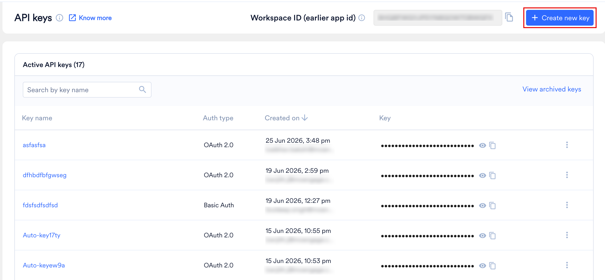
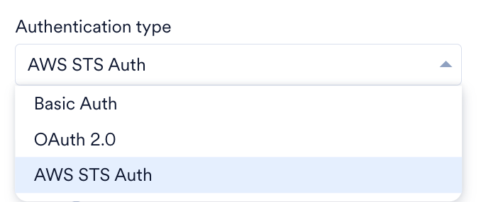
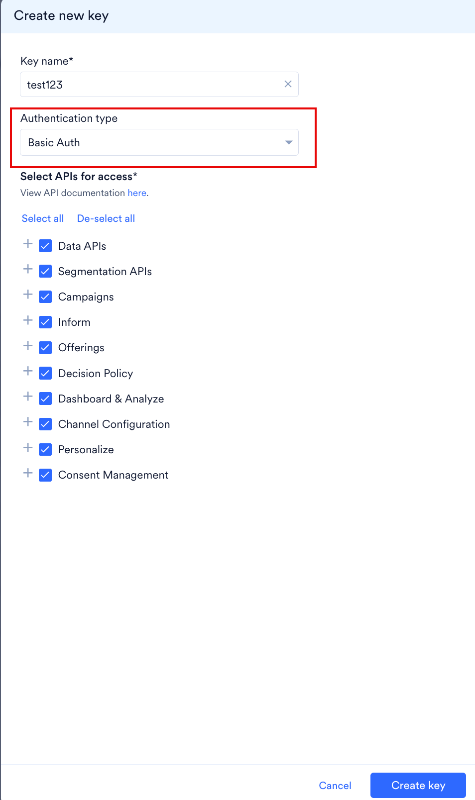
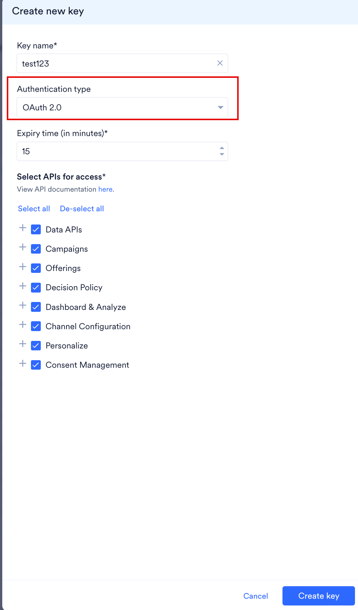
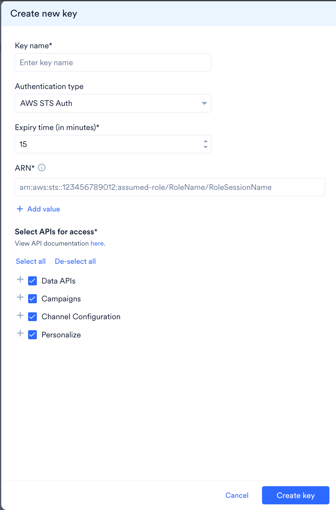
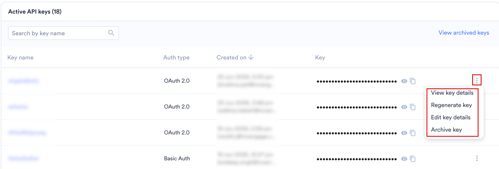
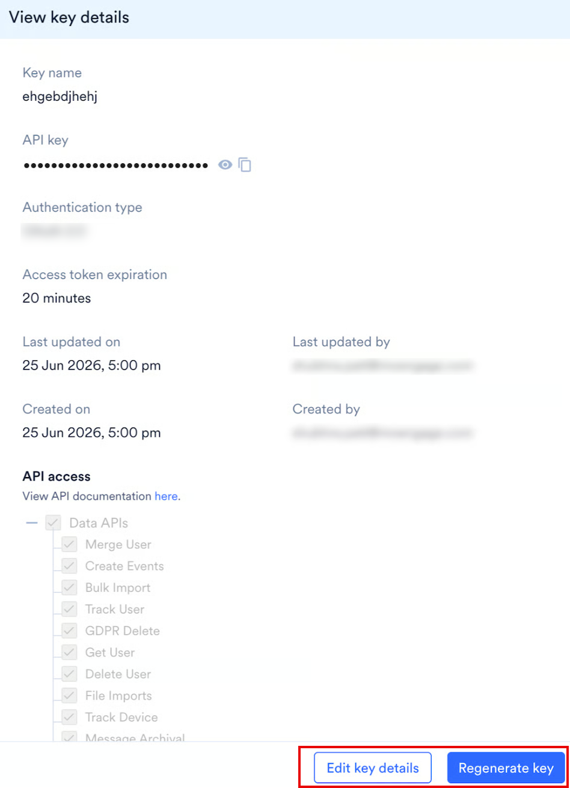
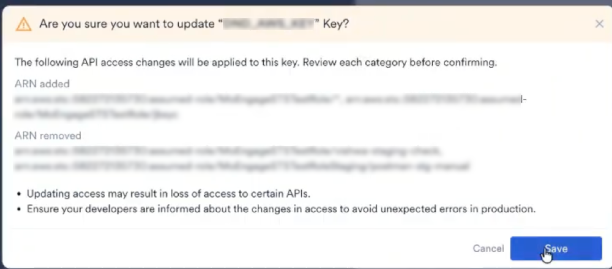
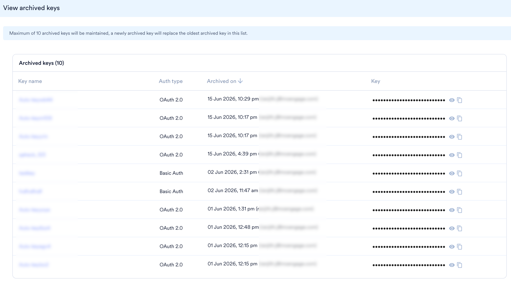
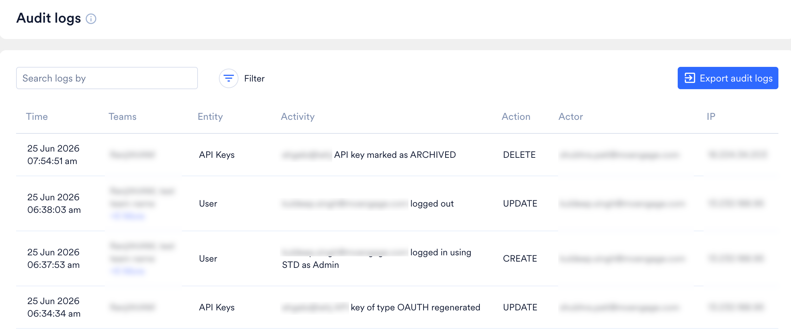

<Note>
  これは Early Access 機能です。アカウントで有効にするには、MoEngage のカスタマーサクセスマネージャー（CSM）またはサポートチームにお問い合わせください。
</Note>

## 概要

API キーは、MoEngage API リソースへのリクエストを認証および認可する一意の識別子です。API キーダッシュボードを使用して、キーを作成し、各キーを必要な API に範囲限定し、統合の変更に応じてキーを再生成またはアーカイブします。

マルチ API キー機能は現在、次の API グループでサポートされています。

| API グループ | サポートされている認証タイプ |
| --- | --- |
| [Data APIs](/ja/api/data/data-overview) | Basic Auth, OAuth 2.0, AWS STS Auth |
| [Segmentation APIs](/ja/api/custom-segments/custom-segments-overview) | Basic Auth |
| [Push APIs](/ja/api/push/push-overview) | Basic Auth (Legacy) |
| [Campaigns](/ja/api/campaigns/campaigns-overview) | Basic Auth, OAuth 2.0 |
| [Inform](/ja/api/inform/inform-overview) | Basic Auth |
| [Offerings](/ja/api/offerings/offerings-overview) | Basic Auth, OAuth 2.0 |
| Decision Policy | Basic Auth, OAuth 2.0 |
| [Dashboard & Analyze](/ja/api/analytics/analytics-overview) | Basic Auth, OAuth 2.0 |
| Channel Configuration | Basic Auth, OAuth 2.0, AWS STS Auth |
| [Personalize](/ja/api/personalize-experience/personalize-overview) | Basic Auth, OAuth 2.0, AWS STS Auth |

<Note>
 - Segmentation APIs と Inform は Basic Auth でのみ利用できます。
 - AWS STS Auth は、上記のグループの一部に対応しています。[AWS STS Auth で利用可能なスコープ](#scopes-available-to-aws-sts-auth)を参照してください。
 - Push APIs 用の新しい API キーの作成は現在サポートされていません。Push APIs は、このダッシュボードに移行された **Basic Auth (Legacy)** キーでのみ動作します。移行されたレガシーキーは[再生成](#manage-keys)できます。
</Note>

MoEngage にデータを送信するには、その API 用の Workspace ID とキーを使用できます。キーを再生成すると、古いキーは即座に失効し、新しいキーが機能するまでに時間がかかるため、サービスが中断する可能性があります。MoEngage では、このような状況を回避できるよう複数の API キーを提供しています。

- **既存のキーが利用可能な間に新しいキーを生成する**: マルチキーのサポートにより、新しいキーが機能するまで既存のキーは有効なままです。これにより、ダウンタイムを発生させることなく、セキュリティ目的でキーをローテーションできます。たとえば、チームが新しいキーを統合するのに時間が必要な場合でも、その間は古いキーが引き続き機能します。新しいキーの統合後、古いキーをアーカイブできます。
- **チームごとに異なるキーを使用する**: 社内のチームや外部ベンダーごとに、それぞれが必要な API に範囲を限定した個別のキーを作成できます。これにより、きめ細かなアクセス制御が可能になり、組織全体のセキュリティが向上します。

キーを使用できる IP アドレスを制限するには、[API Firewall](/ja/user-guide/settings/account/security/api-firewall) を参照してください。

## 認証タイプ

MoEngage は、API キーについて次の認証タイプをサポートしています。

- **Basic Auth**: API キーとシークレットを使用する標準的な認証方式です。トークンの有効期限を必要としないサーバー間の統合では、この方式を選択します。
- **OAuth 2.0**: 有効期間の短いアクセストークンを発行するトークンベースの方式です。トークンの有効期限を設定でき、MoEngage が各アクセストークンを自動的に検証します。トークンの生成、使用、更新を含むフロー全体については、[OAuth 2.0 Overview](/ja/api/oauth/oauth-overview) を参照してください。
- **AWS STS Auth**: AWS 上で実行されるワークロード向けのトークンベースの方式です。キーを使用できる AWS Security Token Service（STS）の assumed-role ARN を許可リストに登録し、各リクエストはロールの一時的な認証情報による署名で AWS ID を証明します。MoEngage はキーに対して `MOE-APPSECRET` の値も発行し、すべてのリクエストはこの値を署名とともに送信します。サービスがすでに IAM ロールを引き受けており、MoEngage にそれらのロールを直接認可させたい場合は、この方式を選択します。[ロール ARN を追加する](#add-role-arns)および [AWS STS Auth](/ja/api/aws-sts/aws-sts-overview) を参照してください。

認証タイプは、**Create new key** ダイアログの **Authentication type** リストから選択します。キーの作成後に認証タイプを変更することはできません。統合を別の認証タイプに移行するには、新しいキーを作成して古いキーをアーカイブします。

## キーを作成する

<Info>
  - マルチ API キー機能が有効になると、API ダッシュボード内の既存の API キーは、レガシーキーとして新しい API キーダッシュボードに移行されます。
  - レガシーキー（ワークスペース作成時に以前自動生成され、この新しいダッシュボードに移行されたもの）の詳細を表示し、引き続き使用できます。レガシーキーは再生成できます。ただし、レガシーキーの編集とアーカイブはサポートされていません。
  - レガシーキーは将来非推奨となるため、MoEngage では新しいキーを作成して使用することを推奨しています。
</Info>

<Steps>
  <Step title="API Keys ページを開く">
    MoEngage ダッシュボードの左側のナビゲーションメニューで、**Settings** \> **Account** \> **API keys** に移動します。
  </Step>
  <Step title="新しいキーの作成を開始する">
    **+ Create new key** をクリックします。

    <Frame></Frame>
  </Step>
  <Step title="キーの詳細フォームを開く">
    **Create new key** ダイアログで、キーの詳細を入力します。
  </Step>
  <Step title="キーに名前を付ける">
    **Key name** ボックスに名前を入力します。キー名は 100 文字以内で、ワークスペース内で一意である必要があります。アーカイブされたキーは名前を保持するため、以前にアーカイブしたキーの名前を再利用することはできません。
  </Step>
  <Step title="認証タイプを選択する">
    **Authentication type** リストから使用する方式を選択し、その方式のオプションを設定します。

    <Frame></Frame>

    <Tabs>
      <Tab title="Basic Auth">
        **Select APIs for access** で、このキーを使用してアクセスする API グループを選択します。

        - Data APIs
        - Segmentation APIs
        - Campaigns
        - Inform
        - Offerings
        - Decision Policy
        - Dashboard & Analyze

       <Frame></Frame>
 
      </Tab>
      <Tab title="OAuth 2.0">
        1. **Expiry time (in minutes)** ボックスに、アクセストークンの有効期間を入力します。値は 5～60 分の範囲で指定する必要があり、デフォルトは 15 分です。

           <Info>
             **Expiry time (in minutes)** ボックスは Basic Auth キーには表示されません。AWS STS Auth キーにも同じ名前のボックスがありますが、設定する制限は異なります。**AWS STS Auth** タブを参照してください。
           </Info>

        2. **Select APIs for access** で、このキーを使用してアクセスする API グループを選択します。
           - Data APIs
           - Campaigns
           - Offerings
           - Decision Policy
           - Dashboard & Analyze

         <Frame></Frame>

        **Segmentation APIs** と **Inform** は OAuth 2.0 キーには表示されません。これらのグループにアクセスするには、Basic Auth キーを作成してください。
      </Tab>
      <Tab title="AWS STS Auth">
        1. **Expiry time (in minutes)** ボックスに、MoEngage が検証済みの署名を信頼する期間を入力します。値は 5～15 分の範囲で指定する必要があり、デフォルトは 15 分です。この設定は、MoEngage が最初に署名を検証する時点で許容される署名の経過時間を変更するものではありません。これは AWS の鮮度ウィンドウによって決まります。

        2. **ARN** ボックスに、このキーを使用できる AWS STS assumed-role ARN を入力します。**+ Add value** をクリックすると、最大 10 件まで ARN を追加できます。受け付けられる形式と、ダッシュボードが各エントリに適用する検証については、[ロール ARN を追加する](#add-role-arns)を参照してください。

        3. **Select APIs for access** で、このキーを使用してアクセスする API グループを選択します。
           - Data APIs
           - Channel Configuration
           - Personalize

         <Frame></Frame>

        **Campaigns**、**Segmentation APIs**、**Inform**、**Offerings**、**Decision Policy**、**Dashboard & Analyze** は AWS STS Auth キーでは利用できません。これらのグループにアクセスするには、Basic Auth または OAuth 2.0 キーを作成してください。

        表示されているグループ内のすべてのスコープが AWS STS Auth キーで利用できるわけではありません。このキーで使用できるスコープについては、[AWS STS Auth で利用可能なスコープ](#scopes-available-to-aws-sts-auth)を参照してください。

        キーを保存すると、MoEngage はそのキーの `MOE-APPSECRET` の値を生成します。アプリケーションは、AWS 署名に加えて、すべてのリクエストでこの値をヘッダーとして送信します。値を取得するには、[キーの詳細を表示する](#view-key-details)を参照してください。
      </Tab>
    </Tabs>
  </Step>
  <Step title="API アクセスの範囲を設定する">
    グループの横にある <Icon icon="plus" /> をクリックしてグループを展開し、個々の API を選択します。**Select all** または **De-select all** を使用すると、すべてのグループにわたって選択を管理できます。
  </Step>
  <Step title="新しいキーを保存する">
    **Create key** をクリックします。新しいキーが **Active API keys** に表示されます。
  </Step>
</Steps>

リクエストでキーを使用する方法については、[Authentication](/ja/api/introduction#authentication) を参照してください。OAuth 2.0 キーを作成した場合、アクセストークンの生成、API の呼び出し、トークンの更新については [OAuth 2.0 Overview](/ja/api/oauth/oauth-overview) を参照してください。エンドポイントごとのリクエスト制限とペイロードの上限については、[Rate Limits](/ja/api/rate-limits) を参照してください。

## AWS STS Auth

このセクションは、**AWS STS Auth** 認証タイプを使用するキーにのみ適用されます。MoEngage はこのようなキーを assumed-role ARN のリストに照らして認可し、キーに登録された assumed-role ARN を持つ呼び出し元のみがキーを使用できます。

<Note>
  このセクションでは、AWS STS Auth キーのダッシュボード設定について説明します。アプリケーションが実行する署名の手順、リージョンごとの AWS STS ホスト、各 API リクエストに含めるヘッダーについては、[AWS STS Auth](/ja/api/aws-sts/aws-sts-overview) を参照してください。
</Note>

### AWS STS Auth で利用可能なスコープ

AWS STS Auth キーは、Basic Auth キーおよび OAuth 2.0 キーで利用可能なスコープの一部にアクセスできます。

| API グループ | AWS STS Auth キーで選択できるスコープ |
| --- | --- |
| [Data APIs](/ja/api/data/data-overview) | すべてのスコープ: Get User、Track User、Merge User、Bulk Import、GDPR Delete、Delete User、Create Events、File Imports、Track Device、Email Double Opt-in。 |
| Channel Configuration | **Setup & Manage** のみ。**View** と **Manage Message Template** には Basic Auth または OAuth 2.0 キーが必要です。 |
| [Personalize](/ja/api/personalize-experience/personalize-overview) | **View** のみ。 |

その他のスコープは AWS STS Auth キーを受け付けません。Campaigns、Segmentation APIs、Inform、Offerings、Decision Policy、Dashboard & Analyze を呼び出すには、Basic Auth または OAuth 2.0 キーを作成してください。

### ロール ARN を追加する

これらのロールは、お客様自身の AWS アカウントで作成・管理します。MoEngage は ARN を生成しないため、AWS アカウントから ARN をコピーしてキーに貼り付けてください。詳細については、[AWS Security Token Service API Reference](https://docs.aws.amazon.com/STS/latest/APIReference/Welcome.html) を参照してください。

#### ARN の形式

各 ARN は次の形式で入力します。

```text
arn:aws:sts::<aws-account-id>:assumed-role/<RoleName>/<RoleSessionName>
```

| セグメント | 説明 |
| --- | --- |
| `aws:sts` | サービス。AWS STS Auth キーは Security Token Service の ARN のみを受け付けます。 |
| `<aws-account-id>` | 12 桁の AWS アカウント ID。 |
| `assumed-role` | リソースタイプ。ダッシュボードは、`role` またはその他のリソースタイプを使用する ARN を拒否します。 |
| `<RoleName>` | ワークロードが引き受ける IAM ロールの名前。 |
| `<RoleSessionName>` | ロールセッション名、またはそのロールのすべてのセッションに一致させる場合は `*`。 |

例:

```text
arn:aws:sts::123456789012:assumed-role/MoEngageIngestionRole/data-pipeline-prod
```

セッション名は必須です。`arn:aws:sts::123456789012:assumed-role/MoEngageIngestionRole` のようにロール名で終わるエントリは、**Invalid format** として拒否されます。

#### ワイルドカードで複数の ARN に一致させる

ロールのセッションごとに異なる ARN が生成されるため、多くのワークロードやチームメンバーが共有するロールでは 10 件の上限を超える場合があります。範囲を広げたいセグメントの末尾に `*` を配置します。

| 目的 | エントリ | 一致する対象 |
| --- | --- | --- |
| 1 つのロールのすべてのセッション | `arn:aws:sts::123456789012:assumed-role/MoEngageIngestionRole/*` | `MoEngageIngestionRole` のすべてのセッション。 |
| 名前のプレフィックスが共通するすべてのロール | `arn:aws:sts::123456789012:assumed-role/MoEngageIngestionRole-*` | `MoEngageIngestionRole-Dev`、`MoEngageIngestionRole-Prod`、およびそのプレフィックスを持つその他すべてのロール。 |

すべてのワイルドカードエントリには、次の 2 つのルールが適用されます。

- エントリで使用できる `*` は 1 つだけで、最後の文字としてのみ使用できます。`arn:aws:sts::123456789012:assumed-role/My*Role` や、ワイルドカードを 2 つ含むエントリは無効です。
- ロール名にはワイルドカードの前に少なくとも 1 文字が必要なため、`arn:aws:sts::123456789012:assumed-role/*` は無効です。

<Warning>
  ワイルドカードは、一致するすべての ARN にキーの API アクセス全体を付与します。そのため、一致するすべてのロールまたはセッションが同じアクセスを必要とする場合にのみ使用してください。ワイルドカードエントリを追加すると、ダッシュボードに **Using \* matches multiple ARNs. Ensure that this broader scope is intentional for security.** というバナーが表示されます。
</Warning>

ワイルドカードエントリがすでにロールをカバーしている場合、同じロールの名前付きセッションを追加することはできません。ダッシュボードは名前付きセッションを重複として扱います。キーを保存するには、2 つのエントリのいずれかを削除してください。

#### ARN の検証

| 条件 | メッセージ |
| --- | --- |
| ARN が想定される形式と一致しない。たとえば、アカウント ID が 12 桁未満である、リソースタイプが `assumed-role` ではなく `role` である、セッション名がない場合など。 | **Invalid format** |
| エントリに `*` が 2 つ以上含まれている、`*` が最後の文字以外の位置にある、または `*` がロール名全体として使用されている。 | **Invalid format** |
| 同じ ARN を 2 回入力した、またはワイルドカードエントリがすでにカバーしているロールの名前付きセッションを追加した。 | **Duplicate ARN detected** |
| リストにすでに 10 件の ARN が含まれている。 | ダッシュボードは **+ Add value** を無効にし、最大 10 件の値を追加できることを示します。 |

## 有効なキーを表示する

**API Keys** ページの **Active API keys** テーブルには、次の列が表示されます。

| 列 | 説明 |
| --- | --- |
| Key name | キーに割り当てられた名前。 |
| Auth type | **Basic Auth**、**OAuth 2.0**、**AWS STS Auth**、または移行されたレガシーキーの場合は **Basic Auth (Legacy)**。 |
| Created on | キーが作成された日時と、作成したユーザーのメールアドレス。 |
| Key | マスクされたキーの値と、表示ボタンおよびコピーボタン。 |
| Actions (<Icon icon="ellipsis-stroke-vertical" />) | キーを管理するためのオプション。[キーを管理する](#manage-keys) を参照してください。 |

検索バーを使用してキーを検索できます。有効なキーの数はテーブルの上に表示されます。

<Note>
  レガシーキーは、認証タイプ **Basic Auth (Legacy)** として表示されます。これらのキーは表示、継続使用、[再生成](#manage-keys)ができますが、編集やアーカイブはできません。
</Note>

## キーを管理する

**API Keys** ページで、キーの <Icon icon="ellipsis-stroke-vertical" /> をクリックすると、次のオプションが表示されます。 <Frame></Frame>

| オプション | 説明 |
| --- | --- |
| [View key details](#view-key-details) | キーの詳細をすべて表示します。詳細パネルから **Edit key details** と **Regenerate key** にもアクセスできます。 |
| Regenerate key | 新しいキーを生成します。キーは必要に応じて何度でも再生成できます。AWS STS Auth キーの場合は、新しい `MOE-APPSECRET` の値が発行され、キーのロール ARN と API アクセスは変更されません。このオプションはレガシーキーでも利用できます。 |
| [Edit key details](#edit-key-details) | キーの名前または API アクセス設定を編集します。 |
| Archive key | キーをアーカイブします。アーカイブされたキーはアーカイブを解除できません。アーカイブ済みキーの一覧には最大 10 個のアーカイブ済みキーが保持されます。 |

**Edit key details** と **Archive key** はレガシーキーでは利用できません。

<Warning>
  再生成すると、古いキーは即座に失効します。エラーを避けるため、統合内の古いキーを置き換えてください。Push APIs は単一のレガシーキーを使用し、2 つ目の Push API キーを作成することはできません。中断を最小限に抑えるため、再生成後すぐに統合内のキーを更新してください。
</Warning>

### キーの詳細を表示する

<Steps>
  <Step title="キーのアクションメニューを開く">
    **API Keys** ページで、表示するキーの <Icon icon="ellipsis-stroke-vertical" /> をクリックします。
  </Step>
  <Step title="詳細パネルを開く">
    **View key details** をクリックします。詳細パネルのフィールドは、キーの認証タイプによって異なります。

    <Tabs>
      <Tab title="Basic Auth">
        | フィールド | 説明 |
        | --- | --- |
        | Key name | キーに割り当てられた名前。 |
        | API key | マスクされたキーの値と、表示ボタンおよびコピーボタン。 |
        | Authentication type | **Basic Auth**、または移行されたレガシーキーの場合は **Basic Auth (Legacy)**。 |
        | Last updated on | キーが最後に変更された日時。 |
        | Last updated by | キーを最後に変更したユーザーのメールアドレス。 |
        | Created on | キーが作成された日時。 |
        | Created by | キーを作成したユーザーのメールアドレス。 |
        | API access | このキーで選択された API。有効なオプションはチェックマークで示されます。グループの横にある <Icon icon="plus" /> をクリックすると、そのグループに含まれる個々の API が表示されます。 |
      </Tab>
      <Tab title="OAuth 2.0">
        | フィールド | 説明 |
        | --- | --- |
        | Key name | キーに割り当てられた名前。 |
        | API key | マスクされたキーの値と、表示ボタンおよびコピーボタン。 |
        | Authentication type | **OAuth 2.0**。 |
        | Access token expiration | トークンの有効期間（分）。 |
        | Last updated on | キーが最後に変更された日時。 |
        | Last updated by | キーを最後に変更したユーザーのメールアドレス。 |
        | Created on | キーが作成された日時。 |
        | Created by | キーを作成したユーザーのメールアドレス。 |
        | API access | このキーで選択された API。有効なオプションはチェックマークで示されます。グループの横にある <Icon icon="plus" /> をクリックすると、そのグループに含まれる個々の API が表示されます。 |
      </Tab>
      <Tab title="AWS STS Auth">
        | フィールド | 説明 |
        | --- | --- |
        | Key name | キーに割り当てられた名前。 |
        | API key | マスクされたキーの値と、表示ボタンおよびコピーボタン。 |
        | Authentication type | **AWS STS Auth**。 |
        | MOE-APPSECRET | MoEngage がこのキー用に生成したシークレットと、表示ボタンおよびコピーボタン。値は作成後も利用可能なため、いつでもここから取得できます。 |
        | Expiry time | MoEngage が検証済みの署名を信頼する期間（分）。 |
        | ARNs | このキーを使用できる assumed-role ARN。**Show more** をクリックすると一覧全体が展開され、エントリにカーソルを合わせると完全な ARN が表示されます。 |
        | Last updated on | キーが最後に変更された日時。 |
        | Last updated by | キーを最後に変更したユーザーのメールアドレス。 |
        | Created on | キーが作成された日時。 |
        | Created by | キーを作成したユーザーのメールアドレス。 |
        | API access | このキーで選択された API。有効なオプションはチェックマークで示されます。グループの横にある <Icon icon="plus" /> をクリックすると、そのグループに含まれる個々の API が表示されます。 |
      </Tab>
    </Tabs>
  </Step>
</Steps>

詳細パネルから **Edit key details** または **Regenerate key** をクリックして、それらの操作を実行できます。

<Frame></Frame>

### キーの詳細を編集する

<Steps>
  <Step title="キーのアクションメニューを開く">
    **API Keys** ページで、編集するキーの <Icon icon="ellipsis-stroke-vertical" /> をクリックします。
  </Step>
  <Step title="編集ダイアログを開く">
    **Edit key details** をクリックします。
  </Step>
  <Step title="フィールドを更新する">
    **Edit key details** ダイアログで、編集可能なフィールドを編集します。

    <Tabs>
      <Tab title="Basic Auth">
        | フィールド | 編集可否 |
        | --- | --- |
        | Key name | 可 |
        | Authentication type | 不可 |
        | Select APIs for access | 可 |
      </Tab>
      <Tab title="OAuth 2.0">
        | フィールド | 編集可否 |
        | --- | --- |
        | Key name | 可 |
        | Authentication type | 不可 |
        | Access token expiration | 可 |
        | Select APIs for access | 可 |
      </Tab>
      <Tab title="AWS STS Auth">
        | フィールド | 編集可否 |
        | --- | --- |
        | Key name | 可 |
        | Authentication type | 不可 |
        | Expiry time (in minutes) | 可 |
        | ARN | 可 |
        | Select APIs for access | 可 |

        キーの作成時と同じ検証が適用されます。[ロール ARN を追加する](#add-role-arns)を参照してください。
      </Tab>
    </Tabs>
  </Step>
  <Step title="変更を保存する">
    **Save** をクリックします。変更を行うまで、**Save** ボタンは無効のままです。

    API アクセスまたは ARN リストを変更すると、**Are you sure you want to update "\<key name\>" Key?** というタイトルの確認ダイアログが開きます。ダイアログでは、変更内容が **ARN added** や **ARN removed** などのカテゴリにまとめられ、変更したカテゴリのみが表示されます。長いリストを展開するには **Show more** をクリックし、エントリにカーソルを合わせると完全な ARN が表示されます。

    <Frame></Frame>

    概要を確認し、**Save** をクリックして変更を適用します。

    <Warning>
      API グループまたは ARN を削除すると、そのアクセスは即座に取り消されます。変更を確定するとすぐに統合が失敗するため、保存する前にこのキーを使用しているすべての人に通知してください。
    </Warning>
  </Step>
</Steps>

### アーカイブ済みキーを表示する

1. **API Keys** ページで、**View archived keys** をクリックします。
2. アーカイブ済みキーの一覧が開き、Key name、Auth type、Archived on、Key の各列が表示されます。

<Frame></Frame>

## 監査ログ

<Frame></Frame>

[監査ログ](/ja/user-guide/settings/account/audit-logs/audit-logs)には API キーのすべてのアクションが記録されるため、誰がいつキーを作成、更新、再生成、アーカイブしたかを特定できます。これらのエントリは **API Keys** エンティティの下に表示され、各説明にはキーとその認証タイプの名前が含まれます。記録されるイベントとその説明形式の完全な一覧については、[Identity and Access Management](/ja/user-guide/settings/account/audit-logs/audit-logs#identity-and-access-management) を参照してください。

## よくある質問

<AccordionGroup>
  <Accordion title="レガシーキーとは何ですか？">
    レガシーキーとは、ワークスペース作成時に自動的に作成され、以前の API キーダッシュボードからこのダッシュボードに移行された API キーです。再生成はできますが、編集やアーカイブはできません。
  </Accordion>

  <Accordion title="OAuth 2.0 のアクセストークンの有効期限とは何ですか？">
    OAuth 2.0 のアクセストークンの有効期限は、アクセストークンが無効になるまでに保護された API の呼び出しに使用できる期間を制限するセキュリティ機能です。

    アクセストークンは一時的なデジタルパスとして機能します。すべてのアプリやサービスとパスワードを共有する代わりに、認可サーバーが有効期間の短いトークンを発行します。そのトークンが有効期限に達すると、API はそれ以降のリクエストを拒否し、`HTTP 401 Unauthorized` エラーを返します。
  </Accordion>

  <Accordion title="アクセストークンの有効期限が重要なのはなぜですか？">
    - **セキュリティの向上**: 攻撃者が有効期間の短いトークンを盗んだ場合でも、トークンが機能しなくなるまでのわずかな時間しか悪用できません。
    - **リソースの管理**: 有効期限により、未使用または放置されたトークンが認可サーバーのデータベースを圧迫するのを防ぎます。
    - **標準の有効期間**: アクセストークンの有効期限は 5～60 分の範囲で設定できます。
  </Accordion>

  <Accordion title="MoEngage は期限切れのトークンをどのように処理しますか？">
    MoEngage は、アクセストークンとともにリフレッシュトークンを発行します。統合はバックグラウンドでこのリフレッシュトークンを新しいアクセストークンと交換するため、API キーを再送信する必要はありません。リフレッシュトークンは、更新されないまま 24 時間が経過すると失効し、最長でも 30 日で失効します。そのため、トークンを有効に保つには少なくとも 1 日に 1 回更新してください。更新リクエストとそのエラーコードについては、[Refresh Access Token](/ja/api/oauth/refresh-access-token) を参照してください。
  </Accordion>

  <Accordion title="assumed-role ARN はどこで確認できますか？">
    お客様自身の AWS アカウントで確認できます。ワークロードが引き受けるロールを作成または特定し、その assumed-role ARN をコピーしてください。MoEngage はロールの作成や ARN の生成を行いません。MoEngage が受け付ける形式については、[ARN の形式](#arn-format)を参照してください。
  </Accordion>

  <Accordion title="1 つのキーに登録できる ARN の数はいくつですか？">
    1 つのキーには最大 10 件の ARN を登録できます。リストが 10 件に達すると、ダッシュボードは **+ Add value** を無効にします。同じロールのより多くのセッションをカバーするには、各セッションを個別に登録する代わりに、ワイルドカードのセッション名を使用してください。[ロールのすべてのセッションに一致させる](#match-all-sessions-of-a-role)を参照してください。
  </Accordion>

  <Accordion title="既存のキーの認証タイプを変更できますか？">
    いいえ、変更できません。キー名、有効期限、ARN リスト、API アクセスは編集できますが、認証タイプは作成時に設定したままになります。統合を別の認証タイプに切り替えるには、新しいキーを作成して古いキーをアーカイブします。
  </Accordion>
</AccordionGroup>
