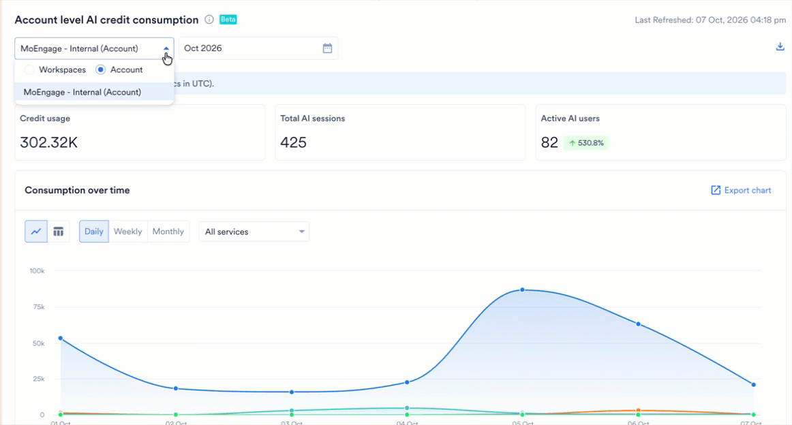
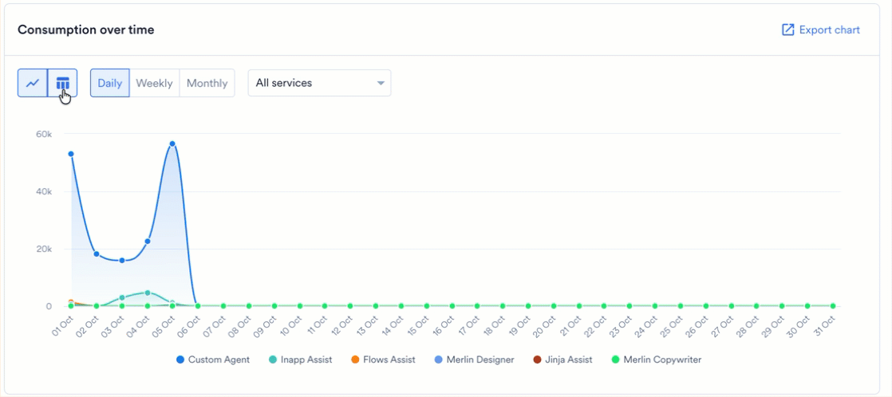
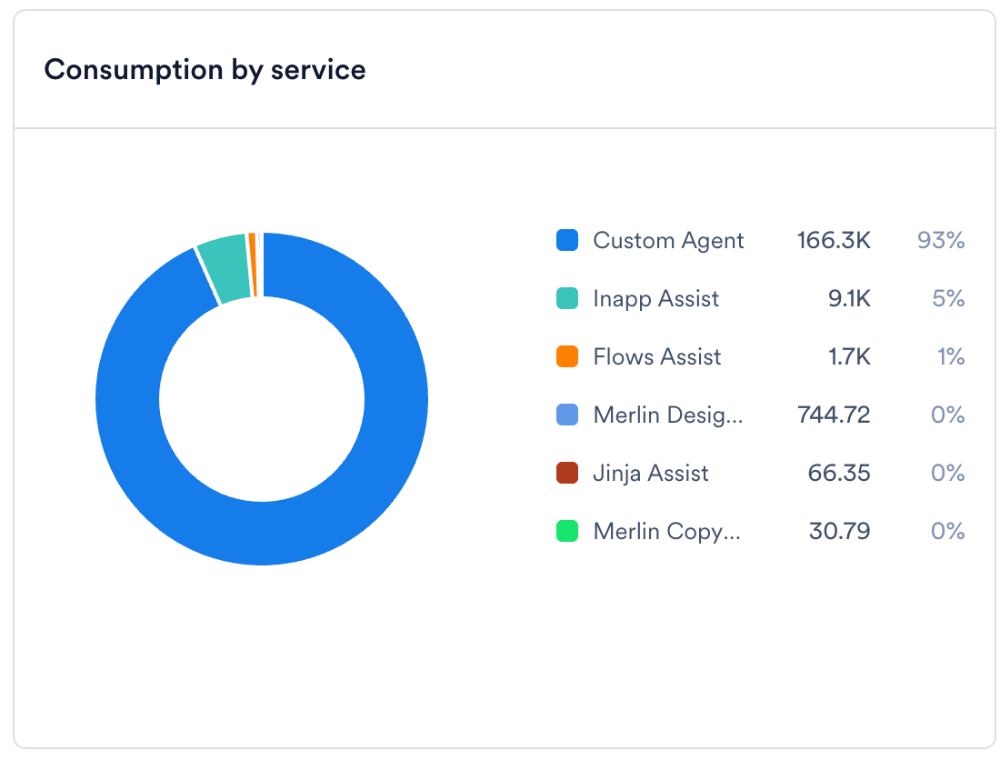
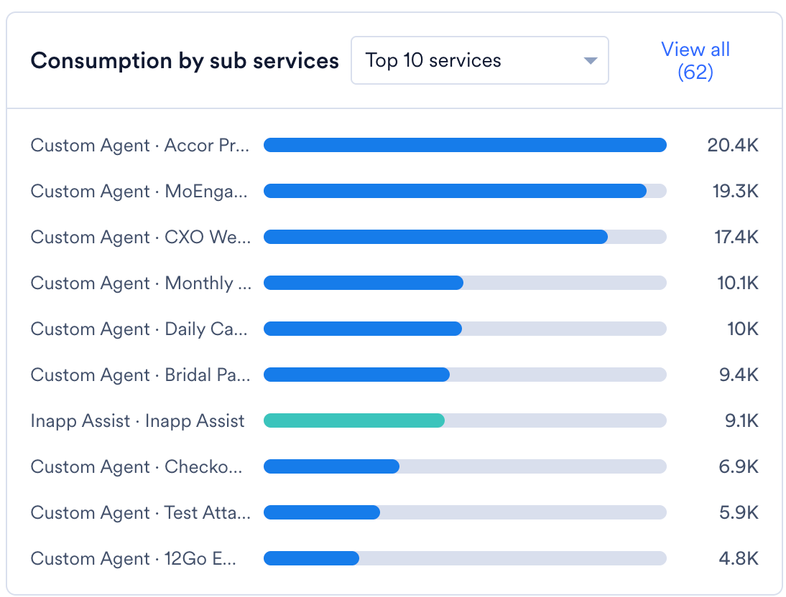
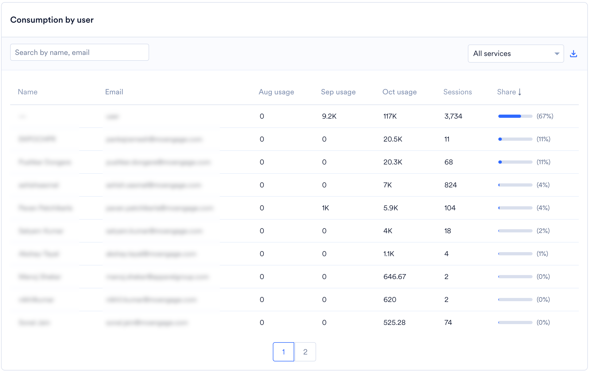

## 概要

MoEngage AI Credits は、ワークスペースでの Merlin AI の使用量を測定する単一の単位です。すべてのテキストバリエーション、生成されたクリエイティブ、エージェントの実行は、1 つの共有された月間クレジット残高から差し引かれます。

## クレジットを消費する機能

すべての Merlin AI 機能は、同じクレジット残高から差し引かれます。

| 機能 | 使用する場所 |
| --- | --- |
| [Merlin AI Copywriter](/ja/user-guide/ai-and-intelligence/merlin-ai/merlin-ai-copywriter/merlin-ai-copywriter) | Push キャンペーン、メールの件名、On-site Messaging キャンペーン、[Merlin AI Studio](/ja/user-guide/ai-and-intelligence/merlin-ai/merlin-ai-studio)。 |
| [Merlin AI Designer](/ja/user-guide/ai-and-intelligence/merlin-ai/merlin-ai-designer/merlin-ai-designer) | Push キャンペーン、メールの件名、On-site Messaging キャンペーン、Merlin AI Studio。 |
| [Merlin AI Jinja Assistant](/ja/user-guide/ai-and-intelligence/merlin-ai/merlin-ai-jinja-generator/merlin-ai-jinja-assistant) | すべてのキャンペーンでのパーソナライゼーション。 |
| [Merlin AI Segment Assist](/ja/user-guide/ai-and-intelligence/merlin-ai/merlin-ai-segment-assist) | セグメントの作成と Merlin AI Studio。 |
| [Merlin AI In-App Template Generator](/ja/user-guide/ai-and-intelligence/merlin-ai/merlin-ai-in-app-template-generator/merlin-ai-in-app-template-generator) | In-App キャンペーンと Merlin AI Studio。 |
| [Merlin AI Flows Assist](/ja/user-guide/ai-and-intelligence/merlin-ai/merlin-ai-flows-assist) | Flows と Merlin AI Studio。 |
| [Campaign Insights Agent](/ja/user-guide/ai-and-intelligence/merlin-ai/campaign-insights-agent) | Push キャンペーン、メールキャンペーン、On-site Messaging キャンペーン。 |
| [Custom Agents](/ja/user-guide/ai-and-intelligence/merlin-ai/custom-agents/custom-agents-overview) | すべてのエージェントの実行。エージェント名に対して記録されます。 |

### クレジットの要素

MoEngage は、完了した各セッションについて、そのセッションが使用したリソースに基づいてクレジットを記録します。各セッションには、複数のエージェントリクエストが関連付けられている場合があります。

- **テキスト生成:** MoEngage は、セッションが使用した入力トークンと出力トークンをカウントします。
- **画像生成:** MoEngage は、セッションが生成したアセットのサイズ（バイト単位）をカウントします。
- **エージェントの実行:** MoEngage は、モデルの処理時間、実行が使用したインフラストラクチャ、および実行時に行われた Web 検索をカウントします。

完了した各セッションは、セッションが終了するとすぐに残高を更新するため、チームは消費量を特定のユーザー、サービス、サブサービスに帰属させることができます。

<Note>
  Merlin AI は、出力を承認したときではなく、セッションが完了したときにクレジットを消費します。バリエーションを再生成したり、エージェントを再実行したりすると、再度クレジットが消費されます。
</Note>

## AI クレジットの消費量を表示する

MoEngage ダッシュボードの左側のナビゲーションメニューで、**Settings** > **Account** > **Billing** をクリックし、**Merlin AI** タブを選択します。

### サマリーメトリクス

メトリクスを確認する前に、スコープとレポート期間を設定します。

- **Scope:** スコープセレクターを開き、次のいずれかのオプションを選択します。
  - **Account:** アカウント全体の AI クレジットの消費量を表示します。
  - **Workspaces:** 選択したワークスペースの AI クレジットの消費量を表示します。**Select all** または **Clear all** を使用すると、選択をすばやく調整できます。
- **Month:** レポート対象の月を選択します。すべてのメトリクスは選択した月を反映し、前月と比較されるため、消費量が増加しているか減少しているかを確認できます。

メトリクスの上にある見出しで現在のスコープを確認でき、**Last Refreshed** のタイムスタンプには、MoEngage がデータを最後に更新した日時が表示されます。

<Frame>
  
</Frame>

#### セッションレベルのデータを確認する

個々の Merlin AI セッションすべてを網羅する生データのテーブルをエクスポートするには、ダウンロードアイコンをクリックします。テーブルには次の詳細が含まれます。

- セッションを作成したユーザー。
- セッションのサービスとサブサービス。
- セッションで消費されたクレジット。
- セッションのタイムスタンプ。

テーブルのフィルターを適用して、予期しない消費量の増加を調査します。

選択内容に基づいて、タブには次の 3 つのメトリクスが表示されます。

| メトリクス | 表示内容 |
| --- | --- |
| Credit usage | 総割り当て量に対する消費クレジット。プログレスバーで表示されます。 |
| Total AI sessions | Merlin AI セッションの数。 |
| Active AI users | Merlin AI を使用しているチームメンバーの数。 |

### 消費量を分析する

**Merlin AI** タブでは、消費量を次の 4 つのビューに分けて表示します。各ビューには、選択したスコープと月が反映されます。

<Tabs>
  <Tab title="Consumption over time">
    このビューでは、選択した期間のクレジット消費量がサービスごとに 1 系列ずつプロットされます。チャートの下にある凡例で各サービスを識別できます。次のコントロールを使用してチャートを設定します。

    - **Chart type:** 折れ線グラフと棒グラフを切り替えます。
    - **Granularity:** **Daily**、**Weekly**、**Monthly** から選択します。
    - **Service:** **All services** のままにするか、単一のサービスを選択してその消費量のみを表示します。

    チャートをダウンロードするには、**Export chart** をクリックします。

    <Frame>
      
    </Frame>
  </Tab>

  <Tab title="Consumption by service">
    このビューでは、クレジットを Merlin AI サービスごとにドーナツチャートで分割して表示します。サービスとは、Merlin Copywriter、Merlin Designer、Jinja Assist、Inapp Assist、Flows Assist、Custom Agent など、セッションを処理する Merlin AI 機能です。

    チャートの横にある凡例には、各サービスとその消費クレジット、および総消費量に占める割合が表示されます。

    <Frame>
      
    </Frame>
  </Tab>

  <Tab title="Consumption by sub services">
    このビューでは、サブサービスをクレジット消費量の順に棒グラフでランク付けします。サブサービスとは、Push キャンペーン、メールの件名、In-App キャンペーン、Merlin AI Studio など、サービスを使用する場所です。Custom Agent の場合、サブサービスはエージェント名です。

    各行にはサービスとサブサービスが示され、その組み合わせで消費されたクレジットが表示されます。ドロップダウンで表示する行数を制御でき、デフォルトは上位 10 件です。すべてのサブサービスを表示するには、**View all** をクリックします。

    <Frame>
      
    </Frame>
  </Tab>

  <Tab title="Consumption by user">
    このビューでは、すべてのユーザーと各ユーザーの消費クレジットを、次の列を含むテーブルで一覧表示します。

    - **Name** と **Email:** セッションを作成したユーザー。
    - **Monthly usage:** 選択した月の列と、その前の 2 か月それぞれの列があり、ユーザーの最近のアクティビティを比較できます。
    - **Sessions:** ユーザーが実行した Merlin AI セッションの数。
    - **Share:** 総消費量に占めるユーザーの割合。バーで表示されます。列見出しをクリックすると、テーブルを並べ替えることができます。

    特定のユーザーを検索するには、検索フィールドに名前またはメールアドレスを入力します。テーブルを 1 つのサービスに絞り込むには、サービスのドロップダウンを使用します。テーブルをダウンロードするには、エクスポートアイコンをクリックします。

    <Frame>
      
    </Frame>
  </Tab>
</Tabs>

## よくある質問

<AccordionGroup>
  <Accordion title="すべての Merlin AI 機能で同じ量のクレジットが使用されますか？">
    いいえ。セッションのクレジットは、テキスト生成で消費されたトークンや、セッションで生成された画像のサイズなど、そのセッションが使用したリソースを反映します。サービス間のコストを比較するには、セッションレベルのテーブルを確認してください。
  </Accordion>

  <Accordion title="このタブのデータはどのくらい最新ですか？">
    MoEngage は、セッションが終了するとすぐに各セッションを残高に記録するため、消費量はその後まもなくこのタブに表示されます。
  </Accordion>

  <Accordion title="どのチームメンバーが最も多くのクレジットを消費しているかを確認できますか？">
    はい。**Merlin AI** タブには、すべてのユーザーと、選択した期間に各ユーザーが消費したクレジットが一覧表示されます。また、セッションレベルのテーブルでは、個々のセッションがユーザーに帰属されます。
  </Accordion>
</AccordionGroup>

## 関連記事

- [Merlin AI Studio](/ja/user-guide/ai-and-intelligence/merlin-ai/merlin-ai-studio)
- [Custom Agents: 概要](/ja/user-guide/ai-and-intelligence/merlin-ai/custom-agents/custom-agents-overview)
- [使用量の詳細](/ja/user-guide/settings/account/billing/usage-details)
- [サブスクリプションの管理](/ja/user-guide/settings/account/billing/manage-subscription)
- [請求と契約に関するよくある質問](/ja/user-guide/settings/account/billing/billing-and-contract-faqs)
