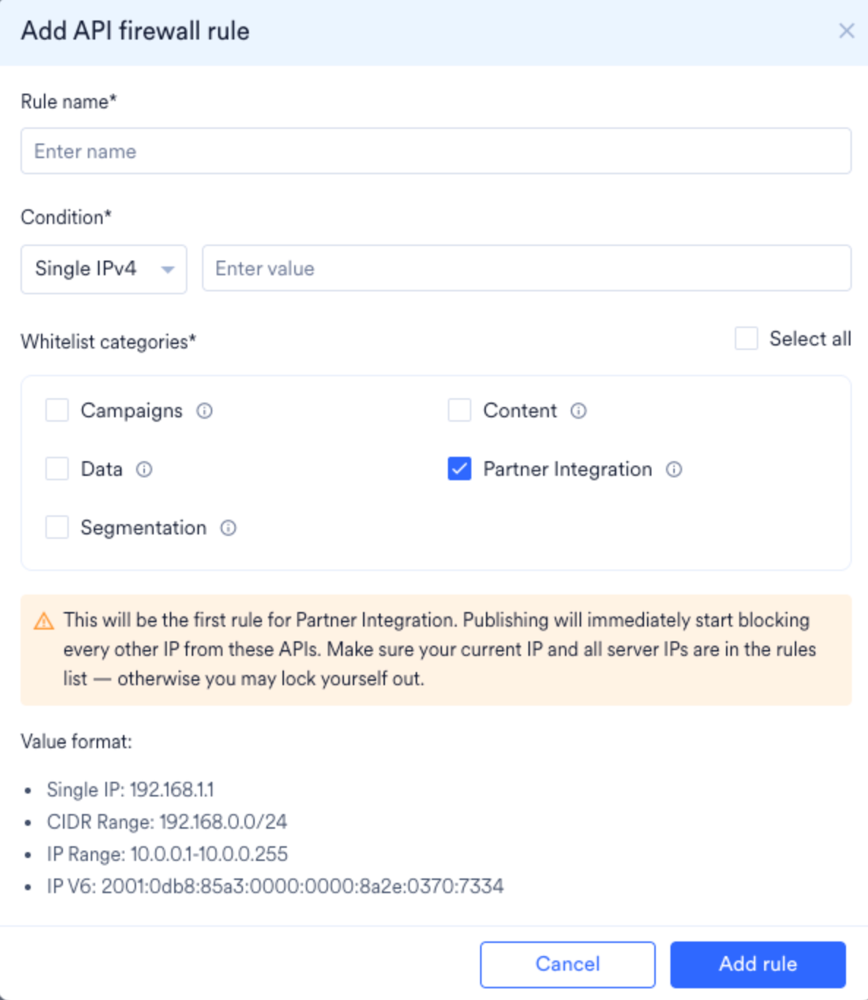
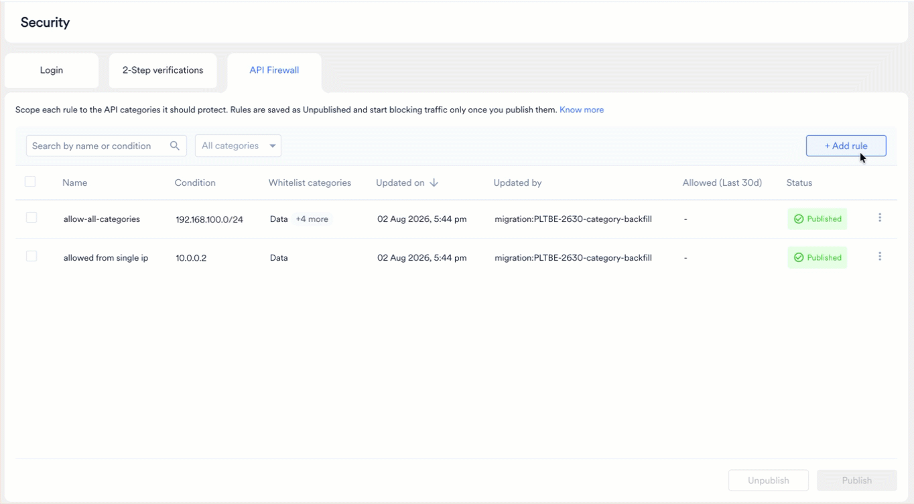
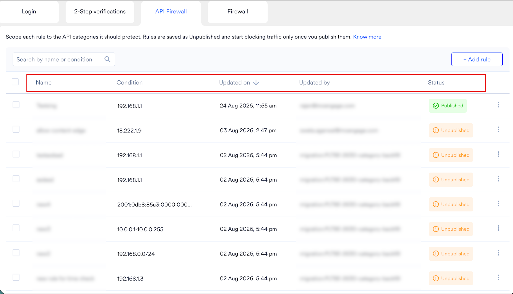
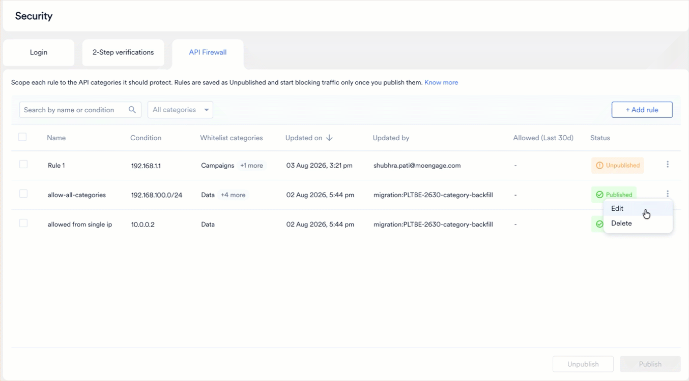
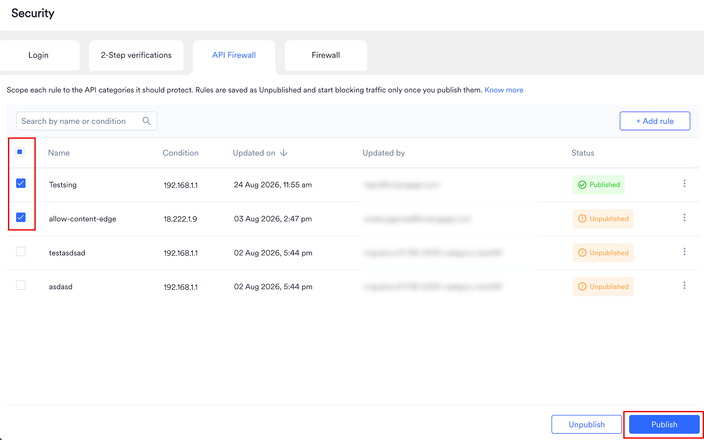
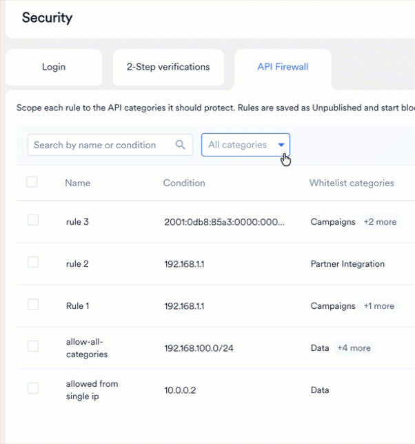
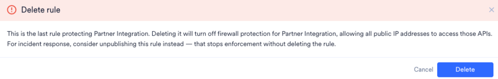

API Firewall を使用すると、MoEngage API にリクエストを送信できる IP アドレスを制御できます。API キーが漏洩または盗難にあった場合でも、API Firewall はホワイトリストにない IP アドレスからのリクエストを拒否します。各ルールは 1 つ以上の API カテゴリをホワイトリストに登録するため、設定していないカテゴリに影響を与えることなく、API の特定の部分へのアクセスを制限できます。

これらのルールが適用される API キーの作成とスコープ設定については、[API Key Dashboard](/ja/user-guide/settings/account/api-and-api-keys/api-key-dashboard) を参照してください。

<Info>
API Firewall は、次の API カテゴリに適用されます: **Data**、**Segmentation**、**Campaigns**、**Partner Integration**、**Content**。すべてのルールで、少なくとも 1 つのカテゴリをホワイトリストに登録する必要があります。
</Info>

## 仕組み

デフォルトでは、API Firewall は無効です。カテゴリを対象とするルールを公開するまで、MoEngage はそのカテゴリの API へのリクエストを任意の IP アドレスから受け付けます。適用はカテゴリごとに行われます。ルールを公開すると、そのルールが対象とするカテゴリのみが保護され、他のすべてのカテゴリはオープンなままです。

各ルールには、ホワイトリストに登録するカテゴリと公開ステータスという 2 つの独立したプロパティがあります。トラフィックに影響するのは公開されたルールのみです。ルールを保存しただけでは適用されません。

| ルールのステータス | 効果 |
| --- | --- |
| **Unpublished** | 新規作成および編集されたルールのデフォルトステータスです。保存されますが、適用されません。 |
| **Published** | 明示的な別のアクションです。MoEngage は、ルールが対象とするすべてのカテゴリに対して IP 制限の適用を開始します。そのカテゴリを対象とする公開済みルールのいずれにも含まれない IP アドレスからのリクエストには、`403` レスポンスが返されます。 |

## API カテゴリ

API Firewall は、API エンドポイントを 5 つの固定カテゴリに分類します。このリストの名前を変更したり、項目を追加したりすることはできません。ルールを作成または編集する際は、そのルールでホワイトリストに登録するすべてのカテゴリを選択してください。

### Data

| サブカテゴリ | API 名 | 説明 |
| --- | --- | --- |
| User Management | [Track User](/ja/api/user/track-user), [Get User](/ja/api/user/get-user), [Merge Users](/ja/api/user/merge-users), [Delete Users](/ja/api/user/delete-users) | ユーザープロファイルの作成、更新、取得、マージ、削除を行います。 |
| Event Tracking | [Track Event](/ja/api/event/track-event) | カスタムユーザーイベントを追跡します。 |
| Bulk Import | [Bulk Import Users & Events](/ja/api/bulk/bulk-import-users-and-events) | ユーザーデータとイベントデータを一括でインポートします。 |
| Device Management | [Track Device](/ja/api/device/track-device), [Device Opt-out](/ja/api/device/device-opt-out) | ユーザーデバイスを作成または更新し、デバイスを通知からオプトアウトします。 |
| GDPR / CCPA | [Submit GDPR / CCPA Data Request](/ja/api/gdpr/submit-a-gdpr-ccpa-data-request) | データ削除またはデータポータビリティのリクエストを送信します。 |
| Analytics | [List Dashboards](/ja/api/dashboards/list-dashboards), [Get Dashboard Charts](/ja/api/dashboards/get-dashboard-charts), [Get Chart Data](/ja/api/dashboards/get-chart-data) | ダッシュボードを一覧表示し、ダッシュボードとチャートのデータを取得します。 |

### Segmentation

| サブカテゴリ | API 名 | 説明 |
| --- | --- | --- |
| File Segments | [Create File Segment](/ja/api/file-segments/create-file-segment), [Add Users to File Segment](/ja/api/file-segments/add-users-to-file-segment), [Remove Users from File Segment](/ja/api/file-segments/remove-users-from-file-segment), [Replace Users in File Segment](/ja/api/file-segments/replace-users-from-file-segment) | ファイルベースのセグメントを作成し、ユーザーの追加、削除、置換を行います。 |
| Filter Segments | [List Segments](/ja/api/filter-segments/list-segments), [Create Filter Segment](/ja/api/filter-segments/create-filter-segment), [Get Segment by ID](/ja/api/filter-segments/get-segment-by-id), [Update Filter Segment](/ja/api/filter-segments/update-filter-segment) | フィルターベースのセグメントの一覧表示、作成、取得、更新を行います。 |
| Manage Segments | [Archive Segment](/ja/api/manage-segments/archive-segment), [Unarchive Segment](/ja/api/manage-segments/unarchive-segment) | カスタムセグメントをアーカイブまたはアーカイブ解除します。 |

### Campaigns

| サブカテゴリ | API 名 | 説明 |
| --- | --- | --- |
| Campaign Management | [Create Campaign](/ja/api/create-campaigns/create-campaign), [Update Campaign](/ja/api/update-campaigns/update-campaign-v1-legacy), [Change Campaign Status](/ja/api/update-campaigns/change-campaign-status), [Update Global Control Group](/ja/api/update-campaigns/update-global-control-group), [Search Campaigns](/ja/api/get-campaign-details/search-campaigns), [Get Campaign Meta](/ja/api/get-campaign-details/get-campaign-meta-v1-legacy), [Get Child Campaigns](/ja/api/get-campaign-details/get-child-campaigns) | Push キャンペーンと Email キャンペーンの作成、更新、検索、ステータス変更を行い、グローバルコントロールグループを管理します。 |
| Testing | [Test Campaign](/ja/api/test-campaigns/test-campaign), [Personalized Preview](/ja/api/test-campaigns/personalized-preview) | キャンペーンのテスト版を送信し、ユーザー向けにパーソナライズされたキャンペーンコンテンツをプレビューします。 |
| Stats & Reports | [Get Campaign Stats](/ja/api/stats/get-campaign-stats), [Download Campaign Report](/ja/api/campaign-reports/download-campaign-report) | キャンペーンのパフォーマンス統計を取得し、キャンペーンレポートファイルをダウンロードします。 |
| Business Events | [Create Business Event](/ja/api/business-events/create-business-event), [Trigger Business Event (Legacy)](/ja/api/business-events/trigger-business-event), [Search Business Events (Legacy)](/ja/api/business-events/search-business-events), [Trigger Business Event (V5)](/ja/api/business-events/trigger-business-event-v5), [List Business Events](/ja/api/business-events/list-business-events), [Search Business Events (V5)](/ja/api/business-events/search-business-events-v5) | 自動化されたキャンペーンを動かすビジネスイベントの定義、トリガー、検索を行います。 |
| Subscriptions | [Bulk Resubscribe Users](/ja/api/resubscribe/bulk-resubscribe-users), [Update User Email Opt-in Preferences](/ja/api/opt-in-management/update-user-email-opt-in-preferences), [Get Subscription Preferences](/ja/api/subscription-preferences/get-subscription-preferences), [Update Subscription Preferences](/ja/api/subscription-preferences/update-subscription-preferences), [Bulk Update Subscription Preferences](/ja/api/subscription-preferences/bulk-update-subscription-preferences), [Get Subscription Categories (V5)](/ja/api/subscription-categories/get-subscription-categories-v5), [Get Subscription Preferences (V5)](/ja/api/subscription-preferences/get-subscription-preferences-v5), [Update Subscription Preferences (V5)](/ja/api/subscription-preferences/update-subscription-preferences-v5) | 一括更新を含め、ユーザーのメールオプトインステータスと購読カテゴリの設定を管理します。 |
| Push | [Send Push Notification (V5)](/ja/api/push/push-api) | Android、iOS、Web、または Windows にトランザクションプッシュ通知を送信します。 |
| Cards | [Fetch Cards for User](/ja/api/cards/fetch-cards-for-user), [Delete Cards for User](/ja/api/cards/delete-cards-for-user) | ユーザーの App Inbox カードを取得または削除します。 |
| Inform | [Send Transactional Alert](/ja/api/transactional-alerts/send-transactional-alert) | SMS、メール、またはプッシュでトランザクションアラートを送信します。 |
| Live Activities | [Start Broadcast Live Activity](/ja/api/live-activities/start-broadcast-live-activity), [Update Broadcast Live Activity](/ja/api/live-activities/update-broadcast-live-activity), [End Broadcast Live Activity](/ja/api/live-activities/end-broadcast-live-activity) | iOS の Live Activity を開始、更新、終了します。 |
| Personalize | [Fetch Experience](/ja/api/experiences/fetch-experience), [Fetch Experience Metadata](/ja/api/experiences/fetch-experience-metadata), [Track Experience Events](/ja/api/events/track-experience-events) | パーソナライズされたエクスペリエンスとそのメタデータを取得し、それらに対するユーザーのインタラクションを追跡します。 |
| Message Archival | [View Archived Message](/ja/api/message-archival/view-archived-message) | ユーザーのアーカイブされたメッセージを取得して表示します。 |
| Flows | [Flows Search](/ja/api/flows/search-flows), [Get Specific Flow](/ja/api/flows/get-a-single-flow), [Get Specific Version](/ja/api/flows/get-a-specific-version-of-a-flow), [Flow Status Update](/ja/api/flows/update-flow-status) | フローを検索し、フローまたは特定のフローバージョンを取得し、フローのステータスを更新します。 |

<Note>
  API Firewall は [Send Push Notification (v2, Legacy)](/ja/api/push/push-api-v2-legacy) (v2) API をサポートしておらず、この API には IP ホワイトリストルールは適用されません。IP アドレスでプッシュリクエストを制限するには、[Send Push Notification (V5)](/ja/api/push/push-api) を使用してください。API Firewall は [Send Transactional Alert](/ja/api/transactional-alerts/send-transactional-alert) (Inform) API をサポートしていますが、適用除外となっている一部のアカウントは例外です。ご自身のアカウントが適用除外の対象と思われる場合は、MoEngage のカスタマーサクセスマネージャー (CSM) またはサポートチームにお問い合わせください。
</Note>

### Partner Integration

| サブカテゴリ | API 名 | 説明 |
| --- | --- | --- |
| Cohort Sync | [Sync Cohort Members](/ja/api/cohort-sync/sync-cohort-members) | サードパーティの分析ツールからコホートオーディエンスを同期します。 |
| File Import | [Trigger File Imports](/ja/api/file-import/trigger-file-imports), [Get Import Details](/ja/api/file-import/import-details), [Import File Run History](/ja/api/file-import/import-file-run-history) | パートナー向けのファイルインポートをトリガーし、そのステータスと実行履歴を確認します。 |
| App Install | [Track App Install](/ja/api/tracking/track-app-install) | アプリのインストール情報を取得または追跡します。 |
| Utilities | [Test Connection API](/ja/api/utilities/test-connection-api) | API 認証情報を検証し、ワークスペースへの接続をテストします。 |

### Content

| サブカテゴリ | API 名 | 説明 |
| --- | --- | --- |
| In-App Templates | [Create In-App Template](/ja/api/in-app-templates/create-in-app-template), [Update In-App Template](/ja/api/in-app-templates/update-in-app-template), [Search In-App Templates](/ja/api/in-app-templates/search-in-app-templates) | In-App メッセージテンプレートの作成、更新、検索を行います。 |
| OSM Templates | [Create OSM Template](/ja/api/osm-templates/create-osm-template), [Update OSM Template](/ja/api/osm-templates/update-osm-template), [Search OSM Templates](/ja/api/osm-templates/search-osm-templates) | On-Site Message テンプレートの作成、更新、検索を行います。 |
| SMS Templates | [Create SMS Template](/ja/api/sms-templates/create-sms-template), [Update SMS Template](/ja/api/sms-templates/update-sms-template), [Search SMS Templates](/ja/api/sms-templates/search-sms-templates) | SMS テンプレートの作成、更新、検索を行います。 |
| Email Templates | [Create Email Template (V1)](/ja/api/email-templates/create-email-template-v1), [Get All Email Templates](/ja/api/email-templates/get-all-templates), [Get Specific Email Template](/ja/api/email-templates/get-specific-template), [Update Email Template (V1)](/ja/api/email-templates/update-specific-template), [Search Email Template](/ja/api/email-templates/search-email-template), [Create Email Template (V2)](/ja/api/email-templates/create-email-template-v2), [Update Email Template (V2)](/ja/api/email-templates/update-email-template), [Bulk Create/Update Email Templates](/ja/api/email-templates/bulk-createupdate-templates) | メールテンプレートの作成、取得、更新、検索を行います。 |
| Push Templates | [Create Push Template](/ja/api/templates/create-push-template), [Update Push Template](/ja/api/templates/update-push-template), [Search Push Templates](/ja/api/templates/search-for-push-templates) | プッシュ通知テンプレートの作成、更新、検索を行います。 |
| Content Blocks | [Create Content Block](/ja/api/content-blocks/create-content-block), [Update Content Block](/ja/api/content-blocks/update-content-block), [Get Specific Content Blocks](/ja/api/content-blocks/get-specific-content-blocks), [Search Content Blocks](/ja/api/content-blocks/search-content-blocks) | 再利用可能なコンテンツブロックの作成、更新、取得、検索を行います。 |
| Recommendations | [Fetch All Recommendations](/ja/api/recommendations/fetch-all-recommendations), [Fetch Recommendation Details](/ja/api/recommendations/fetch-recommendation-details), [Fetch Recommendation Results](/ja/api/recommendations/fetch-recommendation-results) | ユーザー向けの製品またはコンテンツのレコメンデーションのメタデータと結果を取得します。 |
| Coupon Lists | [Create Coupon List](/ja/api/coupon-lists/create-a-coupon-list), [Fetch All Coupon Lists](/ja/api/coupon-lists/fetch-all-coupon-lists), [Fetch Coupon List Details](/ja/api/coupon-lists/fetch-coupon-list-details), [Update Coupon List](/ja/api/coupon-lists/update-a-coupon-list), [Activate Coupon List](/ja/api/coupon-lists/activate-coupon-list), [Archive Coupon List](/ja/api/coupon-lists/archive-a-coupon-list) | クーポンリストの作成、取得、更新、有効化、アーカイブを行います。 |
| Coupon Files | [Upload Coupon File](/ja/api/coupon-files/upload-a-coupon-file-to-the-coupon-list), [Fetch All Coupon Files](/ja/api/coupon-files/fetch-all-coupon-files-from-coupon-list), [Delete Coupon File](/ja/api/coupon-files/delete-a-coupon-file-from-the-coupon-list) | クーポンリスト内のクーポンファイルのアップロード、取得、削除を行います。 |
| Coupon Reports | [Generate Usage Report](/ja/api/reports/generate-usage-report) | クーポンリストの使用状況レポートを生成します。 |
| Catalog | [Create Catalog](/ja/api/catalog/create-catalog), [Add Catalog Attributes](/ja/api/catalog/add-catalog-attributes), [Add Items (Ingest)](/ja/api/items/add-items), [Get Items](/ja/api/items/get-items), [Update Items](/ja/api/items/update-items), [Delete Items](/ja/api/items/delete-items) | カタログを作成し、カタログ属性とアイテムの追加、取得、更新、削除を行います。 |
| Offerings | [List Offerings](/ja/api/public-offerings/list-offerings), [Create Offering](/ja/api/public-offerings/create-offering), [Update Offering](/ja/api/public-offerings/update-offering), [List Offer Templates](/ja/api/public-offerings/list-offer-templates) | オファリングの一覧表示、作成、更新を行い、Offer Decisioning で利用可能なテンプレートを一覧表示します。 |

## パートナー連携への影響

MoEngage がパートナーのインフラストラクチャから呼び出しを受けるすべての連携が影響を受けます。これらの連携のいずれかが使用するカテゴリのルールを公開する場合は、パートナーの IP アドレスをそれらのルールに追加してください。追加しない場合、MoEngage はパートナーのリクエストを `403` レスポンスで拒否します。影響を受けるパートナー連携は次のとおりです。

| パートナー名 | IP ホワイトリスト登録は必要か | スコープ | 必要なアクション |
| --- | --- | --- | --- |
| [Salesforce Sales CRM](/ja/partner-guide/data-and-analytics/crm/salesforce-crm-native/overview) | はい | Data | パートナーの IP 範囲を取得し、ホワイトリストに追加 |
| [Hightouch](/ja/partner-guide/data-and-analytics/cdps/hightouch) | はい | Data | パートナーの IP 範囲を取得し、ホワイトリストに追加 |
| [RudderStack](/ja/partner-guide/data-and-analytics/cdps/rudderstack/moengage-destination) | はい | Data | パートナーの IP 範囲を取得し、ホワイトリストに追加 |
| [Salla](/ja/partner-guide/commerce-and-loyalty/e-commerce/salla) | はい | Data | パートナーの IP 範囲を取得し、ホワイトリストに追加 |
| [Zapier](/ja/partner-guide/data-and-analytics/workflow-automation/zapier/overview) | はい | Data | パートナーの IP 範囲を取得し、ホワイトリストに追加 |
| [Amplitude (イベント同期)](/ja/partner-guide/data-and-analytics/analytics/amplitude/amplitude-event-streaming) | はい | Data | パートナーの IP 範囲を取得し、ホワイトリストに追加 |
| [AppsFlyer Audiences](/ja/partner-guide/data-and-analytics/install-attribution/appsflyer/appsflyer-audience) | はい | Data | パートナーの IP 範囲を取得し、ホワイトリストに追加 |
| [Microsoft Dynamics 365](/ja/partner-guide/data-and-analytics/crm/microsoft-dynamics-365-sales/microsoft-dynamics-365-sales) | はい | Data | パートナーの IP 範囲を取得し、ホワイトリストに追加 |
| [Mixpanel](/ja/partner-guide/data-and-analytics/analytics/mixpanel) | はい | Cohort APIs | パートナーの IP 範囲を取得し、ホワイトリストに追加 |
| [Amplitude](/ja/partner-guide/data-and-analytics/analytics/amplitude/amplitude-audiences) | はい | Cohort APIs | パートナーの IP 範囲を取得し、ホワイトリストに追加 |
| [Salesforce Marketing Cloud](/ja/partner-guide/message-orchestration/marketing-cloud/salesforce-marketing-cloud-sfmc/overview) | はい | Data, Campaigns | パートナーの IP 範囲を取得し、ホワイトリストに追加 |
| [AEM](/ja/partner-guide/personalize-and-optimize/dynamic-content/adobe-experience-manager/syncing-experience-fragments-as-content-blocks) | はい | Content | パートナーの IP 範囲を取得し、ホワイトリストに追加 |
| [Segment](/ja/partner-guide/data-and-analytics/cdps/twillio-segment/getting-started/overview) | いいえ | – | – |
| [mParticle](/ja/partner-guide/data-and-analytics/cdps/mparticle/getting-started/overview) | いいえ | – | – |
| [Adobe RT CDP](/ja/partner-guide/data-and-analytics/cdps/adobe-real-time-cdp/overview) | いいえ | – | – |
| Connected sources (Punchh、RevenueCat、Unbounce など) | いいえ | – | – |

<Note>
  Connected Segments (旧称 Outbound Segment Sync)、Streams、または Connector Campaigns を使用して MoEngage ワークスペースにデータを送信する場合は、MoEngage の IP アドレスをそのワークスペースのルールに追加してください。IP アドレスの一覧については、[MoEngage の IP ホワイトリスト](/ja/user-guide/settings/account/security/ip-whitelisting-in-moengage)を参照してください。
</Note>

## ユースケース

- **大規模なチームを持つワークスペースの保護:** 多数の API ユーザーを抱える組織は、ホワイトリストに登録されたサーバーの IP アドレスにアクセスを制限できます。チームメンバーが API キーを持ったまま退職した場合でも、承認されていない IP アドレスからのリクエストは拒否されます。
- **漏洩した認証情報からの保護:** API キーがパブリックリポジトリで公開された場合でも、API Firewall は有効な認証情報が提示されたとしても、ホワイトリストにない IP アドレスからのリクエストを拒否します。
- **非本番環境の分離:** ステージングワークスペースで、内部の自動化ネットワークや QA テストツール向けのワークスペース固有のホワイトリストルールを作成し、テストトラフィックを本番データから分離できます。
- **特定のカテゴリへの保護範囲の限定:** 段階的なロールアウトや移行の間、Partner Integration や Segmentation など機密性の高い単一のカテゴリに IP 制限を適用し、他のカテゴリには適用しないままにできます。

## API Firewall への移動

1. MoEngage ダッシュボードの左側のナビゲーションメニューで、**Settings** \> **Account** \> **Security** をクリックします。
2. **Security** ページで、**API firewall** タブを選択します。
3. **API firewall** ページで、**Enable API Firewall** を選択します。[Add API Firewall Rule](#add-new-api-firewall-rule) ダイアログボックスが開きます。

<Info>
  API Firewall ルールを追加するには、MoEngage ワークスペースの Admin である必要があります。詳細については、[Access Roles](/ja/user-guide/settings/account/team-management/access-roles) を参照してください。
</Info>

## API Firewall ルールの作成と公開

<Note>
  ルールを設定する前に、DevOps チームまたはセキュリティチームから、サーバーで使用されている静的 IP アドレスと CIDR ブロックの完全なリストを入手してください。
</Note>

### 新しい API Firewall ルールの追加

1. **Add API firewall rule** ダイアログボックスで、次の詳細を入力します。
   - **Rule name:** わかりやすい名前を入力します (たとえば、"Internal Corporate Network" や "AWS Production Server")。
   - **Whitelist categories:** このルールでホワイトリストに登録する API カテゴリを 1 つ以上選択します。**Data**、**Segmentation**、**Campaigns**、**Partner Integration**、**Content** から選択できます。少なくとも 1 つのカテゴリを選択する必要があります。
   - **Condition:** ドロップダウンメニューから IP アドレスの種類を選択します。

     | 条件 | 説明 |
     | --- | --- |
     | **Single IPv4** | 特定の IPv4 アドレスを許可します (たとえば、`192.168.1.1`)。 |
     | **Single IPv6** | 特定の IPv6 アドレスを許可します。 |
     | **CIDR Range IPv4** | CIDR 表記のネットワークアドレスとサブネットマスクで定義された IPv4 アドレスのブロックを許可します (たとえば、`192.168.0.0/24`)。IP ブロックが CIDR の境界に揃っている場合に使用します。 |
     | **CIDR Range IPv6** | CIDR 表記の IPv6 アドレスのブロックを許可します。 |
     | **IPv4 Range** | 開始アドレスと終了アドレスで指定された連続した IPv4 アドレスの範囲を許可します (たとえば、`192.168.1.0 - 192.168.1.255`)。IP ブロックが CIDR の境界に揃っていない場合に使用します。 |
   - **Value:** 例に示されている形式で、IP アドレス、CIDR 範囲、または開始 IP アドレスと終了 IP アドレスを入力します。

<Warning>
  **このカテゴリの最初のルール**

  この警告は、公開済み・未公開を問わず、他のルールが対象としていないカテゴリを選択するとすぐにインラインで表示されます。このルールを公開すると、約 15 分以内にそのカテゴリに IP 制限が適用され、ホワイトリストにある IP 以外のすべての IP がブロックされることを警告し、誤ってロックアウトされないよう、現在の IP とすべてのサーバー IP が含まれていることを確認するよう促します。カテゴリの選択を変更するとリアルタイムで更新されるため、保存する前に結果を確認できます。
  
</Warning>

2. **Add rule** を選択します。最初のルールを保存すると、MoEngage は API firewall のリストページにリダイレクトします。さらにルールを追加するには、リストページの右上にある **+ Add rule** を選択します。

<Info>
  **ルールは Unpublished として保存されます**

  保存したルールは記録されますが、まだ適用されていません。現在、そのルールが対象とするカテゴリのトラフィックは制限されていません。承認されたシステムのアクセスが中断されないように、公開する前に必要なすべてのサーバー IP を追加してください。公開されると、MoEngage はこのルールが対象とするカテゴリへのリクエストをホワイトリストに登録された IP アドレスからのみ受け付け、それ以外のすべてに対して `403` エラーを返します。
</Info>

### ルールの公開

ルールを公開すると、ルールが有効になり、対象とするすべてのカテゴリに IP 制限が適用されます。すべてのルールを一度に公開することも、一部のルールを選択して公開することもできます。

1. 有効にする各未公開ルールの横にあるチェックボックスを選択します。
2. 画面下部の **Publish** を選択します。
3. 確認ダイアログボックスで、カテゴリの最初のルールに関する警告を含む通知を確認し、**Publish** を選択して確定します。

ルールのステータスが **Published** に変わります。MoEngage は、このルールが対象とするすべてのカテゴリへのリクエストを、公開済みルールに一致する IP アドレスからのみ受け付けるようになります。その他すべてのアドレスからのリクエストには `403` レスポンスが返されます。

<Note>
  一部のルールのみを公開した場合、残りの未公開ルールのみが対象とするカテゴリには制限が適用されないままです。それらのカテゴリへのリクエストは、対象ルールを公開するまで任意の IP アドレスから引き続き受け付けられます。
</Note>

### ルールの詳細とアクティビティの表示

API firewall ページには、各ルールについて次の情報が表示されます。

| 列 | 説明 |
| --- | --- |
| **Name** | ルールに割り当てられたわかりやすい名前です。 |
| **Whitelist categories** | このルールでホワイトリストに登録されている API カテゴリです (たとえば、Data、または Segmentation と Campaigns)。 |
| **Condition** | ルールに適用される IP アドレスの種類です (たとえば、Single IPv4 や CIDR Range IPv4)。 |
| **Updated on** | ルールが最後に更新された日時です。 |
| **Updated by** | ルールを最後に編集または変更したユーザーのメールアドレスです。 |
| **Status** | ルールの現在の適用状態です: **Published** または **Unpublished**。 |
| **Actions** (省略記号アイコン) | 省略記号アイコンをクリックすると、ルールを編集または削除するオプションにアクセスできます。 |

## API Firewall ルールの管理

### 既存のルールの編集

1. **API firewall** ページで、変更するルールの省略記号アイコンをクリックします。
2. **Edit** をクリックします。**Edit API Firewall Rule** ダイアログボックスが開きます。
3. 必要に応じて、**Rule name**、**Whitelist categories**、**Condition**、または **Value** を更新します。

<Warning>
  **編集中の警告**

  - **このカテゴリの最初のルール:** 現在他のルールが対象としていないカテゴリを追加すると、[新しい API Firewall ルールの追加](#add-new-api-firewall-rule) で説明したものと同じ最初のルールの警告がエディターに表示されます。
  
  - **このカテゴリの最後のルール:** この警告は、現在 **Published** であり、1 つ以上のカテゴリを対象とする唯一の公開済みルールを編集している場合にのみ表示されます。たとえば、編集によってルールからカテゴリを削除する場合などです。この警告は、この編集を公開すると、それらのカテゴリのファイアウォール保護が無効になることを示します。
</Warning>

4. **Save** を選択します。編集したルールは **Unpublished** として保存されます。変更を適用するには **Publish** を選択してください。

### カテゴリによるルールのフィルタリング

ルールリストをフィルタリングして、特定の API カテゴリを対象とするルールのみを表示できます。API Firewall ページで、カテゴリを選択すると、そのカテゴリをホワイトリストに登録しているすべてのルールが表示されます。

### ルールの非公開または削除

- **非公開にするには:** チェックボックスを使用して有効なルールを選択し、画面下部の **Unpublish** を選択します。確認ダイアログが表示されます。**Unpublish** を選択して確定します。ルールはリストに残りますが、適用されなくなります。

<Warning>
  **非公開の確認モーダル**

  ルールを非公開にすると、ルールが対象とするカテゴリを示す確認モーダルが表示されます。このモーダルは、このルールを非公開にするとそのカテゴリの IP のブロックが停止されることを警告し、カテゴリのすべてのルールが非公開になるとファイアウォール保護が無効になり、すべての IP がそのカテゴリの API にアクセスできるようになることを通知します。
</Warning>

- **削除するには:** ルールの省略記号アイコンをクリックし、**Delete** を選択して、ダイアログボックスで削除を確定します。削除されたルールはリストから完全に削除されます。

<Warning>
  **カテゴリの最後の公開済みルールの削除**

  削除しようとしているルールが **Published** であり、1 つ以上のカテゴリを対象とする唯一の公開済みルールである場合、確認モーダルが開きます。このモーダルには影響を受けるカテゴリが一覧表示され、このルールを削除するとそれらのカテゴリのファイアウォール保護が無効になることが警告されます。また、後でルールを復元する必要がある可能性がある場合は、代わりにルールを非公開にすることが提案されます。
  
</Warning>

## FAQ

<AccordionGroup>

<Accordion title="公開する前にすべての IP ルールを追加すべきなのはなぜですか?">
  ルールを公開すると、約 15 分以内にそのルールが対象とするすべてのカテゴリに適用されます。2 つのカテゴリにまたがる 3 つのサーバー IP があり、それらを 1 つずつ公開した場合、カテゴリに有効なルールがないサーバーは、そのルールが公開されて反映されるまで `403` エラーを受け取る可能性があります。承認されたシステムのサービス中断を防ぐため、まずすべてのルールを **Unpublished** ステータスで追加し、次にすべてを選択してまとめて公開してください。
</Accordion>

<Accordion title="1 つのルールで複数のカテゴリを対象にできますか?">
  はい。ルールを作成または編集する際に、**Whitelist categories** フィールドで複数のカテゴリを選択します。ルールは選択したすべてのカテゴリに適用されます。
</Accordion>

<Accordion title="API Firewall はモバイルアプリやウェブサイトの SDK トラフィックに影響しますか?">
  いいえ。API Firewall は、サポートされているカテゴリにおけるサーバー間の API トラフィックに適用されます。エンドユーザーのモバイル SDK や Web SDK のトラフィックには影響しません。
</Accordion>

<Accordion title="ブロックされたシステムは、ブロックされたことをどのように知るのですか?">
  ファイアウォールがリクエストをブロックしても、MoEngage はダッシュボード通知を送信しません。ブロックされたシステムは、API レスポンスで直接 `403` エラーを受け取ります。ダッシュボードのステータス列には、各ルールの現在の公開済みまたは未公開の状態が反映されます。
</Accordion>

<Accordion title="公開時に誤ってサーバーの IP を除外してしまった場合はどうなりますか?">
  API Firewall は、該当するカテゴリの有効なルールに含まれていない IP アドレスからのリクエストを、自社のサーバーからのものも含めて拒否します。誤ったロックアウトを防ぐため、**Publish** を選択する前に、承認されたすべてのサーバー IP がルールに含まれていることを確認してください。エディターの最初のルールの警告により、そのルールが最初の有効なルールとなるカテゴリが示されます。
</Accordion>

<Accordion title="ルールでワイルドカードや完全修飾ドメイン名 (FQDN) を使用できますか?">
  いいえ。API Firewall は、ネットワーク層の IP 識別子を使用してリクエストを評価します。ルールでは、単一の IP アドレスまたは CIDR 範囲を指定する必要があります。ドメイン名はサポートされていません。
</Accordion>

<Accordion title="API Firewall で内部障害が発生した場合はどうなりますか?">
  API Firewall はフェイルオープンになるように設計されています。内部障害が発生した場合、システムは正当なリクエストをブロックするのではなく API トラフィックを通過させ、データ収集の継続性を維持します。
</Accordion>

</AccordionGroup>

## 次のステップ

API Firewall ルールの設定が完了したら、次のリソースを参照してワークスペースのセキュリティをさらに強化してください。

- [Audit Logs](/ja/user-guide/settings/account/audit-logs/audit-logs) — 各変更を行ったユーザー、日時、IP アドレスを含む、API Firewall ルールのすべての変更の完全な記録を確認できます。
- [Firewall](/ja/user-guide/settings/account/security/firewall) — MoEngage ダッシュボードへのログインアクセスを承認された IP アドレスに制限し、API Firewall による API レベルの保護を補完します。
- [SDK Authentication](/ja/user-guide/settings/account/security/sdk-authentication) — JWT ベースの認証を使用してモバイル SDK と Web SDK のトラフィックを保護し、アプリユーザーからのリクエストを検証します。
- [Security Best Practices](/ja/user-guide/settings/account/security/security-best-practices) — 認証、アクセス制御、ネットワークセキュリティにわたる推奨設定を確認し、ワークスペースの安全性を維持します。
