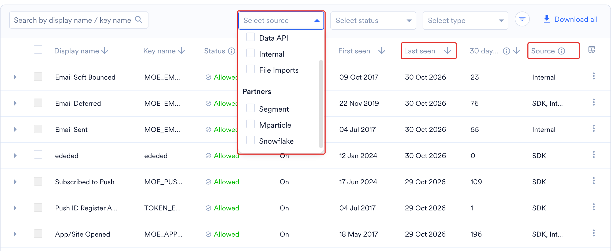
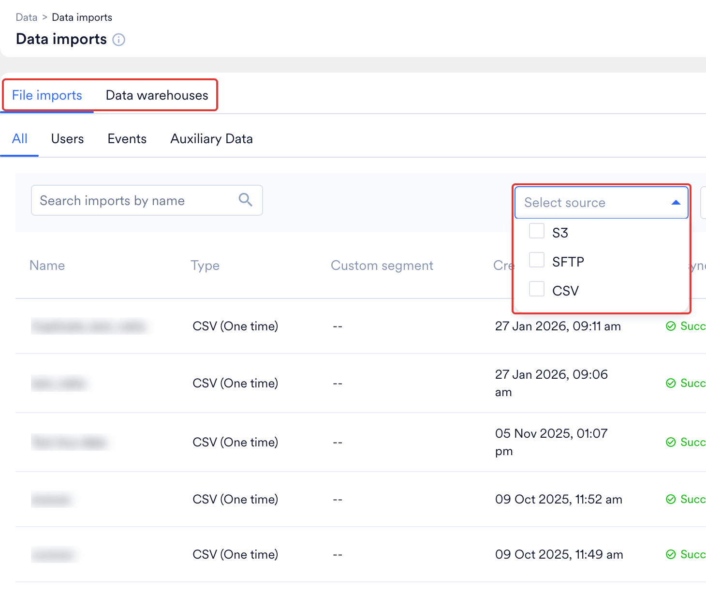
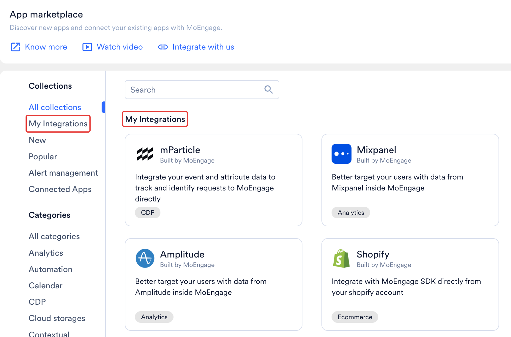
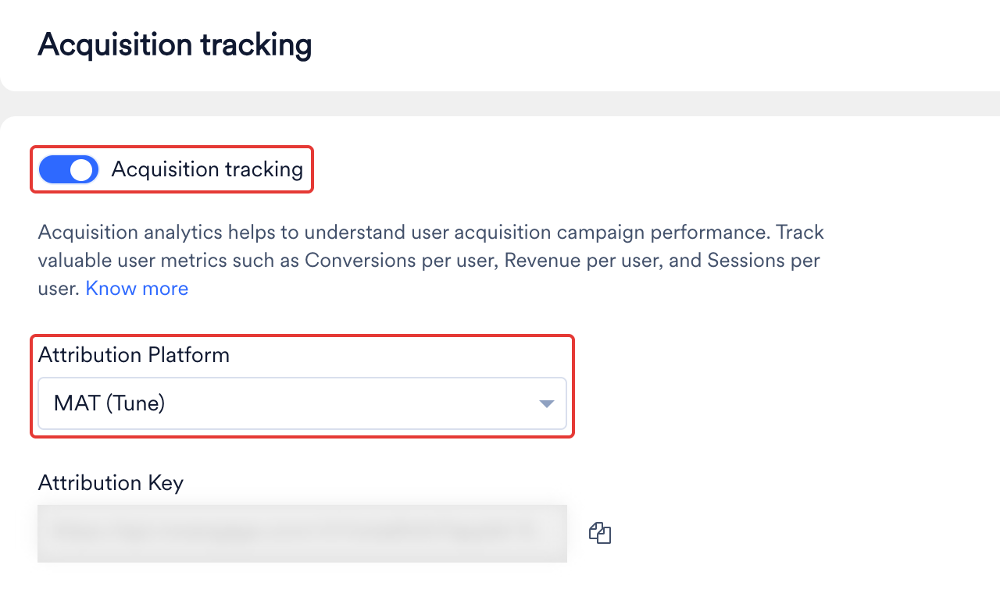
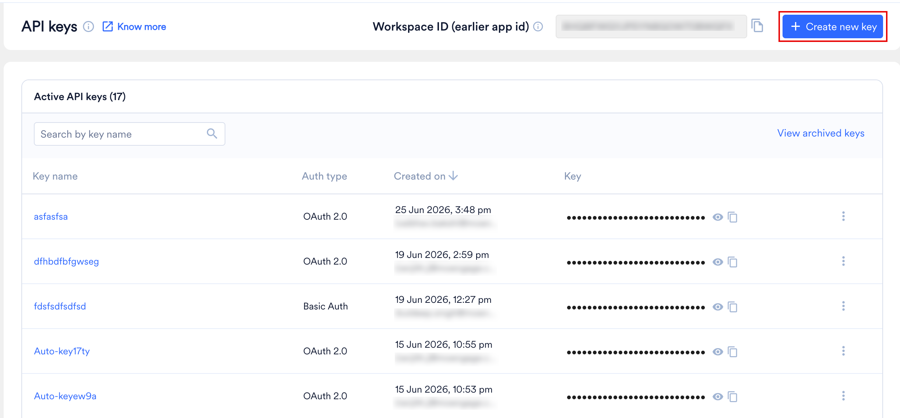
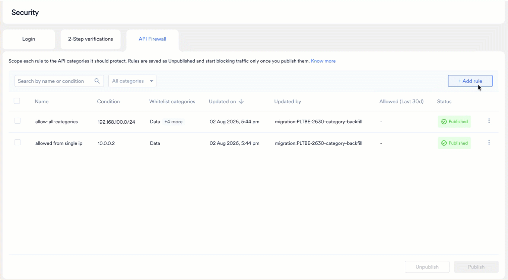
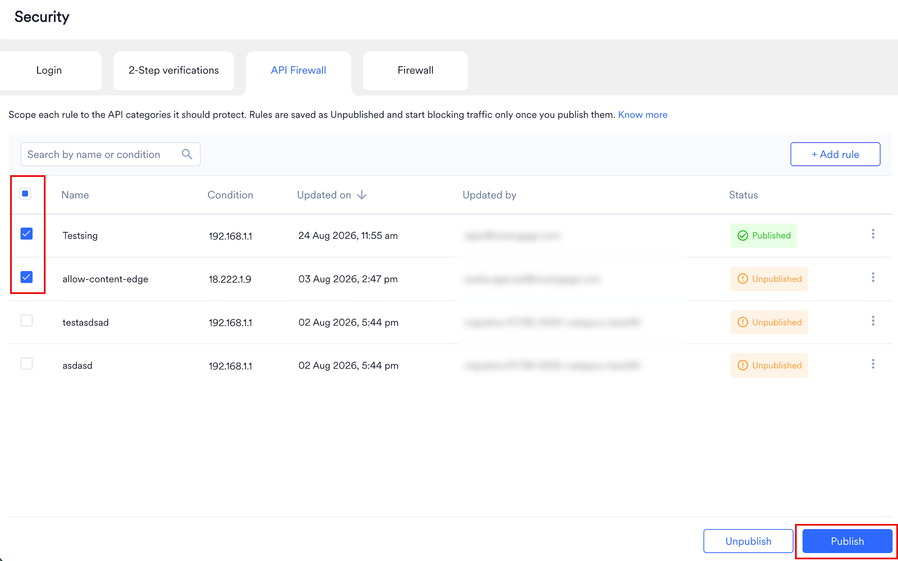

[API Firewall](/ja/user-guide/settings/account/security/api-firewall) ルールを公開すると、MoEngage は、自社のパートナーからの呼び出しを含め、ホワイトリストにない IP アドレスからのすべての API 呼び出しをブロックします。このガイドでは、MoEngage を呼び出すすべてのパートナーとサーバーを特定し、それらの IP アドレスを収集して、データフローを中断することなくルールを公開する方法を説明します。

次のいずれかに該当する場合は、このガイドを使用してください。

- セキュリティチームが、MoEngage への API アクセスを IP アドレスで制限することを求めている。
- これから API Firewall を有効にしようとしている。
- パートナーツールが、すでに MoEngage から `403` エラーを受け取っている。

<Info>
API Firewall はデフォルトでオフになっています。カテゴリのルールを公開するまで、MoEngage はそのカテゴリへの呼び出しを任意の IP アドレスから受け付けます。MoEngage のドキュメントでは、この手法を「IP ホワイトリスト登録」と呼んでいます。多くのセキュリティチームでは「IP 許可リスト登録 (IP allowlisting)」と呼びますが、意味は同じです。
</Info>

## 概要

このガイドでは、MoEngage へのインバウンドトラフィック、つまりサーバーやパートナーが MoEngage API に対して行う呼び出しを扱います。IP アドレスは MoEngage ではなくそれらの呼び出し元に属するため、各所有者から収集して API Firewall に入力します。

作業を進めながら、スプレッドシートなどのワークシートを管理してください。各呼び出し元、その所有者、使用する API カテゴリ、IP アドレス、各 IP アドレスの入手元、入手した日付を記録します。

このプロセスは 6 つのステップで構成されます。

1. [データセンターと API ホストを確認する](#step-1-find-your-data-center-and-api-host)。パートナーと開発者は、データセンターに対応するホストを呼び出す必要があります。
2. [MoEngage にデータを送信しているパートナーを特定する](#step-2-find-the-partners-that-send-data-into-moengage)。ダッシュボードでは、パートナーの種類ごとに異なる場所に表示されます。
3. [MoEngage を呼び出している自社のサーバーとツールを特定する](#step-3-find-your-own-servers-and-tools-that-call-moengage)。開発者は自社のアウトバウンド IP アドレスを把握しています。
4. [各呼び出し元を API カテゴリに対応付ける](#step-4-match-each-caller-to-an-api-category)。ルールは API キー単位ではなく、カテゴリ単位で設定します。
5. [各所有者から IP アドレスを入手する](#step-5-get-the-ip-addresses-from-each-owner)。すべての IP アドレスを把握している人は 1 人もいません。
6. [ルールを作成し、まとめて公開する](#step-6-create-the-rules-then-publish-them-together)。ワークスペースの Admin がダッシュボードで行います。

## ステップ 1: データセンターと API ホストを確認する

データセンターによって、パートナーと開発者が呼び出す必要のある API ホストが決まります。MoEngage へのログインに使用しているアドレスを確認してください。`dashboard-0X.moengage.com` という形式で、`0X` がデータセンター番号です。

| ダッシュボード URL | データセンター | API ホスト | リージョン |
| --- | --- | --- | --- |
| `dashboard-01.moengage.com` | DC-01 | `api-01.moengage.com` | 米国 |
| `dashboard-02.moengage.com` | DC-02 | `api-02.moengage.com` | EU |
| `dashboard-03.moengage.com` | DC-03 | `api-03.moengage.com` | インド |
| `dashboard-04.moengage.com` | DC-04 | `api-04.moengage.com` | 米国 |
| `dashboard-05.moengage.com` | DC-05 | `api-05.moengage.com` | シンガポール |
| `dashboard-06.moengage.com` | DC-06 | `api-06.moengage.com` | インドネシア |

API ホストをワークシートに記録します。以降のステップに登場するすべての呼び出し元は、お客様のデータセンターのホストを使用する必要があります。誤ったホストを指定しているパートナーは、API Firewall とは無関係の理由で失敗します。詳細については、[MoEngage のデータセンター](/ja/user-guide/data/key-concepts/data-centers-in-moengage)を参照してください。

<Note>
**自社のアウトバウンドファイアウォールは別の設定です。** ネットワークでサーバーから MoEngage への接続がブロックされている場合は、MoEngage の IP アドレスではなく、Data API 用のドメイン `api-0X.moengage.com` を許可してください。MoEngage はマルチテナントであり、IP アドレスは頻繁に変わるため、キャッシュしないでください。ステップ 6 の API Firewall は逆方向に機能し、MoEngage がどの呼び出し元を受け付けるかを制御します。
</Note>

## ステップ 2: MoEngage にデータを送信しているパートナーを特定する

パートナーが MoEngage に接続する方法は 2 つあり、それぞれ異なる痕跡が残るため、両方を確認してください。メニュー名は、現在の MoEngage UI と新しい UI とで若干異なる場合があります。

### MoEngage で設定したパートナー

MoEngage では、パートナーの種類ごとにダッシュボードの異なる場所に表示されます。次の表を使用して確認してください。

| パートナーの種類 | インポートが表示される場所 (MoEngage へ) | エクスポートが表示される場所 (MoEngage から) | API Firewall への登録が必要か |
| --- | --- | --- | --- |
| AppsFlyer、Adjust、Singular、Branch、Airbridge などのアトリビューションパートナー | **Settings** > **Analytics** > **Acquisition tracking** で、トラッキングがオンになっているかどうかと、**Attribution Platform** で選択されているパートナーを確認できます。ワークスペースによっては、**Settings** > **Analytics and Data** > **Acquisition tracking** に表示されます。 | 該当なし | CSM にお問い合わせください。**Partner Integration** カテゴリには Track App Install API が含まれます。AppsFlyer Audiences は [パートナー連携への影響](/ja/user-guide/settings/account/security/api-firewall#impact-on-partner-integrations)に記載されています。 |
| Hightouch、RudderStack、Segment、mParticle、Amplitude、Mixpanel などの CDP および分析パートナー | **Settings** > **Data** > **Data management** に、受信したすべてのイベントとユーザープロパティが、最初と最後に確認された日付とともに一覧表示されます。 | 左側のナビゲーションの **App marketplace** | 多くの場合は必要です。[パートナー連携への影響](/ja/user-guide/settings/account/security/api-firewall#impact-on-partner-integrations)でパートナー名を確認してください。 |
| Punchh、RevenueCat、Unbounce などの Connected sources | 上記と同様に、**Settings** > **Data** > **Data management**。これらのパートナーは、MoEngage が設定したエンドポイントにデータを送信します。 | 該当なし | 不要 |
| Snowflake、BigQuery、Databricks などのデータウェアハウス | 接続は **App marketplace** で管理されます。**Data** > **Data imports** の **Data warehouses** タブに各インポートが一覧表示されます。 | **App marketplace** | 不要。MoEngage がデータを取得します。 |
| Amazon S3 や SFTP などのクラウドストレージ | 接続は **App marketplace** で管理されます。**Data** > **Data imports** に各ファイルインポートが一覧表示されます。 | **App marketplace** | 不要。MoEngage がデータを取得します。 |
| 広告プラットフォームやメッセージングアプリなどの Connected channels | **App marketplace** | **App marketplace**、および作成した Connector campaigns | 不要。MoEngage がデータを送信します。 |

以下のセクションでは、表の各経路を確認する場所を示します。

#### Data Management

[Data management](/ja/user-guide/settings/data-management/overview-data-management) で、**Events** タブを開きます。**Select source** で **Data API** または **Partners** に表示されているパートナーを選択し、**Last seen** で並べ替えます。パートナーから現在もイベントが届いている場合は最近の日付が表示され、接続が有効であることがわかります。**Source** 列には、各イベントの送信元が表示されます。

<Frame></Frame>

#### Data Imports

**Data imports** ページでは、**File imports** タブと **Data warehouses** タブにインポートジョブが名前別に一覧表示されます。**File imports** タブの **Select source** フィルターを使用して Amazon S3、SFTP、CSV のインポートを区別し、インポート名でパートナーを見分けます。

<Frame></Frame>

#### App Marketplace

**App marketplace** で **My Integrations** を選択すると、ワークスペースに接続されているパートナーが表示されます。

<Frame></Frame>

#### Acquisition Tracking

**Attribution Platform** フィールドには、ワークスペースで使用しているアトリビューションパートナーが表示されます。

<Frame></Frame>

### パートナー側から接続するパートナー

Hightouch、Zapier、Konnectify など、多くのパートナーはパートナー独自のツール内で設定されます。チームの誰かが Workspace ID と Data API キーをそのツールに貼り付けているため、MoEngage にはそのパートナーのタイルや設定が表示されない場合があります。次の方法を使用して、これらのパートナーを特定してください。

- **Settings > Account > APIs を開く。** このページには、Workspace ID と、Data、Push、Inform、Campaigns and catalog、Personalize などの API グループごとに 1 つの API キーが表示されます。各キーを誰がコピーし、どこに貼り付けたかを確認してください。
- **API Key Dashboard を利用できる場合は使用する。** この Early Access 機能を使用すると、Admin は **Settings** > **Account** > **API keys** で、それぞれ選択した API に限定された名前付きのキーを複数作成できます。Audit Logs には、各キーを作成、更新、またはアーカイブしたユーザーが記録されます。ベンダーごとに 1 つのキーを作成するのが、MoEngage を呼び出している相手を把握する最も簡単な方法です。詳細については、[API Key Dashboard](/ja/user-guide/settings/account/api-and-api-keys/api-key-dashboard) を参照してください。
  <Frame></Frame>
- **MoEngage がすでに認識している IP アドレスをサポートに問い合わせる。** [サポートチケットを作成](/ja/user-guide/contact-support/raise-a-support-ticket-through-moengage-dashboard)して、ワークスペースに対して MoEngage が成功した API リクエストを受信した IP アドレスを依頼します。1 か月など、最も長いジョブサイクルを含む十分な期間を指定してください。リスト内のすべての IP アドレスは、ワークシート上のサーバーまたはパートナーに属している必要があります。ルールを公開する前に、見覚えのない IP アドレスの所有者を特定してください。このリストには成功したリクエストのみが表示されるため、すでに失敗している呼び出し元や、まれにしか実行されない呼び出し元が漏れる可能性があります。
- **データツールを所有するチームに確認する。** データ、グロース、CRM、分析の各チームは、どのツールが MoEngage を送信先として設定しているかを把握しています。
- **パートナー側から確認する。** CDP、リバース ETL、自動化、CRM の各ツールの送信先または接続済みアプリのリストに、MoEngage のエントリーがあるかどうかを確認します。
- **パートナーへの影響リストをチェックリストとして使用する。** [パートナー連携への影響](/ja/user-guide/settings/account/security/api-firewall#impact-on-partner-integrations)に記載されている各パートナーについて、チームが使用しているかどうかを確認します。

### パートナーを記録する

1. 上記の各場所を開き、すべてのパートナーをベンダー名、所有者、連絡先とともにワークシートに記録します。
2. パートナーが自社のサーバーから MoEngage を呼び出すかどうかをマークします。[パートナー連携への影響](/ja/user-guide/settings/account/security/api-firewall#impact-on-partner-integrations)の表で、該当する名前付きパートナーを確認できます。
3. 分類できないパートナーについては、CSM にお問い合わせください。CSM は同じパートナーリストを確認でき、一緒に確認を進めることができます。

## ステップ 3: MoEngage を呼び出している自社のサーバーとツールを特定する

パートナーは全体の一部にすぎません。MoEngage API キーを使用している自社のものもすべて、ルールの公開後にブロックされるため、開発者と IT チームにすべての呼び出し元を一覧にするよう依頼してください。次の表を共有します。

| 呼び出し元の種類 | 例 | 収集する情報 |
| --- | --- | --- |
| 本番バックエンド | ユーザーの操作に応じてユーザー属性とイベントを MoEngage に送信するサービス | 送信元の静的パブリック IP アドレス、または NAT ゲートウェイの IP アドレス |
| データパイプラインとスケジュールされたジョブ | 夜間同期、一括インポート、レポートのダウンロード | 呼び出しを行うマシンまたはランナーの IP アドレス |
| 社内ツールとスクリプト | 管理パネル、サポートツール、単発のスクリプト | それぞれの所有者と、呼び出し元の IP アドレス |
| ステージングと QA | ステージングワークスペースを使用するテスト環境 | テストシステムの IP アドレス (ステージングワークスペースの別のルールで管理) |
| 代理店と請負業者 | お客様の API キーを保有している人 | 本人から入手したアウトバウンド IP アドレス |
| 自動化ツールと BI ツール | API 経由で分析データを読み取るワークフローツールやダッシュボード | ツールが公開している IP アドレスリスト、またはツールを実行するサーバーの IP アドレス |

開発者は、次の 2 つの方法でこれらの呼び出し元を特定できます。

- コード、スケジュールされたジョブ、設定から、ステップ 1 の MoEngage API ホストを検索します。
- **Settings** > **Account** > **APIs**、および利用できる場合は API Key Dashboard で API キーを確認し、各キーの所有者に何がそのキーを使用しているかを確認します。

IP アドレスを収集する前に、次の点に注意してください。

- **固定 IP アドレスのみ。** API Firewall で指定できるのは単一の IP アドレスと IP 範囲のみで、ドメイン名やワイルドカードは指定できません。サーバーレス関数など、固定のアウトバウンド IP アドレスを持たない呼び出し元は、まず固定 IP アドレスを持つ NAT ゲートウェイまたはプロキシを経由してトラフィックをルーティングする必要があります。
- **モバイルアプリとウェブアプリは影響を受けません。** API Firewall はサーバー間の API トラフィックを対象とし、アプリやウェブサイトからの SDK トラフィックには影響しないため、ユーザーのデバイスを一覧にする必要はありません。
- **両方の IP バージョンに対応しています。** IPv4 および IPv6 アドレス、CIDR 範囲、開始アドレスと終了アドレスを指定した IPv4 範囲を入力できます。

## ステップ 4: 各呼び出し元を API カテゴリに対応付ける

API Firewall ルールはワークスペース全体で API カテゴリごとに適用されるため、ワークシート上の各呼び出し元について、その呼び出しがどのカテゴリに該当するかを把握する必要があります。固定のカテゴリは 5 つあります。

| カテゴリ | 対象範囲 |
| --- | --- |
| Data | ユーザープロファイル、イベントトラッキング、一括インポート、デバイス管理、GDPR および CCPA リクエスト、分析ダッシュボードのデータ |
| Segmentation | ファイルセグメント、フィルターセグメント、セグメントのアーカイブまたはアーカイブ解除 |
| Campaigns | キャンペーン管理、テスト送信、統計とレポート、ビジネスイベント、購読、プッシュ (V2.1)、カード、Inform アラート、Live Activities、Personalize、メッセージアーカイブ、フロー |
| Partner Integration | コホート同期、パートナーのファイルインポート、アプリインストールのトラッキング、接続テスト |
| Content | In-App、On-Site、SMS、メール、プッシュのテンプレート、コンテンツブロック、レコメンデーション、クーポン、カタログ、オファリング |

開発者に各呼び出しがどの API を使用しているかを確認し、カテゴリに分類します。各カテゴリに含まれる API の一覧については、[API カテゴリ](/ja/user-guide/settings/account/security/api-firewall#api-categories)を参照してください。

次の例外に注意してください。

- **レガシーのプッシュ API は対象外です。** [Send Push Notification (Legacy)](/ja/api/push/push-api-legacy) v2 API はホワイトリストルールを無視します。IP アドレスでプッシュリクエストを制限するには、[Send Push Notification (V2.1)](/ja/api/push/push-api) に移行してください。
- **一部のアカウントは Inform の適用除外です。** API Firewall は Send Transactional Alert (Inform) API をサポートしていますが、一部のアカウントは例外です。ご自身のアカウントが適用除外の対象と思われる場合は、CSM にお問い合わせください。
- **ルールは API キー単位ではなく、カテゴリ単位で適用されます。** 1 つのキーを 1 つの IP アドレスに限定することはできません。ホワイトリストに登録されている呼び出し元は、そのカテゴリのどのキーでも使用できます。
- **ワークスペース間のトラフィックには MoEngage の IP アドレスが必要です。** Connected Segments、Streams、または Connector campaigns を使用して、ある MoEngage ワークスペースから別のワークスペースにデータを送信する場合は、受信側ワークスペースのルールに MoEngage 自体の IP アドレスを追加してください。一覧については、[MoEngage の IP ホワイトリスト](/ja/user-guide/settings/account/security/ip-whitelisting-in-moengage)を参照してください。

## ステップ 5: 各所有者から IP アドレスを入手する

すべての IP アドレスを把握している人はいないため、各依頼はその呼び出し元の所有者に送信してください。追加の確認なしで回答できるように、所有者ごとに必要な情報をすべて含めたメッセージを 1 通送信します。

| 依頼先 | 所有しているもの | 依頼内容 |
| --- | --- | --- |
| 開発者、DevOps、または IT セキュリティチーム | 自社のサーバー、NAT ゲートウェイ、プロキシ、CI ツール | ステップ 3 のすべての呼び出し元の静的アウトバウンド IP アドレスまたは CIDR 範囲 |
| 各パートナーベンダー | パートナーが MoEngage を呼び出すサーバー | 使用しているパブリック IP アドレスまたは CIDR 範囲と、それらが固定かどうか |
| MoEngage の CSM またはサポートチーム | アカウントレベルの回答 | MoEngage が成功した API リクエストを受信した IP アドレス (サポートチケット経由)、影響を受けるパートナー、アカウントが Inform の適用除外かどうか、およびパートナーが固定 IP アドレスを提供できない場合の支援 |

### パートナーの IP アドレスを確認する

- **パートナーのヘルプセンターで検索します。** 「IP allowlist」、「IP whitelist」、「static IP」、「egress IP」、「webhook IPs」などで検索してください。多くのベンダーが専用のページを公開しています。
- [Partner Guide](/ja/partner-guide/introduction) で**パートナーの MoEngage 連携ガイドを確認します**。
- **パートナーのサポートチームまたはアカウントマネージャーに**、MoEngage を呼び出す際の IP アドレスを問い合わせます。
- **自社でホストしているミドルウェアやツールについて開発者に確認します。** 開発者は、クラウドコンソールから NAT ゲートウェイまたはロードバランサーのパブリック IP アドレスを確認できます。NAT ゲートウェイとは、多数の社内サーバーがインターネットに接続する際に共有する単一のパブリックアドレスです。
- **すべての IP アドレスを**入手元と入手日とともに**ワークシートに記録します**。

### ベンダーの対応について

- **固定リストを公開しているベンダーもあります。** Klaviyo、Iterable、Optimove は送信トラフィックの IP アドレスリストを公開しており、Iterable ではリストをプログラムで取得できます。
- **共有のリージョン範囲のみを提供するベンダーもあります。** Twilio Segment はリージョン別の範囲を公開しており、個々の顧客に専用 IP アドレスは提供していません。
- **プランによって固定 IP アドレスを提供するベンダーもあります。** Segment の Functions トラフィック向け IP 許可リスト登録は、Business プランで提供されています。
- **すべてのトラフィックに固定 IP アドレスを提供できないベンダーもあります。** Iterable は、API と CDN のトラフィックについては IP アドレスではなくドメインを許可するよう顧客に案内しています。

<Warning>
パートナーが固定 IP アドレスを提供できない場合は、そのパートナーのカテゴリのルールを公開する前に CSM にご相談ください。ルールが公開されると、MoEngage はルールに含まれていない IP アドレスからのパートナーの呼び出しをブロックします。
</Warning>

## ステップ 6: ルールを作成し、まとめて公開する

主なリスクは自社のトラフィックをブロックしてしまうことです。そのため、まずすべてのルールを追加し、最後に適用を有効にします。ルールを追加するには、ワークスペースの Admin である必要があります。

### ルールを作成する

1. MoEngage ダッシュボードの左側のナビゲーションメニューで、**Settings** > **Account** > **Security** に移動し、**API firewall** タブを選択します。
2. **Enable API Firewall** を選択します。**Add API firewall rule** ダイアログボックスが開きます。
3. **Rule name** に、「Production backend」や「Hightouch」など、ルールの対象がわかる名前を入力します。
4. **Whitelist categories** で、ステップ 4 で確認した呼び出し元が使用するすべてのカテゴリを選択します。少なくとも 1 つ選択する必要があります。
5. **Condition** で、入手した IP アドレスに合ったタイプ (単一の IPv4 または IPv6 アドレス、CIDR 範囲、または IPv4 範囲) を選択します。
6. **Value** に IP アドレスまたは範囲を入力し、**Add rule** を選択します。
7. ワークシート上のすべての呼び出し元について、これらの手順を繰り返します。ルールをさらに追加するには、API firewall のリストページで **+ Add rule** を選択します。

<Frame></Frame>

MoEngage は新しいルールをそれぞれ **Unpublished** として保存します。これは、ルールが記録されているものの、まだ適用されていないことを意味します。フィールドの詳細とスクリーンショットについては、[API Firewall ルールの作成と公開](/ja/user-guide/settings/account/security/api-firewall#create-and-publish-api-firewall-rules)を参照してください。

### ルールを公開する

ルールを公開すると、そのルールが対象とするすべてのカテゴリに適用され、MoEngage は約 15 分以内に適用を開始します。それ以降、そのカテゴリの公開済みルールに含まれていない IP アドレスからの呼び出しには、`403` レスポンスが返されます。

公開する前に、次の点を確認してください。

- ステップ 2 と 3 のすべての呼び出し元にルールがある。
- [パートナー連携への影響](/ja/user-guide/settings/account/security/api-firewall#impact-on-partner-integrations)で **Yes** となっているパートナーのうち、使用しているすべてのパートナーの IP アドレスが、正しいカテゴリのルールに含まれている。
- すべてのルールが **Unpublished** として保存されている。
- ダイアログボックスの **First rule for this category** の警告を読み、漏れている呼び出し元がないことを確認した。
- チームが公開時刻を把握しており、当日は誰かがサーバーやパートナーからの `403` エラーを監視している。
- ワークシートに各 IP アドレスが入手元と日付とともに記載されている。

その後、未公開のルールをすべて選択し、1 つずつではなく 1 回の操作でまとめて公開します。これにより、ルールの公開待ちの間に呼び出し元がブロックされることを防げます。

<Frame></Frame>

MoEngage はリクエストをブロックしてもダッシュボード通知を送信しません。ブロックされた呼び出し元には `403` レスポンスが直接返されるため、開発者とパートナーにこのレスポンスのアラートを設定するよう依頼してください。

### ロールバックと確認

ルールの適用を停止するには、ルールを選択して **Unpublish** を選択します。あるカテゴリのすべてのルールの公開を取り消すと、そのカテゴリは再び任意の IP アドレスからの呼び出しを受け付けるようになります。カテゴリの最後の公開済みルールを削除した場合も同じ結果になり、ダッシュボードには事前に警告が表示されます。

[Audit Logs](/ja/user-guide/settings/account/audit-logs/audit-logs) には、すべてのルールの変更が、変更者、日時、IP アドレスとともに記録されます。

API Firewall 自体で内部障害が発生した場合は、フェイルオープンするように設計されています。データ収集が継続されるように、トラフィックを通過させます。

## トラブルシューティング

| 発生している事象 | 考えられる原因 | 対処方法 |
| --- | --- | --- |
| パートナーツールが MoEngage から `403` エラーを受け取る。 | パートナーの IP アドレスが公開済みルールに含まれていないか、ルールの対象カテゴリが誤っています。 | パートナーの IP アドレスを入手し、ステップ 4 で確認したカテゴリのルールに追加して公開します。 |
| 公開後、自社のサーバーが `403` エラーを受け取る。 | サーバーのパブリック IP アドレス (多くの場合 NAT ゲートウェイ) が、そのカテゴリの公開済みルールに含まれていません。 | 開発者に実際のアウトバウンド IP アドレスを確認して追加し、公開後約 15 分待ちます。 |
| しばらくは呼び出しが成功していたが、その後失敗し始めた。 | パートナーまたは自社のインフラストラクチャの IP アドレスが変更されました。 | 所有者に新しい IP アドレスを確認して追加し、ルールを公開します。 |
| あるカテゴリは機能するが、別のカテゴリは失敗する。 | 呼び出し元が使用するカテゴリのうち、1 つにしか公開済みルールがありません。公開済みルールがないカテゴリは開放されたままで、対象となるカテゴリには適用されます。 | 失敗しているカテゴリのルールに、呼び出し元の IP アドレスを追加します。 |
| ルールを追加したが、他の IP アドレスからの呼び出しが引き続き成功する。 | ルールが **Unpublished** として保存されているため、トラフィックに影響しません。 | ルールのステータスを確認し、適用する意図がある場合は公開します。 |
| ダッシュボードのアラートなしで呼び出しがブロックされる。 | MoEngage はリクエストをブロックしてもダッシュボードに通知しません。 | 呼び出し元側のログで `403` レスポンスを確認します。 |
| 1 つの API キーを 1 つの IP アドレスに制限する必要がある。 | ルールはキー単位ではなく、ワークスペースのカテゴリ単位で適用されます。 | ダッシュボードの **Need help** から [製品アイデアを送信](/ja/user-guide/contact-support/suggest-a-feature)します。 |
| パートナーが固定 IP アドレスを提供できない。 | ベンダーが IP アドレスを共有またはローテーションしています。 | そのパートナーのカテゴリのルールを公開する前に、CSM にご相談ください。 |
| プッシュリクエストが制限されない。 | Send Push Notification (Legacy) v2 API はホワイトリストルールを無視します。 | [Send Push Notification (V2.1)](/ja/api/push/push-api) に移行します。 |
| サーバーが MoEngage を呼び出す際にタイムアウトまたはネットワークエラーが発生する。 | 自社のアウトバウンドファイアウォールが MoEngage のアドレスをブロックしているか、その後変更された古い IP アドレスを許可しています。 | MoEngage の IP アドレスではなく、データセンターのドメイン `api-0X.moengage.com` を許可し、IP アドレスをキャッシュしないでください。 |

## FAQ

<AccordionGroup>

<Accordion title="API Firewall を有効にする必要がありますか？">
  いいえ。API Firewall はデフォルトで無効になっており、カテゴリのルールを公開するまで、MoEngage は任意の IP アドレスからの API 呼び出しを受け付けます。
</Accordion>

<Accordion title="ルールを作成できるのは誰ですか？">
  ワークスペースの Admin です。開発者とパートナーは IP アドレスを提供できますが、ルールを入力して公開するのは Admin です。
</Accordion>

<Accordion title="ドメイン名やワイルドカードを入力できますか？">
  いいえ。ルールで指定できるのは、単一の IP アドレス、CIDR 範囲、IPv4 範囲のみです。
</Accordion>

<Accordion title="API Firewall はモバイルアプリやウェブサイトに影響しますか？">
  いいえ。API Firewall はサーバー間の API トラフィックに適用され、エンドユーザーからの SDK トラフィックには影響しません。
</Accordion>

<Accordion title="公開する前にすべてのルールを追加する必要があるのはなぜですか？">
  公開すると、約 15 分以内に各カテゴリに適用されます。ルールを 1 つずつ公開すると、まだルールが公開されていない呼び出し元が `403` エラーを受け取る可能性があります。
</Accordion>

<Accordion title="API Firewall が何かをブロックした場合、通知されますか？">
  ダッシュボードからは通知されません。ブロックされた呼び出し元には `403` レスポンスが返されるため、呼び出し元側で監視してください。
</Accordion>

<Accordion title="ルールを変更したユーザーはどこで確認できますか？">
  [Audit Logs](/ja/user-guide/settings/account/audit-logs/audit-logs) で確認できます。各ルールの変更、変更者、日時、IP アドレスが記録されています。
</Accordion>

<Accordion title="CSM がいない場合は誰に連絡すればよいですか？">
  MoEngage サポートチームにお問い合わせください。
</Accordion>

<Accordion title="パートナーが独自のツールで設定されており、MoEngage で見つけられません。どうすればよいですか？">
  [パートナー側から接続するパートナー](#partners-that-connect-from-their-own-side)を参照してください。**Settings** > **Account** > **APIs**、利用できる場合は API Key Dashboard、およびパートナー独自のツールの送信先リストを確認してください。
</Accordion>

</AccordionGroup>
