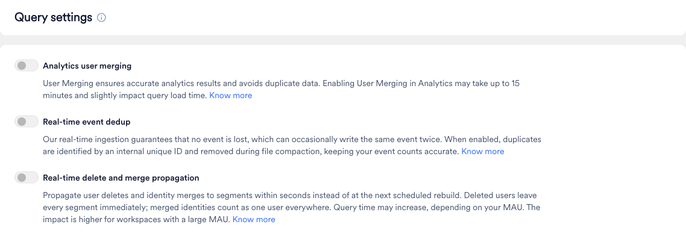

Query settings を使用すると、MoEngage が Analytics および Segmentation のクエリを実行する際に、マージされたユーザー、重複したイベント、削除されたユーザーをどのように処理するかを制御できます。各設定はカウントの精度を向上させますが、いずれもクエリの実行時間が長くなる可能性があるため、ワークスペースに必要な設定を選択してください。

Query settings を開くには、MoEngage ダッシュボードの左側のナビゲーションメニューで、**Settings** \> **Analytics & Segmentation** \> **Query settings** に移動します。

このページには 3 つのトグルがあります。

| 設定 | 変更内容 | 適用対象 |
| --- | --- | --- |
| [Analytics user merging](#analytics-user-merging) | 匿名プロファイルと、そのマージ先となる登録済みプロファイルを 1 人のユーザーとしてカウントします。 | Analytics |
| [Real-time event dedup](#real-time-event-deduplication) | MoEngage が 2 回保存したイベントの重複コピーを削除します。 | Segmentation |
| [Real-time delete and merge propagation](#real-time-delete-and-merge-propagation) | ユーザーの削除と ID のマージを数秒以内にセグメントに反映します。 | Segmentation |

トグルをオンにした後、変更が反映されるまでに最大 15 分かかる場合があります。

## Analytics のユーザーマージ

MoEngage は、ユーザーがログインした後に匿名ユーザープロファイルを登録済みユーザープロファイルとマージするため、各ユーザーはデバイスやセッションをまたいで単一のユーザー ID を持ちます。詳細については、[ユーザーマージ](/ja/user-guide/data/user-data/anonymous-to-registered-user-merge)を参照してください。

**Analytics user merging** をオンにすると、MoEngage Analytics にも同じマージロジックが適用されるため、[Behavior Analysis](/ja/user-guide/analyze/analytics/behavior/behavior-overview) などのレポートで、ユーザーの匿名時とログイン時のアクティビティが 1 人のユーザーとしてカウントされます。クエリの読み込み時間がわずかに増加する場合があります。

<Info>
Segmentation には独自のユーザーマージロジックがあります。Analytics user merging がオフの場合、Analytics は匿名セッションとログインセッションを別々のユーザーとして扱うため、同じ条件でも Segmentation のクエリと Analytics のレポートとでユーザー数が異なる場合があります。これらのカウントを一致させるには、Analytics user merging をオンにしてください。
</Info>

## リアルタイムのイベント重複排除

まれに、MoEngage が同じイベントを複数回記録することがあります。MoEngage はデータを決して失わないことを優先しているため、イベントが 2 回保存されることがあります。この場合、イベントを 1 回実行したユーザーが 2 回実行したように見えます。その結果、イベントを **exactly** 指定回数 **has executed** など、発生回数をカウントするフィルターで、条件を満たさないユーザーが含まれたり除外されたりする可能性があります。

**Real-time event dedup** をオンにすると、MoEngage はこれらの重複コピーを検出して削除します。重複は、`event_id` やイベント属性とは別に MoEngage が各イベントに割り当てる内部 ID を使用して識別されるため、ユーザーによる本当の繰り返しイベントが削除されることはありません。重複は MoEngage の定期的なデータ最適化プロセスでクリーンアップされ、Segmentation では各イベントが 1 回だけカウントされます。

<Warning>
この設定がオンの場合、Segmentation のクエリの実行に時間がかかります。
</Warning>

## リアルタイムの削除およびマージの反映

MoEngage がユーザーを削除したり、匿名プロファイルを登録済みプロファイルにマージしたりすると、その変更は次回のスケジュールされた再構築時にセグメントに反映されます。それまでは、削除されたユーザーがセグメントに残ったり、マージされたユーザーが 2 人のユーザーとしてカウントされたりする場合があります。

**Real-time delete and merge propagation** をオンにすると、削除されたユーザーは直ちにすべてのセグメントから除外され、マージされた ID はすべての場所で 1 人のユーザーとしてカウントされます。

これらの変更を適用するためにクエリで追加の処理が行われるため、クエリ時間が増加する場合があります。増加の程度は、ワークスペースの月間アクティブユーザー (MAU) によって異なります。MAU が少ないワークスペースでは通常ほとんど変化がありませんが、MAU が多いワークスペースではクエリ時間が顕著に増加する場合があります。クエリの速度よりも、最新の削除とマージを直ちに反映することが重要な場合は、この設定をオンにしてください。
