## 概要

Email キャンペーンで記録されるすべての開封やクリックが、実際の人間の受信者によるものとは限りません。[Apple Mail Privacy Protection (MPP)](/ja/user-guide/campaigns-and-channels/email/getting-started-with-email/mail-privacy-protection-mpp-and-email-analytics)、企業のセキュリティスキャナー、自動リンクチェックプロキシなどのソースは、開封やクリックを自動的にトリガーすることがあります。これらを除外しないままにすると、指標が水増しされ、開封率、クリック率、クリック対開封率 (CTOR) などの重要業績評価指標 (KPI) が歪み、エンゲージメントベースの自動化 (例: メールの開封やクリックに基づくリターゲティング) が誤ってトリガーされる可能性があります。

Bot Detection を使用すると、既知のボットのユーザーエージェントや IP アドレスのブロックリスト、タイミングやクリックパターンに基づいて開封とクリックにフラグを付けるヒューリスティックルールなど、人間以外のアクティビティを特定するための具体的なルールを定義できます。**Bot opens** と **Bot clicks** のルールを個別に設定し、キャンペーンの分析やレポートで MoEngage がこれらの指標をどのように表示するかを選択できます。

<Note>
  - ボット検出機能は現在、Email チャネルでのみ利用できます。
  - MoEngage はバックグラウンドでプラットフォーム全体の開封とクリックを継続的に監視し、新しいボット IP やボットのユーザーエージェントを特定して、デフォルトルールを最新の状態に保っています。さらに、この設定により、これらのデフォルトに加えて独自のカスタムルールを追加できます。
  - MoEngage のボット検出機能は、ボットアクティビティの大部分を検出するように構築されており、精度向上のために継続的に改良されています。他の検出システムと同様に、一部のボットアクティビティが検出されない場合や、一部の正当なアクティビティがボットとしてフラグ付けされる場合があります。
</Note>

## ユースケース
 
* **正確なキャンペーンパフォーマンスレポート**: マーケティングチームや分析チームは、Apple MPP のプリフェッチ、画像プロキシ、自動セキュリティスキャナーによって水増しされることなく、実際の受信者の行動を反映した開封率、クリック率、CTOR を利用できます。
* **信頼性の高いエンゲージメントベースのセグメンテーションとジャーニー**: ボットによる開封やクリックによって連絡先が誤って「エンゲージ済み」と判定されることがなくなるため、ユーザーが実際の受信者のアクションのみを対象としたエンゲージ済みセグメント、ウィンバックフロー、または自動化ブランチに誤って移動されることがありません。
* **ボットとしてフラグ付けされた配信停止を柔軟に処理**: ボット検出はベストエフォートで動作するため、正当な配信停止クリックが誤ってボットクリックとして分類されることがあります。この設定により、その判断をお客様に委ねます。ボットとしてフラグ付けされた場合でも常に配信停止リクエストを受け入れ、配信停止を希望した人を引き留めてしまうリスクを回避するか、ボットとしてフラグ付けされた配信停止クリックを無視して、正当な購読者が誤って除外されないようにするかを選択できます。
* **ダウンストリームのレポート向けのクリーンなデータ**: ボット調整済みの指標を合計とは別に表示できるため、エンゲージメントデータを BI ツール、ダッシュボード、CRM にエクスポートするチームは、人間のみの数値を使用して、より正確な顧客エンゲージメントスコアリングを行えます。

## Bot Detection を有効にする

ボットアクティビティのフィルタリングを開始するには、次の手順を実行します。
   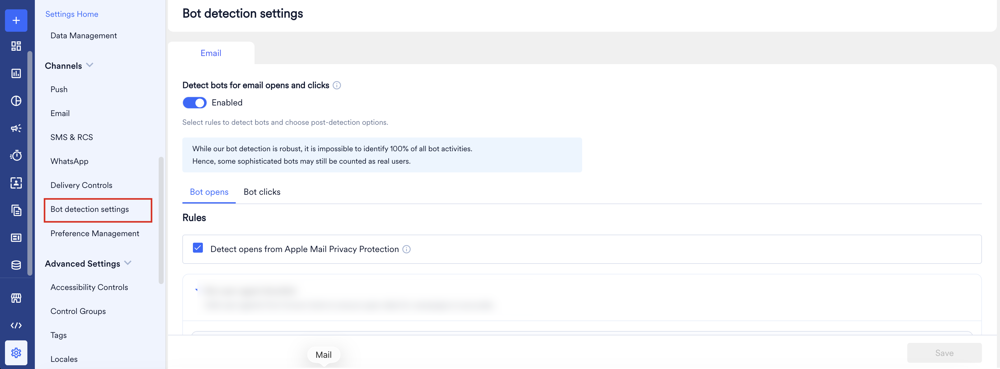

1. MoEngage ダッシュボードにログインします。
2. **Settings** > **Channels** > **Bot Detection Settings** に移動します。
3. **Bot Detection Settings** ページの **Email** タブで、**Detect bots for email opens and clicks** トグルをオンにして **Enabled** と表示されるようにします。

有効にすると、**Bot opens** と **Bot clicks** の 2 つのサブタブが表示されます。それぞれで具体的な検出ルールを設定できます。

## Bot Opens を設定する

**Bot opens** タブに移動して、MoEngage がボットによるメール開封を特定および処理する方法を定義します。
  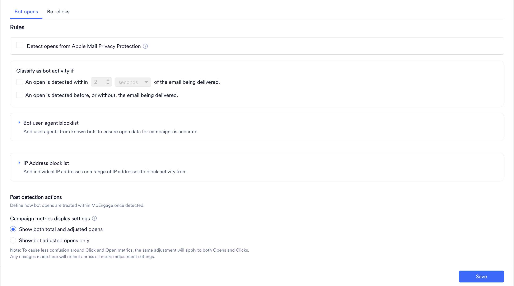

### 検出ルール

* **Detect opens from Apple Mail Privacy Protection**: [Apple Mail Privacy Protection (MPP)](/ja/user-guide/campaigns-and-channels/email/getting-started-with-email/mail-privacy-protection-mpp-and-email-analytics) を有効にしている受信者の場合、Apple は受信者が実際にメールを開く前に、トラッキングピクセルを含むリモートコンテンツを独自のリレーサーバー経由でプリロードします。このプリロードは即時または遅れて発生する可能性があり、誰もメールを読んでいないにもかかわらず「開封」として記録されるため、誤ったエンゲージメントシグナルが生成されます。このチェックボックスをオンにすると、プロキシによって生成されたこれらの開封が自動的に特定されます。
     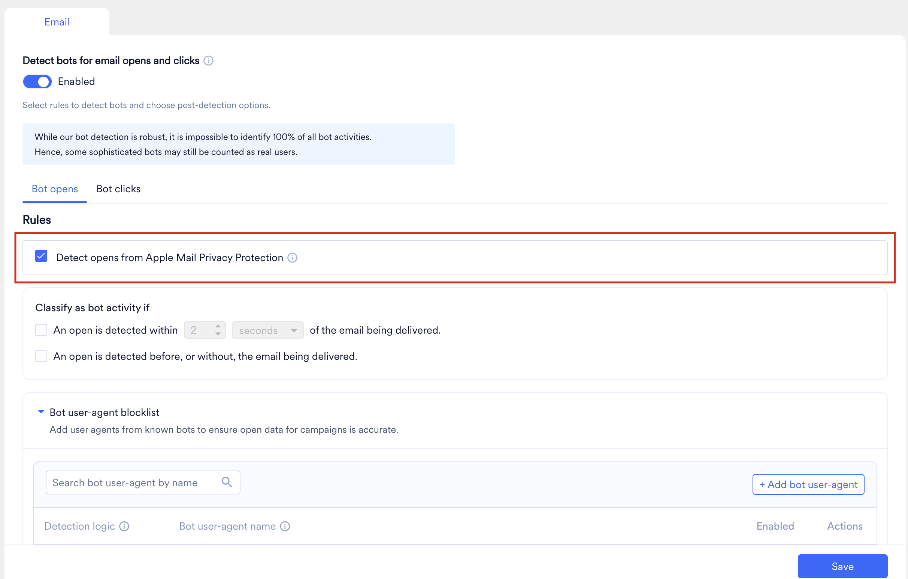
* **Classify as bot activity if**: これらのヒューリスティックルールを使用して、メール配信に対する発生タイミングに基づいて開封にフラグを付けます。ルールを有効にするには、ルールの横にあるチェックボックスを選択します。時間のしきい値があるルールでは、ルールを選択するまで値と単位のフィールドは無効のままです。MoEngage がこれらのルールを評価する方法の詳細については、[ヒューリスティックルールの仕組み](#how-heuristic-rules-work)を参照してください。
    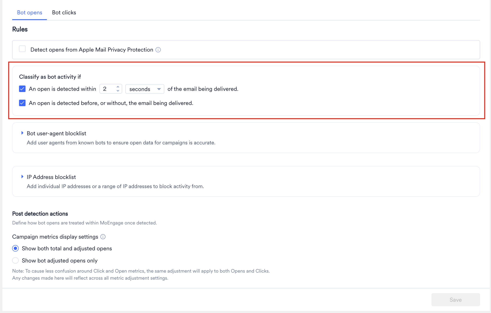
  * **An open is detected within [value] [unit] of the email being delivered.**: メールの配信後、指定した時間内に発生した開封をボットアクティビティとして分類します。セキュリティスキャナーや画像プロキシは通常、人間の受信者がメールを読むよりもはるか前の、配信から数秒以内にトラッキングピクセルを取得します。
    * **Value**: しきい値の期間を入力します。
    * **Unit**: **seconds** または **minutes** を選択します。
    * しきい値の上限は 10 分 (600 秒) です。これより大きい値を入力すると、MoEngage は **Opens can be classified as bot opens for up to 10 minutes after the email is delivered.** というエラーを表示します。値を修正するまで設定を保存できません。
    * 例えば、しきい値を 10 分に設定し、メールが午後 5:48 に配信された場合、午後 5:52 に記録された開封はボット開封として分類されます。午後 6:00 に記録された開封は正当な開封として扱われます。
  * **An open is detected before the email being delivered.**: メールが配信される前に発生した開封をボットアクティビティとして分類します。受信者は受信トレイに届いていないメールを開封できないため、配信前に記録された開封は自動化されたアクティビティであることを示します。MoEngage が配信イベントより前に開封イベントを受信した場合、メールサービスプロバイダー (ESP) から共有されたイベントのタイムスタンプを比較して、実際にどちらが先に発生したかを判断します。
* **Bot user-agent blocklist**: このセクションを展開して、ボットの検出に使用されるユーザーエージェントシグネチャのリストを管理します。
    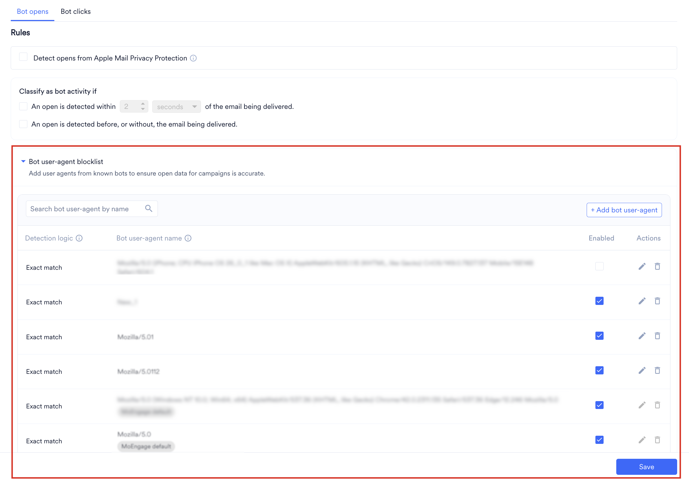
  * **MoEngage Default**: **"MoEngage default"** のタグが付いたルールは、既知のボットをカバーするために MoEngage によって自動的に管理されています。これらのルールは削除できません。ただし、特定のデフォルトのユーザーエージェントや IP からのトラフィックが実際にはお客様のブランドにとって正当なものである場合は、その個別のルールを **Enabled** チェックボックスを使用していつでも無効にできます。
  * **Search**: **Search bot user-agent by name** フィールドを使用して、特定のルールを検索します。
  * **Add bot user-agent**: **+ Add bot user-agent** ボタンをクリックして、カスタムルールを作成します。最大 200 件のエントリーを追加できます。新しい入力行が作成され、次のフィールドを定義する必要があります。
        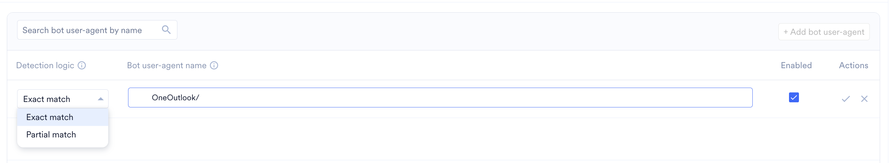
    * **Detection logic**: 
       - 受信したユーザーエージェント文字列がエントリーと 1 文字ずつ完全に一致する場合にのみ MoEngage に開封をブロックさせるには、**Exact match** を選択します (例: 123456)。
       - 受信したユーザーエージェント文字列にエントリーが部分文字列として含まれている場合に開封をブロックするには、**Partial match** を選択します (例: random と入力すると、"random" という単語を含むすべてのユーザーエージェント文字列がブロックされます)。
          <Warning>
            **Partial match** は慎重に使用してください。範囲が広すぎる値を指定すると、正当なトラフィックに意図せず一致し、実際のユーザーがボットとして誤分類される可能性があります。例えば、**Mozilla/5.0** を部分一致として入力すると、ほとんどの正当なブラウザーにはこの部分文字列が含まれているため、ほぼすべての実際のブラウザーのユーザーエージェント文字列に一致し、正当な開封の大部分がボットとして分類されてしまいます。
          </Warning>  
       - **Exact match** と **Partial match** はどちらも大文字と小文字を区別しないため、_Random_ と _random_ のようなエントリーは同じものとして扱われます。
    * **Bot user-agent name**: 検出する完全な文字列または部分的な文字列を入力します。注: 保存する前にここに文字列を入力する必要があります。入力しない場合、MoEngage は **Please enter a user agent string before saving** エラーを表示します。
    * **Enabled**: このチェックボックスは、ルールのアクティブ状態を決定します。保存時にすぐにルールを有効にするには、チェックを入れたままにします。ルールをリストに保存しつつ、当面は非アクティブにしておく場合は、チェックを外します。
    * **Actions**: 新しいルールを追加する際、チェックマークアイコンをクリックすると新しいエントリーが保存されて適用され、バツ (X) アイコンをクリックするとキャンセルして行が破棄されます。ルールが保存されると、これらのアイコンは編集用の鉛筆アイコンと削除用のゴミ箱アイコンに変わります。
* **IP Address blocklist**: このセクションを展開して、特定の IP アドレスまたは範囲 (例: 企業のプロキシやデータセンター) からの開封をブロックします。
       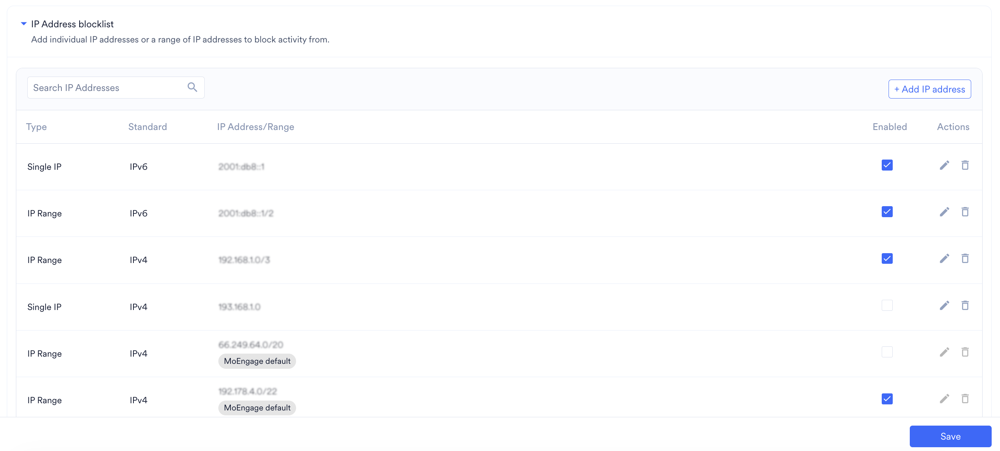
  * **+ Add IP address** をクリックして、**Type** (**Single IP** または **IP Range**)、**Standard** (**IPv4** または **IPv6**)、および正確なアドレス/範囲を定義します。
  * 新しい IP アドレスを追加する際、チェックマークアイコンをクリックすると新しいエントリーが保存されて適用され、バツ (X) アイコンをクリックするとキャンセルして行が破棄されます。IP アドレスが保存されると、これらのアイコンは編集用の鉛筆アイコンと削除用のゴミ箱アイコンに変わります。
       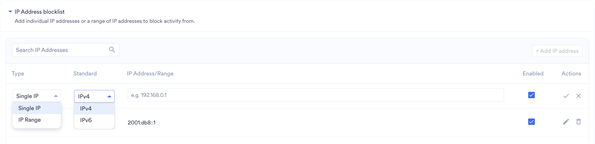

### 検出後のアクション

**Bot opens** タブの **Post detection actions** セクションで、希望する **Campaign metrics display settings** を選択します。
    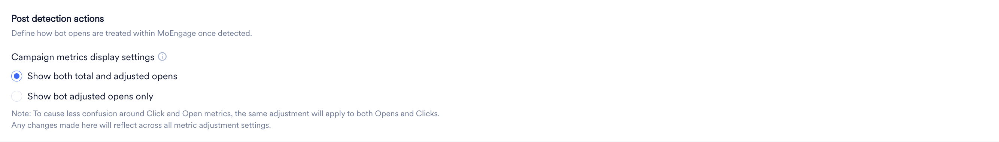
* **Show both total and adjusted opens**: キャンペーンレポートに、フィルタリングされていない未加工の開封数と、調整済み (人間のみ) の開封数が並べて表示されます。
* **Show bot adjusted opens only**: キャンペーンレポートから検出されたボット開封が完全に除外され、調整済みの指標のみが表示されます。

詳細については、[Campaign Performance Stats](/ja/user-guide/campaigns-and-channels/email/analyze/email-analytics-and-info#campaign-performance-stats) の Engagement Metrics セクションを参照してください。

<Note>
  重要な注意: 不一致を防ぐため、この表示調整は開封とクリックの両方に適用されます。この設定に加えた変更は、すべての指標調整ダッシュボードに一律に反映されます。
</Note>

## Bot Clicks を設定する

**Bot clicks** タブに移動して、MoEngage が自動リンクチェックボットを特定および処理する方法を定義します。ボットは悪意のあるコンテンツをチェックするためにメール内のすべてのリンクをクロールすることが多いため、クリックスルー率 (CTR) を誤って水増ししたり、配信停止リンクを誤ってトリガーしたりする可能性があります。
    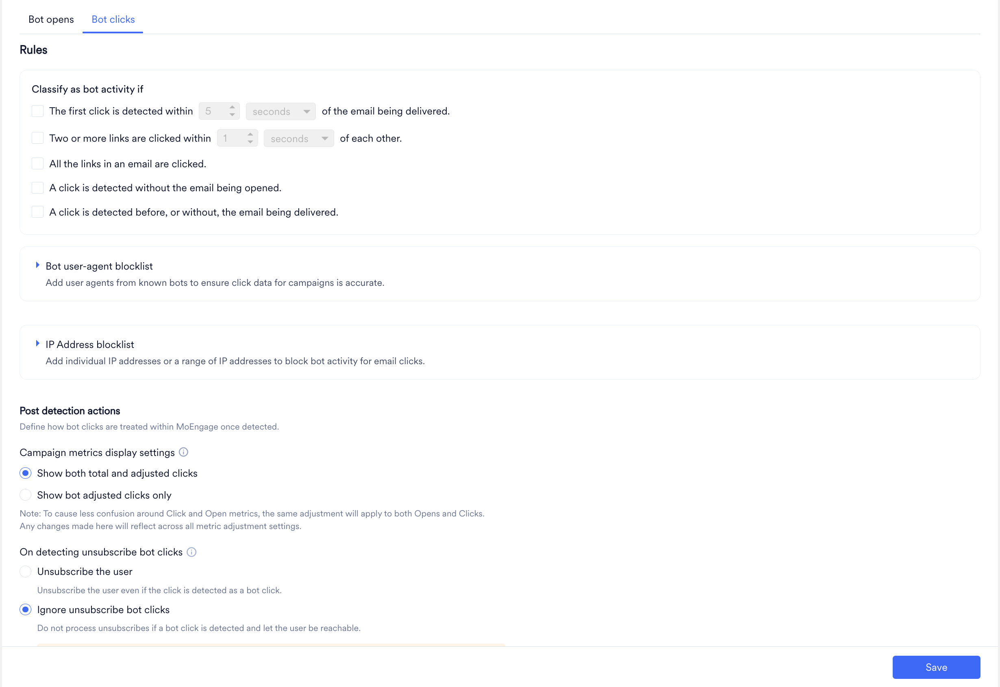
### 検出ルール

このタブでは **Bot opens** タブと同じブロックリスト構造を使用しますが、特にリンクのクリックに適用されます。初めて設定する場合は、開始を促す空の状態のイラストが表示されます。
   
* **Classify as bot activity if**: これらのヒューリスティックルールを使用して、タイミングとパターンに基づいてクリックにフラグを付けます。リンクスキャンボットは、多くの場合メール自体を読み込まずに、配信から数秒以内にメール内のすべてのリンクをたどります。ルールを有効にするには、ルールの横にあるチェックボックスを選択します。時間のしきい値があるルールでは、ルールを選択するまで値と単位のフィールドは無効のままです。MoEngage がこれらのルールを評価する方法の詳細については、[ヒューリスティックルールの仕組み](#how-heuristic-rules-work)を参照してください。
    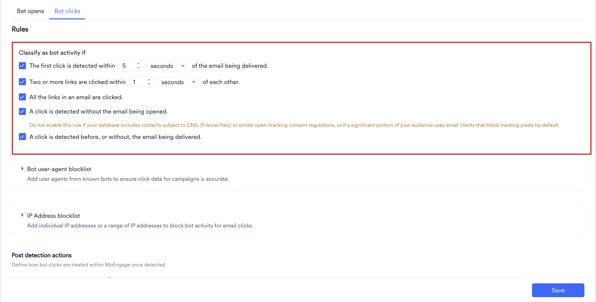
  * **The first click is detected within [value] [unit] of the email being delivered.**: メールに対する最初のクリックが配信後の指定した時間内に発生した場合、そのクリックをボットアクティビティとして分類します。
    * **Value**: しきい値の期間を入力します。
    * **Unit**: **seconds** または **minutes** を選択します。
    * しきい値の上限は 10 分 (600 秒) です。これより大きい値を入力すると、MoEngage は **Clicks can be classified as bot clicks for up to 10 minutes after the email is opened.** というエラーを表示します。値を修正するまで設定を保存できません。
    * 例えば、しきい値を 3 秒に設定した場合、配信の 2 秒後に記録されたクリックはボットクリックとして分類されます。
  * **Two or more links are clicked within [value] [unit] of each other.**: 同じメール内の 2 つ以上のリンクが、互いに指定した時間内にクリックされた場合、それらのクリックをボットアクティビティとして分類します。複数のリンクにわたる素早いクリックは、人間の読者ではなく自動リンクチェッカーに典型的なものです。
    * **Value**: クリック間の最大時間を入力します。
    * **Unit**: **seconds** または **minutes** を選択します。
    * しきい値の上限は 10 分 (600 秒) です。これより大きい値を入力すると、MoEngage は **Clicks can be classified as bot clicks for up to 10 minutes after the email is opened.** というエラーを表示します。値を修正するまで設定を保存できません。
    * 例えば、しきい値を 3 秒に設定し、あるリンクがクリックされた 1 秒後に 2 つ目のリンクがクリックされた場合、両方のクリックがボットクリックとして分類されます。
  * **All the links in an email are clicked.**: メール内のすべてのリンクがクリックされた場合、それらのクリックをボットアクティビティとして分類します。セキュリティボットは悪意のあるコンテンツがないかメール内のすべての URL をスキャンするのが一般的ですが、人間の受信者がすべてのリンクをクリックすることはほとんどありません。このルールには設定可能なしきい値はありません。
  * **A click is detected without the email being opened.**: クリックの前にメールの開封が記録されていない場合、そのクリックをボットアクティビティとして分類します。自動リンクチェッカーはメールのトラッキングピクセルを読み込まずにリンクをたどるため、それらのクリックは先行する開封なしで到着します。クリックの後に開封が記録されても、クリックの分類は変わりません。
    <Warning>
      データベースに CNIL (フランス/イタリア) または同様の開封トラッキング同意規制の対象となる連絡先が含まれている場合や、オーディエンスのかなりの部分がデフォルトでトラッキングピクセルをブロックするメールクライアントを使用している場合は、このルールを有効にしないでください。これらの連絡先では開封がトラッキングされないため、正当なクリックがボットクリックとして分類されてしまいます。
    </Warning>
  * **A click is detected before the email being delivered.**: メールが配信される前に発生したクリックをボットアクティビティとして分類します。MoEngage が配信イベントより前にクリックイベントを受信した場合、ESP から共有されたイベントのタイムスタンプを比較して、実際にどちらが先に発生したかを判断します。
* **Bot user-agent blocklist**: **+ Add bot user-agent** をクリックして、既知のリンククロールボットのユーザーエージェントシグネチャを入力します。[Bot Opens](#configure-bot-opens) セクションで説明したものとまったく同じインライン入力 (**Detection logic**、**Bot user-agent name**、**Enabled** チェックボックス、およびチェックマーク/バツの **Actions**) を使用します。
   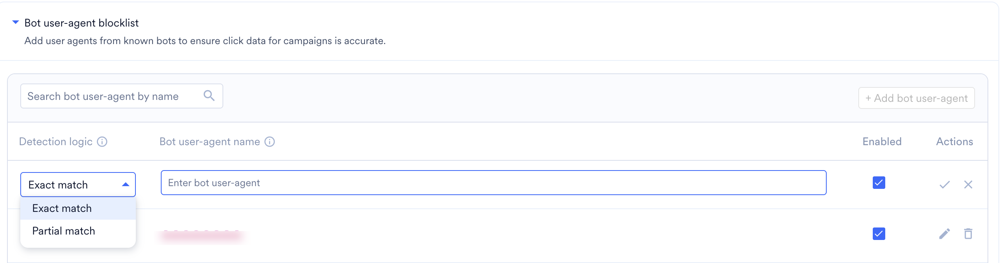
* **IP Address blocklist**: **+ Add IP address** をクリックして、特定のサーバーまたはデータセンターの IP 範囲からのクリックアクティビティをブロックします。
    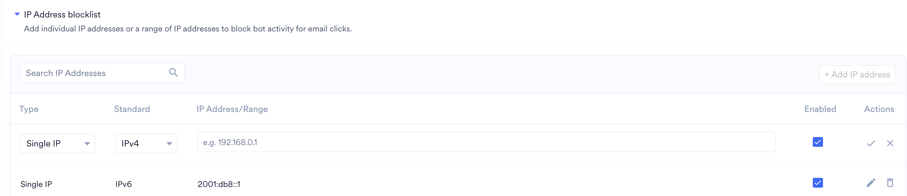

### 検出後のアクション
   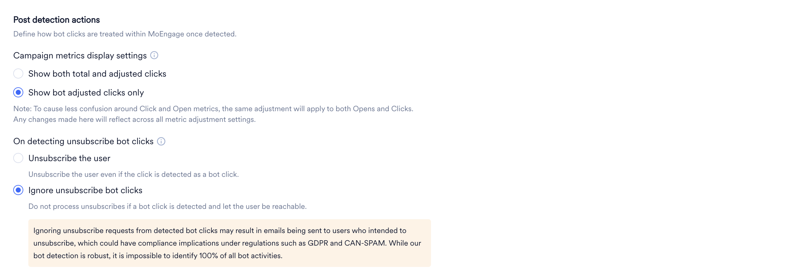

#### キャンペーン指標の表示設定

キャンペーンダッシュボードでのクリックデータの表示方法を選択します。

* **Show both total and adjusted clicks**: 未加工のカウントと調整済み (人間のみ) のクリック数を並べて表示します。
* **Show bot adjusted clicks only**: 検出されたボットクリックをレポートから完全に除外します。(注: これを更新すると、**Bot opens** タブの設定も更新されます。)

詳細については、[Campaign Performance Stats](/ja/user-guide/campaigns-and-channels/email/analyze/email-analytics-and-info#campaign-performance-stats) の Engagement Metrics セクションを参照してください。

#### 配信停止のボットクリックを検出した場合

セキュリティボットはすべてのリンクをテストするため、必然的に配信停止リンクもクリックします。この設定により、正当なユーザーが誤ってオプトアウトされることを防ぎます。

* **Unsubscribe the user**: システムがボットによってトリガーされたと疑われる場合でも、MoEngage はオプトアウトリクエストを通常どおり処理します。
* **Ignore unsubscribe bot clicks**: ボットクリックが検出された場合、MoEngage はオプトアウトリクエストをブロックし、正当なユーザーが購読状態を維持して引き続き連絡可能な状態にします。

<Warning>
  配信停止のボットクリックを無視することを選択すると、コンプライアンス上のリスクが伴います。検出された「ボットクリック」が実際にはオプトアウトしようとした正当なユーザーによるものだった場合、そのユーザーの配信停止リクエストは処理されず、停止を意図していたメールを引き続き受信することになります。地域や対象者によっては、GDPR や CAN-SPAM などの規制 (いずれもオプトアウトリクエストの尊重を義務付けています) に基づくコンプライアンス上の影響が生じる可能性があります。当社のボット検出は堅牢ですが、すべてのボットアクティビティを 100% 特定することは不可能であるため、一部の正当な配信停止クリックが依然としてボットアクティビティとして誤分類される可能性があります。このオプションを選択する前にコンプライアンス上の義務を確認し、誤検知を検出するために、抑制された配信停止の試行を定期的に監査することを検討してください。
</Warning>

## ヒューリスティックルールの仕組み

**Bot opens** タブと **Bot clicks** タブの **Classify as bot activity if** にあるヒューリスティックルールは、次のように動作します。

* **合計 7 つのルール**: **Bot opens** タブには 2 つ、**Bot clicks** タブには 5 つのヒューリスティックルールがあります。このうち 3 つのルールでは時間のしきい値を設定できます (**Bot opens** で 1 つ、**Bot clicks** で 2 つ)。
* **しきい値の上限**: しきい値は 10 分 (600 秒) を超えることはできません。これより大きい値を入力すると、MoEngage はルールの下に検証エラーを表示し、値を修正するまで設定を保存できません。
  * **Bot opens** タブ: **Opens can be classified as bot opens for up to 10 minutes after the email is delivered.**
  * **Bot clicks** タブ: **Clicks can be classified as bot clicks for up to 10 minutes after the email is opened.**
* **複数のルールへの一致**: 有効な各ルールは個別に評価されるため、1 つの開封またはクリックが複数のルールに一致する場合があります。MoEngage は、一致したすべてのルールをイベントの理由として記録します。例えば、ボットが配信から数秒以内にメール内の 3 つのリンクすべてをクリックし、開封が記録されていない場合、そのクリックには **The first click is detected within**、**All the links in an email are clicked.**、**A click is detected without the email being opened.** のフラグが付けられます。
* **分類は確定的**: MoEngage は、イベントの処理時に開封またはクリックを分類します。後から到着したイベントによって、以前の分類が変更されることはありません。例えば、クリックの後に記録された開封によって、そのクリックが再分類されることはありません。
* **指標に影響するのは有効なルールのみ**: キャンペーン指標で開封とクリックがボットアクティビティとして分類されるのは、有効にしたルールに対してのみです。
* **配信ベースのルール**: 4 つのルールはメールの配信イベントに依存します: **An open is detected within [value] [unit] of the email being delivered.**、**An open is detected before the email being delivered.**、**The first click is detected within [value] [unit] of the email being delivered.**、**A click is detected before the email being delivered.**。MoEngage がこれらのルールを評価する方法は、メールの配信イベントがあるかどうかによって異なります。
  * **配信イベントがある場合**: MoEngage は ESP から共有されたイベントのタイムスタンプを比較します。開封またはクリックが配信より前に発生した場合、対応する「before the email being delivered」ルールに基づいてボットアクティビティとして分類されます。MoEngage がイベントを受信した順序は関係なく、ESP のタイムスタンプによって判断されます。
  * **配信イベントがない場合**: 配信イベントが受信されなかった場合、または評価するには受信が遅すぎた場合、MoEngage はその開封またはクリックに対して配信ベースのルールをスキップします。配信イベントがないという理由だけで、MoEngage が開封またはクリックをボットアクティビティとして分類することはありません。ブロックリスト、Apple MPP 検出、配信に依存しないヒューリスティックルールなど、その他の有効なルールは引き続き適用されます。
  * **配信イベントを送信しない ESP**: Mandrill や SparkPost などの一部の ESP は MoEngage に配信イベントを送信しないため、これらのメールには配信ベースのルールが適用されることはありません。詳細については、[FAQ](#faqs) を参照してください。

<Note>
  配信ベースのルールでは、MoEngage は開封またはクリックの時刻から最大 24 時間さかのぼって、メールの配信イベントを検索します。
</Note>

### しきい値を選択する

タイミングベースのルールでは、高速なボットと素早く反応する人間を区別できません。しきい値内に開封またはクリックした正当な受信者は、手動の操作であってもボットとして分類されます。しきい値を設定する前に、受信者が配信後どのくらいの速さでエンゲージするのが一般的かを確認してください。短いしきい値から始めて、調整済みの指標を監視し、ボットアクティビティがまだ検出されずに残っている場合は徐々にしきい値を増やしてください。

## Bot Detection 設定を保存または無効にする

**保存**: 画面右下の **Save** ボタンをクリックして、設定を適用します。**Bot opens** タブと **Bot clicks** タブの変更は個別に保存されます。未保存の変更がある状態でページを離れようとすると、MoEngage は変更を破棄する前に確認を求めます。

**無効化**: 機能を完全にオフにするには、**Detect bots for email opens and clicks** マスタートグルをオフにします。MoEngage は、ルールを無効にする前に、指標への影響をまとめた確認ダイアログを表示します。

 
## FAQ
 
<AccordionGroup>
  <Accordion title="ボット検出は過去のキャンペーンに遡って適用されますか？">
    いいえ。ボット検出ルールは、保存された時点以降の開封とクリックにのみ適用されます。ルールや表示設定を変更しても、変更前に記録された過去のキャンペーンデータは再処理されません。
  </Accordion>
 
  <Accordion title="開封とクリックで異なる検出ルールを使用できますか？">
    はい。**Bot opens** タブと **Bot clicks** タブにはそれぞれ独立したブロックリストがあるため、各インタラクションタイプで観察されている特定の種類のボットアクティビティに基づいて、異なる User-Agent または IP Address ルールを設定できます。
  </Accordion>
 
  <Accordion title="開封とクリックで異なる表示設定を選択できますか？">
    いいえ。レポートの一貫性を保つため、"Campaign metrics display settings" は一律に適用されます。"Show bot adjusted opens only" を選択すると、レポートには自動的にボット調整済みのクリックのみも表示されます。
  </Accordion>

  <Accordion title="これは Email 以外のチャネルに影響しますか？">
    いいえ。ボット検出は現在、Email チャネルにのみ適用されます。
  </Accordion>

  <Accordion title="正当な開封やクリックがボットアクティビティとしてフラグ付けされるのはなぜですか？">
    タイミングベースのルールは、実際の受信者による手動の操作も含め、しきい値内に該当するすべての開封またはクリックにフラグを付けます。また、**A click is detected without the email being opened.** ルールは、CNIL や同様の開封トラッキング同意規制の対象となる連絡先や、メールクライアントがデフォルトでトラッキングピクセルをブロックする受信者など、開封がトラッキングされない連絡先からの正当なクリックにもフラグを付ける場合があります。しきい値と有効にしているルールを確認してください。ガイダンスについては、[しきい値を選択する](#choose-a-threshold)を参照してください。
  </Accordion>

  <Accordion title="1 つの開封またはクリックが複数のヒューリスティックルールでフラグ付けされることはありますか？">
    はい。有効な各ルールは個別に評価され、一致したすべてのルールがイベントの理由として記録されます。
  </Accordion>

  <Accordion title="ヒューリスティックルールに設定できるしきい値の上限はどれくらいですか？">
    10 分 (600 秒) です。これより大きい値を入力すると、MoEngage は検証エラーを表示し、設定を保存できません。
  </Accordion>

  <Accordion title="マシンによる開封とクリックとして分類されるものは何ですか？">
    **Bot opens** タブまたは **Bot clicks** タブで有効にしたいずれかのルールに一致する開封とクリックは、マシンアクティビティとして分類されます。これには、Apple Mail Privacy Protection による開封、ブロックリストに登録されたユーザーエージェントまたは IP アドレスからの開封とクリック、**Classify as bot activity if** のヒューリスティックルールに一致する開封とクリックが含まれます。デフォルトのユーザーエージェントリストは、継続的なプラットフォームの監視に基づいて MoEngage が作成および管理しています。
  </Accordion>

  <Accordion title="抑制も分割表示も不要な場合はどうすればよいですか？">
    メールの開封とクリックがボットアクティビティの影響を受けていないと考える場合は、**Bot Detection Settings** ページ (**Settings** > **Channels** > **Bot Detection Settings** > **Email** タブ) の上部にある **Detect bots for email opens and clicks** トグルをオフにします。トグルがオフの場合、MoEngage はメールの開封とクリックについてボットアクティビティを評価せず、キャンペーンレポートにはすべての開封とクリックの指標が調整なしで表示されます。詳細については、[Bot Detection 設定を保存または無効にする](#save-or-disable-bot-detection-settings)を参照してください。
  </Accordion>

  <Accordion title="このソリューションは将来にわたって有効ですか？">
    過去数四半期にわたり、MoEngage はメールの開封とクリックに関して広範な調査とトラブルシューティングを行い、関連するさまざまな要素を十分に把握しています。ただし、ボットによる開封とクリックの検出とラベル付けは変化し続ける分野であり、問題の継続的な特定と解決が必要です。MoEngage は今後も同様の取り組みを続けます。
  </Accordion>

  <Accordion title="これはすべてのマシンアクティビティをカバーしますか？">
    いいえ。マシンアクティビティは、メールの開封に加えて、クリック、配信停止、スパム苦情にも影響します。MoEngage の現在のソリューションは、メールの開封/クリックのみを分類します。
  </Accordion>

  <Accordion title="これはどのキャンペーンに適用されますか？">
    合計開封数と調整済み開封数の分割は、2024 年 12 月 16 日以降に作成されたすべてのキャンペーンで利用できます。それ以前に作成されたキャンペーンには、このデータはありません。
  </Accordion>

  <Accordion title="コンバージョンにはどのような影響がありますか？">
    ビジネスレポートやマーケターの KPI への影響を考慮して、コンバージョンロジックはそのまま維持され、これまでどおりすべてのメール開封/クリックが考慮されます。MoEngage はお客様の導入状況と反応を監視した上で、コンバージョンロジックも更新すべきかどうかを判断します。ボットとして分類されたイベントを、コンバージョンアトリビューションや [Best Time to Send](/ja/user-guide/ai-and-intelligence/timing/best-time-to-send)、[Most Preferred Channel](/ja/user-guide/ai-and-intelligence/most-preferred-channel/most-preferred-channel)、[Next Best Action](/ja/user-guide/flows-cross-channel-messaging/create/intelligence-in-flows/next-best-action-in-flows) などの機能から除外することは、今後のリリースで予定されています。
  </Accordion>

  <Accordion title="分析とレポート / 主要指標ダッシュボードはどうなりますか？">
    レポートには、合計指標と調整済み指標の両方を含めるオプションが表示されます。主要指標には、ユーザーの選択に基づいてすべての開封または調整済みの開封が表示されます。
  </Accordion>

  <Accordion title="これは Inform でサポートされていますか？">
    現在はサポートされていません。今後、Inform Analytics にも拡張される予定です。
  </Accordion>

  <Accordion title="これは Flows でサポートされていますか？">
    はい、サポートされています。
  </Accordion>

  <Accordion title="配信イベントを送信しない ESP 経由で送信されたメールにも、配信ベースのボット検出ルールは適用されますか？">
    いいえ。Mandrill や SparkPost などの一部の ESP は、MoEngage に配信イベントを送信しません。これらの ESP 経由で送信されたメールについては、MoEngage は次の配信ベースのルールをスキップします。

    - **An open is detected within [value] [unit] of the email being delivered.**
    - **An open is detected before the email being delivered.**
    - **The first click is detected within [value] [unit] of the email being delivered.**
    - **A click is detected before the email being delivered.**

    配信イベントがないという理由だけで、これらのメールの開封とクリックがボットアクティビティとして分類されることはありません。その他の有効なルールはすべて引き続き適用されます。
  </Accordion>
</AccordionGroup>
