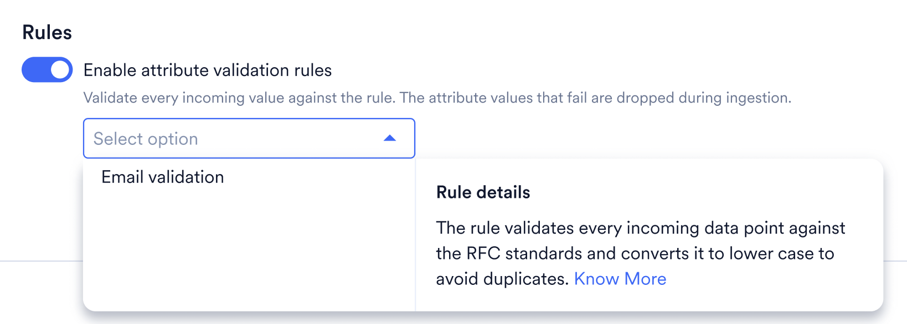

データ管理機能は、MoEngage でトラッキングしているデータに関する包括的なインサイトを提供します。このデータには、イベントやユーザープロパティなどのさまざまな重要な要素が含まれます。この機能には **Settings** \>**Data** \> **Data Management** からアクセスできます。

<Info>
  ワークスペースで [Portfolio](/ja/user-guide/settings/account/portfolio/portfolio) が有効になっている場合、データ管理にも関連する変更が適用されます。詳細については、[Portfolio: データの取り込みと管理](/ja/user-guide/data/key-concepts/portfolio-data-ingestion-and-management)を参照してください。
</Info>

データ管理ダッシュボードで確認できる主な情報は次のとおりです。

- MoEngage アカウントでトラッキングされているユニークイベントとユニークユーザープロパティの数を、許可されているイベントとユーザープロパティの総クォータと比較して明確に把握できます。
- 上限超過により自動的にブロックされたイベントとユーザープロパティの数を表示します。
- MoEngage で処理されたユーザーとイベントのボリュームを表示します。
- ボリュームに基づく上位 10 件のイベントを表示します。

## Overview タブ

データ管理の Overview タブでは、MoEngage アカウントで現在トラッキングされているユニークイベントとユーザープロパティの数に関する概要情報を確認できます。

### 使用状況

MoEngage におけるイベントとユーザープロパティの使用状況に関する情報を提供します。

#### イベント

- **Unique events used:** MoEngage アカウントでトラッキング可能なイベントの総数のうち、トラッキングされているユニークイベントの数を示します。**Unique events used** カードをクリックすると、[**Event** タブ](/ja/user-guide/settings/data-management/overview-data-management#usage)に移動します。
- **Auto-blocked events.** ユニークイベントがワークスペースのクォータの 100% に達したときに、MoEngage アカウントで自動的にブロックされたユニークイベントの数を示します。 自動ブロックされたイベントの一覧を表示するには、次の手順を実行します。
  1. **Overview** タブで、**Auto-blocked events** カードをクリックします
  2. **Event** タブで、自動ブロックされたすべてのイベントの一覧を確認できます 

#### ユーザープロパティ

- **Unique user attributes used**\
  MoEngage アカウントでトラッキング可能な総数のうち、トラッキングされているユニークユーザープロパティの数を示します。**Unique user attributes used** カードをクリックすると、[**User properties** タブ](/ja/user-guide/settings/data-management/overview-data-management#usage)に移動します。
- **Auto-blocked user attributes**\
  ユニークユーザープロパティがワークスペースのクォータの 100% に達したときに、MoEngage アカウントで自動的にブロックされたユニークユーザープロパティの数を示します。 自動ブロックされたユーザープロパティの一覧を表示するには、次の手順を実行します。
  1. **Overview** タブで、**Auto-blocked user attributes** カードをクリックします
  2. **User attributes** タブで、自動ブロックされたすべてのユーザープロパティの一覧を確認できます 

#### MoEngage でトラッキングされるイベントと属性の上限

MoEngage でデータをトラッキングする際には、以下の上限が適用されます。

| **タイプ** | **デフォルトの上限** | **超過時の処理** |
| --- | --- | --- |
| ユニークイベント | 512 | 過去 60 日間にトラッキングされていないイベントが最初に自動ブロックされ、それでも上限を超えている場合は新しいイベントがブラックリストに登録されます。 |
| ユニークユーザープロパティ | 256 | 過去 60 日間にトラッキングされていないユーザープロパティが最初に自動ブロックされ、それでも上限を超えている場合は新しいユーザープロパティがブラックリストに登録されます。 |
| ユニークイベントプロパティ | イベントあたり 100 | 最初の 100 個のイベントプロパティのみが取り込まれます。 |

詳細については、[データトラッキングポリシー](/ja/user-guide/data/key-concepts/data-tracking-policies)を参照してください。

### ボリューム

MoEngage で処理されたユーザーとイベントのボリュームに関する情報を提供します。期間フィルターを変更すると、**Event Volume (All Events)** および **Event Volume (Custom Events)** チャートに反映されます。システムはユーザーが定義した期間に基づいてチャートを生成します。

<Info>
  過去の日付のイベントは Event Volume チャートに含まれません。たとえば、今日取り込まれたイベントで日付が前日になっているもの（例: 11 月 17 日に取り込まれ、日付が 11 月 16 日のイベント）は、チャートの指標に反映されません。
</Info>

- **Event volume (All events)**\
  さまざまなソースから MoEngage に取り込まれたすべてのイベントの総数を示します。総イベントにはシステムイベントとカスタムイベントの両方が含まれます。**Event volume** カードをクリックすると分析チャートに移動し、日単位の粒度でイベントをフィルタリングできます。
- **Event volume (Custom events)** さまざまなソースから MoEngage に取り込まれたカスタムイベントの総数を示します。**Event volume** カードをクリックすると分析チャートに移動し、日単位の粒度でイベントをフィルタリングできます。
- **Web user volume (30-Day)** _Web_ プラットフォームでイベント _App/Site opened_ を実行したユーザーの数を示します。月に 1 回以上アプリ/サイトを開いたユーザーはアクティブユーザーと見なされます。**Web user volume** カードをクリックすると分析チャートに移動し、月単位の粒度でユーザーをフィルタリングできます。
- **Mobile user volume (30-Day)** _Mobile_ プラットフォームでイベント _App/Site opened_ を実行したユーザーの数を示します。月に 1 回以上アプリ/サイトを開いたユーザーはアクティブユーザーと見なされます。**Mobile** **user volume** カードをクリックすると分析チャートに移動し、月単位の粒度でユーザーをフィルタリングできます。
- **Top events by volume** ボリュームが最も多い上位 10 件のイベントを表示します。要件に応じて、**All events** または **Custom events** から上位イベントをフィルタリングできます。

## Event タブ

**Event** タブには、MoEngage アカウントでトラッキングされているすべてのイベントが一覧表示され、イベントに対してアクションを実行できます。以下のイベントカードをクリックすると、関連するイベントの一覧を表示できます。

- **Unique events used** MoEngage アカウントでトラッキング可能なイベントの総数のうち、トラッキングされているユニークイベントの数を示します。
- **Auto-blocked events** ユニークイベントがワークスペースのクォータの 100% に達したときに、MoEngage アカウントで自動的にブロックされたユニークイベントの数を示します。
- **Events not tracked** 選択した期間以降にデータを受信していないイベントの数を示します。ワークスペースのクォータの 100% に達した後、これらのイベントをブロックして新しいイベントを作成できます。

イベントに対して次のアクションを実行できます。

- <Icon icon="download" /> をクリックすると、イベント一覧を CSV 形式でダウンロードできます。
- <Icon icon="bars-filter" /> をクリックして、**Visibility**、**Category**、**Platform**、**Last seen**、**First seen** に基づいてイベントをフィルタリングし、**Apply** をクリックします。
  
- 編集アイコン <Icon icon="credit-card" /> をクリックし、イベントテーブルに表示する列を選択します。

## User Attributes タブ

**User attributes** タブには、MoEngage アカウントでトラッキングされているすべてのユーザープロパティが一覧表示され、ユーザープロパティに対してアクションを実行できます。**Unique user attributes used**、**Auto-blocked user attributes** カードをクリックすると、関連するユーザープロパティの一覧を表示できます。

ユーザープロパティに対して次のアクションを実行できます。

- <Icon icon="download" /> をクリックすると、イベント一覧を CSV 形式でダウンロードできます。
- <Icon icon="bars-filter" /> をクリックして、**Visibility**、**Category**、**Platform**、**Last seen**、**First seen,Tracked Data type, Allowed Data type, PII Masking** に基づいてイベントをフィルタリングし、**Apply** をクリックします。
- 編集アイコン <Icon icon="credit-card" /> をクリックし、ユーザープロパティテーブルに表示する列を選択します。

## カテゴリ

このダッシュボードに表示されるイベントとユーザープロパティは、MoEngage によって事前に作成されたそれぞれのカテゴリに分類されています。以下のように、任意のカテゴリを展開して、そのカテゴリに含まれるイベントやユーザープロパティを確認できます。

## アクション

データ管理ダッシュボードでは、次のアクションがサポートされています。

| アクション | 結果 | サポート対象 |
| --- | --- | --- |
| 属性またはイベントの詳細を編集 | イベント、イベントプロパティ、またはユーザープロパティの詳細を編集できます。  イベントの詳細には次のものが含まれます: <ul><li>表示名</li><li>ステータス</li><li>可視性</li><li>説明</li></ul> 属性の詳細には次のものが含まれます: <ul><li>表示名</li><li>ステータス</li><li>可視性</li><li>説明</li><li>データプライバシー設定<ul><li>属性の暗号化</li><li>属性のマスキング</li></ul></li><li>説明</li><li>許可されるデータ型</li></ul> | <ul><li>イベント</li><li>イベントプロパティ</li><li>ユーザープロパティ</li></ul> |
| [表示名の設定/編集](/ja/user-guide/settings/data-management/overview-data-management#edit-display-name) | イベントまたはイベントプロパティの表示名を設定/編集すると、その表示名がドロップダウンに表示され、マーケターがセグメントやキャンペーンを作成しやすくなります。 | <ul><li>イベント</li><li>イベントプロパティ</li><li>ユーザープロパティ</li></ul> |
| [ステータスの変更: Allowed](/ja/user-guide/settings/data-management/overview-data-management#status) | ブロックされたイベントのステータスを Allowed に変更すると、そのイベントは MoEngage アカウントでトラッキングされるようになります。データトラッキングの上限を超えない限り、デフォルトですべてのユニークイベントが許可されます。 | <ul><li>イベント</li><li>イベントプロパティ</li><li>ユーザープロパティ</li></ul> |
| [ステータスの変更: Blocked](/ja/user-guide/settings/data-management/overview-data-management#status) | イベントのステータスを Blocked に変更すると、そのイベントは受信しても MoEngage アカウントでトラッキングされなくなります。このイベントを使用している既存のキャンペーンはすべて機能しなくなります。 | <ul><li>イベント</li><li>イベントプロパティ</li><li>ユーザープロパティ</li></ul> |
| [可視性の変更: On](/ja/user-guide/settings/data-management/overview-data-management#visibility) | イベントの可視性を On に変更すると、そのイベントがドロップダウンに表示されるようになります。デフォルトでは、すべてのユニークイベントがドロップダウンに表示されます。 | <ul><li>イベント</li><li>イベントプロパティ</li><li>ユーザープロパティ</li></ul> |
| [可視性の変更: Off](/ja/user-guide/settings/data-management/overview-data-management#visibility) | イベントの可視性を Off に変更すると、そのイベントはドロップダウンに表示されなくなります。可視性が Off のイベントを使用しているキャンペーンやセグメントは引き続き正常に機能します。イベントは MoEngage アカウントで引き続きトラッキングされ、ドロップダウンから非表示になるだけです。 | <ul><li>イベント</li><li>イベントプロパティ</li><li>ユーザープロパティ</li></ul> |
| [説明の設定/編集](/ja/user-guide/settings/data-management/overview-data-management#edit-display-name) | イベント/イベントプロパティの説明を設定/編集すると、トラッキングに関する追加のコンテキストを得られます。現時点では MoEngage イベントの説明は MoEngage によって設定済みで、編集できません。 | <ul><li>イベント</li><li>イベントプロパティ</li><li>ユーザープロパティ</li></ul> |
| データプライバシー設定 | <ul><li>**Encrypt attribute** トグルをオンにすると、PII（個人を特定できる情報）属性を暗号化して MoEngage データウェアハウスに保存します。このオプションを有効にする前に受信した属性値は暗号化されません。</li><li>**Mask attribute** トグルをオンにすると、組織内の他のユーザーから PII を非表示にします。</li></ul> | <ul><li>イベントプロパティ</li><li>ユーザープロパティ</li></ul> |
| [許可されるデータ型の設定](/ja/user-guide/settings/data-management/overview-data-management#set-allowed-data-types) | 属性に許可されるデータ型を 1 つ設定することで、誤ったデータ型がデータベースに取り込まれないようにします。 | <ul><li>イベントプロパティ</li><li>ユーザープロパティ</li></ul> |

<Note>
  属性の暗号化の有効化に追加料金はかかりませんが、一度オンにすると元に戻すことはできず、暗号化された値を後から復号化したりマスク解除したりすることはできません。暗号化が有効になった*後*に受信したデータのみが暗号化され、すでに取り込まれたデータはそのまま残ります。暗号化された属性のエクスポートも暗号化されます。
</Note>

### ステータス

**Status** オプションでは、イベント、イベントプロパティ、またはユーザープロパティの Allowed または Blocked のステータスを確認できます。

属性が MoEngage システムに取り込まれると、そのステータスは **Allowed** に設定されます。時間の経過とともに、誤った統合やテストが原因で、アカウントに誤ったイベント、イベントプロパティ、またはユーザープロパティが見られるようになる場合があります。このように不正確にトラッキングされたデータポイントを防ぎたい場合は、これらの属性をブロックできます。ブロックするとステータスが **Blocked** に変わります。

許可されているイベント、イベントプロパティ、またはユーザープロパティをブロックするには、次の手順を実行します。

1. ブロックするイベントまたはユーザープロパティを選択します。
2. **Block** をクリックします。
3. 表示されるダイアログボックスで、**Update** をクリックします。
4. ブロック後、ステータスが **Allowed** から **Blocked** に変わります。

ブロックされたイベント、イベントプロパティ、またはユーザープロパティを許可するには、次の手順を実行します。

1. 許可するイベントまたはユーザープロパティを選択します。
2. **Allow** をクリックします。
3. 表示されるダイアログボックスで、**Update** をクリックします。
4. 許可後、ステータスが **Blocked** から **Allowed** に変わります。上記と同じ手順で、自動ブロックされたイベントも許可できます。
5. 省略記号アイコンをクリックして、**Edit an attribute or event**、**Turn visibility off**、または **Block** を実行します。

#### データトラッキングの上限によるブロック

イベント、イベントプロパティ、またはユーザープロパティが[こちら](/ja/user-guide/data/key-concepts/data-tracking-policies)に記載されている上限、または [Overview タブ](/ja/user-guide/settings/data-management/data-management-alerts)に表示されている上限を超えた場合、新しいイベント、イベントプロパティ、またはユーザープロパティが自動的にブロックされることがあります。

### 可視性

**Visibility** オプションを使用すると、イベント、イベントプロパティ、ユーザープロパティをドロップダウンで非表示または再表示にできます。デフォルトでは、MoEngage システムに取り込まれたすべてのイベント、イベントプロパティ、ユーザープロパティの可視性はオンになっています。

時間の経過とともに、マーケターが必要としないものも含め、イベントやイベントプロパティが多くなりすぎてドロップダウンが煩雑になる場合があります。このような場合、非表示にすることで、それらのイベントやイベントプロパティがドロップダウンに表示されなくなります。\
イベント、イベントプロパティ、またはユーザープロパティの可視性をオフにするには、次の手順を実行します。

1. 可視性をオフにするイベント、イベントプロパティ、またはユーザープロパティを選択します。
2. **Visibility Off** をクリックします。
3. 表示されるダイアログボックスで、**Update** をクリックします。
4. オフにすると、**Visibility** が **On** から **Off** に変わります。

イベント、イベントプロパティ、またはユーザープロパティの可視性をオンにするには、次の手順を実行します。

1. 可視性をオンにするイベント、イベントプロパティ、またはユーザープロパティを選択します。
2. **Visibility On** をクリックします。
3. 表示されるダイアログボックスで、**Update** をクリックします。
4. オンにすると、**Visibility** が **Off** から **On** に変わります。

### 表示名の編集

表示名を設定すると、マーケターがセグメントを作成する際に、イベント、イベントプロパティ、ユーザープロパティの名前を明確に読み取れるようになります。

分析システムがイベントを生成する際、イベント名がエンコードされていてマーケターにとって読みにくい場合があります。そのような場合は、イベントの表示名を定義して、マーケターが扱いやすくすることができます。

イベントプロパティまたはユーザープロパティの表示名を設定するには、次の手順を実行します。

1. イベントプロパティまたはユーザープロパティの横にある省略記号アイコンをクリックします。
2. **Edit attribute** をクリックします。
3. **Edit attribute details** サイドドロワーで、**Display name** を入力します。

4. **Save** をクリックします。

イベントの表示名を設定するには、次の手順を実行します。

1. イベントの横にある省略記号アイコンをクリックします。
2. **Edit event** をクリックします。
3. **Edit event** サイドドロワーで、**Display name** を入力します。

4. **Save** をクリックします。

#### 説明の編集

説明を設定すると、イベントが何を行うかについての追加のコンテキストをマーケターに提供できます。これは、[表示名の編集](/ja/user-guide/settings/data-management/overview-data-management#volume)アクションで示したのと同様に、イベントの編集/イベントプロパティの編集/ユーザープロパティの編集ポップアップから設定できます。

### 許可されるデータ型の設定

許可されるデータ型の設定アクションはユーザープロパティとイベントプロパティでサポートされており、同じ属性に他のデータ型が記録されないようにします。

イベントプロパティまたはユーザープロパティに許可されるデータ型を設定するには、次の手順を実行します。

1. イベントプロパティまたはユーザープロパティの横にある省略記号アイコンをクリックします。
2. **Edit attribute** をクリックします。
3. **Edit attribute details** サイドドロワーで、**Allowed data type** リストからデータ型を選択します。
4. **Save** をクリックします。

#### 仕組み

たとえば、"amount" という属性に許可されるデータ型を Numeric に設定すると、それ以降 "amount" 属性がトラッキングされるたびに、MoEngage は値を Numeric に型変換しようとします。たとえば、amount に許可されるデータ型を Numeric に設定した後、文字列値である `{"amount": "145"}` を送信すると、145 の数値として保存され、セグメンテーションや分析でこの値に数値演算子を使用できるようになります。ただし、`{"amount": "sample value"}` を送信した場合、この値は型変換できないため破棄されます。正確なデータのみが保存されるように、amount: sample\_value はデータベースに保存されません。

以下の表では、列に受信する属性のデータ型、行に許可されるデータ型を示しており、各セルの値はデータ取り込みのロジックを表しています。

|  | String | Numeric | Boolean | Date | Location |
| --- | --- | --- | --- | --- | --- |
| Any | String として受け入れ | Numeric として受け入れ | Boolean として受け入れ | Date として受け入れ | Location として受け入れ |
| String | String として受け入れ | String に型変換 | String に型変換 | String に型変換 | String に型変換 |
| Numeric | 可能であれば Numeric に型変換、それ以外は破棄 | Numeric として受け入れ | 破棄 | 破棄 | 破棄 |
| Boolean | 可能であれば boolean に型変換、それ以外は破棄 | 破棄 | 破棄 | 破棄 | 破棄 |
| Date | 受け入れ可能な形式であれば Date に型変換、それ以外は破棄 | 破棄 | 破棄 | 破棄 | 破棄 |
| Location | 受け入れ可能な形式であれば Location に型変換、それ以外は破棄 | 破棄 | 破棄 | 破棄 | 破棄 |

デフォルトでは、属性は **Any** に設定されており、この属性にはどのデータ型も受け入れられます。属性に複数のデータ型が設定されている場合、以下のように、クエリ作成時にセグメンテーションのドロップダウンに複数のデータ型が表示されます。

許可されるデータ型を設定すると、それ以降は許可されたデータ型のみが取り込まれます。ただし、システムに過去のデータが存在するため、データベースに古いデータ型が引き続き表示される場合があります。デフォルトでは、セグメンテーションで許可されたデータ型が事前に選択されます。

#### すでに取り込まれたデータへの影響

許可されるデータ型の設定は、変更後に取り込まれたデータに適用されます。MoEngage は、以前のデータ型ですでに保存されている値を変換せず、過去のイベントを再取り込みしたり書き換えたりすることもありません。そのため、古い値が保持期間を過ぎるまで、属性には両方のデータ型が混在します。

すでに使用中の属性の許可されるデータ型を変更する前に、次の影響を考慮して計画してください。

- **新しいデータ型でのクエリは、新しい値のみに一致します。** 新しく許可されたデータ型として属性をフィルタリングするセグメンテーションまたは分析クエリは、以前のデータ型で保存された値が新しいデータ型として評価されないため、0 ユーザー、または予想よりもはるかに少ない数を返します。新しいデータが取り込まれるにつれて、カウントは回復します。これは、データ型の変更直後にセグメント数が減少したように見える最も一般的な理由です。
- **クエリビルダーでは両方のデータ型が引き続き利用可能です。** 属性はこれまでトラッキングされたすべてのデータ型を保持するため、セグメンテーションのドロップダウンには、許可されたデータ型とともに以前のデータ型も引き続き表示されます。許可されたデータ型が事前に選択されますが、古いデータ型も選択可能なままです。
- **値の候補には、以前のデータ型の値も引き続き表示されます。** 候補はすでに取り込まれたデータから生成されるため、古いデータ型で保存された値は表示され続けます。これらの値が削除されるのは、属性が候補の上限に達した後に新しい値に置き換えられた場合、または属性が 60 日間値を受信しなかった場合のみです。詳細については、[値の候補](/ja/user-guide/segment/advanced-concepts/value-suggestions)を参照してください。

両方のデータ型が存在する間に属性の全履歴をクエリするには、データ型ごとに 1 つの条件を追加し、OR で組み合わせます。たとえば、新しい値には Date としての属性、OR 古い値には String としての属性を指定します。

<Note>
  「過去 7 日間」などの相対日付演算子は、Date データ型でのみ使用できます。String として保存されたままの値は相対日付でフィルタリングできないため、両方のデータ型をカバーする必要があるセグメントでは、String の条件に絶対値または範囲を指定する必要があります。全履歴が重要で相対日付が必要な場合は、両方のデータ型にまたがってクエリを実行するのではなく、許可されたデータ型で過去の値を再取り込みしてください。
</Note>

### ルール

<Note>
  これは Early Access 機能です。アカウントで有効にするには、MoEngage のカスタマーサクセスマネージャー (CSM) またはサポートチームにお問い合わせください。
</Note>

ルールを使用すると、受信するユーザー識別子にデータ標準を適用できます。メールアドレスまたは携帯電話番号の属性で検証ルールを有効にすると、MoEngage は取り込み前に受信するすべての値をルールと照合します。これにより、配信の失敗が減り、キャンペーンのパフォーマンスが向上します。

属性で検証ルールが有効になっている場合:

- 受信する値は、取り込み前にルールと照合されます。
- ルールに一致しない値は破棄されます。属性値は保存されませんが、ユーザーレコードの残りの部分は受け入れられます。
- 有効な値は通常どおり取り込まれます。

<Info>
  検証ルールは新しく受信するデータにのみ適用されます。既存のユーザーレコードは遡って検証されません。既存のデータをクリーンアップするには、[File Imports](/ja/user-guide/data/imports/setting-up-a-file-import) を使用して再インポートするか、[Data API](/ja/api/data/data-overview) を使用して更新してください。
</Info>

#### 組み込みルール

##### Email

Email ルールは、すべてのメールアドレスがキャンペーンで使用できる状態であることを保証します。RFC 5322 標準を適用し、各メールアドレスを小文字に変換します。

- 検証内容:
   - メールアドレスの構文が RFC 5322 (グローバルなメール標準) に準拠していること。
   - ローカル部 (`@` の前) とドメインに有効な文字のみが含まれていること。
   - `@` が正しい位置にあり、ドメインが正しく構成されていること。

- 変換内容:
   - すべてのメールアドレスを小文字に変換します (`User@Example.com` → `user@example.com`)。

- 重要な理由:
   - 同じユーザーが異なる大文字・小文字で登録した場合に、プロファイルの重複を防ぎます。
   - 無効なメールアドレスが送信時にハードバウンスを引き起こすのを防ぎます。
   - メールサービスプロバイダーによる拒否を減らします。

- 例: 

| 受信データ | 結果 | 理由 |
| :--- | :--- | :--- |
| `user@example.com` | `user@example.com` として保存 | 有効 |
| `User@Example.com` | `user@example.com` として保存 | 有効、小文字に変換 |
| `user.name@example.com` | `user.name@example.com` として保存 | 有効 |
| `user..name@example.com` | 破棄 | 無効 (ピリオドの連続) |
| `userexample.com` | 破棄 | 無効 (`@` がない) |
| `user@` | 破棄 | 無効 (ドメインがない) |

##### Mobile number

Mobile number ルールは、電話番号がグローバルな電話番号標準である E.164 に準拠していることを保証します。

- 検証内容: 
   - 番号に `+` プレフィックスがあること。
   - 国番号が有効であること (1～3 桁)。
   - 加入者番号が有効であること (最大 12 桁)。
   - 全体の長さが 15 桁以下であること。
   - 番号に特殊文字 (スペース、ハイフン、括弧) が含まれていないこと。

- 重要な理由: 
   - E.164 は、WhatsApp Business API および SMS アグリゲーター (Twilio や Vonage など) で必須です。
   - 国による曖昧さを防ぎます。
   - ルーティングエラーによるメッセージの送信失敗を防ぎます。

- 例:

| 受信データ | 結果 | 理由 |
| :--- | :--- | :--- |
| `+14155552671` | 保存 | 有効な E.164 |
| `+919876543210` | 保存 | 有効な E.164 (インド) |
| `+447123456789` | 保存 | 有効な E.164 (英国) |
| `14155552671` | 破棄 | 無効 (`+` プレフィックスがない) |
| `+1 (415) 555-2671` | 破棄 | 無効 (スペースと括弧を含む) |
| `(0) 98765 43210` | 破棄 | 無効 (E.164 形式ではない) |

<Tip>
  Mobile number ルールを有効にする前に、データソースが E.164 形式で番号を送信していることを確認してください。既存のデータがローカル形式 (`(0) 98765 43210` など) を使用している場合は、まず取り込みパイプラインを更新して変換してください。
</Tip>

#### 検証ルールを有効にする

ユーザープロパティで検証ルールを有効にするには、次の手順を実行します。

1. **User attributes** タブで、ルールを適用する属性 (標準のメール属性やカスタムの携帯電話番号属性など) の横にある省略記号アイコンをクリックします。
2. **Edit attribute** をクリックします。
3. **Edit attribute details** サイドドロワーの **Rules** で、**Enable attribute validation rules** トグルをオンにします。
4. **Email** または **Mobile number** を選択します。
5. **Save** をクリックします。

<Warning>
  ルールが有効になると、ルールに一致しない受信データはすべて破棄されます。まず非本番環境でテストしてください。
</Warning>

#### ルールに関する FAQ

<AccordionGroup>
  <Accordion title="ルールを適用できないのはなぜですか？">
   検証ルールは、許可されるデータ型が **String** で、PII 暗号化が有効になっていない属性にのみ適用できます。
  </Accordion>
  <Accordion title="ルールは PII 暗号化とどのように連携しますか？">
    暗号化されたデータは値が暗号化された文字列として表示されるため、検証ルールで検証できません。PII 暗号化を使用する場合は、検証ルールを無効にする必要があります。
  </Accordion>
  <Accordion title="ルールを無効にするとどうなりますか？">
    検証は直ちに停止します。既存のレコードは影響を受けず、新しく受信するデータは検証されなくなります。
  </Accordion>
  <Accordion title="MoEngage にすでにあるデータを検証できますか？">
    いいえ。検証ルールは受信データにのみ適用されます。既存のユーザーレコードを検証するには、属性をエクスポートして外部でクリーンアップし、再インポートしてください。
  </Accordion>
</AccordionGroup>

### 配列の型変換

配列内のすべての要素は均質である必要があります。つまり、すべて整数またはすべて文字列でなければなりません。均質でない場合、MoEngage は要素の型変換（変形）を試みてからデータを保存します。CSV フィールドにおける配列の例は次のとおりです: \[1|2|3\] 

配列に複数のデータ型を含む要素 \[1 | 2 | “abc”\] があり、最初の要素に基づいて定義されたデータ型が Array Integer である場合、"abc" は Integer に正常に型変換できないため、配列またはデータポイント全体が取り込まれません。

空の配列 \[\] の取り込みはサポートされており、既存の配列属性の設定が解除されます。
