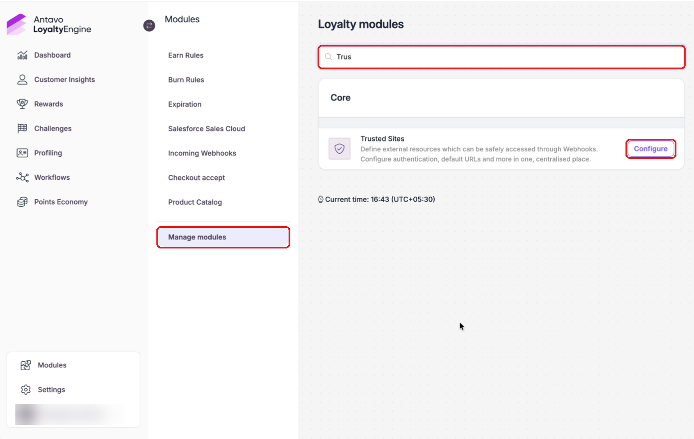
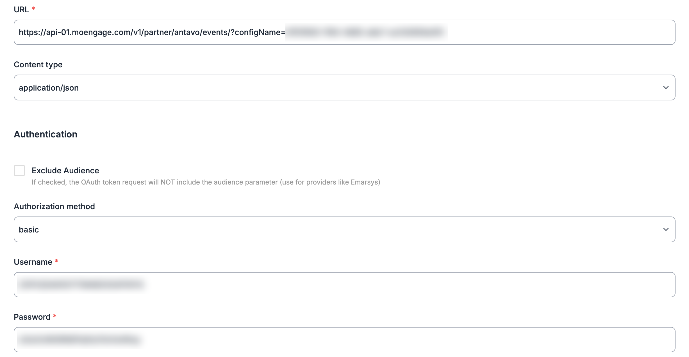
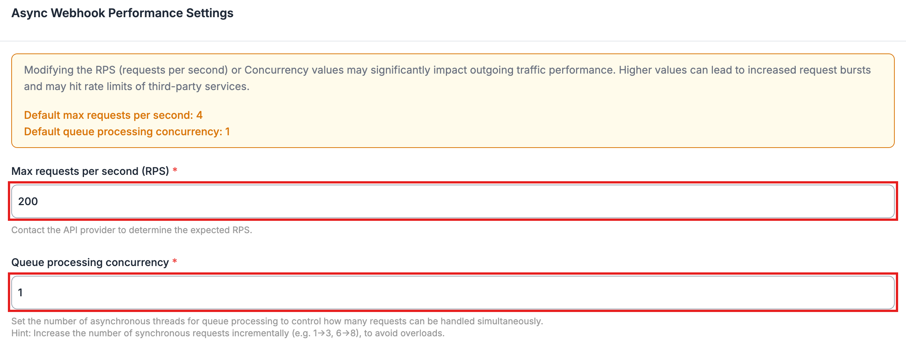
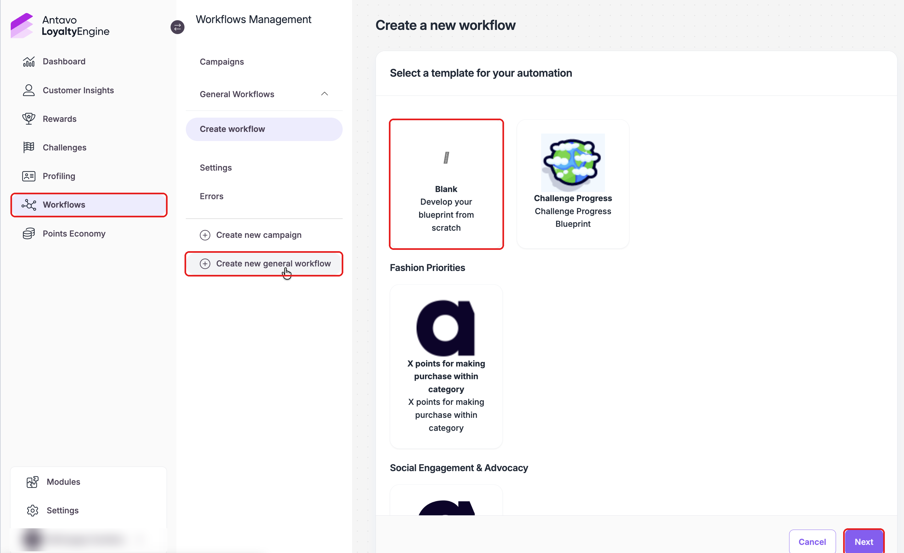
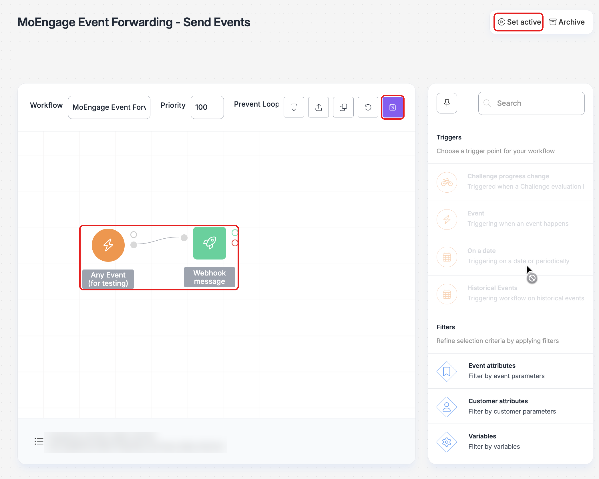
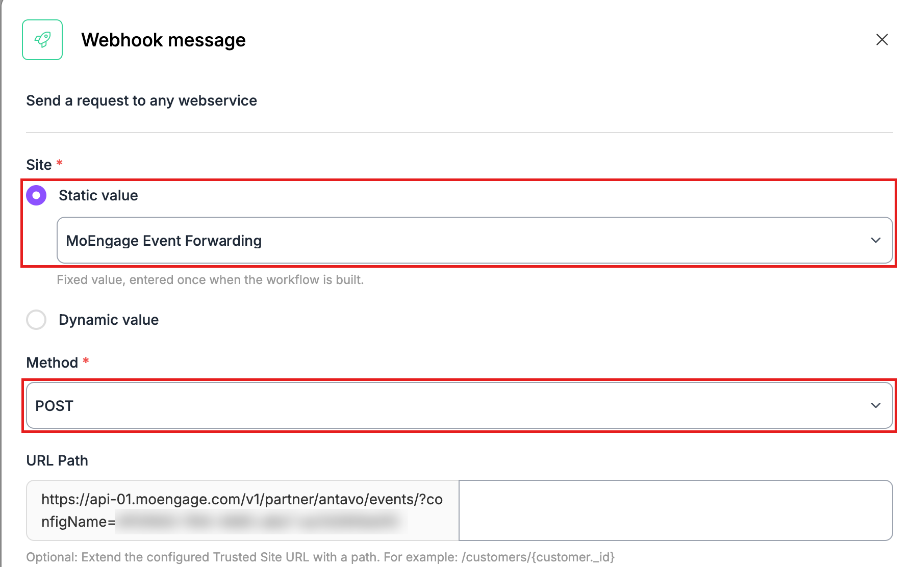
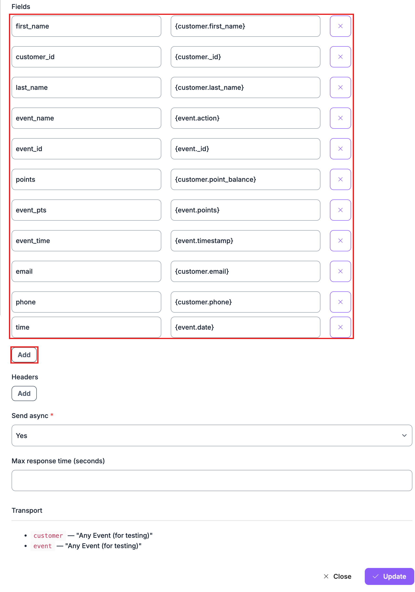

# Introduction

[Antavo](https://antavo.com/) Loyalty Engine is a loyalty management platform that brands use to run loyalty programs with points, tiers, rewards, and challenges.

# MoEngage × Antavo

The MoEngage and Antavo integration sends Antavo loyalty events and customer data to MoEngage in real time. Whenever an event happens in Antavo, an Antavo workflow sends it to a dedicated MoEngage endpoint with a webhook. MoEngage adds the data to the user's profile, so you can use it in segments, campaigns, and flows.

You can set up one of two sync types:

- **Event sync**: Sends Antavo events and updates user profiles.
- **User sync**: Updates user profiles only.

## Use Cases

Integrating Antavo with MoEngage helps you solve use cases such as the following:

- **Loyalty-triggered messages**: Send a message when a customer earns points, claims a reward, or moves up a tier.
- **Loyalty segments**: Group users by their loyalty data, such as tier or points balance, and target each group with its own campaign.
- **Unified customer profile**: Keep loyalty activity in the same MoEngage profile as the user's app, web, and campaign activity.

# Integration

<Info>
  **Prerequisites**

  - Admin access to your Antavo Loyalty Engine workspace.
  - Your MoEngage Workspace ID and Data API Key. To find them, in the MoEngage UI, navigate to **Settings** \> **Account** \> **APIs**.
  - A dedicated Antavo endpoint from MoEngage, from [Step 1](/partner-guide/commerce-and-loyalty/loyalty/antavo#step-1-get-your-antavo-endpoint-from-moengage).
</Info>

## Step 1: Get Your Antavo Endpoint from MoEngage

Contact MoEngage support, and share the following:

- **Sync type**: Event sync or user sync.
- **Identifier**: The field that identifies a customer in both platforms. For example, the Antavo customer ID mapped to the MoEngage customer ID.
- **Fields**: A sample of the data you plan to send, so that MoEngage can build the field mapping.

MoEngage support shares an endpoint URL and the list of field names it expects. The endpoint depends on the sync type:

```text Event Sync
https://api-0X.moengage.com/v1/partner/antavo/events/?configName=<your-config-id>
```

```text User Sync
https://api-0X.moengage.com/v1/partner/antavo/users/?configName=<your-config-id>
```

The `X` in `api-0X` is the number of your [MoEngage data center](/user-guide/data/key-concepts/data-centers-in-moengage). Keep the field list for [Step 3](/partner-guide/commerce-and-loyalty/loyalty/antavo#step-3-create-a-workflow-in-antavo).

## Step 2: Add MoEngage as a Trusted Site in Antavo

A [Trusted Site](https://docs.antavo.com/docs/trusted-sites) stores the MoEngage endpoint and its authentication in Antavo, so that workflows can call it. To add MoEngage as a Trusted Site, perform the following steps:

1. In Antavo, click **Modules** \> **Manage modules**.
2. Search for **Trusted Sites**, and then click **Configure**.

   
3. Click **Add new site**.
4. Enter the following details:

   | Field | Value |
   | --- | --- |
   | Name | A name for the site (for example, MoEngage Event Forwarding). Workflows show this name in the **Site** list. |
   | URL | The endpoint from [Step 1](/partner-guide/commerce-and-loyalty/loyalty/antavo#step-1-get-your-antavo-endpoint-from-moengage). |
   | Content type | **application/json** |
   | Exclude Audience | Leave clear. |
   | Authorization method | **basic** |
   | Username | Your MoEngage Workspace ID. |
   | Password | Your MoEngage Data API Key. |

   
5. Under **Async Webhook Performance Settings**, enter the following:
   - **Max requests per second (RPS)**: **500** or lower. For more information, refer to [Rate Limits](/partner-guide/commerce-and-loyalty/loyalty/antavo#rate-limits).
   - **Queue processing concurrency**: Choose based on your traffic. If you're not sure, ask your Antavo contact.

   
6. Click **Create**.
7. Click **Set active**.

New sites are saved as drafts, and workflows can use only active sites. If you don't change the async settings, Antavo uses 4 requests per second and a concurrency of 1.

<Warning>
  Treat the Data API Key like a password. Don't share screenshots of the Trusted Site page.
</Warning>

## Step 3: Create a Workflow in Antavo

The workflow sends a [Webhook message](https://docs.antavo.com/docs/actions) to MoEngage whenever its trigger fires. To create the workflow, perform the following steps:

1. In Antavo, click **Workflows**.
2. Click **Create new general workflow**.
3. Click **Blank**, and then click **Next**.

   
4. In the **Workflow** box, enter a name (for example, MoEngage Event Forwarding - Send Events).
5. From **Triggers**, drag a trigger onto the canvas:
   - **Event**: Sends only the events you select. Use this trigger in production.
   - **Any Event (for testing)**: Sends every event. Use this trigger only while you test.
6. Add a **Webhook message** action, and connect the trigger to it.

   
7. Click the **Webhook message** action, and enter the following details:

   | Field | Value |
   | --- | --- |
   | Site | Select **Static value**, and then select the Trusted Site from [Step 2](/partner-guide/commerce-and-loyalty/loyalty/antavo#step-2-add-moengage-as-a-trusted-site-in-antavo). The MoEngage URL fills in. |
   | Method | **POST** |
   | URL Path | Leave empty. |
   | Fields | Click **Add** once for each field in the mapping from MoEngage support. Enter the field name on the left and its value on the right. Type `{` in the value box to select a variable. |
   | Headers | Leave empty. The Trusted Site handles authentication. |
   | Send async | Choose based on your traffic. If you're not sure, ask your Antavo contact. |
   | Max response time (seconds) | Leave empty to use the default. |
   | Transport | Leave as is. |

   

   
8. Click the save button, and then click **Set active**.

The following table shows an example field mapping. Use the exact field names MoEngage support gives you.

| Field Name | Value |
| --- | --- |
| customer_id | `{customer._id}` |
| first_name | `{customer.first_name}` |
| last_name | `{customer.last_name}` |
| email | `{customer.email}` |
| phone | `{customer.phone}` |
| points | `{customer.point_balance}` |
| event_name | `{event.action}`. Event sync only. |
| event_id | `{event._id}`. Event sync only. |
| event_pts | `{event.points}`. Event sync only. |
| event_time | `{event.timestamp}`. Event sync only. |

<Warning>
  Field names must match the mapping exactly. If a field name is misspelled or missing, its value doesn't reach MoEngage.
</Warning>

## Step 4: Check the Data in MoEngage

To check that the data reaches MoEngage, perform the following steps:

1. In Antavo, trigger an event. For example, create a test customer or record a purchase.
2. In Antavo, open the workflow's **Log** and **Errors** pages, and check that the webhook was sent and got a success response.
3. In MoEngage, click **Segment** \> **Search Users**, and search for the customer ID you used.
4. Open the user profile.

The event appears in the user's activity with its attributes, and profile fields such as name and email show the new values. For more information, refer to [User Profile](/user-guide/data/user-data/user-profile).

## Rate Limits

To maintain platform stability, MoEngage limits ingestion of Antavo data to a maximum of 500 requests per second (RPS) per workspace. If your workspace exceeds this limit, MoEngage returns an HTTP `429 (Too Many Requests)` status code.

For more information about payload size and the other ingestion limits, refer to [Partner Data Ingestion Rate Limits](/partner-guide/data-and-analytics/ingestion-rate-limits).

## Troubleshooting

| Issue | What to Check |
| --- | --- |
| No webhook in the Antavo log | The workflow is active, and its trigger matches the event you fired. |
| 401 or authentication error | The username is your Workspace ID and the password is your Data API Key, with no extra spaces. |
| Webhook succeeds, but the user or event is missing in MoEngage | The field names match the mapping exactly, and `customer_id` has a value. |
| Event shows the wrong time | The timestamp format matches what MoEngage configured for your endpoint. |
| 429 errors or delays | The RPS on the Trusted Site is 500 or lower. |

If the issue continues, send MoEngage support the customer ID, the time of the event, and the response from the Antavo log.
