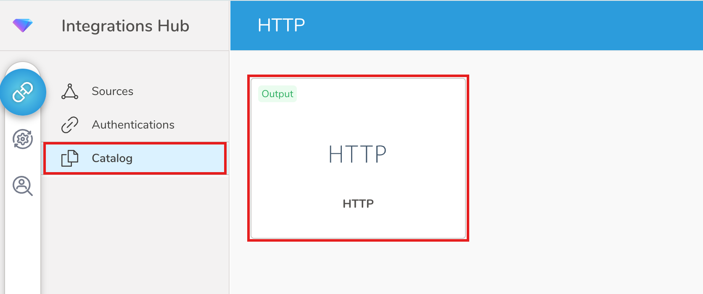
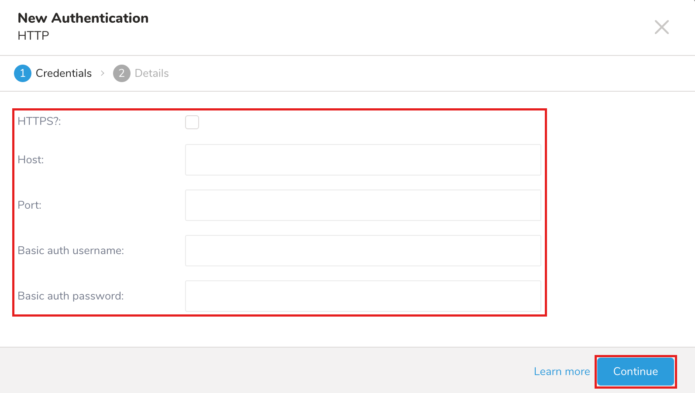
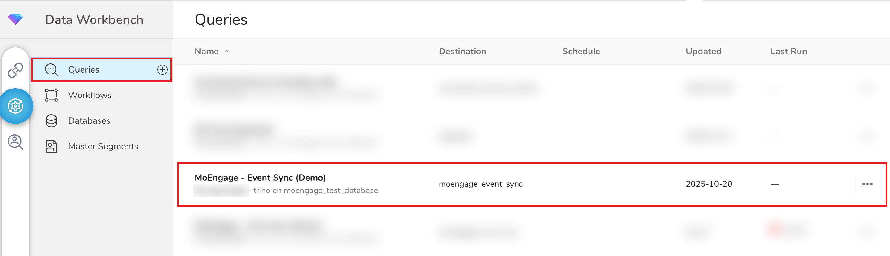
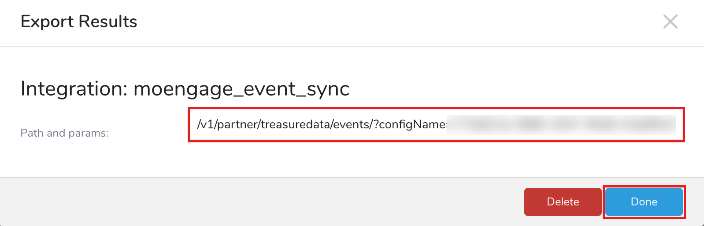
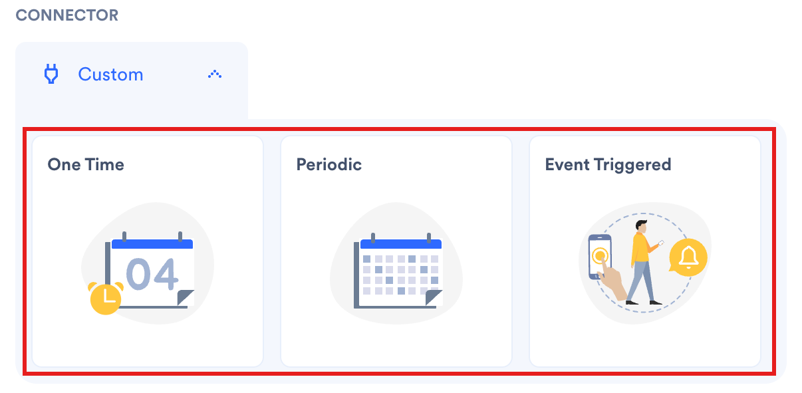

# Introduction

[Treasure Data](https://www.treasure.ai/) is a customer data platform (CDP) that collects customer data from many sources and sends it to the other tools in your marketing stack.

# MoEngage × Treasure Data

The MoEngage and Treasure Data integration works in both directions. You can do the following:

- Send users and events from Treasure Data to MoEngage.
- Create or update users in MoEngage.
- Send MoEngage campaign interaction data back to Treasure Data.

## Use Cases

- **Target segments**: Sync your consolidated customer profiles from Treasure Data to MoEngage to build segments. Treasure Data profiles can include first-party cookie data, mobile IDs, and data from third-party systems such as your CRM.
- **Campaign data in Treasure Data**: Send MoEngage campaign interactions back to Treasure Data to analyze them with the rest of your customer data.

# Send Data from Treasure Data to MoEngage

<Info>
  **Prerequisites**

  - Permission to create an HTTP authentication in Treasure Data.
  - Your MoEngage Workspace ID and Data API Key. To find them, in the MoEngage UI, navigate to **Settings** \> **Account** \> **APIs**.
</Info>

<Note>
  This integration isn't enabled by default. Contact your MoEngage Customer Success Manager (CSM) to enable it.
</Note>

## Step 1: Get Your MoEngage Endpoints

Contact your MoEngage CSM to get dedicated Treasure Data endpoints. You get two endpoints: one to import users and one to import events.

## Step 2: Create an HTTP Authentication in Treasure Data

Perform the following steps once for each endpoint:

1. In Treasure Data, click **Integrations Hub** \> **Catalog**.

   
2. Search for **HTTP**, and then click **Create Authentication**.
3. Enter the following details:

   | Field | Value |
   | --- | --- |
   | HTTPS | Select this check box. |
   | Host | The part of your MoEngage endpoint before `/v1/partner/treasuredata/`, without `https://`. |
   | Port | Leave empty. |
   | Basic auth username | Your MoEngage Workspace ID. |
   | Basic auth password | Your MoEngage Data API Key. |

   
4. Click **Continue**.
5. Save the authentication with a name, such as `moengage_user_sync` or `moengage_event_sync`.

## Step 3: Export Query Results to MoEngage

1. In Treasure Data, click **Data Workbench** \> **Queries**, and then select the query whose results you want to send.

   
2. Run the query.
3. Click **Export Results**, and then select the authentication you created in [Step 2](/partner-guide/data-and-analytics/cdps/treasure-data#step-2-create-an-http-authentication-in-treasure-data).
4. In **Path and params**, enter the rest of your MoEngage endpoint, starting from `/v1/partner/treasuredata/`.
5. Click **Done**.

   

The query must return a `customer_id` column. MoEngage uses it to identify users. If you write queries in Hive, wrap column and table names that start with an underscore in backquotes, such as `` `_merge_objects` ``.

For more information about pre-formatted fields, example queries, and scheduling export jobs, refer to [Web Server and HTTP PUT Endpoint Export Integration](https://docs.treasure.ai/int/web-server-and-http-put-endpoint-export-integration) in the Treasure Data docs.

## Step 4: Check the Data in MoEngage

In MoEngage, click **Segment** \> **Search Users**, and search for a `customer_id` from your query. The user profile shows the new attributes and events.

# Send Campaign Interaction Data to Treasure Data

Send MoEngage campaign interactions to Treasure Data with a custom connector campaign that calls the Treasure Data Postback API.

<Info>
  **Prerequisites**

  - A Treasure Data [Write-only API key](https://docs.treasure.ai/products/my-settings/getting-your-api-keys).
  - A Treasure Data database and table that the key can write to.
</Info>

To create the connector campaign, perform the following steps:

1. On the left navigation menu in the MoEngage UI, click **+ Create New**, and then click **Campaign**.
2. Under **Connector**, click **Custom**, and then click the delivery type you need: **One Time**, **Periodic**, or **Event Triggered**.

   
3. In **Step 1** (Target Users), select your audience.
4. In **Step 2** (Content), enter the following details:

   | Field | Value |
   | --- | --- |
   | Method | **POST** |
   | URL | `<postback-base-url>/postback/v3/event/<database>/<table>`. For the Postback base URL of your region, refer to [Sites and Endpoints](https://docs.treasure.ai/apis/endpoints/endpoints) in the Treasure Data docs. |
   | Headers | `Content-Type`: `application/json`<br />`X-TD-Write-Key`: Your Treasure Data Write-only API key. |
   | Body | A JSON object with one key-value pair for each column in your table. The key is the column name. |

5. Under **Test Campaign**, select an identifier, enter the value of a test user, and then click **Test**.

   
6. Click **Next**, set the schedule in **Step 3** (Schedule and Goals), and then publish the campaign.

The following is an example body:

```json Example Body
{
  "email": "{{UserAttribute['Email (Standard)']}}",
  "campaign_name": "Spring Sale Push"
}
```

Each request sends one record.

Treasure Data returns `200 OK` even if the Write-only API key is invalid, because it checks the key after it responds. If data doesn't appear in your table, check the key first.

<Tip>
  **Use Postback API v2**

  You can also send data to Treasure Data's newer [Postback API v2](https://docs.treasure.ai/apis/postback-v2/quickstart). It uses the same path, with these changes:

  - **URL**: `https://<region>.records.in.treasuredata.com/postback/v3/event/<database>/<table>`. For example, `https://us01.records.in.treasuredata.com/postback/v3/event/marketing_db/campaign_events`.
  - **Authentication**: Send your key in a header, either `X-TD-Write-Key: <key>` or `Authorization: TD1 <key>`. Postback API v2 doesn't accept the key as a URL parameter (`?td_write_key=`).
  - **Size limit**: Each request body can be up to 1,048,064 bytes.
</Tip>
