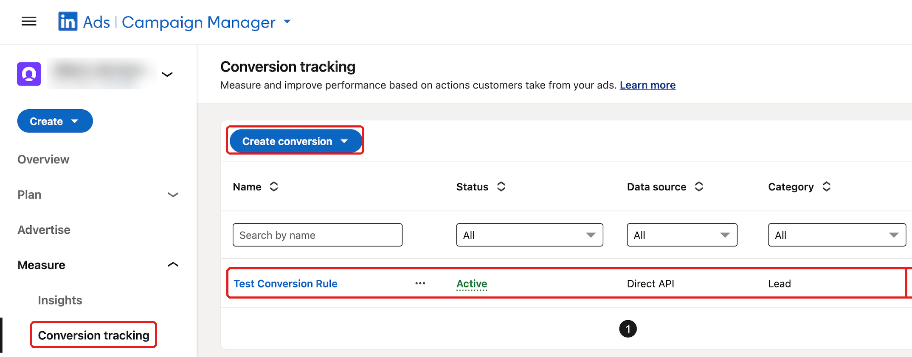
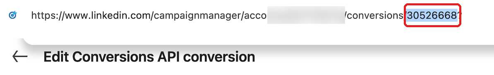
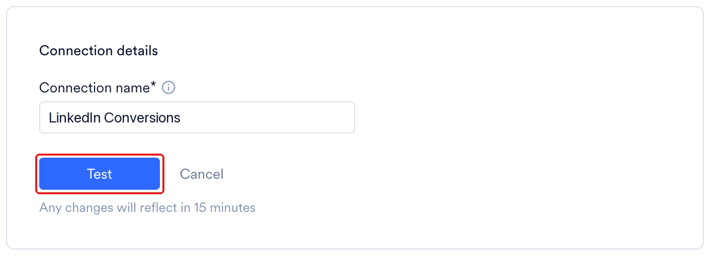
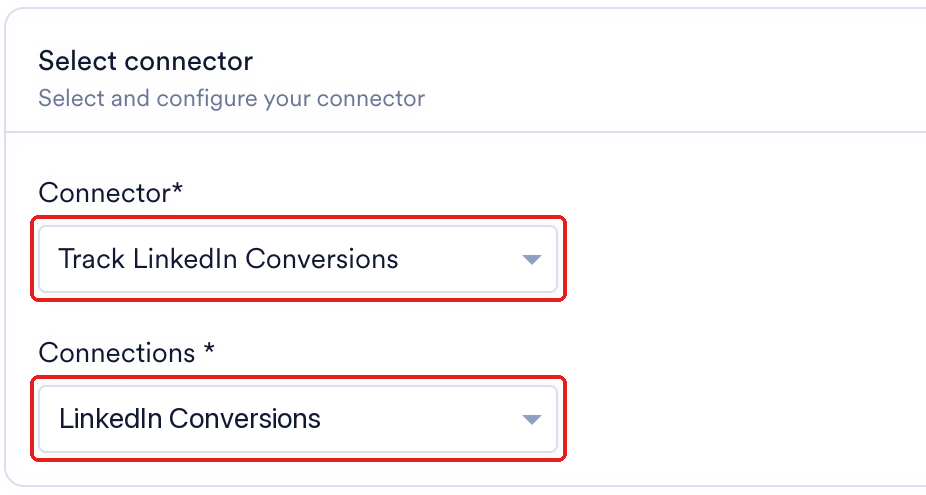
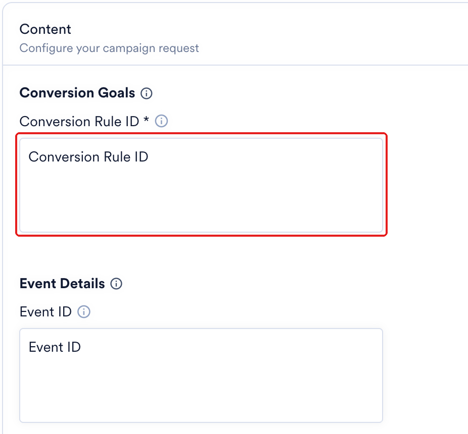
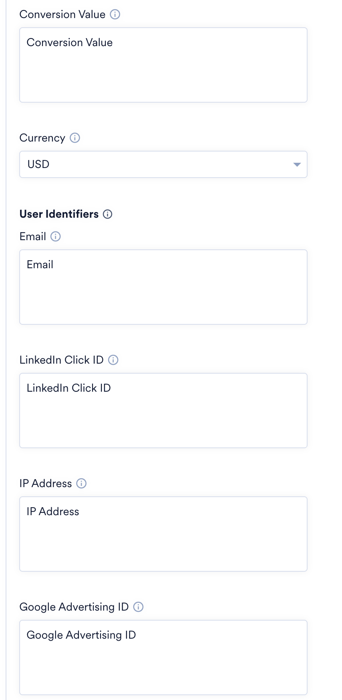
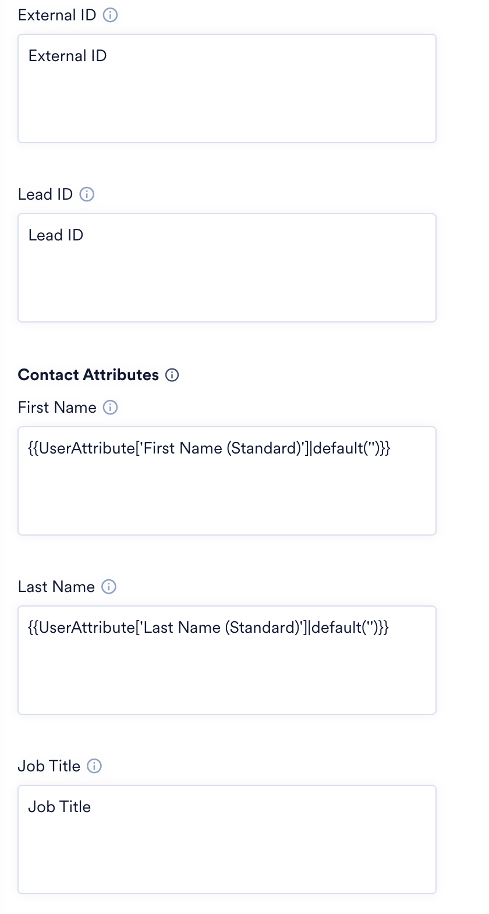

import ConnectedSegmentsAddOn from '/snippets/connected-segments-add-on.mdx';

<ConnectedSegmentsAddOn />

# Introduction

The LinkedIn Ads Conversions integration sends conversion events from MoEngage to the [LinkedIn Conversions API](https://learn.microsoft.com/en-us/linkedin/marketing/integrations/ads-reporting/conversions-api) over a server-to-server (S2S) connection. Because the events don't pass through the browser, cookie restrictions and ad blockers can't stop them, and LinkedIn receives conversions that client-side tracking misses.

MoEngage provides one connector for LinkedIn, **Track LinkedIn Conversions**. It sends conversions from any source, such as your website, app, CRM, or physical store, to a conversion rule in LinkedIn Campaign Manager.

## Use Cases

Integrating LinkedIn Ads Conversions with MoEngage helps you solve the following use cases:

- **Complete conversion data**: Send conversions that browser privacy settings and ad blockers hide from the LinkedIn Insight Tag.
- **Offline and lead attribution**: Attribute conversions that happen in your app, CRM, or store, or that come from a LinkedIn Lead Gen Form, to the ads that drove them.
- **Campaign optimization**: Give LinkedIn more conversion data, so it can deliver your ads to members who are more likely to convert and lower your Cost Per Acquisition (CPA).

<Info>
  **Prerequisites**

  Before setting up the connector, ensure you have the following in [LinkedIn Campaign Manager](https://www.linkedin.com/campaignmanager):

  - **Ad account role**: One of these roles in the ad account: Account Billing Admin, Account Manager, Campaign Manager, or Creative Manager. You sign in to LinkedIn with this user when you connect the app.
  - **Conversion rule**: A conversion rule for each type of conversion you want to track.
  - **Connected Apps in MoEngage**: Contact your MoEngage CSM if Connected Apps is not enabled for your account.
</Info>

# Integration with LinkedIn Ads Conversions

## Step 1: Set Up Conversion Tracking in LinkedIn

LinkedIn records each event that MoEngage sends against a conversion rule. Create the rule, link it to your ad sets, and copy its ID.

### Step 1.1: Create a Conversion Rule

1. Log in to [LinkedIn Campaign Manager](https://www.linkedin.com/campaignmanager), and open your ad account.
2. On the left navigation menu, click **Measure** \> **Conversion tracking**.
3. Click **Create conversion** to create a conversion rule.
4. Complete the **Settings**, **Sources**, and **Review** steps. Under **Ad sets**, select the ad sets you want to measure.

   

The rule appears on the **Conversion tracking** page with **Direct API** as its data source. LinkedIn attributes conversions only to the ad sets linked to the rule, so select every ad set you want to measure. For more information, refer to [Get started with LinkedIn Conversion Tracking](https://www.linkedin.com/help/lms/answer/67513) in LinkedIn Help.

### Step 1.2: Retrieve the Conversion Rule ID

1. On the **Conversion tracking** page, click your conversion rule.
2. Copy the number after `/conversions/` in the browser URL.

   

For example, in `https://www.linkedin.com/campaignmanager/accounts/<ad-account-id>/conversions/30526668`, the Conversion Rule ID is `30526668`. You enter this ID in [Step 3](/partner-guide/retargeting-and-audience-sync/ad-conversions/linkedin-ads-conversions#step-3-create-a-linkedin-ads-conversions-campaign).

## Step 2: Connect LinkedIn Ads Conversions in the App Marketplace

To connect LinkedIn Ads Conversions in the App Marketplace, perform the following steps:

1. On the left navigation menu in the MoEngage UI, click **App Marketplace**.
2. On the **App Marketplace** page, search for **LinkedIn Ads Conversions**.
3. Click the **LinkedIn Ads Conversions** tile.
4. On the **LinkedIn Ads Conversions** page, click the **Integrate** tab.
5. Click **\+ Add integration**.
6. Enter the following details:

   | Field | Required | Description |
   | --- | --- | --- |
   | Connection name | Yes | A unique internal name (for example, LinkedIn Conversions). |

7. Click **Test**.

   
8. On the LinkedIn sign-in page, sign in with a user who has access to the ad account, and then click **Allow**.

MoEngage can now upload conversion data to LinkedIn and read your ad accounts. Changes to a connection take up to 15 minutes to reflect in campaigns.

## Step 3: Create a LinkedIn Ads Conversions Campaign

To create a LinkedIn Ads Conversions campaign, perform the following steps:

1. On the left navigation menu in the MoEngage UI, click **+ Create New**, and then click **Campaign**.
2. Under **Active Apps**, click **See all**.
3. In the **Connected Apps** dialog box, search for **LinkedIn**, and then click the **LinkedIn Ads Conversions** tile.
4. Click the delivery type you need: **One Time**, **Periodic**, or **Event Triggered**.
5. In **Step 1** (Target Users), select the users whose conversions you want to send to LinkedIn.
6. In **Step 2** (Content), select your connector (**Track LinkedIn Conversions**) and the connection you created.

   
7. Under **Conversion Goals** and **Event Details**, enter the following fields:

   | Field | Required | Description |
   | --- | --- | --- |
   | Conversion Rule ID | Yes | The ID of your LinkedIn conversion rule (from [Step 1.2](/partner-guide/retargeting-and-audience-sync/ad-conversions/linkedin-ads-conversions#step-1-2-retrieve-the-conversion-rule-id)). |
   | Event ID | No | A unique ID for the conversion, used for deduplication (for example, `{{Event['order_id']}}`). |
   | Conversion Value | No | The monetary value of the conversion (for example, `50.0`). |
   | Currency | No | The ISO 4217 currency code for the conversion value. Default is **USD**. |

   
8. Under **User Identifiers**, enter the identifiers LinkedIn uses to match the conversion to a LinkedIn member:

   | Field | Required | Description |
   | --- | --- | --- |
   | Email | No | The user's email address. Map the plain email. MoEngage hashes it before sending it to LinkedIn. |
   | LinkedIn Click ID | No | The click ID (`li_fat_id`) that LinkedIn adds to your landing-page URL when a user clicks your ad. Store it in MoEngage as a user or event attribute to map it here. For more information, refer to [Enabling Click IDs](https://learn.microsoft.com/en-us/linkedin/marketing/conversions/enabling-first-party-cookies). |
   | IP Address | No | The user's IP address. LinkedIn supports only IPv4 addresses. |
   | Google Advertising ID | No | The user's Google Advertising ID (GAID). |
   | External ID | No | Your internal customer or user ID (for example, `customer_12345`). LinkedIn can match a conversion by External ID alone only after it has received that ID together with another identifier, such as Email or LinkedIn Click ID. |
   | Lead ID | No | The ID of the user's LinkedIn Lead Gen Form response (for example, `urn:li:leadGenFormResponse:8f7356abcd9-8d5c-49ca-931b-513123abc9-4`). |

   
9. Under **Contact Attributes**, enter the user details that improve matching:

   | Field | Required | Description |
   | --- | --- | --- |
   | First Name | No | The user's first name. Mapped to **First Name (Standard)** by default. |
   | Last Name | No | The user's last name. Mapped to **Last Name (Standard)** by default. |
   | Job Title | No | The user's job title. |
   | Company Name | No | The user's company. |
   | Country Code | No | The user's two-letter country code (for example, `US`). |

   
10. Your campaign is now ready to be tested. Under **Test Campaign**, select an identifier, enter the value of a test user, and then click **Test**.

    

    If the test conversion reaches LinkedIn, your setup is complete.
11. Click **Next**, set the schedule in **Step 3** (Schedule and Goals), and then publish the campaign.

<Info>
  **Information**

  - **Matching signals**: Each conversion must include at least one of these: Email, LinkedIn Click ID, IP Address, Google Advertising ID, External ID, Lead ID, or both First Name and Last Name. LinkedIn rejects conversions without one, and uses only matched conversions for attribution, so map as many identifiers as you have.
  - **Conversion time**: MoEngage sends the campaign send time as the conversion time.
  - **Conversion window**: LinkedIn accepts only conversions that happened in the past 90 days.
  - **Active conversion rule**: Keep the conversion rule turned on in LinkedIn. LinkedIn rejects events sent to a rule that is turned off or deleted.
  - **Deduplication**: If LinkedIn receives the same conversion from the Insight Tag and the Conversions API with the same Event ID, it counts only the Insight Tag event.
  - **One rule per conversion type**: To track more than one type of conversion, such as leads and purchases, create a conversion rule for each type and a separate MoEngage campaign for each rule.
</Info>
